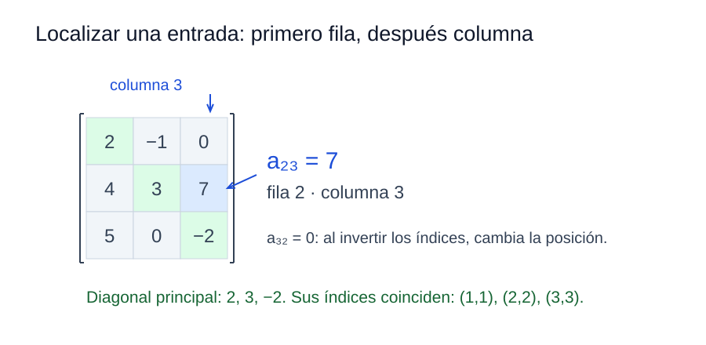

# Demostración por componentes

^2bd3aa

Este método se apoya en las [[Física/Grado/1º/Álgebra Lineal y Geometría Analítica/01 Matrices y sistemas/01 Matrices#Matrices: filas, columnas y entradas|entradas y la igualdad de matrices]]. La igualdad de cada entrada se obtiene con definiciones y propiedades de los escalares; el criterio de igualdad permite volver a la igualdad entre matrices.[^componentes]

## 1. Fundamento matemático

Una matriz $A \in M_{m \times n}(K)$ es una disposición rectangular de $m \times n$ elementos pertenecientes a un cuerpo $K$.

Formalmente, podemos interpretar una matriz como una función:

$$
A:\{1,\ldots,m\}\times\{1,\ldots,n\}\longrightarrow K
$$

que asigna a cada pareja de índices $(i,j)$ un elemento $a_{ij}\in K$.

La notación habitual es:

$$
A=(a_{ij})_{\substack{1\leq i\leq m\\1\leq j\leq n}}
$$

donde:

- $i$ representa el índice de fila.
- $j$ representa el índice de columna.
- $a_{ij}$ representa el elemento situado en la fila $i$ y columna $j$.
- $K$ es el cuerpo al que pertenecen los elementos de la matriz, habitualmente $\mathbb{R}$ o $\mathbb{C}$.

## 2. Criterio de igualdad de matrices

**Definición.** Sean $A,B\in M_{m\times n}(K)$.

Dos matrices son iguales si, y solo si, sus entradas correspondientes son iguales.

Formalmente:

$$
\boxed{
A=B\iff
\forall i\in\{1,\ldots,m\},
\forall j\in\{1,\ldots,n\},
\quad a_{ij}=b_{ij}
}
$$

Esta equivalencia constituye el fundamento de la demostración por componentes.

### Justificación formal

Como las matrices pueden interpretarse como funciones sobre el mismo conjunto de índices, podemos aplicar el principio de **igualdad extensional de funciones**:

>[!important]
>Dos funciones con el mismo dominio y codominio son iguales si asignan la misma imagen a cada elemento de su dominio.

Por tanto, demostrar que dos matrices son iguales equivale a demostrar que sus elementos correspondientes coinciden para todas las posiciones posibles.

No es necesario comprobar cada posición individualmente: basta razonar con índices arbitrarios.

```anki
deck: Matemáticas::Álgebra lineal::Matrices
tags:
  - matemáticas
  - matrices
  - igualdad
---
> [!note] Pregunta
> ¿Qué debe comprobarse para demostrar que dos matrices son iguales?
===
> [!important] Respuesta
> Que tienen el mismo tamaño y que sus entradas correspondientes coinciden para todos los índices admisibles.
```

## 3. ¿En qué consiste la demostración por componentes?

La **demostración por componentes** es un método para probar igualdades matriciales mediante las propiedades algebraicas de sus entradas.

En lugar de operar directamente con matrices completas, operamos con elementos de $K$.

El razonamiento sigue el esquema:

$$
\underbrace{X_{ij}}_{\text{Componente de }X}
=
\underbrace{\cdots}_{\text{Definiciones y propiedades algebraicas}}
=
\underbrace{Y_{ij}}_{\text{Componente de }Y}
$$

Si esta igualdad es válida para cualquier pareja de índices admisible, entonces:

$$
\boxed{X=Y}
$$

La demostración transforma así un problema matricial en un problema algebraico sobre los elementos del cuerpo $K$.

```anki
deck: Matemáticas::Álgebra lineal::Matrices
tags:
  - matemáticas
  - matrices
  - demostraciones
---
> [!note] Pregunta
> ¿Cómo se demuestra por entradas que dos matrices del mismo tamaño son iguales?
===
> [!important] Respuesta
> Se fija una posición arbitraria $(i,j)$, se calcula la entrada de ambos lados y se prueba que coinciden; como la posición es arbitraria, coinciden todas las entradas.
```

## 4. Definiciones fundamentales por componentes

Para aplicar correctamente el método, necesitamos conocer cómo se definen las operaciones matriciales.

### 4.1. Suma de matrices

Sean $A,B\in M_{m\times n}(K)$.

$$
\boxed{(A+B)_{ij}=a_{ij}+b_{ij}}
$$

La suma se realiza elemento a elemento.

### 4.2. Multiplicación por un escalar

Sean $A\in M_{m\times n}(K)$ y $\lambda\in K$.

$$
\boxed{(\lambda A)_{ij}=\lambda a_{ij}}
$$

Cada elemento de la matriz se multiplica por el mismo escalar.

### 4.3. Producto de matrices

Esta operación se desarrolla en [[Física/Grado/1º/Álgebra Lineal y Geometría Analítica/01 Matrices y sistemas/02 Operaciones|Producto matricial, potencias y sistemas]]. No es necesaria para el primer ejemplo del prefacio.


Sean $A\in M_{m\times n}(K)$ y $B\in M_{n\times p}(K)$.

Entonces $AB\in M_{m\times p}(K)$ y:

$$
\boxed{(AB)_{ij}=\sum_{k=1}^{n}a_{ik}b_{kj}}
$$

A diferencia de la suma, el producto matricial no se calcula multiplicando directamente las entradas correspondientes.

Cada componente es una suma de productos.

### 4.4. Trasposición

La [[Física/Grado/1º/Álgebra Lineal y Geometría Analítica/01 Matrices y sistemas/01 Matrices|transpuesta]] se utiliza únicamente en el ejemplo opcional de esta nota.


Sea $A\in M_{m\times n}(K)$.

Su traspuesta $A^T\in M_{n\times m}(K)$ satisface:

$$
\boxed{(A^T)_{ij}=a_{ji}}
$$

La trasposición intercambia los índices de fila y columna.

## 5. Estructura general de una demostración

Supongamos que queremos demostrar una identidad matricial:

$$
X=Y
$$

**Paso 1. Verificar las dimensiones.**

Comprobamos que $X$ e $Y$ pertenecen al mismo espacio matricial:

$$
X,Y\in M_{r\times s}(K)
$$

**Paso 2. Elegir índices arbitrarios.**

Sean:

$$
1\leq i\leq r,\qquad 1\leq j\leq s
$$

**Paso 3. Desarrollar una componente.**

Partimos de $(X)_{ij}$ y aplicamos las definiciones de las operaciones matriciales que aparezcan.

**Paso 4. Utilizar las propiedades algebraicas de $K$.**

Aplicamos las propiedades necesarias: conmutatividad, asociatividad, distributividad, elementos neutros, inversos, etc.

**Paso 5. Identificar la componente correspondiente.**

Transformamos la expresión hasta obtener:

$$
(X)_{ij}=(Y)_{ij}
$$

**Paso 6. Aplicar el criterio de igualdad.**

Como los índices eran arbitrarios, la igualdad se cumple para todas las posiciones admisibles.

Por tanto:

$$
\boxed{X=Y}\qquad\blacksquare
$$

## 6. Ejemplo — Conmutatividad de la suma

> [!ejemplo] Comparar una entrada de las dos sumas
> Sean $A=(a_{ij})$ y $B=(b_{ij})$ matrices de $M_{m\times n}(K)$. Para $i\in\{1,\ldots,m\}$ y $j\in\{1,\ldots,n\}$ arbitrarios,
> $$
> (A+B)_{ij}=a_{ij}+b_{ij}=b_{ij}+a_{ij}=(B+A)_{ij}.
> $$
> La primera y la última igualdad aplican la definición de suma; la central usa la conmutatividad en $K$. Ambas sumas tienen tamaño $m\times n$ y las entradas coinciden en toda posición, por lo que $A+B=B+A$.[^componentes]

## 6 bis. Ampliación opcional — Traspuesta de una suma

Este segundo ejemplo presupone la [[Física/Grado/1º/Álgebra Lineal y Geometría Analítica/01 Matrices y sistemas/01 Matrices#Transpuesta|definición de traspuesta]]. Puede retomarse después de estudiar esa operación.


**Proposición.** Para cualesquiera $A,B\in M_{m\times n}(K)$:

$$
(A+B)^T=A^T+B^T
$$

**Demostración.**

Ambos miembros pertenecen a $M_{n\times m}(K)$.

Sean $i,j$ índices arbitrarios con:

$$
1\leq i\leq n,\qquad 1\leq j\leq m
$$

Por definición de traspuesta:

$$
((A+B)^T)_{ij}=(A+B)_{ji}
$$

Por definición de suma de matrices:

$$
(A+B)_{ji}=a_{ji}+b_{ji}
$$

Aplicando nuevamente la definición de traspuesta:

$$
a_{ji}+b_{ji}=(A^T)_{ij}+(B^T)_{ij}
$$

Y por definición de suma:

$$
(A^T)_{ij}+(B^T)_{ij}=(A^T+B^T)_{ij}
$$

En consecuencia:

$$
((A+B)^T)_{ij}=(A^T+B^T)_{ij}
$$

Como esta igualdad se cumple para todos los índices admisibles, por el criterio de igualdad de matrices:

$$
\boxed{(A+B)^T=A^T+B^T}\qquad\blacksquare
$$

## 7. Consideraciones importantes

> [!important] Igualdad matricial e igualdad escalar
> No debemos confundir los dos niveles del razonamiento:
>
> - $A=B$ es una igualdad entre matrices.
> - $a_{ij}=b_{ij}$ es una igualdad entre elementos de $K$.
>
> La demostración por componentes conecta ambos niveles mediante el criterio de igualdad de matrices.

> [!warning] Errores frecuentes
> - No comprobar que las matrices comparadas tienen las mismas dimensiones.
> - Demostrar la propiedad solamente para una matriz concreta, lo cual no constituye una demostración general.
> - Omitir que los índices $i,j$ son arbitrarios.
> - Confundir $(AB)_{ij}$ con $a_{ij}b_{ij}$.
> - Aplicar automáticamente al producto de matrices propiedades del producto de escalares, como la conmutatividad. En general, $AB\neq BA$.
> - Olvidar que, al trasponer, se intercambian los índices y las dimensiones.

## 8. Principio general

La demostración por componentes no es una propiedad específica de la suma de matrices, sino una técnica general basada en la definición de igualdad.

Su fundamento lógico es:

$$
\boxed{
\left(
\forall i,j,\ X_{ij}=Y_{ij}
\right)
\Longrightarrow X=Y
}
$$

Siempre bajo la hipótesis de que $X$ e $Y$ son matrices de las mismas dimensiones y los índices recorren todas sus posiciones.

Este principio será la base para demostrar muchas de las propiedades algebraicas de las matrices.




*Cada pareja de índices selecciona una entrada. El argumento por componentes se formula para una posición arbitraria, no sólo para la resaltada en el dibujo.*

[[Física/Grado/1º/Álgebra Lineal y Geometría Analítica/01 Matrices y sistemas/assets/02-indices-y-diagonal.excalidraw|Abrir el dibujo editable]]

## 📚 Fuentes

[^componentes]: W. Keith Nicholson, *Linear Algebra with Applications*, §2.1, «Matrix Addition, Scalar Multiplication, and Transposition», definición de igualdad y demostración de la conmutatividad mediante entradas correspondientes. [LibreTexts](https://math.libretexts.org/Bookshelves/Linear_Algebra/Linear_Algebra_with_Applications_(Nicholson)/02:_Matrix_Algebra/2.01:_Matrix_Addition_Scalar_Multiplication_and_Transposition). El esquema de seis pasos organiza editorialmente ese método; no se presenta como transcripción literal del manual.

## 🧑‍🏫 Prompt para tutor conversacional

Actúa como tutor de primer curso de Física. El estudiante acaba de aprender entradas, dimensiones, igualdad y suma de matrices. Para demostrar $X=Y$, comprueba primero que ambos miembros tienen tamaño $r\times s$; fija $i\in\{1,\ldots,r\}$ y $j\in\{1,\ldots,s\}$ arbitrarios; aplica las definiciones y las leyes escalares hasta obtener $X_{ij}=Y_{ij}$. Concluye que las matrices son iguales por coincidir todas sus entradas. Usa $(A+B)_{ij}=a_{ij}+b_{ij}=b_{ij}+a_{ij}=(B+A)_{ij}$ para distinguir definición de suma y conmutatividad escalar. Reserva la traspuesta para después de estudiarla. Formula una pregunta cada vez y espera el intento antes de mostrar la respuesta. Distingue errores de concepto, de notación y de cálculo; ofrece pistas concretas y recupera después lo que haya fallado. Usa los ejemplos existentes; no generes ejercicios nuevos.
