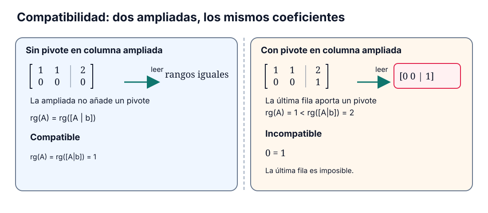

```dataviewjs
await dv.view("Planes/Estudio/Scripts/study-session", { location: "start" })
```

# Compatibilidad, rango e inversa

Consideremos el sistema

$$
\begin{cases}
x+y=2,\\
2x+2y=4.
\end{cases}
$$

Al restar dos veces la primera ecuación a la segunda obtenemos $0=0$: la segunda no impone ninguna condición adicional. Si cambiamos su término independiente de $4$ a $5$, la misma operación da $0=1$ y el sistema deja de tener solución.

Los coeficientes son los mismos en ambos casos. Para decidir la compatibilidad tenemos que seguir también la columna de términos independientes durante la eliminación. El rango permite expresar esa diferencia mediante el número de [[Física/Grado/1º/Álgebra Lineal y Geometría Analítica/01 Matrices y sistemas/02 Eliminación y matrices elementales#Pivote|pivotes]].[^a9]

Trabajaremos sobre $K=\mathbb R$ o $K=\mathbb C$, con $m,n\geq1$, matrices $A\in M_{m\times n}(K)$ y vectores columna $\mathbf x\in K^n$ y $\mathbf b\in K^m$.

## Rango y pivotes

### Rango de una matriz

> [!definicion] Rango
> El [[Matemáticas/Álgebra lineal/Rango de una matriz|rango]] de $A$, denotado $\operatorname{rg}(A)$, es el número de [[Física/Grado/1º/Álgebra Lineal y Geometría Analítica/01 Matrices y sistemas/02 Eliminación y matrices elementales#Pivote|pivotes]] de cualquiera de sus [[Matemáticas/Álgebra lineal/Forma escalonada|formas escalonadas]] por filas; también es el número de filas no nulas en esa forma.[^a6-rango]

Podemos elegir distintas operaciones para escalonar $A$, pero [[Física/Grado/1º/Álgebra Lineal y Geometría Analítica/01 Matrices y sistemas/02 Eliminación y matrices elementales#El rango no depende de la forma escalonada elegida|el número de pivotes no cambia]]. Por eso basta obtener una [[Matemáticas/Álgebra lineal/Forma escalonada|forma escalonada]] y contar sus filas no nulas.

#### Ejemplo: contar pivotes

La matriz

$$
R=\begin{pmatrix}1&1\\0&0\end{pmatrix}
$$

ya está escalonada. Tiene un solo [[Física/Grado/1º/Álgebra Lineal y Geometría Analítica/01 Matrices y sistemas/02 Eliminación y matrices elementales#Pivote|pivote]], en la primera columna, por lo que $\operatorname{rg}(R)=1$.

```anki
deck: Matemáticas::Álgebra lineal::Sistemas lineales
tags:
  - matemáticas
  - rango
---
> [!note] Pregunta
> ¿Cómo se calcula el rango de una matriz mediante eliminación por filas?
===
> [!important] Respuesta
> Se obtiene una forma escalonada y se cuentan sus pivotes, uno por fila no nula. Las operaciones elementales conservan el rango.
```

### Cotas del rango

#### Propiedad

> [!teorema] El rango está limitado por el tamaño
> Para $A\in M_{m\times n}(K)$,
>
> $$
> \boxed{0\leq\operatorname{rg}(A)\leq\min(m,n)}.
> $$

#### Demostración

> [!demostracion] Demostración
> El rango cuenta [[Física/Grado/1º/Álgebra Lineal y Geometría Analítica/01 Matrices y sistemas/02 Eliminación y matrices elementales#Pivote|pivotes]], por lo que no puede ser negativo. En una [[Matemáticas/Álgebra lineal/Forma escalonada|forma escalonada]] hay como máximo un [[Física/Grado/1º/Álgebra Lineal y Geometría Analítica/01 Matrices y sistemas/02 Eliminación y matrices elementales#Pivote|pivote]] por fila y uno por columna. Por tanto, su número no supera ni las $m$ filas ni las $n$ columnas. Así,
>
> $$
> 0\leq\operatorname{rg}(A)\leq\min(m,n).\qquad\blacksquare
> $$
>
> [^a9]

```anki
deck: Matemáticas::Álgebra lineal::Sistemas lineales
tags:
  - matemáticas
  - rango
---
> [!note] Pregunta
> ¿Entre qué valores puede estar el rango de una matriz $m\times n$?
===
> [!important] Respuesta
> $0\leq\operatorname{rg}(A)\leq\min(m,n)$: el rango cuenta pivotes y no puede haber más de uno por fila ni por columna.
```

Una matriz $2\times3$ puede tener dos [[Física/Grado/1º/Álgebra Lineal y Geometría Analítica/01 Matrices y sistemas/02 Eliminación y matrices elementales#Pivote|pivotes]], uno en cada fila, aunque una de sus tres columnas carezca de [[Física/Grado/1º/Álgebra Lineal y Geometría Analítica/01 Matrices y sistemas/02 Eliminación y matrices elementales#Pivote|pivote]]. Habrá alcanzado el rango máximo $2$; seguirá siendo rectangular. El criterio de invertibilidad que demostraremos más adelante exige que la matriz sea cuadrada.

```anki
deck: Matemáticas::Álgebra lineal::Matrices
tags:
  - matrices
  - rango
  - inversa
---
> [!note] Pregunta
> ¿Una matriz rectangular de rango máximo tiene necesariamente inversa bilateral?
===
> [!important] Respuesta
> No. El rango máximo rectangular es $\min(m,n)$; la inversa bilateral requiere que la matriz sea cuadrada y tenga rango $n$.
```

> [!opcional]- Lectura mediante espacios generados
> El espacio generado por unas columnas reúne todas sus [[Matemáticas/Álgebra lineal/Espacios vectoriales/03 Combinaciones lineales y espacio generado|combinaciones lineales]]. Su dimensión es el número de vectores de [[Matemáticas/Álgebra lineal/Espacios vectoriales/05 Bases y dimensión|una base]]: una familia independiente que genera el mismo espacio. El rango coincide con la dimensión del espacio columna y del espacio fila. Esta interpretación conecta los [[Física/Grado/1º/Álgebra Lineal y Geometría Analítica/01 Matrices y sistemas/02 Eliminación y matrices elementales#Pivote|pivotes]] con [[Matemáticas/Álgebra lineal/Espacios vectoriales/07 Núcleo, imagen, rango y nulidad|núcleo, imagen, rango y nulidad]].[^rango-espacios]

```anki
deck: Matemáticas::Álgebra lineal::Sistemas lineales
tags:
  - matemáticas
  - rango
---
> [!note] Pregunta
> ¿Qué contiene el espacio generado por una familia de vectores?
===
> [!important] Respuesta
> Todas las combinaciones lineales de esos vectores, con escalares del cuerpo sobre el que se trabaja.
```

```anki
deck: Matemáticas::Álgebra lineal::Sistemas lineales
tags:
  - matemáticas
  - rango
---
> [!note] Pregunta
> ¿Qué dos condiciones debe cumplir una familia de vectores para ser una base de un espacio vectorial?
===
> [!important] Respuesta
> Debe ser linealmente independiente y generar todo el espacio.
```

```anki
deck: Matemáticas::Álgebra lineal::Sistemas lineales
tags:
  - matemáticas
  - rango
---
> [!note] Pregunta
> ¿Cómo se obtiene la dimensión de un espacio vectorial de dimensión finita a partir de una base?
===
> [!important] Respuesta
> Contando los vectores de una base. Todas sus bases tienen el mismo número de vectores.
```

```anki
deck: Matemáticas::Álgebra lineal::Sistemas lineales
tags:
  - matemáticas
  - rango
---
> [!note] Pregunta
> ¿Cómo se relaciona el rango de una matriz con los espacios generados por sus filas y sus columnas?
===
> [!important] Respuesta
> Es la dimensión de ambos espacios: el número de vectores de una base de cada uno.
```

## Criterio de compatibilidad

### Sistema compatible

> [!definicion] Compatibilidad
> Un [[Matemáticas/Álgebra/Sistemas de ecuaciones lineales|sistema lineal]] es **compatible** si tiene al menos una solución.[^a9]

Por ejemplo, $x+y=2$ admite la solución $(2,0)$. En un sistema con varias ecuaciones, una misma tupla debe satisfacerlas todas. Para comprobarlo por eliminación, trabajamos con la [[Matemáticas/Álgebra lineal/Matriz ampliada|matriz ampliada]] $[A\mid\mathbf b]$: las operaciones transforman los coeficientes y los términos independientes a la vez.

```anki
deck: Matemáticas::Álgebra lineal::Sistemas lineales
tags:
  - matemáticas
  - compatibilidad
---
> [!note] Pregunta
> ¿Qué significa que un sistema sea compatible?
===
> [!important] Respuesta
> Que existe al menos una tupla que satisface todas sus ecuaciones.
```

### Teorema de Rouché–Capelli

Para establecer el [[Matemáticas/Álgebra lineal/Teorema de Rouché-Capelli|criterio de Rouché–Capelli]], escalonemos $A\in M_{m\times n}(K)$ y apliquemos las mismas operaciones a la columna $\mathbf b\in K^m$. Si $r=\operatorname{rg}(A)$, bajo las primeras $r$ filas no nulas todos los coeficientes serán cero. En esas filas sólo pueden quedar entradas no nulas en la [[Matemáticas/Álgebra lineal/Matriz ampliada|columna ampliada]].

Si todas ellas son cero, no aparece ningún [[Física/Grado/1º/Álgebra Lineal y Geometría Analítica/01 Matrices y sistemas/02 Eliminación y matrices elementales#Pivote|pivote]] nuevo. Si alguna es distinta de cero, podemos usarla como pivote y anular las restantes entradas de esa columna: se añade exactamente uno. Los $r$ [[Física/Grado/1º/Álgebra Lineal y Geometría Analítica/01 Matrices y sistemas/02 Eliminación y matrices elementales#Pivote|pivotes]] de los coeficientes siguen presentes. Por tanto,

$$
\operatorname{rg}(A)\leq\operatorname{rg}([A\mid\mathbf b])\leq\operatorname{rg}(A)+1.
$$

La columna $\mathbf b$ deja el rango igual cuando no aparece un [[Física/Grado/1º/Álgebra Lineal y Geometría Analítica/01 Matrices y sistemas/02 Eliminación y matrices elementales#Pivote|pivote]] en su posición; si aparece, el rango de la ampliada sube exactamente en uno.

```anki
deck: Matemáticas::Álgebra lineal::Sistemas lineales
tags:
  - matemáticas
  - rango
---
> [!note] Pregunta
> ¿Cuánto puede aumentar el rango al añadir una columna a una matriz?
===
> [!important] Respuesta
> Como máximo, en uno: la nueva columna aporta a lo sumo un pivote. El rango nunca disminuye.
```

#### Propiedad



[[Física/Grado/1º/Álgebra Lineal y Geometría Analítica/01 Matrices y sistemas/assets/03-compatibilidad-rango-ampliada.excalidraw|Abrir dibujo editable]].

> **Figura.** Los dos casos usan la misma matriz de coeficientes y difieren en la última fila de la ampliada. Así se ve por qué el rango de $A$ por sí solo no decide la compatibilidad.

> [!teorema] Criterio de Rouché–Capelli
> El sistema $A\mathbf x=\mathbf b$ es compatible si, y sólo si,
>
> $$
> \boxed{\operatorname{rg}(A)=\operatorname{rg}([A\mid\mathbf b])}.
> $$
>
> [^a9]

#### Demostración

> [!demostracion] Demostración
> Reducimos la [[Matemáticas/Álgebra lineal/Matriz ampliada|matriz ampliada]] mediante [[Matemáticas/Álgebra lineal/Operaciones elementales por filas|operaciones elementales]]. Estas conservan las soluciones y los rangos.
>
> **Si los rangos son distintos**, la última columna añade un [[Física/Grado/1º/Álgebra Lineal y Geometría Analítica/01 Matrices y sistemas/02 Eliminación y matrices elementales#Pivote|pivote]] que no está en la parte de coeficientes. Aparece entonces una fila
>
> $$
> [0\ \cdots\ 0\mid c],\qquad c\ne0.
> $$
>
> Su ecuación es $0=c$, imposible para cualquier valor de las incógnitas. El sistema es [[#Sistema incompatible|incompatible]].
>
> **Si los rangos son iguales**, no hay [[Física/Grado/1º/Álgebra Lineal y Geometría Analítica/01 Matrices y sistemas/02 Eliminación y matrices elementales#Pivote|pivote]] en la última columna y no aparece ninguna ecuación imposible. Se pueden elegir las variables sin pivote y resolver las restantes por sustitución desde la última fila no nula. Si no hay [[Física/Grado/1º/Álgebra Lineal y Geometría Analítica/01 Matrices y sistemas/02 Eliminación y matrices elementales#Variables pivote y variables libres|variables libres]], la sustitución determina directamente todas las incógnitas. En ambos casos se obtiene al menos una solución.
>
> Por tanto, la igualdad de rangos equivale a la compatibilidad. $\blacksquare$[^a9]

```anki
deck: Matemáticas::Álgebra lineal::Sistemas lineales
tags:
  - matemáticas
  - rango
  - compatibilidad
---
> [!note] Pregunta
> ¿Cuál es el criterio de Rouché–Capelli para que $A\mathbf x=\mathbf b$ tenga solución?
===
> [!important] Respuesta
> Que $\operatorname{rg}(A)=\operatorname{rg}([A\mid\mathbf b])$.
```

## Clasificación de los sistemas

==Una vez comprobada la compatibilidad==, se cuentan las columnas de coeficientes sin [[Física/Grado/1º/Álgebra Lineal y Geometría Analítica/01 Matrices y sistemas/02 Eliminación y matrices elementales#Pivote|pivote]]. Si hay $n$ incógnitas y $r$ [[Física/Grado/1º/Álgebra Lineal y Geometría Analítica/01 Matrices y sistemas/02 Eliminación y matrices elementales#Pivote|pivotes]], quedan $n-r$ [[Física/Grado/1º/Álgebra Lineal y Geometría Analítica/01 Matrices y sistemas/02 Eliminación y matrices elementales#Variables pivote y variables libres|variables libres]].[^a9]

### Sistema compatible determinado

> [!definicion] Compatible determinado
> Un sistema es compatible determinado cuando tiene **una única solución**. El criterio es
>
> $$
> \boxed{\operatorname{rg}(A)=\operatorname{rg}([A\mid\mathbf b])=n}.
> $$

No queda ninguna [[Física/Grado/1º/Álgebra Lineal y Geometría Analítica/01 Matrices y sistemas/02 Eliminación y matrices elementales#Variables pivote y variables libres|variable libre]]: la sustitución determina una incógnita en cada fila [[Física/Grado/1º/Álgebra Lineal y Geometría Analítica/01 Matrices y sistemas/02 Eliminación y matrices elementales#Pivote|pivote]]. Por ejemplo, la ampliada reducida

$$
\left[\begin{array}{cc|c}1&0&2\\0&1&3\end{array}\right]
$$

expresa directamente $x=2$ e $y=3$. En general, si la ampliada reducida es $[I_n\mid\mathbf c]$, la solución es $\mathbf x=\mathbf c$.

```anki
deck: Matemáticas::Álgebra lineal::Sistemas lineales
tags:
  - matemáticas
  - compatibilidad
---
> [!note] Pregunta
> ¿Cuándo es compatible determinado un sistema de $n$ incógnitas?
===
> [!important] Respuesta
> Cuando tiene una única solución, lo que equivale a $\operatorname{rg}(A)=\operatorname{rg}([A\mid\mathbf b])=n$.
```

### Sistema compatible indeterminado

> [!definicion] Compatible indeterminado
> Un sistema es compatible indeterminado cuando tiene **más de una solución**. Sobre $\mathbb R$ o $\mathbb C$, el criterio es
>
> $$
> \boxed{\operatorname{rg}(A)=\operatorname{rg}([A\mid\mathbf b])<n}.
> $$

En $x+y=2$ podemos elegir $y=t$ y despejar $x=2-t$. Cada $t\in K$ produce una solución:

$$
(x,y)=(2-t,t).
$$

Esto ocurre siempre que el sistema es compatible y queda una [[Física/Grado/1º/Álgebra Lineal y Geometría Analítica/01 Matrices y sistemas/02 Eliminación y matrices elementales#Variables pivote y variables libres|variable libre]]: podemos variar su valor y resolver las [[Física/Grado/1º/Álgebra Lineal y Geometría Analítica/01 Matrices y sistemas/02 Eliminación y matrices elementales#Variables pivote y variables libres|variables pivote]]. Como $\mathbb R$ y $\mathbb C$ son infinitos, se obtienen infinitas soluciones.

```anki
deck: Matemáticas::Álgebra lineal::Sistemas lineales
tags:
  - matemáticas
  - compatibilidad
---
> [!note] Pregunta
> ¿Cuándo es compatible indeterminado un sistema real o complejo de $n$ incógnitas?
===
> [!important] Respuesta
> Cuando $\operatorname{rg}(A)=\operatorname{rg}([A\mid\mathbf b])<n$. Tiene variables libres y, por tanto, infinitas soluciones.
```

### Sistema incompatible

> [!definicion] Incompatible
> Un sistema es incompatible cuando **no tiene solución**. Esto equivale a
>
> $$
> \boxed{\operatorname{rg}(A)<\operatorname{rg}([A\mid\mathbf b])}.
> $$

Una fila $[0\ \cdots\ 0\mid c]$, con $c\ne0$, exige que $0=c$. Por ejemplo,

$$
\left[\begin{array}{cc|c}1&1&2\\0&0&1\end{array}\right]
$$

incluye la ecuación $0=1$. Ninguna elección de $x$ e $y$ puede satisfacerla.

```anki
deck: Matemáticas::Álgebra lineal::Sistemas lineales
tags:
  - matemáticas
  - compatibilidad
---
> [!note] Pregunta
> ¿Cómo se reconoce un sistema incompatible en su matriz ampliada escalonada?
===
> [!important] Respuesta
> Aparece una fila $[0\ \cdots\ 0\mid c]$ con $c\ne0$: expresa $0=c$. Entonces el rango de la ampliada supera al de los coeficientes.
```

### Grado de indeterminación

> [!definicion] Grado de indeterminación
> Para un sistema [[#Sistema compatible indeterminado|compatible indeterminado]] de $n$ incógnitas, el grado de indeterminación es el número de parámetros independientes de su solución general:
>
> $$
> \boxed{p=n-\operatorname{rg}(A)}.
> $$
>
> [^a9]

Por ejemplo, un sistema compatible de cinco incógnitas y rango tres tiene dos parámetros. **Discutir** un sistema consiste en clasificarlo e indicar, si procede, ese número; **resolverlo** exige además determinar sus soluciones.

```anki
deck: Matemáticas::Álgebra lineal::Sistemas lineales
tags:
  - matemáticas
  - variables-libres
---
> [!note] Pregunta
> ¿Cuál es el grado de indeterminación de un sistema compatible indeterminado con $n$ incógnitas y rango $r$?
===
> [!important] Respuesta
> $n-r$: el número de variables libres y de parámetros independientes de su solución general.
```

```anki
deck: Matemáticas::Álgebra lineal::Sistemas lineales
tags:
  - matemáticas
  - compatibilidad
---
> [!note] Pregunta
> ¿Qué diferencia hay entre discutir un sistema lineal y resolverlo?
===
> [!important] Respuesta
> Discutirlo es clasificarlo e indicar su grado de indeterminación, si procede. Resolverlo es determinar su conjunto solución.
```

### Ejemplo trabajado: el segundo miembro decide la compatibilidad

Clasifiquemos la ampliada escalonada

$$
\left[\begin{array}{cc|c}1&1&2\\0&0&0\end{array}\right].
$$

La parte de coeficientes tiene un [[Física/Grado/1º/Álgebra Lineal y Geometría Analítica/01 Matrices y sistemas/02 Eliminación y matrices elementales#Pivote|pivote]] y la [[Matemáticas/Álgebra lineal/Matriz ampliada|columna ampliada]] no añade otro: ambos rangos valen $1$. La primera fila exige $x+y=2$ y la segunda, $0=0$.

Elegimos $y=t$, con $t\in K$. La primera ecuación determina entonces $x=2-t$, de modo que

$$
\operatorname{Sol}(S)=\{(2-t,t):t\in K\}.
$$

Al sustituir obtenemos $(2-t)+t=2$ para cualquier $t\in K$. Hay un parámetro independiente: el sistema es [[#Sistema compatible indeterminado|compatible indeterminado]], de grado uno.

Si sólo cambia el último término independiente,

$$
\left[\begin{array}{cc|c}1&1&2\\0&0&1\end{array}\right],
$$

la última fila exige $0=1$. Ahora $\operatorname{rg}(A)=1$ y $\operatorname{rg}([A\mid\mathbf b])=2$: el sistema es [[#Sistema incompatible|incompatible]].

> [!advertencia] El rango de $A$ no basta
> Los dos ejemplos tienen la misma matriz de coeficientes. Para decidir si un segundo miembro concreto admite solución, hay que estudiar también la [[Matemáticas/Álgebra lineal/Matriz ampliada|columna ampliada]].

## Inversa de una matriz cuadrada

Para despejar $x$ en $3x=6$, multiplicamos ambos miembros por $\frac13$. El producto $\frac13\cdot3=1$ deja $x=2$. También $\sqrt5$ tiene recíproco, pues $\sqrt5\cdot\frac1{\sqrt5}=1$. Estos inversos pertenecen a $\mathbb R$; en $\mathbb N$, por ejemplo, $3$ no tiene inverso multiplicativo.[^a6]

En la ecuación matricial $A\mathbf x=\mathbf b$ buscamos una matriz que permita hacer un despeje semejante. Si $BA=I_n$, al multiplicar por $B$ a la izquierda obtenemos

$$
B(A\mathbf x)=(BA)\mathbf x=I_n\mathbf x=\mathbf x.
$$

La definición de inversa exige además que el producto en el otro orden sea [[Matemáticas/Álgebra lineal/Matriz identidad|la identidad]]. Más adelante probaremos que, para matrices cuadradas del mismo orden, una de las dos igualdades basta.

### Matriz inversa e invertibilidad

> [!definicion] Matriz inversa
> Sea $A\in M_n(K)$. Una matriz $B\in M_n(K)$ es una [[Matemáticas/Álgebra lineal/Matriz inversa|inversa]] de $A$ si
>
> $$
> \boxed{AB=BA=I_n}.
> $$
>
> Si existe, $A$ se llama **invertible**. [[#Unicidad de la inversa|La inversa es única]] y se denota $A^{-1}$.[^a6]

[[Matemáticas/Álgebra lineal/Matriz identidad|La identidad]] es su propia inversa, puesto que $I_nI_n=I_n$.

```anki
deck: Matemáticas::Álgebra lineal::Matrices
tags:
  - matrices
  - inversa
---
> [!note] Pregunta
> ¿Qué debe cumplir $B\in M_n(K)$ para ser la inversa de $A\in M_n(K)$?
===
> [!important] Respuesta
> $AB=BA=I_n$. Si existe tal $B$, la matriz $A$ es invertible y se escribe $B=A^{-1}$.
```

```anki
deck: Matemáticas::Álgebra lineal::Matrices
tags:
  - matemáticas
  - inversa
---
> [!note] Pregunta
> ¿Cuál es la inversa de la matriz identidad?
===
> [!important] Respuesta
> $I_n^{-1}=I_n$, porque $I_nI_n=I_n$.
```

#### Matriz singular

> [!definicion] Matriz singular
> Una matriz cuadrada es **singular** cuando no tiene inversa.[^a6]

Una matriz puede ser no nula y singular, como muestra el siguiente ejemplo.

```anki
deck: Matemáticas::Álgebra lineal::Matrices
tags:
  - matrices
  - inversa
---
> [!note] Pregunta
> ¿Qué significa que una matriz cuadrada sea singular?
===
> [!important] Respuesta
> Que no tiene inversa. Ser una matriz no nula no garantiza la invertibilidad.
```

#### Ejemplo: una fila o una columna nula

La matriz

$$
C=\begin{pmatrix}1&0\\0&0\end{pmatrix}
$$

no es nula, pero no puede tener inversa. Para cualquier matriz $D$, la segunda fila de $CD$ es nula; por tanto, $CD\ne I_2$.

En general, una fila nula de $A$ permanece nula en $AB$, y una columna nula permanece nula en $BA$. Cualquiera de esas condiciones impide que ambos productos sean [[Matemáticas/Álgebra lineal/Matriz identidad|la identidad]].[^a6]

```anki
deck: Matemáticas::Álgebra lineal::Matrices
tags:
  - matrices
  - inversa
---
> [!note] Pregunta
> ¿Por qué una matriz cuadrada con una fila o una columna nula no puede ser invertible?
===
> [!important] Respuesta
> Una fila nula de $A$ permanece nula en $AB$, impidiendo $AB=I$. Una columna nula de $A$ permanece nula en $BA$, impidiendo $BA=I$.
```

### Unicidad de la inversa

#### Propiedad

> [!teorema] La inversa es única
> Si $B,C\in M_n(K)$ son inversas de $A\in M_n(K)$, entonces
>
> $$
> \boxed{B=C}.
> $$

#### Demostración

> [!demostracion] Demostración
> Por las hipótesis, $BA=I_n$ y $AC=I_n$. Calculamos el producto $BAC$ agrupándolo de dos formas:
>
> $$
> B(AC)=BI_n=B,
> $$
>
> $$
> (BA)C=I_nC=C.
> $$
>
> La [[Física/Grado/1º/Álgebra Lineal y Geometría Analítica/01 Matrices y sistemas/01 Matrices y operaciones#Asociatividad del producto|asociatividad]] garantiza que $B(AC)=(BA)C$. Por tanto, $B=C$: dos inversas de la misma matriz necesariamente coinciden. $\blacksquare$[^unicidad]

```anki
deck: Matemáticas::Álgebra lineal::Matrices
tags:
  - matrices
  - inversa
---
> [!note] Pregunta
> ¿Qué producto permite demostrar que dos inversas $B$ y $C$ de una misma matriz $A$ coinciden?
===
> [!important] Respuesta
> $BAC$: por un lado, $B(AC)=B$; por otro, $(BA)C=C$. La asociatividad da $B=C$.
```

```anki
deck: Matemáticas::Álgebra lineal::Matrices
tags:
  - matrices
  - inversa
---
> [!note] Pregunta
> ¿Puede una matriz cuadrada tener dos inversas distintas?
===
> [!important] Respuesta
> No. Si $B$ y $C$ son inversas de $A$, entonces $B=B(AC)=(BA)C=C$. La inversa, cuando existe, es única.
```

### Ejemplo trabajado: cálculo por Gauss–Jordan

Calculemos la inversa de

$$
A=\begin{pmatrix}1&2\\3&7\end{pmatrix}.
$$

Escribimos $[A\mid I_2]$ y aplicamos las operaciones a las ==filas completas, incluidos los dos bloques==. Para anular el $3$ situado bajo el primer [[Física/Grado/1º/Álgebra Lineal y Geometría Analítica/01 Matrices y sistemas/02 Eliminación y matrices elementales#Pivote|pivote]], hacemos $R_2\leftarrow R_2-3R_1$:

$$
\left[\begin{array}{cc|cc}1&2&1&0\\3&7&0&1\end{array}\right]
\longrightarrow
\left[\begin{array}{cc|cc}1&2&1&0\\0&1&-3&1\end{array}\right].
$$

Después, $R_1\leftarrow R_1-2R_2$:

$$
\left[\begin{array}{cc|cc}1&0&7&-2\\0&1&-3&1\end{array}\right].
$$

A la izquierda ha quedado [[Matemáticas/Álgebra lineal/Matriz identidad|la identidad]]. El bloque derecho es

$$
A^{-1}=\begin{pmatrix}7&-2\\-3&1\end{pmatrix}.
$$

La comprobación por ambos lados da

$$
AA^{-1}=\begin{pmatrix}7-6&-2+2\\21-21&-6+7\end{pmatrix}=I_2,
$$

$$
A^{-1}A=\begin{pmatrix}7-6&14-14\\-3+3&-6+7\end{pmatrix}=I_2.
$$

Ambos productos son [[Matemáticas/Álgebra lineal/Matriz identidad|la identidad]], así que la matriz obtenida es la inversa. Falta justificar por qué reducir $[A\mid I_n]$ permite encontrarla; lo haremos después de estudiar las inversas de las [[Física/Grado/1º/Álgebra Lineal y Geometría Analítica/01 Matrices y sistemas/02 Eliminación y matrices elementales#Multiplicación por la izquierda y operaciones elementales|matrices elementales]].[^a7-calculo]

## Inversas y operaciones matriciales

### Inversa de una matriz elemental de permutación

#### Propiedad

> [!teorema] Deshacer un intercambio
> Sea $P_{ij}$ la matriz elemental obtenida de $I_n$ al intercambiar las filas distintas $i$ y $j$. Entonces
>
> $$
> \boxed{P_{ij}^{-1}=P_{ij}}.
> $$
>
> [^a6-elementales]

#### Demostración

> [!demostracion] Demostración
> Multiplicar por $P_{ij}$ a la izquierda intercambia esas dos filas. Al hacerlo dos veces sobre $I_n$, cada fila vuelve a su lugar:
>
> $$
> P_{ij}P_{ij}=I_n.
> $$
>
> Como el candidato a inversa es el propio $P_{ij}$, ambos órdenes producen exactamente este mismo producto. Por la definición de inversa, $P_{ij}^{-1}=P_{ij}$. $\blacksquare$

```anki
deck: Matemáticas::Álgebra lineal::Matrices
tags:
  - matrices
  - inversa
  - matrices-elementales
---
> [!note] Pregunta
> ¿Cuál es la inversa de una matriz elemental que intercambia dos filas?
===
> [!important] Respuesta
> Ella misma: repetir el intercambio devuelve las filas a sus posiciones iniciales.
```

### Inversa de una matriz elemental de escalado

#### Propiedad

> [!teorema] Deshacer un escalado
> Si $D_i(\lambda)$ es la matriz elemental que multiplica la fila $i$ por $\lambda\ne0$, entonces
>
> $$
> \boxed{D_i(\lambda)^{-1}=D_i(\lambda^{-1})}.
> $$
>
> [^a6-elementales]

#### Demostración

> [!demostracion] Demostración
> Como $\lambda\ne0$, existe $\lambda^{-1}\in K$. Escalar la fila $i$ por $\lambda$ y después por $\lambda^{-1}$ la multiplica en total por $\lambda^{-1}\lambda=1$. Las otras filas no cambian.
>
> En el orden contrario, el factor total es $\lambda\lambda^{-1}=1$. Aplicando ambas composiciones a $I_n$,
>
> $$
> D_i(\lambda^{-1})D_i(\lambda)=I_n,
> $$
>
> $$
> D_i(\lambda)D_i(\lambda^{-1})=I_n.
> $$
>
> Queda comprobada la [[Física/Grado/1º/Álgebra Lineal y Geometría Analítica/01 Matrices y sistemas/02 Eliminación y matrices elementales#Inversa bilateral|inversa bilateral]]. $\blacksquare$

```anki
deck: Matemáticas::Álgebra lineal::Matrices
tags:
  - matrices
  - inversa
  - matrices-elementales
---
> [!note] Pregunta
> ¿Cómo se invierte el escalado de una fila por $\lambda\ne0$?
===
> [!important] Respuesta
> Escalándola por $1/\lambda$: $D_i(\lambda)^{-1}=D_i(1/\lambda)$.
```

### Inversa de una matriz elemental de reemplazo

#### Propiedad

> [!teorema] Deshacer la suma de un múltiplo
> Si $i\ne j$ y $E_{ij}(\lambda)$ es la matriz elemental que representa $R_i\leftarrow R_i+\lambda R_j$, entonces
>
> $$
> \boxed{E_{ij}(\lambda)^{-1}=E_{ij}(-\lambda)}.
> $$
>
> [^a6-elementales]

#### Demostración

> [!demostracion] Demostración
> La fila $j$ no cambia, porque $i\ne j$. Por eso podemos deshacer la operación restando el mismo múltiplo:
>
> $$
> (R_i+\lambda R_j)-\lambda R_j=R_i.
> $$
>
> En el orden contrario ocurre lo mismo:
>
> $$
> (R_i-\lambda R_j)+\lambda R_j=R_i.
> $$
>
> Las demás filas permanecen intactas. Aplicadas a $I_n$, estas operaciones prueban
>
> $$
> E_{ij}(-\lambda)E_{ij}(\lambda)=I_n
> =E_{ij}(\lambda)E_{ij}(-\lambda).
> $$
>
> Por tanto, cada matriz es la inversa de la otra. $\blacksquare$

```anki
deck: Matemáticas::Álgebra lineal::Matrices
tags:
  - matrices
  - inversa
  - matrices-elementales
---
> [!note] Pregunta
> ¿Qué operación deshace $R_i\leftarrow R_i+\lambda R_j$, con $i\ne j$?
===
> [!important] Respuesta
> $R_i\leftarrow R_i-\lambda R_j$. La fila fuente $j$ permanece intacta, por lo que $E_{ij}(\lambda)^{-1}=E_{ij}(-\lambda)$.
```

### Doble inversa

#### Propiedad

> [!teorema] Inversa de la inversa
> Para toda matriz invertible $A\in M_n(K)$,
>
> $$
> \boxed{(A^{-1})^{-1}=A}.
> $$
>
> [^a7]

#### Demostración

> [!demostracion] Demostración
> Las igualdades $A^{-1}A=I_n$ y $AA^{-1}=I_n$ muestran que $A$ es una [[Física/Grado/1º/Álgebra Lineal y Geometría Analítica/01 Matrices y sistemas/02 Eliminación y matrices elementales#Inversa bilateral|inversa bilateral]] de $A^{-1}$. Como [[#Unicidad de la inversa|la inversa es única]], $(A^{-1})^{-1}=A$. $\blacksquare$

```anki
deck: Matemáticas::Álgebra lineal::Matrices
tags:
  - matrices
  - inversa
---
> [!note] Pregunta
> Si $A$ es invertible, ¿cuál es la inversa de $A^{-1}$?
===
> [!important] Respuesta
> La propia matriz $A$: $(A^{-1})^{-1}=A$.
```

### Inversa de un producto

#### Propiedad

> [!teorema] Invertir un producto
> Si $A,B\in M_n(K)$ son invertibles, entonces
>
> $$
> \boxed{(AB)^{-1}=B^{-1}A^{-1}}.
> $$
>
> [^a7]

#### Demostración

> [!demostracion] Demostración
> Comprobamos que $B^{-1}A^{-1}$ da [[Matemáticas/Álgebra lineal/Matriz identidad|la identidad]] al multiplicar por $AB$ en ambos órdenes. La [[Física/Grado/1º/Álgebra Lineal y Geometría Analítica/01 Matrices y sistemas/01 Matrices y operaciones#Asociatividad del producto|asociatividad]] permite agrupar los factores contiguos $B$ y $B^{-1}$:
>
> $$
> (AB)(B^{-1}A^{-1})
> =A(BB^{-1})A^{-1}
> =AI_nA^{-1}
> =I_n.
> $$
>
> En el otro orden, los factores contiguos que se cancelan primero son $A^{-1}$ y $A$:
>
> $$
> (B^{-1}A^{-1})(AB)
> =B^{-1}(A^{-1}A)B
> =B^{-1}I_nB
> =I_n.
> $$
>
> Ambos productos valen $I_n$, por lo que $(AB)^{-1}=B^{-1}A^{-1}$. No se ha intercambiado ningún factor: sólo se han cambiado los paréntesis. $\blacksquare$

```anki
deck: Matemáticas::Álgebra lineal::Matrices
tags:
  - matrices
  - inversa
---
> [!note] Pregunta
> Si $A$ y $B$ son matrices invertibles del mismo orden, ¿cuál es la inversa de $AB$?
===
> [!important] Respuesta
> $(AB)^{-1}=B^{-1}A^{-1}$: se invierte el orden de los factores.
```

### Inversa de un múltiplo escalar

#### Propiedad

> [!teorema] Invertir un múltiplo no nulo
> Si $A\in M_n(K)$ es invertible y $\alpha\in K\setminus\{0\}$, entonces
>
> $$
> \boxed{(\alpha A)^{-1}=\alpha^{-1}A^{-1}}.
> $$
>
> [^a7-tpc][^escalar]

#### Demostración

> [!demostracion] TPC resuelto
> La condición $\alpha\ne0$ permite usar el escalar $\alpha^{-1}$. Para comprobar la fórmula, multiplicamos $\alpha A$ por $\alpha^{-1}A^{-1}$.
>
> [[Física/Grado/1º/Álgebra Lineal y Geometría Analítica/01 Matrices y sistemas/01 Matrices y operaciones#Compatibilidad con el producto por escalar|Los escalares pueden sacarse del producto matricial]]. Así,
>
> $$
> (\alpha A)(\alpha^{-1}A^{-1})
> =(\alpha\alpha^{-1})(AA^{-1})
> =1_KI_n=I_n.
> $$
>
> En el orden contrario,
>
> $$
> (\alpha^{-1}A^{-1})(\alpha A)
> =(\alpha^{-1}\alpha)(A^{-1}A)
> =I_n.
> $$
>
> El candidato es inversa por ambos lados; por tanto, $(\alpha A)^{-1}=\alpha^{-1}A^{-1}$. $\blacksquare$

Si $\alpha=0$, el producto $\alpha A$ es la [[Matemáticas/Álgebra lineal/Matriz nula|matriz nula]] y no tiene inversa para $n\geq1$.

```anki
deck: Matemáticas::Álgebra lineal::Matrices
tags:
  - matrices
  - inversa
---
> [!note] Pregunta
> Para $A$ invertible, ¿cuándo es invertible $\alpha A$ y cuál es su inversa?
===
> [!important] Respuesta
> Cuando $\alpha\ne0$; su inversa es $\alpha^{-1}A^{-1}$. Si $\alpha=0$, se obtiene la matriz nula.
```

### Inversa de la transpuesta

#### Propiedad

> [!teorema] Transponer una inversa
> Si $A\in M_n(K)$ es invertible, entonces $A^T$ es invertible y
>
> $$
> \boxed{(A^T)^{-1}=(A^{-1})^T}.
> $$
>
> [^a7-tpc][^transpuesta]

#### Demostración

> [!demostracion] TPC resuelto
> Partimos de las dos igualdades que definen la inversa: $AA^{-1}=I_n$ y $A^{-1}A=I_n$.
>
> Al [[Física/Grado/1º/Álgebra Lineal y Geometría Analítica/01 Matrices y sistemas/01 Matrices y operaciones#Transpuesta de un producto matricial|transponer un producto]] se invierte el orden de sus factores. Por tanto, transponer la primera igualdad da
>
> $$
> (AA^{-1})^T=(A^{-1})^TA^T=I_n,
> $$
>
> porque $I_n^T=I_n$. Transponer la segunda da
>
> $$
> (A^{-1}A)^T=A^T(A^{-1})^T=I_n.
> $$
>
> Así, $(A^{-1})^T$ es inversa de $A^T$ por los dos lados. Por definición,
>
> $$
> \boxed{(A^T)^{-1}=(A^{-1})^T}.\qquad\blacksquare
> $$

```anki
deck: Matemáticas::Álgebra lineal::Matrices
tags:
  - matrices
  - inversa
  - transpuesta
---
> [!note] Pregunta
> ¿Cómo se calcula la inversa de $A^T$ si se conoce $A^{-1}$?
===
> [!important] Respuesta
> Se transpone la inversa: $(A^T)^{-1}=(A^{-1})^T$.
```

### Inversa de la conjugada transpuesta

#### Propiedad

> [!teorema] Conjugar y transponer una inversa
> Si $A\in M_n(\mathbb C)$ es invertible y $A^*=\overline A^{\,T}$, entonces
>
> $$
> \boxed{(A^*)^{-1}=(A^{-1})^*}.
> $$
>
> [^a7-tpc]

#### Demostración

> [!demostracion] TPC resuelto
> La [[Matemáticas/Álgebra lineal/Conjugada transpuesta de una matriz|conjugada transpuesta]] invierte el orden de un producto. La [[Matemáticas/Álgebra lineal/Conjugada de una matriz|conjugación]] conserva el orden y la transposición lo invierte:
>
> $$
> (XY)^*=\overline{XY}^{\,T}
> =(\overline X\,\overline Y)^T
> =(\overline Y)^T(\overline X)^T
> =Y^*X^*.
> $$
>
> Aplicamos esta regla a $AA^{-1}=I_n$. Como $I_n^*=I_n$, resulta
>
> $$
> (AA^{-1})^*=(A^{-1})^*A^*=I_n.
> $$
>
> Aplicándola a $A^{-1}A=I_n$, obtenemos el otro orden:
>
> $$
> (A^{-1}A)^*=A^*(A^{-1})^*=I_n.
> $$
>
> Las dos igualdades prueban que $(A^{-1})^*$ es la inversa de $A^*$. $\blacksquare$[^conjugada]

Para matrices reales, la [[Matemáticas/Álgebra lineal/Conjugada de una matriz|conjugación]] no cambia las entradas: esta propiedad coincide con la de la [[Matemáticas/Álgebra lineal/Transpuesta de una matriz|transpuesta]].

```anki
deck: Matemáticas::Álgebra lineal::Matrices
tags:
  - matrices
  - inversa
  - conjugada-transpuesta
---
> [!note] Pregunta
> Si $A$ es una matriz compleja invertible, ¿cuál es la inversa de su conjugada transpuesta $A^*$?
===
> [!important] Respuesta
> $(A^*)^{-1}=(A^{-1})^*$. Sobre $\mathbb R$, coincide con la regla de la transpuesta.
```

### Despejar una matriz multiplicada por la izquierda

Sean $B\in M_n(K)$ invertible y $A,C\in M_{n\times p}(K)$. Para despejar $A$ en $BA=C$, multiplicamos ambos miembros **por la izquierda** por $B^{-1}$:

$$
B^{-1}(BA)=B^{-1}C.
$$

Por [[Física/Grado/1º/Álgebra Lineal y Geometría Analítica/01 Matrices y sistemas/01 Matrices y operaciones#Asociatividad del producto|asociatividad]], $(B^{-1}B)A=I_nA=A$. Por tanto,

$$
\boxed{A=B^{-1}C}.
$$

> [!advertencia] Multiplicar por el lado que corresponde
> El factor $B^{-1}$ debe quedar junto a $B$. Si $p=n$, multiplicar por la derecha produciría $BAB^{-1}=CB^{-1}$: los factores $B$ y $B^{-1}$ quedarían separados por $A$. Si $p\ne n$, ni siquiera se puede formar $CB^{-1}$.[^a7-despeje]

```anki
deck: Matemáticas::Álgebra lineal::Matrices
tags:
  - matrices
  - inversa
---
> [!note] Pregunta
> Si $BA=C$ y $B$ es invertible, ¿cómo se despeja $A$?
===
> [!important] Respuesta
> Multiplicando ambos miembros por $B^{-1}$ a la izquierda: $A=B^{-1}C$.
```

## Criterio y cálculo por Gauss–Jordan

### Por qué el bloque derecho contiene la inversa

Cada operación por filas sobre $[A\mid I_n]$ equivale a multiplicar ambos bloques por la misma matriz elemental a la izquierda. Veamos cómo se acumulan esas multiplicaciones.

La primera operación da $E_1A$; la segunda, $E_2(E_1A)$. Tras $p$ operaciones, el factor que actúa sobre ambos bloques es

$$
Q=E_p\cdots E_2E_1.
$$

En el bloque derecho, esas mismas multiplicaciones actúan sobre $I_n$. Por eso obtenemos

$$
[A\mid I_n]\longrightarrow[QA\mid QI_n]=[QA\mid Q].
$$

Cada matriz elemental es invertible; por tanto, $Q$ también lo es, con inversa igual al producto de las inversas elementales en orden inverso.[^a7-calculo]

![Gauss–Jordan sobre la matriz aumentada por la identidad: las mismas operaciones transforman [A|I] en [QA|Q]; si el bloque izquierdo se convierte en I, el derecho es A inversa.](assets/03-gauss-jordan-inversa-bilateral.svg)

[[Física/Grado/1º/Álgebra Lineal y Geometría Analítica/01 Matrices y sistemas/assets/03-gauss-jordan-inversa-bilateral.excalidraw|Abrir dibujo editable]].

> **Figura.** Las operaciones por filas afectan simultáneamente a los dos bloques; el bloque derecho conserva el [[Matemáticas/Álgebra lineal/Producto matricial|producto de matrices]] elementales aplicado a $A$.

```anki
deck: Matemáticas::Álgebra lineal::Matrices
tags:
  - matrices
  - inversa
---
> [!note] Pregunta
> ¿Qué registra el bloque derecho al aplicar operaciones elementales a $[A\mid I_n]$?
===
> [!important] Respuesta
> El producto $Q=E_p\cdots E_1$ de las matrices elementales aplicadas: los dos bloques pasan a ser $[QA\mid Q]$.
```

#### Propiedad

> [!teorema] Criterio de Gauss–Jordan para la inversa
> Para $A\in M_n(K)$, existe $A^{-1}$ si, y sólo si, la [[Matemáticas/Álgebra lineal/Forma escalonada reducida|forma escalonada reducida]] de $A$ es $I_n$. En ese caso,
>
> $$
> \boxed{[A\mid I_n]\longrightarrow[I_n\mid A^{-1}]}.
> $$

#### Demostración

> [!demostracion] Demostración
> Sea $R=QA$ la [[Matemáticas/Álgebra lineal/Forma escalonada reducida|forma escalonada reducida]] de $A$, con $Q$ el producto invertible de las [[Física/Grado/1º/Álgebra Lineal y Geometría Analítica/01 Matrices y sistemas/02 Eliminación y matrices elementales#Multiplicación por la izquierda y operaciones elementales|matrices elementales]] aplicadas.
>
> **Si $R=I_n$**, tenemos $QA=I_n$. Multiplicando por $Q^{-1}$ a la izquierda,
>
> $$
> A=Q^{-1}.
> $$
>
> Así, $A$ es invertible y su inversa es $Q$, precisamente el bloque derecho de la reducción.
>
> **Si $R\ne I_n$**, a $R$ le falta algún [[Física/Grado/1º/Álgebra Lineal y Geometría Analítica/01 Matrices y sistemas/02 Eliminación y matrices elementales#Pivote|pivote]]. En efecto, una matriz cuadrada reducida con $n$ [[Física/Grado/1º/Álgebra Lineal y Geometría Analítica/01 Matrices y sistemas/02 Eliminación y matrices elementales#Pivote|pivotes]] tiene un $1$ en cada posición diagonal y ceros en las demás: es $I_n$. Como $R$ no lo es, tiene una fila nula.
>
> Esa fila sigue siendo nula en cualquier producto $RD$, de modo que $RD$ nunca puede ser $I_n$. Por tanto, $R$ no es invertible.
>
> Si $A$ fuera invertible, $R=QA$ sería un [[Matemáticas/Álgebra lineal/Producto matricial|producto de matrices]] invertibles y también tendría inversa. Esto contradice lo anterior. Luego $A$ no es invertible.
>
> Quedan probados ambos casos y la fórmula del bloque derecho. $\blacksquare$[^a7-calculo]

```anki
deck: Matemáticas::Álgebra lineal::Matrices
tags:
  - matrices
  - inversa
  - gauss-jordan
---
> [!note] Pregunta
> ¿Cómo decide y calcula Gauss–Jordan si una matriz cuadrada $A$ tiene inversa?
===
> [!important] Respuesta
> Se reduce $[A\mid I]$ aplicando cada operación a ambos bloques. Si el izquierdo llega a $I$, el derecho es $A^{-1}$; si la forma reducida de $A$ no es $I$, no hay inversa.
```

### Matrices invertibles como productos de elementales

#### Propiedad

> [!teorema] Caracterización por matrices elementales
> Una matriz $A\in M_n(K)$ es invertible si, y sólo si, puede escribirse como producto finito de [[Física/Grado/1º/Álgebra Lineal y Geometría Analítica/01 Matrices y sistemas/02 Eliminación y matrices elementales#Multiplicación por la izquierda y operaciones elementales|matrices elementales]].[^a7-calculo]

#### Demostración

> [!demostracion] Demostración
> Si $A$ es invertible, su reducción produce $E_p\cdots E_1A=I_n$. Despejando,
>
> $$
> A=(E_p\cdots E_1)^{-1}=E_1^{-1}\cdots E_p^{-1}.
> $$
>
> Cada inversa $E_i^{-1}$ es otra matriz elemental: deshace el intercambio, el escalado o el reemplazo correspondiente. Así se obtiene la factorización pedida. Para $A=I_n$ puede usarse, por ejemplo, $D_1(2)D_1(1/2)$.
>
> Recíprocamente, cada matriz elemental es invertible y un [[Matemáticas/Álgebra lineal/Producto matricial|producto de matrices]] invertibles es invertible. Por tanto, cualquier producto finito de elementales tiene inversa. $\blacksquare$

```anki
deck: Matemáticas::Álgebra lineal::Matrices
tags:
  - matrices
  - inversa
  - matrices-elementales
---
> [!note] Pregunta
> ¿Qué matrices cuadradas pueden expresarse como productos de matrices elementales?
===
> [!important] Respuesta
> Exactamente las invertibles: la reducción a $I$ da $A=E_1^{-1}\cdots E_p^{-1}$, y cada inversa elemental sigue siendo elemental.
```

### Ejemplo trabajado: invertir una matriz de orden tres

Calculemos la inversa de[^a7-ejemplo]

$$
A=\begin{pmatrix}1&0&-1\\2&2&-1\\1&4&2\end{pmatrix}.
$$

**Primera columna.** Partimos de

$$
\left[\begin{array}{rrr|rrr}
1&0&-1&1&0&0\\
2&2&-1&0&1&0\\
1&4&2&0&0&1
\end{array}\right].
$$

Las operaciones $R_2\leftarrow R_2-2R_1$ y $R_3\leftarrow R_3-R_1$ dan

$$
\left[\begin{array}{rrr|rrr}
1&0&-1&1&0&0\\
0&2&1&-2&1&0\\
0&4&3&-1&0&1
\end{array}\right].
$$

**Segunda columna.** Como $4=2\cdot2$, hacemos $R_3\leftarrow R_3-2R_2$:

$$
\left[\begin{array}{rrr|rrr}
1&0&-1&1&0&0\\
0&2&1&-2&1&0\\
0&0&1&3&-2&1
\end{array}\right].
$$

**Eliminación hacia arriba.** El último [[Física/Grado/1º/Álgebra Lineal y Geometría Analítica/01 Matrices y sistemas/02 Eliminación y matrices elementales#Pivote|pivote]] vale $1$. Con $R_2\leftarrow R_2-R_3$ y $R_1\leftarrow R_1+R_3$ queda

$$
\left[\begin{array}{rrr|rrr}
1&0&0&4&-2&1\\
0&2&0&-5&3&-1\\
0&0&1&3&-2&1
\end{array}\right].
$$

Sólo falta normalizar el segundo [[Física/Grado/1º/Álgebra Lineal y Geometría Analítica/01 Matrices y sistemas/02 Eliminación y matrices elementales#Pivote|pivote]]: $R_2\leftarrow\frac12R_2$. Se obtiene $[I_3\mid A^{-1}]$, con

$$
\boxed{A^{-1}=\begin{pmatrix}
4&-2&1\\
-\frac52&\frac32&-\frac12\\
3&-2&1
\end{pmatrix}}.
$$

Comprobamos los dos órdenes del producto:

$$
AA^{-1}=I_3,\qquad A^{-1}A=I_3.
$$

Por ejemplo, las dos primeras filas de $AA^{-1}$ se obtienen así:

$$
(4-3,\,-2+2,\,1-1)=(1,0,0),
$$

$$
(8-5-3,\,-4+3+2,\,2-1-1)=(0,1,0).
$$

En el orden contrario, la primera fila de $A^{-1}A$ es

$$
(4-4+1,\,-4+4,\,-4+2+2)=(1,0,0).
$$

## Equivalencias y sistemas cuadrados

### Relación entre invertibilidad, rango y solución única

#### Propiedad

> [!teorema] Matriz cuadrada de rango completo
> Para $A\in M_n(K)$ son equivalentes:
>
> - $A$ es invertible.
> - Su [[Matemáticas/Álgebra lineal/Forma escalonada|forma escalonada]] tiene $n$ [[Física/Grado/1º/Álgebra Lineal y Geometría Analítica/01 Matrices y sistemas/02 Eliminación y matrices elementales#Pivote|pivotes]].
> - $\operatorname{rg}(A)=n$.
> - Para **todo** $\mathbf b\in K^n$, el sistema $A\mathbf x=\mathbf b$ tiene una única solución.[^a7-calculo][^a10]

#### Demostración

> [!demostracion] Demostración
> **Invertibilidad, [[Física/Grado/1º/Álgebra Lineal y Geometría Analítica/01 Matrices y sistemas/02 Eliminación y matrices elementales#Pivote|pivotes]] y rango.** Por el [[#Por qué el bloque derecho contiene la inversa|criterio de Gauss–Jordan]], $A$ es invertible exactamente cuando su [[Matemáticas/Álgebra lineal/Forma escalonada reducida|forma reducida]] es $I_n$. Esto equivale a tener $n$ pivotes y, por definición, rango $n$.
>
> **De la inversa a la solución única.** Para cualquier $\mathbf b$, el vector $\mathbf x=A^{-1}\mathbf b$ es solución, porque
>
> $$
> A(A^{-1}\mathbf b)=(AA^{-1})\mathbf b=\mathbf b.
> $$
>
> Además, cualquier solución debe ser ese vector: al multiplicar $A\mathbf x=\mathbf b$ por $A^{-1}$ a la izquierda, resulta $\mathbf x=A^{-1}\mathbf b$. Esto prueba existencia y unicidad.
>
> **De la solución única al rango completo.** Si hay solución única para todo $\mathbf b$, la [[Física/Grado/1º/Álgebra Lineal y Geometría Analítica/01 Matrices y sistemas/02 Eliminación y matrices elementales#Sistemas homogéneos|ecuación homogénea]] $A\mathbf x=0$ sólo tiene la solución nula. Si alguna columna careciese de [[Física/Grado/1º/Álgebra Lineal y Geometría Analítica/01 Matrices y sistemas/02 Eliminación y matrices elementales#Pivote|pivote]], habría una [[Física/Grado/1º/Álgebra Lineal y Geometría Analítica/01 Matrices y sistemas/02 Eliminación y matrices elementales#Variables pivote y variables libres|variable libre]]. Asignarle $1$ y asignar $0$ a las demás libres permitiría calcular las básicas y producir una solución no nula. La contradicción muestra que todas las columnas tienen pivote, es decir, que el rango es $n$.
>
> Las implicaciones cierran la equivalencia. $\blacksquare$

```anki
deck: Matemáticas::Álgebra lineal::Matrices
tags:
  - matrices
  - inversa
  - rango
---
> [!note] Pregunta
> Para $A\in M_n(K)$, ¿qué condición de rango equivale a tener inversa y qué implica para $A\mathbf x=\mathbf b$?
===
> [!important] Respuesta
> $\operatorname{rg}(A)=n$. Entonces, para cada $\mathbf b\in K^n$, existe una única solución: $\mathbf x=A^{-1}\mathbf b$.
```

### Resolver un sistema con la inversa

Cuando $A$ es cuadrada e invertible, la igualdad

$$
\boxed{\mathbf x=A^{-1}\mathbf b}
$$

da la solución de $A\mathbf x=\mathbf b$. La multiplicación debe hacerse en ese orden: $A^{-1}$ actúa por la izquierda sobre la columna $\mathbf b$.[^a10]

```anki
deck: Matemáticas::Álgebra lineal::Matrices
tags:
  - matrices
  - inversa
---
> [!note] Pregunta
> ¿Cómo se resuelve $A\mathbf x=\mathbf b$ cuando $A$ es invertible?
===
> [!important] Respuesta
> Multiplicando ambos miembros por $A^{-1}$ a la izquierda: $\mathbf x=A^{-1}\mathbf b$. Es la única solución.
```

#### Ejemplo: usar la inversa calculada

Usamos la inversa calculada en el ejemplo de orden tres:

$$
A^{-1}=\begin{pmatrix}
4&-2&1\\
-\frac52&\frac32&-\frac12\\
3&-2&1
\end{pmatrix}.
$$

Para el segundo miembro

$$
\mathbf b=\begin{pmatrix}1\\2\\3\end{pmatrix},
$$

calculamos cada componente de $\mathbf x=A^{-1}\mathbf b$:

$$
\mathbf x=
\begin{pmatrix}
4-4+3\\
-\frac52+3-\frac32\\
3-4+3
\end{pmatrix}
=
\begin{pmatrix}3\\-1\\2\end{pmatrix}.
$$

La comprobación en el sistema original da

$$
A\mathbf x=
\begin{pmatrix}3-2\\6-2-2\\3-4+4\end{pmatrix}
=
\begin{pmatrix}1\\2\\3\end{pmatrix}=\mathbf b.
$$

### Una identidad de producto fuerza ambas inversas

#### Propiedad

> [!teorema] Basta una identidad para matrices cuadradas
> Si $A,B\in M_n(K)$ y $AB=I_n$, entonces ambas matrices son invertibles y
>
> $$
> \boxed{A^{-1}=B\quad\text{y}\quad B^{-1}=A}.
> $$
>
> [^a10-corolarios][^lateral]

#### Demostración

> [!demostracion] Demostración
> **El homogéneo de $B$ sólo tiene la solución nula.** Si $B\mathbf x=0$, multiplicar por $A$ a la izquierda da
>
> $$
> A(B\mathbf x)=0.
> $$
>
> Por [[Física/Grado/1º/Álgebra Lineal y Geometría Analítica/01 Matrices y sistemas/01 Matrices y operaciones#Asociatividad del producto|asociatividad]] y por $AB=I_n$, ese mismo miembro es
>
> $$
> A(B\mathbf x)=(AB)\mathbf x=I_n\mathbf x=\mathbf x.
> $$
>
> Luego $\mathbf x=0$.
>
> **Esto obliga a que $B$ tenga rango $n$.** Si le faltara un [[Física/Grado/1º/Álgebra Lineal y Geometría Analítica/01 Matrices y sistemas/02 Eliminación y matrices elementales#Pivote|pivote]], se podría dar valor $1$ a una [[Física/Grado/1º/Álgebra Lineal y Geometría Analítica/01 Matrices y sistemas/02 Eliminación y matrices elementales#Variables pivote y variables libres|variable libre]] y resolver las básicas, obteniendo una solución no nula del homogéneo. Por tanto, $B$ tiene $n$ [[Física/Grado/1º/Álgebra Lineal y Geometría Analítica/01 Matrices y sistemas/02 Eliminación y matrices elementales#Pivote|pivotes]] y es invertible.
>
> **Identificamos las inversas.** Multiplicamos $AB=I_n$ por $B^{-1}$ a la derecha:
>
> $$
> A(BB^{-1})=B^{-1},
> $$
>
> de donde $A=B^{-1}$. Así, $A$ también es invertible y $A^{-1}=B$. $\blacksquare$

#### Contraejemplo con matrices rectangulares

Tomemos las matrices

$$
A=\begin{pmatrix}1&0\end{pmatrix}\in M_{1\times2}(K),
$$

$$
B=\begin{pmatrix}1\\0\end{pmatrix}\in M_{2\times1}(K).
$$

Su producto $AB$ es la matriz $1\times1$ con entrada $1$:

$$
AB=\begin{pmatrix}1\end{pmatrix}=I_1.
$$

En cambio,

$$
BA=\begin{pmatrix}1&0\\0&0\end{pmatrix}\ne I_2.
$$

Por tanto, una identidad en un solo orden no basta para matrices rectangulares. La [[#Una identidad de producto fuerza ambas inversas|propiedad anterior]] exige que ambas matrices sean cuadradas del mismo orden.[^lateral]

```anki
deck: Matemáticas::Álgebra lineal::Matrices
tags:
  - matrices
  - inversa
---
> [!note] Pregunta
> Si $A,B\in M_n(K)$ y $AB=I_n$, ¿es necesario comprobar por separado que $BA=I_n$ para concluir que son inversas?
===
> [!important] Respuesta
> No: para matrices cuadradas del mismo orden, $AB=I_n$ implica $BA=I_n$ y $A^{-1}=B$. La hipótesis cuadrada es esencial.
```

### Invertibilidad de ambos factores de un producto invertible

#### Propiedad

> [!teorema] Factores de un producto invertible
> Si $A,B\in M_n(K)$ y $AB$ es invertible, entonces $A$ y $B$ son invertibles.[^a10-corolarios]

#### Demostración

> [!demostracion] TPC resuelto
> Sea $C=(AB)^{-1}$. Por definición, $(AB)C=I_n$ y $C(AB)=I_n$.
>
> Reagrupamos la primera igualdad para que $A$ aparezca como un factor:
>
> $$
> A(BC)=(AB)C=I_n.
> $$
>
> Las matrices $A$ y $BC$ son cuadradas de orden $n$. Por [[#Una identidad de producto fuerza ambas inversas|la propiedad anterior]], $A$ es invertible y su inversa es $BC$.
>
> La segunda igualdad permite hacer lo mismo con $B$:
>
> $$
> (CA)B=C(AB)=I_n.
> $$
>
> Aplicando la misma propiedad a $CA$ y $B$, concluimos que $B$ es invertible y su inversa es $CA$.
>
> Ambos factores de $AB$ son, por tanto, invertibles. $\blacksquare$[^factores]

```anki
deck: Matemáticas::Álgebra lineal::Matrices
tags:
  - matrices
  - inversa
  - sistemas-lineales
---
> [!note] Pregunta
> Si $AB$ es invertible para $A,B\in M_n(K)$, ¿qué se concluye sobre los factores?
===
> [!important] Respuesta
> $A$ y $B$ son invertibles: con $C=(AB)^{-1}$, $A(BC)=I_n$ y $(CA)B=I_n$.
```

## Condiciones de validez y errores frecuentes

- **Compatibilidad antes que parámetros.** La cuenta $n-r$ describe las [[Física/Grado/1º/Álgebra Lineal y Geometría Analítica/01 Matrices y sistemas/02 Eliminación y matrices elementales#Variables pivote y variables libres|variables libres]] de una solución general sólo si el sistema tiene solución.
- **Matriz cuadrada en los criterios de inversa.** Una matriz rectangular puede tener un [[Física/Grado/1º/Álgebra Lineal y Geometría Analítica/01 Matrices y sistemas/02 Eliminación y matrices elementales#Pivote|pivote]] en cada columna sin poseer una [[Física/Grado/1º/Álgebra Lineal y Geometría Analítica/01 Matrices y sistemas/02 Eliminación y matrices elementales#Inversa bilateral|inversa bilateral]].
- **Mismo orden de factores en los despejes.** Multiplicar por una inversa a la izquierda o a la derecha produce igualdades distintas.

Para comprobar una clasificación, se sustituye la solución en el sistema original o se identifica una fila imposible. Para comprobar una inversa, multiplicar por ambos lados permite detectar errores de signos y de orden, aunque el teorema anterior establezca que una sola identidad exacta basta para matrices cuadradas.

## Práctica graduada

### Ejercicio 1 — Resolver y comprobar

Usa la inversa de la matriz de orden tres para resolver $AX=(1,2,3)^T$ y comprueba la respuesta.

> [!resolucion]- Resolución
> El producto $X=A^{-1}(1,2,3)^T$ da $X=(3,-1,2)^T$.
>
> Al sustituir,
>
> $$
> AX=(3-2,\,6-2-2,\,3-4+4)^T=(1,2,3)^T.
> $$

### Ejercicio 2 — Usar el núcleo para probar invertibilidad

Demuestra que, si $A,B\in M_n(K)$ y $AB=I_n$, entonces $B$ es invertible.

> [!resolucion]- Resolución
> Si $B$ fuera singular, su homogéneo tendría una solución no nula $\mathbf c\in K^n$, pues existiría alguna [[Física/Grado/1º/Álgebra Lineal y Geometría Analítica/01 Matrices y sistemas/02 Eliminación y matrices elementales#Variables pivote y variables libres|variable libre]]. Pero entonces
>
> $$
> \mathbf c=I_n\mathbf c=(AB)\mathbf c=A(B\mathbf c)=0,
> $$
>
> contradiciendo $\mathbf c\ne0$. Luego $B$ es invertible; al multiplicar $AB=I_n$ por $B^{-1}$ a la derecha se obtiene $A=B^{-1}$.

### Ejercicio 3 — Separar los factores

Si $AB$ es invertible, con $A,B\in M_n(K)$, obtén dos productos iguales a [[Matemáticas/Álgebra lineal/Matriz identidad|la identidad]] que prueben la invertibilidad de ambos factores.

> [!resolucion]- Resolución
> Con $C=(AB)^{-1}$, las identidades buscadas son $A(BC)=I_n$ y $(CA)B=I_n$. Todos los factores son cuadrados del mismo orden; por el criterio de la inversa lateral, $A$ y $B$ son invertibles.

Una vez calculada $A^{-1}$, podemos resolver sistemas con la misma matriz $A$ y distintos segundos miembros mediante $\mathbf x=A^{-1}\mathbf b$. También podemos conservar los pasos de eliminación sin calcular la inversa: la factorización [[Física/Grado/1º/Álgebra Lineal y Geometría Analítica/01 Matrices y sistemas/04 Factorización LU|LU]] permite resolver esos sistemas mediante dos sustituciones. El [[Matemáticas/Álgebra lineal/Determinantes|determinante]] ofrece, por su parte, otro criterio de invertibilidad.

## 📚 Fuentes

### Material base aportado

[^a6-rango]: FCUL, *Álgebra Linear e Geometria Analítica*, aula 6, 28/09/2026, diapositivas 2–10. Archivo privado `ALGA-2026-27-AulasTeo-slides-aula6-CaractMatrizesInv-impressao.pdf`. Rango —«característica» en el material— y reducción por filas.
[^a6]: FCUL, aula 6, diapositivas 11–13. Mismo archivo. Inversos escalares, definición matricial y ejemplos de invertibilidad.
[^a6-elementales]: FCUL, aula 6, diapositiva 14. Mismo archivo. Inversas de los tres tipos de matrices elementales; las demostraciones desarrollan las operaciones inversas que allí se identifican.
[^a7]: FCUL, aula 7, 30/09/2026, diapositivas 2–3. Archivo privado `ALGA-2026-27-AulasTeo-slides-Aula7-MatrizesInv-impressao.pdf`. Demostraciones de la doble inversa y de la inversa del producto, adaptadas al castellano.
[^a7-tpc]: FCUL, aula 7, diapositivas 2–3. Mismo archivo. Las propiedades 3–4 —múltiplo escalar, transpuesta y conjugada transpuesta— se asignan como TPC. Se desarrollan aquí con las leyes del producto matricial.
[^a7-despeje]: FCUL, aula 7, diapositiva 5. Mismo archivo. Despeje de $BA=C$ por multiplicación a la izquierda.
[^a7-calculo]: FCUL, aula 7, diapositivas 6–7 y 9. Mismo archivo. Argumento con $Q$, criterio de reducción a la identidad y producto de matrices elementales. La demostración conserva sus dos casos y explicita por qué una fila nula impide la inversa.
[^a7-ejemplo]: FCUL, aula 7, diapositiva 8. Mismo archivo. Cálculo de la inversa de orden tres y operaciones intermedias.
[^a9]: FCUL, aula 9, 07/10/2026, diapositivas 2–11. Archivo privado `ALGA-2026-27-AulasTeo-slides-Aula9-Sistemas-impressao.pdf`. Compatibilidad por comparación de rangos, clasificación, grado de indeterminación y cotas del rango. La demostración del criterio reconstruye los casos de las diapositivas 4–7.
[^a10]: FCUL, aula 10, 09/10/2026, diapositivas 8–9. Archivo privado `ALGA-2026-27-AulasTeo-slides-Aula10-Sistemas-impressao.pdf`. Equivalencias para sistemas cuadrados y solución mediante inversa.
[^a10-corolarios]: FCUL, aula 10, diapositiva 10. Mismo archivo. El corolario 1 incluye prueba; el corolario 2 se propone como TPC. En la prueba, la columna no nula pertenece a $M_{n\times1}(K)$, no a $M_n(K)$ como figura por errata en la diapositiva.

### Contraste académico

[^unicidad]: University of Manitoba, [*Linear Algebra*, §2.7, teorema 2.7.3](https://mblinalg.math.umanitoba.ca/section-14.html). Prueba de unicidad comparando las dos agrupaciones de $BAC$, adaptada al castellano.
[^transpuesta]: W. Keith Nicholson, [*Linear Algebra with Applications*, §2.4, ejemplo 2.4.8](https://math.libretexts.org/Bookshelves/Linear_Algebra/Linear_Algebra_with_Applications_%28Nicholson%29/02%3A_Matrix_Algebra/2.04%3A_Matrix_Inverses). Demostración bilateral de la inversa de la transpuesta. El teorema 2.4.4 también enuncia la regla del múltiplo escalar, pero deja su prueba como ejercicio.
[^rango-espacios]: TU Delft, [*Linear Algebra*, §4.2.4, “Row space and rank”, proposición 4.2.5](https://interactivetextbooks.tudelft.nl/linear-algebra/Chapter4/BasisAndDimension.html). Igualdad entre las dimensiones de los espacios de filas y de columnas y su relación con los pivotes.
[^escalar]: Robert A. Beezer, [*A First Course in Linear Algebra*, sección MISLE, teorema MISM](https://runestone.academy/ns/books/published/fcla/section-MISLE.html), Runestone Academy. Prueba bilateral de la inversa del múltiplo escalar; se adapta al castellano y a la notación del curso.
[^conjugada]: Bruce Ikenaga, [“Unitary Matrices and Hermitian Matrices”](https://sites.millersville.edu/bikenaga/linear-algebra/unitary-and-hermitian-matrices/unitary-and-hermitian-matrices.html), Millersville University, proposición (c) y su demostración: $(UV)^*=V^*U^*$. La prueba aquí desarrolla la inversa de la conjugada transpuesta aplicando esa ley a las dos identidades de inversa; adapta el argumento bilateral de Nicholson, §2.4, ejemplo 2.4.8, citado arriba. No es una transcripción literal de una prueba de Ikenaga.
[^lateral]: University of Manitoba, [§2.7, lemas 2.7.6–2.7.7 y proposición 2.7.8](https://mblinalg.math.umanitoba.ca/section-14.html). Argumento mediante el homogéneo y criterio de inversa lateral.
[^factores]: Desarrollo del TPC de FCUL a partir del criterio de inversa lateral demostrado en University of Manitoba, [§2.7, proposición 2.7.8](https://mblinalg.math.umanitoba.ca/section-14.html). Se explicitan sus dos aplicaciones, a $A(BC)$ y a $(CA)B$; la fuente acredita el criterio utilizado, no esta redacción del TPC.

## 🧑‍🏫 Prompt para tutor conversacional

Eres un tutor de Álgebra Lineal para un curso universitario introductorio. El estudiante ya conoce las operaciones con matrices y la eliminación por filas de los capítulos 01 y 02. Usa únicamente las definiciones, ejemplos y tres ejercicios de esta nota: no inventes ejercicios adicionales. Formula una pregunta cada vez, espera el intento antes de revelar una solución y adapta las pistas al error concreto. Separa los fallos de interpretación, de elección del método y de cálculo.

Para discutir sistemas, trabaja con $A\mathbf x=\mathbf b$, $A\in M_{m\times n}(K)$ y $K=\mathbb R$ o $\mathbb C$. El rango es el número de pivotes en una forma escalonada. El sistema es compatible exactamente cuando $\operatorname{rg}(A)=\operatorname{rg}([A\mid\mathbf b])$. Si ambos rangos son $r$, hay $n-r$ variables libres; esa cuenta describe soluciones sólo después de confirmar compatibilidad. Recupera el ejemplo de $x+y=2$, $2x+2y=4$ y su variante con término independiente $5$: la fila final $0=0$ no añade una condición, mientras que $0=1$ hace incompatible el sistema.

Para matrices cuadradas, recuerda que $B$ es inversa de $A$ cuando $AB=BA=I_n$. En Gauss–Jordan, se aplican las mismas operaciones elementales a $[A\mid I_n]$; si se llega a $[I_n\mid Q]$, el producto acumulado $Q$ satisface las dos identidades de inversa. Usa como ejemplo numérico $A=\begin{pmatrix}1&2\\3&7\end{pmatrix}$ y $A^{-1}=\begin{pmatrix}7&-2\\-3&1\end{pmatrix}$, y pide comprobar ambos productos. Recuerda que $AB=I_n$ basta para matrices cuadradas del mismo orden, pero no para matrices rectangulares; usa $A=\begin{pmatrix}1&0\end{pmatrix}$ y $B=\begin{pmatrix}1\\0\end{pmatrix}$: $AB=I_1$, pero $BA=\operatorname{diag}(1,0)\ne I_2$.

Para recuperar las propiedades, usa $(AB)^{-1}=B^{-1}A^{-1}$, $(\alpha A)^{-1}=\alpha^{-1}A^{-1}$ con $\alpha\ne0$, $(A^T)^{-1}=(A^{-1})^T$ y $(A^*)^{-1}=(A^{-1})^*$. Pide proponer el candidato y verificar ambos órdenes del producto. Las matrices deben ser cuadradas e invertibles; $A^*=\overline A^{\,T}$. Para el TPC sobre $AB$ invertible, toma $C=(AB)^{-1}$ y recupera $A(BC)=I_n$ y $(CA)B=I_n$.

Ofrece primero pistas sobre el significado de una fila o un pivote, después sobre el criterio aplicable y, por último, sobre el cálculo. No permitas cancelar factores cambiando su orden. Al cerrar, solicita una comprobación en el sistema o producto original y una frase que interprete el resultado.

```dataviewjs
await dv.view("Planes/Estudio/Scripts/study-session", { location: "end" })
```
