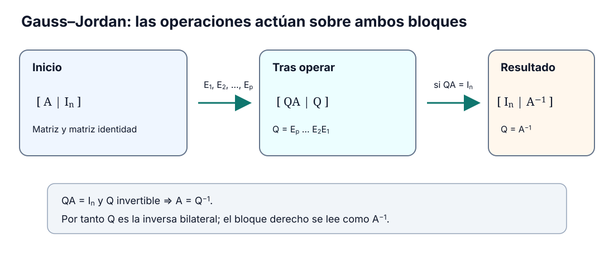

# Matrices invertibles y matriz inversa

## Inversa de una matriz cuadrada

La [[Matemáticas/Álgebra lineal/Matriz identidad|matriz identidad]] $I_n$ es el elemento neutro del [[Matemáticas/Álgebra lineal/Producto matricial|producto matricial]]. Para cualquier [[Matemáticas/Álgebra lineal/Matrices|matriz cuadrada]] $A\in M_n(K)$, con $n\ge1$ y $K=\mathbb R$ o $K=\mathbb C$,

$$
I_nA=A,\qquad AI_n=A.
$$

Si $A,B\in M_n(K)$, están definidos los productos $AB$ y $BA$, aunque pueden ser distintos.

En el [[Matemáticas/Estructuras algebraicas/Cuerpos|cuerpo]] $K$, todo escalar $a\ne0$ tiene un inverso multiplicativo: existe $b\in K$ tal que

$$
ab=ba=1.
$$

Para una matriz no nula $A\in M_n(K)$, ¿existe siempre una [[Matemáticas/Álgebra lineal/Matriz inversa|inversa]] $B\in M_n(K)$ que satisfaga

$$
AB=BA=I_n?
$$

La respuesta es negativa: hay matrices no nulas para las que no existe tal $B$.[^a6]

### Matriz inversa e invertibilidad

> [!definicion] Matriz inversa
> Sea $A\in M_n(K)$. Una matriz $B\in M_n(K)$ es una [[Matemáticas/Álgebra lineal/Matriz inversa|inversa]] de $A$ si
>
> $$
> \boxed{AB=BA=I_n}.
> $$
>
> Si existe, $A$ se llama **invertible**. [[#Unicidad de la inversa|La inversa es única]] y se denota $A^{-1}$.[^a6]

[[Matemáticas/Álgebra lineal/Matriz identidad|La identidad]] es su propia inversa, puesto que $I_nI_n=I_n$.

```anki
deck: Matemáticas::Álgebra lineal::Matrices
tags:
  - matrices
  - inversa
---
> [!note] Pregunta
> ¿Qué debe cumplir $B\in M_n(K)$ para ser la inversa de $A\in M_n(K)$?
===
> [!important] Respuesta
> $AB=BA=I_n$. Si existe tal $B$, la matriz $A$ es invertible y se escribe $B=A^{-1}$.
```

```anki
deck: Matemáticas::Álgebra lineal::Matrices
tags:
  - matemáticas
  - inversa
---
> [!note] Pregunta
> ¿Cuál es la inversa de la matriz identidad?
===
> [!important] Respuesta
> $I_n^{-1}=I_n$, porque $I_nI_n=I_n$.
```

#### Matriz singular

> [!definicion] Matriz singular
> Una matriz cuadrada es **singular** cuando no tiene inversa.[^a6]

Una matriz puede ser no nula y singular, como muestra el siguiente ejemplo.

```anki
deck: Matemáticas::Álgebra lineal::Matrices
tags:
  - matrices
  - inversa
---
> [!note] Pregunta
> ¿Qué significa que una matriz cuadrada sea singular?
===
> [!important] Respuesta
> Que no tiene inversa. Ser una matriz no nula no garantiza la invertibilidad.
```

#### Ejemplo: una fila o una columna nula

La matriz

$$
C=\begin{pmatrix}1&0\\0&0\end{pmatrix}
$$

no es nula, pero no puede tener inversa. Para cualquier matriz $D$, la segunda fila de $CD$ es nula; por tanto, $CD\ne I_2$.

En general, una fila nula de $A$ permanece nula en $AB$, y una columna nula permanece nula en $BA$. Cualquiera de esas condiciones impide que ambos productos sean [[Matemáticas/Álgebra lineal/Matriz identidad|la identidad]].[^a6]

```anki
deck: Matemáticas::Álgebra lineal::Matrices
tags:
  - matrices
  - inversa
---
> [!note] Pregunta
> ¿Por qué una matriz cuadrada con una fila o una columna nula no puede ser invertible?
===
> [!important] Respuesta
> Una fila nula de $A$ permanece nula en $AB$, impidiendo $AB=I$. Una columna nula de $A$ permanece nula en $BA$, impidiendo $BA=I$.
```

Una matriz $2\times3$ puede tener dos [[Física/Grado/1º/Álgebra Lineal y Geometría Analítica/01 Matrices y sistemas/04 Eliminación de Gauss y Gauss-Jordan#Pivote|pivotes]], uno en cada fila, aunque una de sus tres columnas carezca de [[Física/Grado/1º/Álgebra Lineal y Geometría Analítica/01 Matrices y sistemas/04 Eliminación de Gauss y Gauss-Jordan#Pivote|pivote]]. Habrá alcanzado el rango máximo $2$; seguirá siendo rectangular. La [[#Matriz inversa e invertibilidad|definición de inversa]] exige que la matriz sea cuadrada.

```anki
deck: Matemáticas::Álgebra lineal::Matrices
tags:
  - matrices
  - rango
  - inversa
---
> [!note] Pregunta
> ¿Una matriz rectangular de rango máximo tiene necesariamente inversa bilateral?
===
> [!important] Respuesta
> No. El rango máximo rectangular es $\min(m,n)$; la inversa bilateral requiere que la matriz sea cuadrada y tenga rango $n$.
```

### Unicidad de la inversa

#### Propiedad

> [!teorema] La inversa es única
> Si $B,C\in M_n(K)$ son inversas de $A\in M_n(K)$, entonces
>
> $$
> \boxed{B=C}.
> $$

#### Demostración

> [!demostracion] Demostración
> Por las hipótesis, $BA=I_n$ y $AC=I_n$. Calculamos el producto $BAC$ agrupándolo de dos formas:
>
> $$
> B(AC)=BI_n=B,
> $$
>
> $$
> (BA)C=I_nC=C.
> $$
>
> La [[Física/Grado/1º/Álgebra Lineal y Geometría Analítica/01 Matrices y sistemas/02 Operaciones#Asociatividad del producto|asociatividad del producto matricial]] garantiza que $B(AC)=(BA)C$. Por tanto, $B=C$: dos inversas de la misma matriz necesariamente coinciden. $\blacksquare$[^unicidad]

```anki
deck: Matemáticas::Álgebra lineal::Matrices
tags:
  - matrices
  - inversa
---
> [!note] Pregunta
> ¿Qué producto permite demostrar que dos inversas $B$ y $C$ de una misma matriz $A$ coinciden?
===
> [!important] Respuesta
> $BAC$: por un lado, $B(AC)=B$; por otro, $(BA)C=C$. La asociatividad da $B=C$.
```

```anki
deck: Matemáticas::Álgebra lineal::Matrices
tags:
  - matrices
  - inversa
---
> [!note] Pregunta
> ¿Puede una matriz cuadrada tener dos inversas distintas?
===
> [!important] Respuesta
> No. Si $B$ y $C$ son inversas de $A$, entonces $B=B(AC)=(BA)C=C$. La inversa, cuando existe, es única.
```

### Ejemplo trabajado: cálculo por Gauss–Jordan

Calculemos la inversa de

$$
A=\begin{pmatrix}1&2\\3&7\end{pmatrix}.
$$

Escribimos $[A\mid I_2]$ y aplicamos las operaciones a las ==filas completas, incluidos los dos bloques==. Para anular el $3$ situado bajo el primer [[Física/Grado/1º/Álgebra Lineal y Geometría Analítica/01 Matrices y sistemas/04 Eliminación de Gauss y Gauss-Jordan#Pivote|pivote]], hacemos $R_2\leftarrow R_2-3R_1$:

$$
\left[\begin{array}{cc|cc}1&2&1&0\\3&7&0&1\end{array}\right]
\longrightarrow
\left[\begin{array}{cc|cc}1&2&1&0\\0&1&-3&1\end{array}\right].
$$

Después, $R_1\leftarrow R_1-2R_2$:

$$
\left[\begin{array}{cc|cc}1&0&7&-2\\0&1&-3&1\end{array}\right].
$$

A la izquierda ha quedado [[Matemáticas/Álgebra lineal/Matriz identidad|la identidad]]. El bloque derecho es

$$
A^{-1}=\begin{pmatrix}7&-2\\-3&1\end{pmatrix}.
$$

La comprobación por ambos lados da

$$
AA^{-1}=\begin{pmatrix}7-6&-2+2\\21-21&-6+7\end{pmatrix}=I_2,
$$

$$
A^{-1}A=\begin{pmatrix}7-6&14-14\\-3+3&-6+7\end{pmatrix}=I_2.
$$

Ambos productos son [[Matemáticas/Álgebra lineal/Matriz identidad|la identidad]], así que la matriz obtenida es la inversa. Falta justificar por qué reducir $[A\mid I_n]$ permite encontrarla; lo haremos después de estudiar las inversas de las [[Física/Grado/1º/Álgebra Lineal y Geometría Analítica/01 Matrices y sistemas/03 Matrices elementales y operaciones elementales#Multiplicación por la izquierda y operaciones elementales|matrices elementales]].[^a7-calculo]

## Inversas y operaciones matriciales

### Invertibilidad de las matrices elementales

#### Propiedad

> [!teorema] Las matrices elementales son invertibles
> Toda [[Matemáticas/Álgebra lineal/Matriz elemental|matriz elemental]] es invertible y su inversa es una matriz elemental del mismo tipo.[^a6-elementales][^emni]

#### Demostración

> [!demostracion] Demostración
> Sea $A\in M_n(K)$ una matriz elemental. Existe una operación elemental $t$ tal que $A=t(I_n)$. Por la [[Física/Grado/1º/Álgebra Lineal y Geometría Analítica/01 Matrices y sistemas/03 Matrices elementales y operaciones elementales#Reversibilidad de las operaciones|reversibilidad de las operaciones]], otra operación $t'$ del mismo tipo deshace $t$. Construimos su matriz elemental $B$:
>
> $$
> I_n\xrightarrow[t]{}A=t(I_n),
> \qquad I_n\xrightarrow[t']{}B=t'(I_n).
> $$
>
> **Comprobamos $BA=I_n$.** Multiplicar por $B$ a la izquierda efectúa $t'$, que deshace el paso que produjo $A$:
>
> $$
> I_n\xrightarrow[t]{}A\xrightarrow[t']{}I_n,
> \qquad
> BA=t'(A)=t'(t(I_n))=I_n.
> $$
>
> **Comprobamos $AB=I_n$.** La operación $t$ también deshace $t'$; por tanto,
>
> $$
> I_n\xrightarrow[t']{}B\xrightarrow[t]{}I_n,
> \qquad
> AB=t(B)=t(t'(I_n))=I_n.
> $$
>
> $B$ es elemental del mismo tipo que $A$ porque se construyó aplicando $t'$ a $I_n$. Las dos matrices tienen orden $n$ y satisfacen la [[#Matriz inversa e invertibilidad|definición de inversa]]. En consecuencia,
>
> $$
> \boxed{AB=BA=I_n},\qquad
> \boxed{B=A^{-1},\quad A=B^{-1}}.
> \qquad\blacksquare
> $$
>
> [^emni]

```anki
deck: Matemáticas::Álgebra lineal::Sistemas lineales
tags:
  - matemáticas
  - matrices-elementales
  - inversibilidad
---
> [!note] Pregunta
> ¿Por qué toda matriz elemental es invertible?
===
> [!important] Respuesta
> Si $A$ es elemental de orden $n$, la operación que deshace la suya tiene una matriz elemental $B$ del mismo tipo. Se cumple $AB=BA=I_n$, así que $B=A^{-1}$.
```

#### Inversas de los tres tipos

Para construir la inversa, aplicamos a $I_n$ la operación que deshace la inicial. Las tres identidades forman un **único TPC**, resuelto en los tres apartados siguientes.[^a6-elementales]

| Matriz elemental | Matriz inversa | Operación que deshace |
|---|---|---|
| [[#Inversa de una matriz elemental de permutación\|$P_{ij}$]] | $P_{ij}$ | Repetir el intercambio |
| [[#Inversa de una matriz elemental de escalado\|$D_i(\lambda)$]], $\lambda\ne0$ | $D_i(\lambda^{-1})$ | Dividir la fila por $\lambda$ |
| [[#Inversa de una matriz elemental de reemplazo\|$E_{ij}(\lambda)$]], $i\ne j$ | $E_{ij}(-\lambda)$ | Restar el múltiplo añadido |

### Inversa de una matriz elemental de permutación

#### Propiedad

> [!teorema] Deshacer un intercambio
> Sea $P_{ij}$ la matriz elemental obtenida de $I_n$ al intercambiar las filas distintas $i$ y $j$. Entonces
>
> $$
> \boxed{P_{ij}^{-1}=P_{ij}}.
> $$
>
> [^a6-elementales]

#### Demostración

> [!demostracion] Caso 1 — Intercambio
> Multiplicar por $P_{ij}$ a la izquierda intercambia esas dos filas. Al hacerlo dos veces sobre $I_n$, cada fila vuelve a su lugar:
>
> $$
> P_{ij}P_{ij}=I_n.
> $$
>
> Como el candidato a inversa es el propio $P_{ij}$, ambos órdenes producen exactamente este mismo producto. Por la definición de inversa, $P_{ij}^{-1}=P_{ij}$. $\blacksquare$

```anki
deck: Matemáticas::Álgebra lineal::Matrices
tags:
  - matrices
  - inversa
  - matrices-elementales
---
> [!note] Pregunta
> ¿Cuál es la inversa de una matriz elemental que intercambia dos filas?
===
> [!important] Respuesta
> Ella misma: repetir el intercambio devuelve las filas a sus posiciones iniciales.
```

### Inversa de una matriz elemental de escalado

#### Propiedad

> [!teorema] Deshacer un escalado
> Si $D_i(\lambda)$ es la matriz elemental que multiplica la fila $i$ por $\lambda\ne0$, entonces
>
> $$
> \boxed{D_i(\lambda)^{-1}=D_i(\lambda^{-1})}.
> $$
>
> [^a6-elementales]

#### Demostración

> [!demostracion] Caso 2 — Escalado
> Como $\lambda\ne0$, existe $\lambda^{-1}\in K$. Escalar la fila $i$ por $\lambda$ y después por $\lambda^{-1}$ la multiplica en total por $\lambda^{-1}\lambda=1$. Las otras filas no cambian.
>
> En el orden contrario, el factor total es $\lambda\lambda^{-1}=1$. Aplicando ambas composiciones a $I_n$,
>
> $$
> D_i(\lambda^{-1})D_i(\lambda)=I_n,
> $$
>
> $$
> D_i(\lambda)D_i(\lambda^{-1})=I_n.
> $$
>
> Queda comprobada la [[#Matriz inversa e invertibilidad|inversa]]. $\blacksquare$

```anki
deck: Matemáticas::Álgebra lineal::Matrices
tags:
  - matrices
  - inversa
  - matrices-elementales
---
> [!note] Pregunta
> ¿Cómo se invierte el escalado de una fila por $\lambda\ne0$?
===
> [!important] Respuesta
> Escalándola por $1/\lambda$: $D_i(\lambda)^{-1}=D_i(1/\lambda)$.
```

### Inversa de una matriz elemental de reemplazo

#### Propiedad

> [!teorema] Deshacer la suma de un múltiplo
> Si $i\ne j$ y $E_{ij}(\lambda)$ es la matriz elemental que representa $L_i\leftarrow L_i+\lambda L_j$, entonces
>
> $$
> \boxed{E_{ij}(\lambda)^{-1}=E_{ij}(-\lambda)}.
> $$
>
> [^a6-elementales]

#### Demostración

> [!demostracion] Caso 3 — Reemplazo
> La fila $j$ no cambia, porque $i\ne j$. Por eso podemos deshacer la operación restando el mismo múltiplo:
>
> $$
> (L_i+\lambda L_j)-\lambda L_j=L_i.
> $$
>
> En el orden contrario ocurre lo mismo:
>
> $$
> (L_i-\lambda L_j)+\lambda L_j=L_i.
> $$
>
> Las demás filas permanecen intactas. Aplicadas a $I_n$, estas operaciones prueban
>
> $$
> E_{ij}(-\lambda)E_{ij}(\lambda)=I_n
> =E_{ij}(\lambda)E_{ij}(-\lambda).
> $$
>
> Por tanto, cada matriz es la inversa de la otra. $\blacksquare$

```anki
deck: Matemáticas::Álgebra lineal::Matrices
tags:
  - matrices
  - inversa
  - matrices-elementales
---
> [!note] Pregunta
> ¿Qué operación deshace $L_i\leftarrow L_i+\lambda L_j$, con $i\ne j$?
===
> [!important] Respuesta
> $L_i\leftarrow L_i-\lambda L_j$. La fila fuente $j$ permanece intacta, por lo que $E_{ij}(\lambda)^{-1}=E_{ij}(-\lambda)$.
```

### Doble inversa

#### Propiedad

> [!teorema] Inversa de la inversa
> Para toda matriz invertible $A\in M_n(K)$,
>
> $$
> \boxed{(A^{-1})^{-1}=A}.
> $$
>
> [^a7]

#### Demostración

> [!demostracion] Demostración
> Las igualdades $A^{-1}A=I_n$ y $AA^{-1}=I_n$ muestran que $A$ es una [[#Matriz inversa e invertibilidad|inversa]] de $A^{-1}$. Como [[#Unicidad de la inversa|la inversa es única]], $(A^{-1})^{-1}=A$. $\blacksquare$

```anki
deck: Matemáticas::Álgebra lineal::Matrices
tags:
  - matrices
  - inversa
---
> [!note] Pregunta
> Si $A$ es invertible, ¿cuál es la inversa de $A^{-1}$?
===
> [!important] Respuesta
> La propia matriz $A$: $(A^{-1})^{-1}=A$.
```

### Inversa de un producto

#### Propiedad

> [!teorema] Invertir un producto
> Si $A,B\in M_n(K)$ son invertibles, entonces
>
> $$
> \boxed{(AB)^{-1}=B^{-1}A^{-1}}.
> $$
>
> [^a7]

#### Demostración

> [!demostracion] Demostración
> Sean $A,B\in M_n(K)$ invertibles. Por la [[#Matriz inversa e invertibilidad|definición de inversa]], para probar que $B^{-1}A^{-1}$ es la inversa de $AB$ debemos comprobar que su producto con $AB$ es [[Matemáticas/Álgebra lineal/Matriz identidad|la identidad]] en ambos órdenes.
>
> En el producto $(AB)(B^{-1}A^{-1})$, la [[Física/Grado/1º/Álgebra Lineal y Geometría Analítica/01 Matrices y sistemas/02 Operaciones#Asociatividad del producto|asociatividad]] permite agrupar $B$ con $B^{-1}$ y sustituir $BB^{-1}$ por $I_n$:
>
> $$
> (AB)(B^{-1}A^{-1})
> =A(BB^{-1})A^{-1}
> =AI_nA^{-1}
> =I_n.
> $$
>
> Para el producto en el orden contrario, agrupamos $A^{-1}$ con $A$ y usamos $A^{-1}A=I_n$:
>
> $$
> (B^{-1}A^{-1})(AB)
> =B^{-1}(A^{-1}A)B
> =B^{-1}I_nB
> =I_n.
> $$
>
> Ambos productos valen $I_n$, por lo que $(AB)^{-1}=B^{-1}A^{-1}$. No se ha intercambiado ningún factor: sólo se han cambiado los paréntesis. $\blacksquare$

```anki
deck: Matemáticas::Álgebra lineal::Matrices
tags:
  - matrices
  - inversa
---
> [!note] Pregunta
> Si $A$ y $B$ son matrices invertibles del mismo orden, ¿cuál es la inversa de $AB$?
===
> [!important] Respuesta
> $(AB)^{-1}=B^{-1}A^{-1}$: se invierte el orden de los factores.
```

### Inversa de un múltiplo escalar

#### Propiedad

> [!teorema] Invertir un múltiplo no nulo
> Si $A\in M_n(K)$ es invertible y $\alpha\in K\setminus\{0\}$, entonces
>
> $$
> \boxed{(\alpha A)^{-1}=\alpha^{-1}A^{-1}}.
> $$
>
> [^a7-tpc][^escalar]

#### Demostración

> [!demostracion] TPC resuelto
> Sean $A\in M_n(K)$ invertible y $\alpha\in K\setminus\{0\}$.
>
> Por la [[Física/Grado/1º/Álgebra Lineal y Geometría Analítica/01 Matrices y sistemas/02 Operaciones#Compatibilidad con el producto por escalar|compatibilidad del producto matricial con el producto por escalares]],
>
> $$
> \begin{aligned}
> (\alpha A)(\alpha^{-1}A^{-1})
> &=(\alpha\alpha^{-1})(AA^{-1})\\
> &=1_KI_n=I_n.
> \end{aligned}
> $$
>
> $$
> \begin{aligned}
> (\alpha^{-1}A^{-1})(\alpha A)
> &=(\alpha^{-1}\alpha)(A^{-1}A)\\
> &=1_KI_n=I_n.
> \end{aligned}
> $$
>
> Por la [[#Matriz inversa e invertibilidad|definición de inversa]],
>
> $$
> \boxed{(\alpha A)^{-1}=\alpha^{-1}A^{-1}}.
> \qquad\blacksquare
> $$

>[!warning] Cuidado
>Si $\alpha=0$, el producto $\alpha A$ es la [[Matemáticas/Álgebra lineal/Matriz nula|matriz nula]] y no tiene inversa para $n\geq1$.

```anki
deck: Matemáticas::Álgebra lineal::Matrices
tags:
  - matrices
  - inversa
---
> [!note] Pregunta
> Para $A$ invertible, ¿cuándo es invertible $\alpha A$ y cuál es su inversa?
===
> [!important] Respuesta
> Cuando $\alpha\ne0$; su inversa es $\alpha^{-1}A^{-1}$. Si $\alpha=0$, se obtiene la matriz nula.
```

> [!demostracion] Demostración · TPC resuelto
> La compatibilidad de la inversa con la transposición y con la conjugada transpuesta constituye un único encargo, desarrollado en [[#Inversa de la transpuesta|el caso de la transpuesta]] y [[#Inversa de la conjugada transpuesta|el caso de la conjugada transpuesta]].[^a7-tpc]

### Inversa de la transpuesta

#### Propiedad

> [!teorema] Transponer una inversa
> Si $A\in M_n(K)$ es invertible, entonces $A^T$ es invertible y
>
> $$
> \boxed{(A^T)^{-1}=(A^{-1})^T}.
> $$
>
> [^a7-tpc][^transpuesta]

#### Demostración

> [!demostracion] Caso — Inversa de la transpuesta
> Partimos de las dos igualdades que definen la inversa: $AA^{-1}=I_n$ y $A^{-1}A=I_n$.
>
> Al [[Física/Grado/1º/Álgebra Lineal y Geometría Analítica/01 Matrices y sistemas/02 Operaciones#Transpuesta de un producto matricial|transponer un producto]] se invierte el orden de sus factores. Por tanto, transponer la primera igualdad da
>
> $$
> (AA^{-1})^T=(A^{-1})^TA^T=I_n,
> $$
>
> porque $I_n^T=I_n$. Transponer la segunda da
>
> $$
> (A^{-1}A)^T=A^T(A^{-1})^T=I_n.
> $$
>
> Así, $(A^{-1})^T$ es inversa de $A^T$ por los dos lados. Por definición,
>
> $$
> \boxed{(A^T)^{-1}=(A^{-1})^T}.\qquad\blacksquare
> $$

```anki
deck: Matemáticas::Álgebra lineal::Matrices
tags:
  - matrices
  - inversa
  - transpuesta
---
> [!note] Pregunta
> ¿Cómo se calcula la inversa de $A^T$ si se conoce $A^{-1}$?
===
> [!important] Respuesta
> Se transpone la inversa: $(A^T)^{-1}=(A^{-1})^T$.
```

### Inversa de la conjugada transpuesta

#### Propiedad

> [!teorema] Conjugar y transponer una inversa
> Si $A\in M_n(\mathbb C)$ es invertible y $A^*=\overline A^{\,T}$, entonces
>
> $$
> \boxed{(A^*)^{-1}=(A^{-1})^*}.
> $$
>
> [^a7-tpc]

#### Demostración

> [!demostracion] Caso — Inversa de la conjugada transpuesta
> La [[Matemáticas/Álgebra lineal/Conjugada transpuesta de una matriz|conjugada transpuesta]] invierte el orden de un producto. La [[Matemáticas/Álgebra lineal/Conjugada de una matriz|conjugación]] conserva el orden y la transposición lo invierte:
>
> $$
> (XY)^*=\overline{XY}^{\,T}
> =(\overline X\,\overline Y)^T
> =(\overline Y)^T(\overline X)^T
> =Y^*X^*.
> $$
>
> Aplicamos esta regla a $AA^{-1}=I_n$. Como $I_n^*=I_n$, resulta
>
> $$
> (AA^{-1})^*=(A^{-1})^*A^*=I_n.
> $$
>
> Aplicándola a $A^{-1}A=I_n$, obtenemos el otro orden:
>
> $$
> (A^{-1}A)^*=A^*(A^{-1})^*=I_n.
> $$
>
> Las dos igualdades prueban que $(A^{-1})^*$ es la inversa de $A^*$. $\blacksquare$[^conjugada]

Para matrices reales, la [[Matemáticas/Álgebra lineal/Conjugada de una matriz|conjugación]] no cambia las entradas: esta propiedad coincide con la de la [[Matemáticas/Álgebra lineal/Transpuesta de una matriz|transpuesta]].

```anki
deck: Matemáticas::Álgebra lineal::Matrices
tags:
  - matrices
  - inversa
  - conjugada-transpuesta
---
> [!note] Pregunta
> Si $A$ es una matriz compleja invertible, ¿cuál es la inversa de su conjugada transpuesta $A^*$?
===
> [!important] Respuesta
> $(A^*)^{-1}=(A^{-1})^*$. Sobre $\mathbb R$, coincide con la regla de la transpuesta.
```

### Despejar una matriz multiplicada por la izquierda

Sean $A\in M_n(K)$ invertible y $X,C\in M_{n\times p}(K)$. Para despejar $X$ en $AX=C$, multiplicamos ambos miembros **por la izquierda** por $A^{-1}$. Por [[Física/Grado/1º/Álgebra Lineal y Geometría Analítica/01 Matrices y sistemas/02 Operaciones#Asociatividad del producto|asociatividad]],

$$
\begin{aligned}
A^{-1}(AX)&=A^{-1}C,\\
(A^{-1}A)X&=A^{-1}C,\\
I_nX&=A^{-1}C.
\end{aligned}
$$

Por tanto,

$$
\boxed{X=A^{-1}C}.
$$

> [!advertencia] Multiplicar por el lado que corresponde
> $A^{-1}$ debe quedar junto a $A$. Si $p=n$, multiplicar por la derecha produciría $AXA^{-1}=CA^{-1}$, con $X$ entre $A$ y $A^{-1}$. Si $p\ne n$, ni siquiera se puede formar $CA^{-1}$.[^a7-despeje]

```anki
deck: Matemáticas::Álgebra lineal::Matrices
tags:
  - matrices
  - inversa
---
> [!note] Pregunta
> Si $AX=C$ y $A$ es invertible, ¿cómo se despeja $X$?
===
> [!important] Respuesta
> Multiplicando ambos miembros por $A^{-1}$ a la izquierda: $X=A^{-1}C$.
```

### Despejar una matriz multiplicada por la derecha

Sean $A\in M_n(K)$ invertible y $X,C\in M_{p\times n}(K)$. En $XA=C$, el factor $A$ está a la derecha de $X$. Multiplicamos ambos miembros **por la derecha** por $A^{-1}$:

$$
\begin{aligned}
(XA)A^{-1}&=CA^{-1},\\
X(AA^{-1})&=CA^{-1},\\
XI_n&=CA^{-1}.
\end{aligned}
$$

Así obtenemos

$$
\boxed{X=CA^{-1}}.
$$

> [!idea]
> La asociatividad permite agrupar $A$ con $A^{-1}$; no se ha cambiado el orden de los factores.[^a7-despeje]

```anki
deck: Matemáticas::Álgebra lineal::Matrices
tags:
  - matrices
  - inversa
---
> [!note] Pregunta
> Si $XA=C$ y $A$ es invertible, ¿cómo se despeja $X$?
===
> [!important] Respuesta
> Multiplicando ambos miembros por $A^{-1}$ a la derecha: $X=CA^{-1}$.
```

## Criterio y cálculo por Gauss–Jordan

### Por qué el bloque derecho contiene la inversa

Sea $A\in M_n(K)$.

Aplicamos una secuencia de $p\ge1$ [[Física/Grado/1º/Álgebra Lineal y Geometría Analítica/01 Matrices y sistemas/03 Matrices elementales y operaciones elementales#Composición de operaciones elementales|operaciones elementales]] $t_1,\ldots,t_p$ que lleva $A$ a su [[Matemáticas/Álgebra lineal/Forma escalonada reducida|forma escalonada reducida]] $B$. Sean $E_1,\ldots,E_p\in M_n(K)$ sus [[Matemáticas/Álgebra lineal/Matriz elemental|matrices elementales]], en el mismo orden.

Efectuamos cada operación sobre la fila completa de $[A\mid I_n]$. Llamamos $A_i$ y $Q_i$ a los bloques izquierdo y derecho después del paso $i$, con $A_0=A$ y $Q_0=I_n$:

$$
\begin{aligned}
[A\mid I_n]
&\xrightarrow[t_1,\,E_1]{}[A_1\mid Q_1]
\xrightarrow[t_2,\,E_2]{}[A_2\mid Q_2]\\[4pt]
&\xrightarrow[t_3,\,E_3]{}\cdots
\xrightarrow[t_p,\,E_p]{}[A_p\mid Q_p]=[B\mid Q].
\end{aligned}
$$

Los dos bloques tienen orden $n$. En cada paso, la misma matriz elemental multiplica a ambos por la izquierda:

$$
A_i=E_iA_{i-1},\qquad Q_i=E_iQ_{i-1},
\qquad i\in\{1,\ldots,p\}.
$$

Al terminar,

$$
\boxed{Q=E_p\cdots E_2E_1},\qquad
\boxed{QA=B}.
$$

Cada [[#Invertibilidad de las matrices elementales|matriz elemental es invertible]] y un [[#Inversa de un producto|producto de matrices invertibles también lo es]]. Por tanto,

$$
Q^{-1}=E_1^{-1}E_2^{-1}\cdots E_p^{-1}.
$$

El bloque derecho contiene el producto de las matrices elementales aplicadas.[^a7-calculo]



[[Física/Grado/1º/Álgebra Lineal y Geometría Analítica/01 Matrices y sistemas/assets/03-gauss-jordan-inversa-bilateral.excalidraw|Abrir dibujo editable]].

> **Figura.** Las operaciones por filas afectan simultáneamente a los dos bloques; el bloque derecho conserva el [[Matemáticas/Álgebra lineal/Producto matricial|producto de matrices]] elementales aplicado a $A$.

```anki
deck: Matemáticas::Álgebra lineal::Matrices
tags:
  - matrices
  - inversa
---
> [!note] Pregunta
> ¿Qué registra el bloque derecho al aplicar operaciones elementales a $[A\mid I_n]$?
===
> [!important] Respuesta
> El producto $Q=E_p\cdots E_1$ de las matrices elementales aplicadas: los dos bloques pasan a ser $[QA\mid Q]$.
```

#### Los dos casos de la reducción

> [!demostracion] Demostración
> Sean $A,B,Q\in M_n(K)$, con $B=QA$ la [[Matemáticas/Álgebra lineal/Forma escalonada reducida|forma escalonada reducida]] de $A$ y $Q$ [[#Matriz inversa e invertibilidad|invertible]].
>
> **Caso 1: $B=I_n$.** Multiplicamos $QA=I_n$ por $Q^{-1}$ a la izquierda:
>
> $$
> \begin{aligned}
> Q^{-1}(QA)&=Q^{-1}I_n,\\
> (Q^{-1}Q)A&=Q^{-1},\\
> A&=Q^{-1}.
> \end{aligned}
> $$
>
> $A$ es invertible y, por la [[#Doble inversa|inversa de la inversa]],
>
> $$
> \boxed{A^{-1}=(Q^{-1})^{-1}=Q}.
> $$
>
> La reducción simultánea queda
>
> $$
> [A\mid I_n]\longrightarrow[B\mid Q]
> =[I_n\mid A^{-1}].
> $$
>
> **Caso 2: $B\ne I_n$.** Una matriz cuadrada reducida con $n$ [[Física/Grado/1º/Álgebra Lineal y Geometría Analítica/01 Matrices y sistemas/04 Eliminación de Gauss y Gauss-Jordan#Pivote|pivotes]] es $I_n$; por tanto, $B$ tiene una fila nula, de índice $r$:
>
> $$
> b_{rj}=0\qquad\forall j\in\{1,\ldots,n\}.
> $$
>
> Para cualquier $D=(d_{ij})\in M_n(K)$,
>
> $$
> \begin{aligned}
> (BD)_{rr}&=\sum_{k=1}^{n}b_{rk}d_{kr}\\
> &=0\\
> &\ne1=(I_n)_{rr}.
> \end{aligned}
> $$
>
> Así, $BD\ne I_n$ para toda $D\in M_n(K)$, luego $B$ es [[#Matriz singular|singular]]. Si $A$ fuese invertible, podríamos tomar $D=A^{-1}Q^{-1}$ y obtendríamos
>
> $$
> \begin{aligned}
> B(A^{-1}Q^{-1})&=(QA)(A^{-1}Q^{-1})\\
> &=Q(AA^{-1})Q^{-1}\\
> &=QQ^{-1}=I_n.
> \end{aligned}
> $$
>
> Esto contradice que $BD\ne I_n$ para toda $D$. Por tanto,
>
> $$
> \boxed{A\text{ no es invertible}}.
> \qquad\blacksquare
> $$
>
> [^a7-calculo]

### Matrices invertibles como productos de elementales

#### Propiedad

> [!teorema] Cuatro caracterizaciones de la invertibilidad
> Para $A\in M_n(K)$ son equivalentes:
>
> 1. $A$ es [[#Matriz inversa e invertibilidad|invertible]].
> 2. El [[Física/Grado/1º/Álgebra Lineal y Geometría Analítica/01 Matrices y sistemas/04 Eliminación de Gauss y Gauss-Jordan#Rango de una matriz|rango]] de $A$ es $n$: $\operatorname{rg}(A)=n$.
> 3. La [[Matemáticas/Álgebra lineal/Forma escalonada reducida|forma escalonada reducida]] de $A$ es $I_n$.
> 4. $A$ es un producto finito de [[Física/Grado/1º/Álgebra Lineal y Geometría Analítica/01 Matrices y sistemas/03 Matrices elementales y operaciones elementales#Matrices elementales|matrices elementales]] de orden $n$.[^a7-calculo]

#### Invertibilidad y forma reducida (1 ⇔ 3)

> [!demostracion] Demostración
> Los [[#Por qué el bloque derecho contiene la inversa|dos casos anteriores]] prueban que $A$ es invertible exactamente cuando su forma reducida $B$ es $I_n$.
>
> $$
> A\text{ es invertible}\quad\Longleftrightarrow\quad B=I_n.
> $$
>
> [^a7-calculo]

#### Rango y forma reducida (2 ⇔ 3)

> [!demostracion] Demostración
> El [[Física/Grado/1º/Álgebra Lineal y Geometría Analítica/01 Matrices y sistemas/04 Eliminación de Gauss y Gauss-Jordan#Rango de una matriz|rango]] cuenta los pivotes de la forma reducida. En una matriz cuadrada reducida, tener $n$ pivotes equivale a ser $I_n$. Por tanto,
>
> $$
> \operatorname{rg}(A)=n
> \quad\Longleftrightarrow\quad B=I_n.
> $$
>
> [^a7-calculo]

#### De invertibilidad a producto de elementales (1 ⇒ 4)

> [!demostracion] Demostración
> Si $A$ es invertible, la reducción da
>
> $$
> QA=I_n,\qquad Q=E_p\cdots E_1.
> $$
>
> Multiplicamos por $Q^{-1}$ a la izquierda y usamos la [[#Inversa de un producto|inversa de un producto]]:
>
> $$
> \begin{aligned}
> A&=Q^{-1}I_n\\
> &=(E_p\cdots E_1)^{-1}\\
> &=E_1^{-1}\cdots E_p^{-1}.
> \end{aligned}
> $$
>
> Cada [[#Invertibilidad de las matrices elementales|inversa de una matriz elemental]] es otra matriz elemental, de modo que ésta es la factorización pedida.
>
> Para $A=I_n$ también podemos escribir un producto no vacío. La matriz $D_1(\lambda)$ se obtiene [[Física/Grado/1º/Álgebra Lineal y Geometría Analítica/01 Matrices y sistemas/03 Matrices elementales y operaciones elementales#Multiplicar por un escalar no nulo|multiplicando la primera fila]] de $I_n$ por $\lambda\in K\setminus\{0\}$. En particular,
>
> $$
> I_n=D_1(2)D_1(1/2).
> $$
>
> [^a7-calculo]

#### De producto de elementales a invertibilidad (4 ⇒ 1)

> [!demostracion] Demostración
> Supongamos
>
> $$
> A=F_1\cdots F_p,\qquad p\ge1,
> $$
>
> donde cada $F_i\in M_n(K)$, $i\in\{1,\ldots,p\}$, es elemental. Por la [[#Invertibilidad de las matrices elementales|invertibilidad de las matrices elementales]], existe $F_i^{-1}\in M_n(K)$ para cada $i$.
>
> Si $p=1$, $A=F_1$ ya es invertible. Para $p\ge2$, la [[Física/Grado/1º/Álgebra Lineal y Geometría Analítica/01 Matrices y sistemas/02 Operaciones#Asociatividad del producto|asociatividad]] permite cancelar sucesivamente factores contiguos, sin cambiar su orden:
>
> $$
> \begin{aligned}
> A(F_p^{-1}\cdots F_1^{-1})
> &=F_1\cdots F_{p-1}(F_pF_p^{-1})F_{p-1}^{-1}\cdots F_1^{-1}\\
> &=\cdots=F_1F_1^{-1}=I_n.
> \end{aligned}
> $$
>
> $$
> \begin{aligned}
> (F_p^{-1}\cdots F_1^{-1})A
> &=F_p^{-1}\cdots F_2^{-1}(F_1^{-1}F_1)F_2\cdots F_p\\
> &=\cdots=F_p^{-1}F_p=I_n.
> \end{aligned}
> $$
>
> Los puntos suspensivos repiten la misma cancelación: desde $F_p$ hasta $F_1$ en el primer producto y desde $F_1$ hasta $F_p$ en el segundo. Por la [[#Matriz inversa e invertibilidad|definición de inversa]],
>
> $$
> \boxed{A^{-1}=F_p^{-1}\cdots F_1^{-1}}.
> \qquad\blacksquare
> $$
>
> [^a7-calculo]

```anki
deck: Matemáticas::Álgebra lineal::Matrices
tags:
  - matrices
  - inversa
  - rango
  - matrices-elementales
---
> [!note] Pregunta
> Para $A\in M_n(K)$, ¿qué condiciones de rango, forma reducida y factorización son equivalentes a que $A$ sea invertible?
===
> [!important] Respuesta
> 1. $A$ es invertible.
> 2. $\operatorname{rg}(A)=n$.
> 3. Su forma escalonada reducida es $I_n$.
> 4. $A$ es un producto finito de matrices elementales de orden $n$.
```

```anki
deck: Matemáticas::Álgebra lineal::Matrices
tags:
  - matrices
  - inversa
  - matrices-elementales
---
> [!note] Pregunta
> ¿Qué matrices cuadradas pueden expresarse como productos de matrices elementales?
===
> [!important] Respuesta
> Exactamente las invertibles: la reducción a $I$ da $A=E_1^{-1}\cdots E_p^{-1}$, y cada inversa elemental sigue siendo elemental.
```

### La misma secuencia calcula la inversa

#### Propiedad

> [!propiedad] Reducción simultánea de $A$ y de la identidad
> Sea $A\in M_n(K)$ invertible. La **misma secuencia de operaciones elementales** que transforma $A$ en $I_n$ transforma $I_n$ en $A^{-1}$. Al aplicarla a las filas completas de los dos bloques,
>
> $$
> \boxed{[A\mid I_n]\longrightarrow[I_n\mid A^{-1}]}.
> $$
>
> [^a7-calculo]

#### Demostración

> [!demostracion] Demostración
> En el caso $B=I_n$ ya hemos obtenido $QA=I_n$ y $Q=A^{-1}$. Cada operación $t_i$ actúa simultáneamente sobre los dos bloques, de modo que
>
> $$
> [A\mid I_n]\xrightarrow[t_1,\ldots,t_p]{}[QA\mid Q]
> =[I_n\mid A^{-1}].
> \qquad\blacksquare
> $$
>
> [^a7-calculo]

```anki
deck: Matemáticas::Álgebra lineal::Matrices
tags:
  - matrices
  - inversa
  - gauss-jordan
---
> [!note] Pregunta
> ¿Cómo decide y calcula Gauss–Jordan si una matriz cuadrada $A$ tiene inversa?
===
> [!important] Respuesta
> Se reduce $[A\mid I]$ aplicando cada operación a ambos bloques. Si el izquierdo llega a $I$, el derecho es $A^{-1}$; si la forma reducida de $A$ no es $I$, no hay inversa.
```

### Ejemplo trabajado: invertir una matriz de orden tres

Calculemos la inversa de[^a7-ejemplo]

$$
A=\begin{pmatrix}1&0&-1\\2&2&-1\\1&4&2\end{pmatrix}.
$$

**Primera columna.** Partimos de

$$
\left[\begin{array}{rrr|rrr}
1&0&-1&1&0&0\\
2&2&-1&0&1&0\\
1&4&2&0&0&1
\end{array}\right].
$$

Las operaciones $R_2\leftarrow R_2-2R_1$ y $R_3\leftarrow R_3-R_1$ dan

$$
\left[\begin{array}{rrr|rrr}
1&0&-1&1&0&0\\
0&2&1&-2&1&0\\
0&4&3&-1&0&1
\end{array}\right].
$$

**Segunda columna.** Como $4=2\cdot2$, hacemos $R_3\leftarrow R_3-2R_2$:

$$
\left[\begin{array}{rrr|rrr}
1&0&-1&1&0&0\\
0&2&1&-2&1&0\\
0&0&1&3&-2&1
\end{array}\right].
$$

**Eliminación hacia arriba.** El último [[Física/Grado/1º/Álgebra Lineal y Geometría Analítica/01 Matrices y sistemas/04 Eliminación de Gauss y Gauss-Jordan#Pivote|pivote]] vale $1$. Con $R_2\leftarrow R_2-R_3$ y $R_1\leftarrow R_1+R_3$ queda

$$
\left[\begin{array}{rrr|rrr}
1&0&0&4&-2&1\\
0&2&0&-5&3&-1\\
0&0&1&3&-2&1
\end{array}\right].
$$

Sólo falta normalizar el segundo [[Física/Grado/1º/Álgebra Lineal y Geometría Analítica/01 Matrices y sistemas/04 Eliminación de Gauss y Gauss-Jordan#Pivote|pivote]]: $R_2\leftarrow\frac12R_2$. Se obtiene $[I_3\mid A^{-1}]$, con

$$
\boxed{A^{-1}=\begin{pmatrix}
4&-2&1\\
-\frac52&\frac32&-\frac12\\
3&-2&1
\end{pmatrix}}.
$$

Comprobamos los dos órdenes del producto:

$$
AA^{-1}=I_3,\qquad A^{-1}A=I_3.
$$

Por ejemplo, las dos primeras filas de $AA^{-1}$ se obtienen así:

$$
(4-3,\,-2+2,\,1-1)=(1,0,0),
$$

$$
(8-5-3,\,-4+3+2,\,2-1-1)=(0,1,0).
$$

En el orden contrario, la primera fila de $A^{-1}A$ es

$$
(4-4+1,\,-4+4,\,-4+2+2)=(1,0,0).
$$

## Equivalencias y sistemas cuadrados

### Relación entre invertibilidad, rango y solución única

#### Propiedad

> [!teorema] Matriz cuadrada de rango completo
> Para $A\in M_n(K)$ son equivalentes:
>
> - $A$ es invertible.
> - Su [[Matemáticas/Álgebra lineal/Forma escalonada|forma escalonada]] tiene $n$ [[Física/Grado/1º/Álgebra Lineal y Geometría Analítica/01 Matrices y sistemas/04 Eliminación de Gauss y Gauss-Jordan#Pivote|pivotes]].
> - $\operatorname{rg}(A)=n$.
> - Para **todo** $\mathbf b\in K^n$, el sistema $A\mathbf x=\mathbf b$ tiene una [[Física/Grado/1º/Álgebra Lineal y Geometría Analítica/01 Matrices y sistemas/06 Compatibilidad y clasificación de sistemas#Sistema compatible determinado|única solución]].[^a7-calculo][^a10]

#### Invertibilidad, pivotes y rango

> [!demostracion] Demostración
> Sea $R\in M_n(K)$ la [[Matemáticas/Álgebra lineal/Forma escalonada reducida|forma escalonada reducida]] de $A$. Por la [[#Por qué el bloque derecho contiene la inversa|reducción anterior]],
>
> $$
> R=QA,
> $$
>
> con $Q\in M_n(K)$ [[#Matriz inversa e invertibilidad|invertible]]. Las [[#Matrices invertibles como productos de elementales|caracterizaciones ya demostradas]] dan
>
> $$
> \begin{aligned}
> A\text{ es invertible}
> &\quad\Longleftrightarrow\quad R=I_n\\
> &\quad\Longleftrightarrow\quad R\text{ contiene }n\text{ pivotes}\\
> &\quad\Longleftrightarrow\quad\operatorname{rg}(A)=n.
> \end{aligned}
> $$
>
> [^a7-calculo]

#### Existencia de solución

> [!demostracion] Demostración
> Supongamos $A$ invertible y sea $\mathbf b\in K^n$ arbitrario. El vector $\mathbf x=A^{-1}\mathbf b\in K^n$ es solución. Usando la [[Física/Grado/1º/Álgebra Lineal y Geometría Analítica/01 Matrices y sistemas/02 Operaciones#Asociatividad del producto|asociatividad]],
>
> $$
> \begin{aligned}
> A(A^{-1}\mathbf b)
> &=(AA^{-1})\mathbf b\\
> &=I_n\mathbf b\\
> &=\mathbf b.
> \end{aligned}
> $$
>
> [^a10]

#### Unicidad de solución

> [!demostracion] Demostración
> Sean $A\in M_n(K)$ invertible y $\mathbf b\in K^n$.
>
> Para cualquier otra solución $\mathbf y\in K^n$, con $A\mathbf y=\mathbf b$,
>
> $$
> \begin{aligned}
> \mathbf y&=I_n\mathbf y\\
> &=(A^{-1}A)\mathbf y\\
> &=A^{-1}(A\mathbf y)\\
> &=A^{-1}\mathbf b.
> \end{aligned}
> $$
>
> Por tanto, $A^{-1}\mathbf b$ es la única solución para cada $\mathbf b\in K^n$.
>
> [^a10]

#### De la solución única al rango completo

> [!demostracion]- Demostración · ampliación
> Supongamos que para todo $\mathbf b\in K^n$ existe una única solución. Con $\mathbf b=\mathbf0$, el [[Física/Grado/1º/Álgebra Lineal y Geometría Analítica/01 Matrices y sistemas/08 Sistemas de ecuaciones lineales#Sistema homogéneo y solución nula|sistema homogéneo]] satisface
>
> $$
> \{\mathbf x\in K^n:A\mathbf x=\mathbf0\}=\{\mathbf0\}.
> $$
>
> Supongamos, por contradicción, que $s=\operatorname{rg}(A)<n$. Escribimos $R=(r_{ij})$. Sean $j_1<\cdots<j_s$ los índices de sus [[Física/Grado/1º/Álgebra Lineal y Geometría Analítica/01 Matrices y sistemas/04 Eliminación de Gauss y Gauss-Jordan#Pivote|columnas pivote]] y
>
> $$
> F=\{1,\ldots,n\}\setminus\{j_1,\ldots,j_s\}
> $$
>
> el conjunto de índices de las columnas correspondientes a [[Física/Grado/1º/Álgebra Lineal y Geometría Analítica/01 Matrices y sistemas/04 Eliminación de Gauss y Gauss-Jordan#Variable libre|variables libres]]. Como $s<n$, $F\ne\varnothing$; elegimos $k\in F$. Definimos $\mathbf v=(v_1,\ldots,v_n)^T\in K^n$ por
>
> $$
> v_\ell=
> \begin{cases}
> 1,&\ell=k,\\
> 0,&\ell\in F\setminus\{k\},\\
> -r_{ik},&\ell=j_i,\quad i\in\{1,\ldots,s\}.
> \end{cases}
> $$
>
> En cada fila no nula, la columna pivote aporta su única entrada $1$; las otras columnas pivote aportan ceros. Por tanto,
>
> $$
> \begin{aligned}
> (R\mathbf v)_i
> &=v_{j_i}+\sum_{\ell\in F}r_{i\ell}v_\ell\\
> &=-r_{ik}+r_{ik}\\
> &=0,\qquad i\in\{1,\ldots,s\}.
> \end{aligned}
> $$
>
> Las filas restantes son nulas, de modo que
>
> $$
> (R\mathbf v)_i=0,\qquad i\in\{s+1,\ldots,n\}.
> $$
>
> Así, $R\mathbf v=\mathbf0$. Como $R=QA$ y $Q$ es invertible,
>
> $$
> \begin{aligned}
> A\mathbf v&=(Q^{-1}R)\mathbf v\\
> &=Q^{-1}(R\mathbf v)\\
> &=Q^{-1}\mathbf0=\mathbf0.
> \end{aligned}
> $$
>
> Pero $v_k=1$ implica $\mathbf v\ne\mathbf0$, en contradicción con la unicidad de la solución del homogéneo. Concluimos
>
> $$
> \boxed{s=\operatorname{rg}(A)=n}.
> \qquad\blacksquare
> $$
>
> [^a10][^lateral]

```anki
deck: Matemáticas::Álgebra lineal::Matrices
tags:
  - matrices
  - inversa
  - rango
---
> [!note] Pregunta
> Para $A\in M_n(K)$, ¿qué condición de rango equivale a tener inversa y qué implica para $A\mathbf x=\mathbf b$?
===
> [!important] Respuesta
> $\operatorname{rg}(A)=n$. Entonces, para cada $\mathbf b\in K^n$, existe una única solución: $\mathbf x=A^{-1}\mathbf b$.
```

### Resolver un sistema con la inversa

Cuando $A$ es cuadrada e invertible, la igualdad

$$
\boxed{\mathbf x=A^{-1}\mathbf b}
$$

da la solución de $A\mathbf x=\mathbf b$. La multiplicación debe hacerse en ese orden: $A^{-1}$ actúa por la izquierda sobre la columna $\mathbf b$.[^a10]

```anki
deck: Matemáticas::Álgebra lineal::Matrices
tags:
  - matrices
  - inversa
---
> [!note] Pregunta
> ¿Cómo se resuelve $A\mathbf x=\mathbf b$ cuando $A$ es invertible?
===
> [!important] Respuesta
> Multiplicando ambos miembros por $A^{-1}$ a la izquierda: $\mathbf x=A^{-1}\mathbf b$. Es la única solución.
```

#### Ejemplo: usar la inversa calculada

Usamos la inversa calculada en el ejemplo de orden tres:

$$
A^{-1}=\begin{pmatrix}
4&-2&1\\
-\frac52&\frac32&-\frac12\\
3&-2&1
\end{pmatrix}.
$$

Para el segundo miembro

$$
\mathbf b=\begin{pmatrix}1\\2\\3\end{pmatrix},
$$

calculamos cada componente de $\mathbf x=A^{-1}\mathbf b$:

$$
\mathbf x=
\begin{pmatrix}
4-4+3\\
-\frac52+3-\frac32\\
3-4+3
\end{pmatrix}
=
\begin{pmatrix}3\\-1\\2\end{pmatrix}.
$$

La comprobación en el sistema original da

$$
A\mathbf x=
\begin{pmatrix}3-2\\6-2-2\\3-4+4\end{pmatrix}
=
\begin{pmatrix}1\\2\\3\end{pmatrix}=\mathbf b.
$$

### Una identidad de producto fuerza ambas inversas

#### Propiedad

> [!teorema] Basta una identidad para matrices cuadradas
> Si $A,B\in M_n(K)$ y $AB=I_n$, entonces ambas matrices son invertibles y
>
> $$
> \boxed{A^{-1}=B\quad\text{y}\quad B^{-1}=A}.
> $$
>
> [^a10-corolarios][^lateral]

#### Demostración

> [!demostracion] Demostración
> **El homogéneo de $B$ sólo tiene la solución nula.** Si $B\mathbf x=0$, multiplicar por $A$ a la izquierda da
>
> $$
> A(B\mathbf x)=0.
> $$
>
> Por [[Física/Grado/1º/Álgebra Lineal y Geometría Analítica/01 Matrices y sistemas/02 Operaciones#Asociatividad del producto|asociatividad]] y por $AB=I_n$, ese mismo miembro es
>
> $$
> A(B\mathbf x)=(AB)\mathbf x=I_n\mathbf x=\mathbf x.
> $$
>
> Luego $\mathbf x=0$.
>
> **Esto obliga a que $B$ tenga rango $n$.** Si le faltara un [[Física/Grado/1º/Álgebra Lineal y Geometría Analítica/01 Matrices y sistemas/04 Eliminación de Gauss y Gauss-Jordan#Pivote|pivote]], se podría dar valor $1$ a una [[Física/Grado/1º/Álgebra Lineal y Geometría Analítica/01 Matrices y sistemas/04 Eliminación de Gauss y Gauss-Jordan#Variables pivote y variables libres|variable libre]] y resolver las básicas, obteniendo una solución no nula del homogéneo. Por tanto, $B$ tiene $n$ [[Física/Grado/1º/Álgebra Lineal y Geometría Analítica/01 Matrices y sistemas/04 Eliminación de Gauss y Gauss-Jordan#Pivote|pivotes]] y es invertible.
>
> **Identificamos las inversas.** Multiplicamos $AB=I_n$ por $B^{-1}$ a la derecha:
>
> $$
> A(BB^{-1})=B^{-1},
> $$
>
> de donde $A=B^{-1}$. Así, $A$ también es invertible y $A^{-1}=B$. $\blacksquare$

#### Contraejemplo con matrices rectangulares

Tomemos las matrices

$$
A=\begin{pmatrix}1&0\end{pmatrix}\in M_{1\times2}(K),
$$

$$
B=\begin{pmatrix}1\\0\end{pmatrix}\in M_{2\times1}(K).
$$

Su producto $AB$ es la matriz $1\times1$ con entrada $1$:

$$
AB=\begin{pmatrix}1\end{pmatrix}=I_1.
$$

En cambio,

$$
BA=\begin{pmatrix}1&0\\0&0\end{pmatrix}\ne I_2.
$$

Por tanto, una identidad en un solo orden no basta para matrices rectangulares. La [[#Una identidad de producto fuerza ambas inversas|propiedad anterior]] exige que ambas matrices sean cuadradas del mismo orden.[^lateral]

```anki
deck: Matemáticas::Álgebra lineal::Matrices
tags:
  - matrices
  - inversa
---
> [!note] Pregunta
> Si $A,B\in M_n(K)$ y $AB=I_n$, ¿es necesario comprobar por separado que $BA=I_n$ para concluir que son inversas?
===
> [!important] Respuesta
> No: para matrices cuadradas del mismo orden, $AB=I_n$ implica $BA=I_n$ y $A^{-1}=B$. La hipótesis cuadrada es esencial.
```

### Invertibilidad de ambos factores de un producto invertible

#### Propiedad

> [!teorema] Factores de un producto invertible
> Si $A,B\in M_n(K)$ y $AB$ es invertible, entonces $A$ y $B$ son invertibles.[^a10-corolarios]

#### Demostración

> [!demostracion] TPC resuelto
> Sea $C=(AB)^{-1}$. Por definición, $(AB)C=I_n$ y $C(AB)=I_n$.
>
> Reagrupamos la primera igualdad para que $A$ aparezca como un factor:
>
> $$
> A(BC)=(AB)C=I_n.
> $$
>
> Las matrices $A$ y $BC$ son cuadradas de orden $n$. Por [[#Una identidad de producto fuerza ambas inversas|la propiedad anterior]], $A$ es invertible y su inversa es $BC$.
>
> La segunda igualdad permite hacer lo mismo con $B$:
>
> $$
> (CA)B=C(AB)=I_n.
> $$
>
> Aplicando la misma propiedad a $CA$ y $B$, concluimos que $B$ es invertible y su inversa es $CA$.
>
> Ambos factores de $AB$ son, por tanto, invertibles. $\blacksquare$[^factores]

```anki
deck: Matemáticas::Álgebra lineal::Matrices
tags:
  - matrices
  - inversa
  - sistemas-lineales
---
> [!note] Pregunta
> Si $AB$ es invertible para $A,B\in M_n(K)$, ¿qué se concluye sobre los factores?
===
> [!important] Respuesta
> $A$ y $B$ son invertibles: con $C=(AB)^{-1}$, $A(BC)=I_n$ y $(CA)B=I_n$.
```

## Condiciones de validez y errores frecuentes

- **Matriz cuadrada en los criterios de inversa.** Una matriz rectangular puede tener un [[Física/Grado/1º/Álgebra Lineal y Geometría Analítica/01 Matrices y sistemas/04 Eliminación de Gauss y Gauss-Jordan#Pivote|pivote]] en cada columna sin poseer una [[#Matriz inversa e invertibilidad|inversa]].
- **Mismo orden de factores en los despejes.** Multiplicar por una inversa a la izquierda o a la derecha produce igualdades distintas.

Para comprobar una inversa, multiplicar por ambos lados permite detectar errores de signos y de orden, aunque el teorema anterior establezca que una sola identidad exacta basta para matrices cuadradas.

## 📚 Fuentes

### Material base aportado

[^a6]: FCUL, aula 6, diapositivas 11–13. Archivo privado `ALGA-2026-27-AulasTeo-slides-aula6-CaractMatrizesInv-impressao.pdf`. Inversos escalares, definición matricial y ejemplos de invertibilidad.

[^a6-elementales]: FCUL, aula 6, diapositiva 14. Archivo privado `ALGA-2026-27-AulasTeo-slides-aula6-CaractMatrizesInv-impressao.pdf`. Enuncia que toda matriz elemental es invertible y su inversa es elemental del mismo tipo. «Basta verificar (TPC)» introduce conjuntamente las tres identidades de inversas: intercambio, escalado y reemplazo. Constituyen un solo encargo, resuelto aquí en tres casos; la demostración general anterior utiliza el argumento de Nicholson.

[^a7]: FCUL, aula 7, 30/09/2026, diapositivas 2–3. Archivo privado `ALGA-2026-27-AulasTeo-slides-Aula7-MatrizesInv-impressao.pdf`. Demostraciones de la doble inversa y de la inversa del producto, adaptadas al castellano.

[^a7-tpc]: FCUL, aula 7, diapositivas 2–3. Mismo archivo. La propiedad 3 —múltiplo escalar— y la propiedad 4 —transpuesta y conjugada transpuesta juntas— son dos encargos TPC. La propiedad 4 se resuelve aquí en dos casos, no como dos encargos independientes. Se desarrollan aquí con las leyes del producto matricial.

[^a7-despeje]: FCUL, aula 7, diapositiva 5. Mismo archivo. Despeje por la izquierda. El caso $XA=C$ aplica el mismo argumento por la derecha.

[^a7-calculo]: FCUL, aula 7, diapositivas 6–7 y 9. Mismo archivo. Argumento con $Q$, criterio de reducción a la identidad y producto de matrices elementales. La demostración conserva sus dos casos y explicita por qué una fila nula impide la inversa.

[^a7-ejemplo]: FCUL, aula 7, diapositiva 8. Mismo archivo. Cálculo de la inversa de orden tres y operaciones intermedias.

[^a10]: FCUL, aula 10, 09/10/2026, diapositivas 8–9. Archivo privado `ALGA-2026-27-AulasTeo-slides-Aula10-Sistemas-impressao.pdf`. Diapositiva 8: equivalencia para sistemas cuadrados; diapositiva 9: equivalencia $A\mathbf x=\mathbf b\Longleftrightarrow\mathbf x=A^{-1}\mathbf b$ para $A$ invertible. La prueba recíproca mediante una variable libre se desarrolla como complemento del enunciado.

[^a10-corolarios]: FCUL, aula 10, diapositiva 10. Mismo archivo. El corolario 1 incluye prueba; el corolario 2 se propone como TPC. En la prueba, la columna no nula pertenece a $M_{n\times1}(K)$, no a $M_n(K)$ como figura por errata en la diapositiva.

### Contraste académico

[^unicidad]: University of Manitoba, [*Linear Algebra*, §2.7, teorema 2.7.3](https://mblinalg.math.umanitoba.ca/section-14.html). Prueba de unicidad comparando las dos agrupaciones de $BAC$, adaptada al castellano.

[^transpuesta]: W. Keith Nicholson, [*Linear Algebra with Applications*, §2.4, ejemplo 2.4.8](https://math.libretexts.org/Bookshelves/Linear_Algebra/Linear_Algebra_with_Applications_%28Nicholson%29/02%3A_Matrix_Algebra/2.04%3A_Matrix_Inverses). Demostración bilateral de la inversa de la transpuesta. El teorema 2.4.4 también enuncia la regla del múltiplo escalar, pero deja su prueba como ejercicio.

[^escalar]: Robert A. Beezer, [*A First Course in Linear Algebra*, sección MISLE, teorema MISM](https://runestone.academy/ns/books/published/fcla/section-MISLE.html), Runestone Academy. Prueba bilateral de la inversa del múltiplo escalar; se adapta al castellano y a la notación del curso.

[^conjugada]: Bruce Ikenaga, [“Unitary Matrices and Hermitian Matrices”](https://sites.millersville.edu/bikenaga/linear-algebra/unitary-and-hermitian-matrices/unitary-and-hermitian-matrices.html), Millersville University, proposición (c) y su demostración: $(UV)^*=V^*U^*$. La prueba aquí desarrolla la inversa de la conjugada transpuesta aplicando esa ley a las dos identidades de inversa; adapta el argumento bilateral de Nicholson, §2.4, ejemplo 2.4.8, citado arriba. No es una transcripción literal de una prueba de Ikenaga.

[^lateral]: University of Manitoba, [§2.7, lemas 2.7.6–2.7.7 y proposición 2.7.8](https://mblinalg.math.umanitoba.ca/section-14.html). Argumento mediante el homogéneo y criterio de inversa lateral.

[^factores]: Desarrollo del TPC de FCUL a partir del criterio de inversa lateral demostrado en University of Manitoba, [§2.7, proposición 2.7.8](https://mblinalg.math.umanitoba.ca/section-14.html). Se explicitan sus dos aplicaciones, a $A(BC)$ y a $(CA)B$; la fuente acredita el criterio utilizado, no esta redacción del TPC.

[^emni]: W. Keith Nicholson, [*Linear Algebra with Applications*, §2.5, lema 2.5.2 y párrafo precedente](https://math.libretexts.org/Bookshelves/Linear_Algebra/Linear_Algebra_with_Applications_%28Nicholson%29/02%3A_Matrix_Algebra/2.05%3A_Elementary_Matrices). La matriz de la operación inversa es elemental del mismo tipo y satisface $FE=I$. Se adapta el argumento a la notación $A,B$ y se comprueba también $AB=I_n$, para usar directamente la definición de inversa sin anticipar el criterio de una sola identidad.

## 🧑‍🏫 Prompt para tutor conversacional

Actúa como tutor de matrices invertibles e inversas para un estudiante universitario que conoce operaciones matriciales, matrices elementales y Gauss–Jordan. Haz una pregunta cada vez, espera el intento y ofrece pistas antes de dar la respuesta. Usa sólo los ejemplos existentes; no añadas ejercicios nuevos.

Para $A,B\in M_n(K)$, con $K=\mathbb R$ o $\mathbb C$, $B$ es la inversa de $A$ cuando $AB=BA=I_n$. La inversa es única: si $B$ y $C$ son inversas de $A$, entonces $B=B(AC)=(BA)C=C$. Una matriz singular no tiene inversa. Una matriz elemental $A=t(I_n)$ tiene como inversa la matriz elemental $B=t'(I_n)$ de la operación que deshace $t$; comprueba ambos productos antes de concluir.

Para invertir por Gauss–Jordan se opera sobre las filas completas de $[A\mid I_n]$. La secuencia acumula $Q=E_p\cdots E_1$ y deja $[QA\mid Q]$; si el bloque izquierdo llega a $I_n$, $Q=A^{-1}$. Usa $A=\begin{pmatrix}1&2\\3&7\end{pmatrix}$, cuya inversa es $\begin{pmatrix}7&-2\\-3&1\end{pmatrix}$, y pide verificar los dos órdenes del producto. La invertibilidad equivale al rango completo $n$ y a la solución única de $A\mathbf x=\mathbf b$ para todo $\mathbf b\in K^n$.

Recupera $(AB)^{-1}=B^{-1}A^{-1}$, $(\alpha A)^{-1}=\alpha^{-1}A^{-1}$ para $\alpha\ne0$, $(A^T)^{-1}=(A^{-1})^T$ y $(A^*)^{-1}=(A^{-1})^*$, donde $A^*=\overline A^{\,T}$. Pide proponer la matriz candidata y justificar cada agrupación. En $BA=C$, $B$ invertible, se despeja $A=B^{-1}C$ multiplicando por la izquierda.

Para matrices cuadradas del mismo orden, $AB=I_n$ implica que son inversas; no extiendas esto a matrices rectangulares. Usa $A=(1\ 0)$ y $B=(1\ 0)^T$: $AB=I_1$, pero $BA=\operatorname{diag}(1,0)\ne I_2$. Para el TPC sobre un producto $AB$ invertible, toma $C=(AB)^{-1}$ y justifica $A(BC)=I_n$ y $(CA)B=I_n$. Separa errores de concepto, de orden de los factores y de cálculo.
