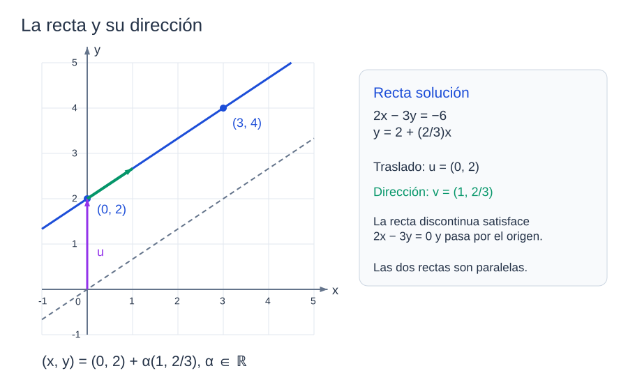
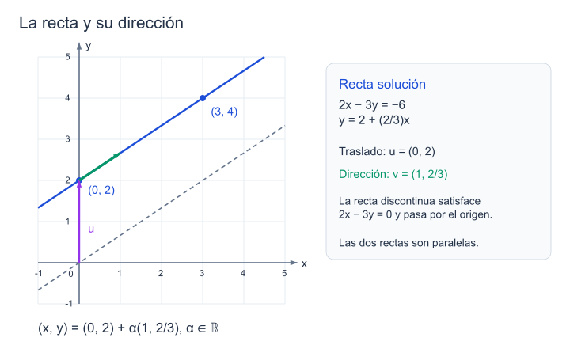
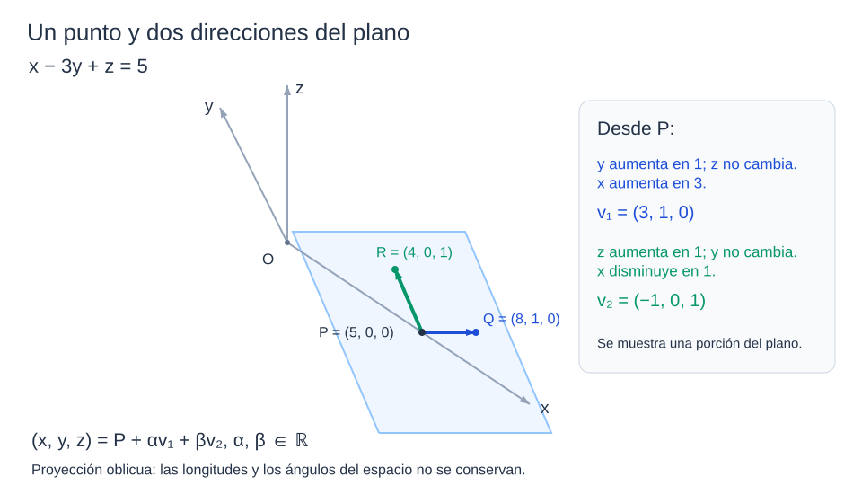
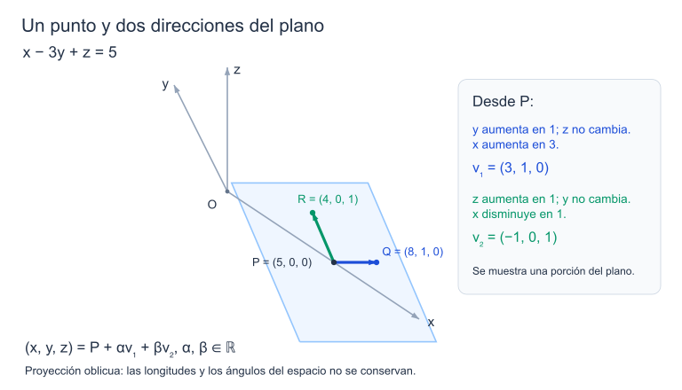
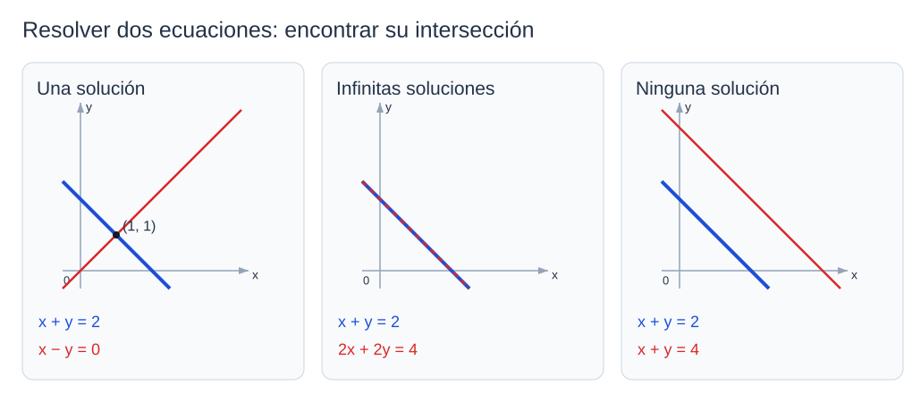

```dataviewjs
await dv.view("Planes/Estudio/Scripts/study-session", { location: "start" })
```

# Sistemas de ecuaciones lineales

Los pares $(0,2)$ y $(3,4)$ satisfacen $2x-3y=-6$:

$$
2\cdot0-3\cdot2=-6,\qquad 2\cdot3-3\cdot4=-6.
$$

Si añadimos la ecuación $x+y=2$, sólo el primero de esos dos pares sigue siendo solución. Para resolver el sistema tendremos que encontrar **todos** los pares que cumplan ambas ecuaciones, no resolver cada una con valores distintos de las incógnitas.[^a8-sistemas]

## Ecuaciones lineales

### Definición y coeficientes

En $3x+5y=-1$, los números $3$, $5$ y $-1$ son datos; buscamos valores de $x$ e $y$ que hagan cierta la igualdad. La expresión es lineal porque las incógnitas sólo intervienen mediante sus múltiplos $3x$ y $5y$, sumados entre sí.

> [!definicion] Ecuación lineal
> Una ecuación lineal en $x_1,\ldots,x_n$ tiene la forma
>
> $$
> \boxed{a_1x_1+\cdots+a_nx_n=b}.
> $$
>
> Los coeficientes $a_1,\ldots,a_n$ y el término independiente $b$ pertenecen a un cuerpo $K$, aquí $\mathbb R$ o $\mathbb C$. Las soluciones se buscan en ese mismo cuerpo.[^a8-ecuaciones]

#### Ejemplo: reconocer los coeficientes

En la ecuación

$$
3x+5y=-1,
$$

los coeficientes de $x$ e $y$ son $3$ y $5$, y el término independiente es $-1$. Del mismo modo,

$$
-2x_1+x_2-7x_3-x_4=5
$$

tiene cuatro incógnitas, con coeficientes $-2,1,-7,-1$. El coeficiente de $x_2$ es $1$, aunque no se escriba; el de $x_4$ es $-1$.

Las expresiones

$$
3x^2-y=8
$$

y

$$
x-3y-5xz=0
$$

no son [[Matemáticas/Álgebra/Sistemas de ecuaciones lineales|ecuaciones lineales]] en sus incógnitas: en la primera aparece $x^2$ y en la segunda, el producto $xz$.

```anki
deck: Matemáticas::Álgebra lineal::Sistemas lineales
tags:
  - sistemas-lineales
  - ecuacion-lineal
---
> [!note] Pregunta
> ¿Qué forma tiene una ecuación lineal en $x_1,\ldots,x_n$ y qué representan sus coeficientes?
===
> [!important] Respuesta
> $a_1x_1+\cdots+a_nx_n=b$, con $a_i,b\in K$ conocidos. Cada $a_i$ multiplica a una incógnita; $b$ es el término independiente. No aparecen productos ni potencias superiores de incógnitas.
```

### Ecuación homogénea

> [!definicion] Ecuación lineal homogénea
> Una [[#Definición y coeficientes|ecuación lineal]] es **homogénea** cuando su término independiente es cero:
>
> $$
> a_1x_1+\cdots+a_nx_n=0.
> $$

#### Ejemplo: un coeficiente irracional

La ecuación

$$
\frac14x+\sqrt2\,y-z=0
$$

es lineal y homogénea. Sus coeficientes son $\frac14$, $\sqrt2$ y $-1$, todos números reales conocidos. El cero del segundo miembro es lo que hace que sea homogénea.[^a8-ecuaciones]

```anki
deck: Matemáticas::Álgebra lineal::Sistemas lineales
tags:
  - sistemas-lineales
  - homogeneidad
---
> [!note] Pregunta
> ¿Cuándo es homogénea una ecuación lineal?
===
> [!important] Respuesta
> Cuando su término independiente es cero: $a_1x_1+\cdots+a_nx_n=0$.
```

## Geometría de una ecuación

### Ejemplo: una recta en el plano

Para describir todas las soluciones reales de

$$
2x-3y=-6,
$$

despejamos $y$:

$$
y=2+\frac23x.
$$

Podemos elegir $x$; el valor de $y$ se obtiene sustituyendo esa elección. Con $x=0$ sale $y=2$ y, con $x=3$, sale $y=4$. Para reunir todas las elecciones en una expresión, escribimos $x=\alpha$:

$$
(x,y)=\left(\alpha,2+\frac23\alpha\right),
\qquad \alpha\in\mathbb R.
$$

> [!definicion] Parámetro libre
> Un parámetro libre es una variable auxiliar que puede recorrer todo el dominio indicado. En esta expresión, $\alpha$ recorre $\mathbb R$; una vez elegido, determina el par solución.

```anki
deck: Matemáticas::Álgebra lineal::Sistemas lineales
tags:
  - sistemas-lineales
  - parametros
---
> [!note] Pregunta
> ¿Qué significa que un parámetro sea libre en una descripción de las soluciones de un sistema?
===
> [!important] Respuesta
> Que puede elegirse arbitrariamente en el dominio indicado, con independencia de los otros parámetros libres.
```

Para interpretar la expresión como una recta, separamos la parte constante de la que multiplica a $\alpha$:

$$
\boxed{(x,y)=(0,2)+\alpha\left(1,\frac23\right)},
\qquad \alpha\in\mathbb R.
$$

Con $\alpha=0$ obtenemos el punto $(0,2)$. Si aumentamos $\alpha$ en una unidad, $x$ aumenta en $1$ e $y$ en $\frac23$; ése es el desplazamiento que recoge el **vector director** $\left(1,\frac23\right)$.

> [!definicion] Vector director de una recta
> Un vector no nulo $v$ es director de una recta si, fijado un punto $P$ de ella, todos sus puntos se describen mediante $P+\alpha v$, con $\alpha\in\mathbb R$.



*La recta azul reúne las soluciones. La recta discontinua pasa por el origen y tiene la misma dirección; aparecerá de nuevo al estudiar el [[#Sistema homogéneo asociado|homogéneo asociado]].* [[Física/Grado/1º/Álgebra Lineal y Geometría Analítica/01 Matrices y sistemas/assets/05-recta-y-homogenea.excalidraw|Dibujo editable]].

Al sustituir en la ecuación original,

$$
2\alpha-3\left(2+\frac23\alpha\right)=-6.
$$

La expresión produce soluciones para cualquier $\alpha\in\mathbb R$. Recíprocamente, cualquier solución tiene un valor de $x$ que podemos tomar como $\alpha$; el despeje obliga entonces a que $y=2+\frac23\alpha$. No queda ninguna solución fuera de la parametrización.[^a8-geometria]

```anki
deck: Matemáticas::Álgebra lineal::Sistemas lineales
tags:
  - sistemas-lineales
  - geometria
---
> [!note] Pregunta
> En $(x,y)=(0,2)+\alpha(1,2/3)$, ¿qué representa el vector que multiplica a $\alpha$?
===
> [!important] Respuesta
> Es un vector director: al aumentar $\alpha$ en $1$, el punto se desplaza $(1,2/3)$. La recta pasa por $(0,2)$.
>
> 
```

### Ejemplo: un plano en el espacio

Despejamos $x$ en

$$
x-3y+z=5:
$$

$$
x=5+3y-z.
$$

Podemos elegir $y$ y $z$ de manera independiente. Si $y=\alpha$ y $z=\beta$, obtenemos

$$
(x,y,z)=(5+3\alpha-\beta,\alpha,\beta).
$$

Para obtener un punto del plano, fijamos ambos parámetros en cero:

$$
P=(5,0,0).
$$

Ahora dejamos $z=0$ y aumentamos $y$ de $0$ a $1$. La ecuación obliga a que $x$ pase de $5$ a $8$. El desplazamiento desde $P$ es

$$
(8,1,0)-(5,0,0)=(3,1,0).
$$

Si mantenemos $y=0$ y aumentamos $z$ de $0$ a $1$, $x$ pasa de $5$ a $4$. Obtenemos otra dirección:

$$
(4,0,1)-(5,0,0)=(-1,0,1).
$$

Reuniendo el punto y ambos desplazamientos,

$$
\boxed{(x,y,z)=(5,0,0)+\alpha(3,1,0)+\beta(-1,0,1)},
\qquad \alpha,\beta\in\mathbb R.
$$

Las dos direcciones no son múltiplos entre sí: la primera cambia la coordenada $y$ sin cambiar $z$ y la segunda cambia $z$ sin cambiar $y$. Al variar los dos parámetros recorremos el plano.



*Se muestra una porción del plano y las flechas representan los cambios calculados. Es una proyección oblicua: las longitudes y los ángulos del espacio no se conservan en el dibujo.* [[Física/Grado/1º/Álgebra Lineal y Geometría Analítica/01 Matrices y sistemas/assets/05-plano-parametrico.excalidraw|Dibujo editable]].

La sustitución comprueba que cualquier elección de $\alpha$ y $\beta$ da una solución:

$$
(5+3\alpha-\beta)-3\alpha+\beta=5.
$$

Además, cualquier punto que satisfaga la ecuación tiene ciertos valores de $y$ y $z$; tomándolos como $\alpha$ y $\beta$, el despeje recupera su coordenada $x$.[^a8-geometria]

```anki
deck: Matemáticas::Álgebra lineal::Sistemas lineales
tags:
  - sistemas-lineales
  - geometria
---
> [!note] Pregunta
> ¿Cómo se obtienen las dos direcciones de $(5,0,0)+\alpha(3,1,0)+\beta(-1,0,1)$ a partir de $x=5+3y-z$?
===
> [!important] Respuesta
> Al aumentar $y$ en $1$ y fijar $z$, $x$ aumenta en $3$: dirección $(3,1,0)$. Al aumentar $z$ en $1$ y fijar $y$, $x$ disminuye en $1$: dirección $(-1,0,1)$.
>
> 
```

> [!recuerda] Cuándo aparecen una recta y un plano
> Sobre $\mathbb R$, una [[#Definición y coeficientes|ecuación lineal]] en dos incógnitas representa una recta si sus coeficientes no son ambos cero. En tres incógnitas representa un plano si al menos un coeficiente es distinto de cero.[^a8-geometria]

> [!advertencia] Cuando todos los coeficientes son cero
> La ecuación se reduce a $0=b$. Si $b=0$, cualquier tupla del dominio es solución; si $b\ne0$, no hay ninguna. En esos casos, la ecuación no representa una recta ni un plano.

```anki
deck: Matemáticas::Álgebra lineal::Sistemas lineales
tags:
  - sistemas-lineales
  - geometria
---
> [!note] Pregunta
> ¿Qué representan una ecuación lineal real en dos incógnitas y otra en tres, si sus coeficientes no son todos cero?
===
> [!important] Respuesta
> Una recta en $\mathbb R^2$ y un plano en $\mathbb R^3$, respectivamente.
```

```anki
deck: Matemáticas::Álgebra lineal::Sistemas lineales
tags:
  - sistemas-lineales
  - ecuacion-lineal
---
> [!note] Pregunta
> ¿Qué soluciones tiene $a_1x_1+\cdots+a_nx_n=b$ cuando todos los coeficientes $a_i$ son cero?
===
> [!important] Respuesta
> Si $b=0$, todas las tuplas de $K^n$; si $b\ne0$, ninguna. La ecuación se reduce a $0=b$.
```

## Sistemas, soluciones y equivalencia

### Sistema de ecuaciones lineales

Un [[Matemáticas/Álgebra/Sistemas de ecuaciones lineales|sistema lineal]] exige que las mismas incógnitas cumplan varias ecuaciones. El número de ecuaciones no tiene por qué coincidir con el de incógnitas.

> [!definicion] Sistema lineal
> Un sistema de $m$ [[Matemáticas/Álgebra/Sistemas de ecuaciones lineales|ecuaciones lineales]] en $n$ incógnitas tiene la forma
>
> $$
> \sum_{j=1}^{n}a_{ij}x_j=b_i,
> \qquad \forall i\in\{1,\ldots,m\}.
> $$
>
> El coeficiente $a_{ij}\in K$ multiplica a $x_j$ en la ecuación $i$, y $b_i\in K$ es su término independiente.[^a8-sistemas]

```anki
deck: Matemáticas::Álgebra lineal::Sistemas lineales
tags:
  - sistemas-lineales
  - definición
---
> [!note] Pregunta
> ¿Qué es un sistema de ecuaciones lineales?
===
> [!important] Respuesta
> Un conjunto de ecuaciones lineales que deben cumplirse simultáneamente con los mismos valores de las incógnitas.
```

#### Ejemplo: cinco ecuaciones y cuatro incógnitas

$$
\begin{cases}
2x_1-7x_2+6x_3+x_4=1,\\
x_1+x_2-5x_3-3x_4=0,\\
-3x_1-3x_2-3x_3+x_4=-2,\\
-5x_1+4x_2+9x_3+8x_4=-1,\\
-6x_1+3x_2-4x_3+3x_4=-3.
\end{cases}
$$

Aquí $m=5$ y $n=4$. Por ejemplo, $a_{23}=-5$ es el coeficiente de $x_3$ en la segunda ecuación.

#### Ejemplo: incógnitas que no aparecen en una ecuación

$$
\begin{cases}
2x_1-x_2+2x_3+x_4=0,\\
5x_2-x_3-\sqrt5\,x_4=-6,\\
x_1+3x_2+2x_4=-1.
\end{cases}
$$

Hay tres ecuaciones y cuatro incógnitas. La ausencia de $x_1$ en la segunda ecuación significa que $a_{21}=0$; la ausencia de $x_3$ en la tercera significa que $a_{33}=0$. Esos ceros deben conservarse al escribir la [[#Matriz de coeficientes y columnas del sistema|matriz de coeficientes]].

#### Ejemplo: dos ecuaciones y dos incógnitas

$$
\begin{cases}
2x-4y=-1,\\
3x+y=0.
\end{cases}
$$

De la segunda ecuación obtenemos $y=-3x$. Al sustituir en la primera,

$$
2x-4(-3x)=14x=-1,
$$

por lo que $x=-\frac1{14}$ e $y=\frac3{14}$. El mismo par satisface las dos ecuaciones:

$$
2\left(-\frac1{14}\right)-4\left(\frac3{14}\right)=-1,
\qquad
3\left(-\frac1{14}\right)+\frac3{14}=0.
$$

```anki
deck: Matemáticas::Álgebra lineal::Sistemas lineales
tags:
  - sistemas-lineales
  - coeficientes
---
> [!note] Pregunta
> En un sistema de $m$ ecuaciones y $n$ incógnitas, ¿qué representa $a_{ij}$? ¿Qué valor tiene si $x_j$ no aparece en la ecuación $i$?
===
> [!important] Respuesta
> Es el coeficiente de $x_j$ en la ecuación $i$. Si esa incógnita no aparece, $a_{ij}=0$.
```

### Solución de un sistema

> [!definicion] Solución
> Una solución de un sistema de $n$ incógnitas sobre $K$ es una tupla ordenada $(s_1,\ldots,s_n)\in K^n$ que, al sustituir $x_j=s_j$, satisface **todas sus ecuaciones**.[^a8-soluciones]

#### Ejemplo: comprobar una tupla

Para la ecuación

$$
5x_1-x_2+2x_3-x_4=8,
$$

las sustituciones dan:

| Tupla | Valor del primer miembro | ¿Es solución? |
|---|---|---|
| $(1,0,1,-1)$ | $5-0+2+1=8$ | Sí |
| $(3,6,-2,-3)$ | $15-6-4+3=8$ | Sí |
| $(3,6,-2,0)$ | $15-6-4=5$ | No |

```anki
deck: Matemáticas::Álgebra lineal::Sistemas lineales
tags:
  - sistemas-lineales
  - soluciones
---
> [!note] Pregunta
> ¿Qué hay que comprobar para afirmar que una tupla es solución de un sistema?
===
> [!important] Respuesta
> Que sus coordenadas, sustituidas en el orden de las incógnitas, satisfacen todas las ecuaciones del sistema.
```

### Conjunto solución y cuerpo de resolución

> [!definicion] Conjunto solución
> El conjunto solución de un sistema $S$, denotado $\operatorname{Sol}(S)$, reúne todas sus soluciones en $K^n$. **Resolver el sistema** significa determinar ese conjunto.[^a8-soluciones]

La tupla $(0,2)$ satisface $2x-3y=-6$, pero dar sólo esa tupla dejaría fuera otras soluciones, como $(3,4)$. La descripción completa conserva el parámetro:

$$
\operatorname{Sol}(2x-3y=-6)
=\left\{(0,2)+\alpha\left(1,\frac23\right):\alpha\in K\right\}.
$$

Si $K=\mathbb R$, el parámetro recorre los reales y obtenemos la recta dibujada. Si $K=\mathbb C$, también se permiten valores complejos: con $\alpha=i$ sale la solución $\left(i,2+\frac23i\right)$. La figura en el plano real no representa esas soluciones complejas.

En los ejemplos numéricos siguientes buscamos soluciones reales, salvo que se indique otro cuerpo.

```anki
deck: Matemáticas::Álgebra lineal::Sistemas lineales
tags:
  - sistemas-lineales
  - conjunto-solucion
---
> [!note] Pregunta
> ¿Qué significa determinar el conjunto solución de un sistema sobre $K$?
===
> [!important] Respuesta
> Describir todas las tuplas de $K^n$ que satisfacen el sistema, y ninguna que no lo satisfaga; no basta con encontrar una solución particular.
```

```anki
deck: Matemáticas::Álgebra lineal::Sistemas lineales
tags:
  - sistemas-lineales
  - cuerpo-de-resolucion
---
> [!note] Pregunta
> ¿Qué determina el cuerpo $K$ al resolver un sistema sobre $K$?
===
> [!important] Respuesta
> Los valores admitidos para las incógnitas y los parámetros. Resolver sobre $\mathbb R$ excluye coordenadas no reales; resolver sobre $\mathbb C$ las permite.
```

### Sistemas equivalentes

> [!definicion] Equivalencia de sistemas
> Dos sistemas en las mismas incógnitas son equivalentes sobre $K$ si tienen el mismo [[#Conjunto solución y cuerpo de resolución|conjunto solución]] en $K^n$.[^a8-soluciones]

Por ejemplo, $2x-3y=-6$ e $y=2+\frac23x$ son expresiones equivalentes de la misma ecuación: el despeje permite pasar de una a otra sin perder ni añadir soluciones.

```anki
deck: Matemáticas::Álgebra lineal::Sistemas lineales
tags:
  - sistemas-lineales
  - equivalencia
---
> [!note] Pregunta
> ¿Cuándo son equivalentes dos sistemas sobre el mismo cuerpo y en las mismas incógnitas?
===
> [!important] Respuesta
> Cuando tienen exactamente el mismo conjunto solución.
```

### Sistema homogéneo y solución nula

> [!definicion] Sistema homogéneo
> Un sistema lineal es homogéneo cuando **todos** sus términos independientes son cero.[^a8-soluciones]

#### Ejemplo: comprobar todas las ecuaciones

Consideremos

$$
\begin{cases}
2x+y-4z=0,\\
x+2y+z=0.
\end{cases}
$$

La tupla $(3,-2,1)$ es solución, pues

$$
2(3)-2-4(1)=0,
\qquad 3+2(-2)+1=0.
$$

En cambio, $(1,2,1)$ satisface la primera ecuación, pero en la segunda da $1+4+1=6$. Por ello no es solución del sistema.

```anki
deck: Matemáticas::Álgebra lineal::Sistemas lineales
tags:
  - sistemas-lineales
  - homogeneidad
---
> [!note] Pregunta
> ¿Qué condición define un sistema homogéneo?
===
> [!important] Respuesta
> Todos sus términos independientes son cero; en forma matricial, $AX=0$.
```

También $(0,0,0)$ satisface ambas ecuaciones. En cualquier sistema homogéneo, cada producto $a_{ij}\cdot0$ vale cero; por eso la sustitución de todas las incógnitas por cero satisface todas las ecuaciones.

> [!definicion] Solución nula o trivial
> Es la solución cuyas [[Matemáticas/Geometría/Geometría analítica/Coordenada cartesiana|coordenadas]] son todas cero: $0\in K^n$. Todo sistema lineal homogéneo la admite.


```anki
deck: Matemáticas::Álgebra lineal::Sistemas lineales
tags:
  - sistemas-lineales
  - solucion-nula
---
> [!note] Pregunta
> ¿Por qué un sistema lineal homogéneo siempre tiene solución?
===
> [!important] Respuesta
> La solución nula, con todas las incógnitas iguales a cero, satisface cada ecuación: todos sus términos se anulan.
```

### Interpretación geométrica del conjunto solución

Un par que satisface dos ecuaciones de rectas pertenece a ambas. Por tanto, el [[#Conjunto solución y cuerpo de resolución|conjunto solución]] es su **intersección**. Dos rectas distintas que se cortan tienen una solución común; si coinciden, comparten toda la recta; si son paralelas distintas, no comparten ningún punto.



*Cada panel exige satisfacer las dos ecuaciones a la vez.* [[Física/Grado/1º/Álgebra Lineal y Geometría Analítica/01 Matrices y sistemas/assets/05-intersecciones-rectas.excalidraw|Dibujo editable]].

En $\mathbb R^3$ se aplica el mismo razonamiento a los planos: buscamos los puntos que pertenecen a todos. Dos planos coincidentes comparten un plano y dos planos secantes comparten una recta; un tercer plano puede cortar esa recta en un solo punto. Si las condiciones son incompatibles, la intersección es vacía.

> [!recuerda] Ecuaciones que representan rectas o planos
> Esta interpretación supone que cada ecuación tiene algún coeficiente no nulo. Si todos son cero, hay que estudiar directamente $0=b$.[^a8-geometria]

```anki
deck: Matemáticas::Álgebra lineal::Sistemas lineales
tags:
  - sistemas-lineales
  - geometria
---
> [!note] Pregunta
> ¿Cómo se interpreta geométricamente la solución de un sistema de ecuaciones de rectas o de planos?
===
> [!important] Respuesta
> Como la intersección de todas las rectas o de todos los planos: los puntos que pertenecen simultáneamente a cada uno.
```

## Forma matricial

### Matriz de coeficientes y columnas del sistema

Al conservar el orden de las ecuaciones y de las incógnitas, los coeficientes forman una [[Matemáticas/Álgebra lineal/Matrices|matriz]].

> [!definicion] Matriz de coeficientes
> La matriz de coeficientes —también llamada **matriz simple**— de un sistema de $m$ ecuaciones y $n$ incógnitas es
>
> $$
> A=(a_{ij})\in M_{m\times n}(K).
> $$
>
> La fila $i$ contiene los coeficientes de la ecuación $i$, incluidos los ceros.[^a8-matriz]

```anki
deck: Matemáticas::Álgebra lineal::Sistemas lineales
tags:
  - sistemas-lineales
  - matriz-coeficientes
---
> [!note] Pregunta
> ¿Cómo se construye la matriz de coeficientes de un sistema de $m$ ecuaciones y $n$ incógnitas?
===
> [!important] Respuesta
> Se coloca en la fila $i$ el coeficiente de cada incógnita de la ecuación $i$, respetando su orden e incluyendo los ceros. Su tamaño es $m\times n$.
```

Las incógnitas se agrupan en la columna

$$
X=\begin{pmatrix}x_1\\\vdots\\x_n\end{pmatrix}\in M_{n\times1}(K),
$$

y los términos independientes, en

$$
B=\begin{pmatrix}b_1\\\vdots\\b_m\end{pmatrix}\in M_{m\times1}(K).
$$

Al multiplicar la fila $i$ de $A$ por la columna $X$, obtenemos

$$
(AX)_{i1}=a_{i1}x_1+\cdots+a_{in}x_n,
\qquad \forall i\in\{1,\ldots,m\}.
$$

Exigir que esta entrada sea $b_i$ en cada fila equivale a exigir todas las ecuaciones del sistema:

> [!formula] Ecuación matricial del sistema
> $$
> \boxed{A_{m\times n}X_{n\times1}=B_{m\times1}}.
> $$

Los subíndices indican los tamaños. El producto tiene $m$ filas, una por ecuación.

```anki
deck: Matemáticas::Álgebra lineal::Sistemas lineales
tags:
  - sistemas-lineales
  - forma-matricial
---
> [!note] Pregunta
> ¿Qué representan $A$, $X$ y $B$ en $AX=B$ para un sistema de $m$ ecuaciones y $n$ incógnitas?
===
> [!important] Respuesta
> $A$ es la matriz de coeficientes ($m\times n$); $X$, la columna de incógnitas ($n\times1$); $B$, la columna de términos independientes ($m\times1$).
```

### Matriz ampliada

> [!definicion] Matriz ampliada
> La [[Matemáticas/Álgebra lineal/Matriz ampliada|matriz ampliada]] se obtiene añadiendo a $A$ la columna $B$:
>
> $$
> [A\mid B]\in M_{m\times(n+1)}(K).
> $$
>
> La barra separa los coeficientes de los términos independientes.[^a8-matriz]

#### Ejemplo: escribir la matriz ampliada

El sistema

$$
\begin{cases}
x-y+2z=1,\\
-2x+3y-3z=-1,\\
-3x+4y-4z=1
\end{cases}
$$

se representa mediante

$$
[A\mid B]=
\left[\begin{array}{ccc|c}
1&-1&2&1\\
-2&3&-3&-1\\
-3&4&-4&1
\end{array}\right].
$$

```anki
deck: Matemáticas::Álgebra lineal::Sistemas lineales
tags:
  - sistemas-lineales
  - matriz-ampliada
---
> [!note] Pregunta
> ¿Qué contiene la matriz ampliada $[A\mid B]$ y qué tamaño tiene si el sistema tiene $m$ ecuaciones y $n$ incógnitas?
===
> [!important] Respuesta
> Contiene los coeficientes y, como última columna, los términos independientes. Tiene tamaño $m\times(n+1)$.
```

### Ejemplo: verificar una solución mediante un producto

Queremos comprobar si $(1,0,-1,2)$ resuelve el sistema

$$
\begin{cases}
x_1+2x_3-x_4=-3,\\
-x_1+3x_2-x_3+x_4=2,\\
2x_1+3x_2+6x_3=-4.
\end{cases}
$$

Multiplicamos la [[#Matriz de coeficientes y columnas del sistema|matriz de coeficientes]] por la columna propuesta:

$$
\begin{pmatrix}
1&0&2&-1\\
-1&3&-1&1\\
2&3&6&0
\end{pmatrix}
\begin{pmatrix}1\\0\\-1\\2\end{pmatrix}
=
\begin{pmatrix}1-2-2\\-1+1+2\\2-6\end{pmatrix}
=
\begin{pmatrix}-3\\2\\-4\end{pmatrix}.
$$

El resultado coincide con $B$, por lo que la tupla satisface las tres ecuaciones.[^a8-matriz]

### Identificación de vectores con columnas

Al escribir $u=(u_1,\ldots,u_n)\in K^n$, se enumeran sus [[Matemáticas/Geometría/Geometría analítica/Coordenada cartesiana|coordenadas]]. Para calcular $Au$, se representa ese vector mediante una columna:

$$
u=(u_1,\ldots,u_n)
\quad\longleftrightarrow\quad
\begin{pmatrix}u_1\\\vdots\\u_n\end{pmatrix}.
$$

Con esta convención,

$$
\operatorname{Sol}(AX=B)=\{u\in K^n:Au=B\}.
$$

En un producto escrito explícitamente se usará la columna, o bien $(u_1,\ldots,u_n)^T$. Una [[Física/Grado/1º/Álgebra Lineal y Geometría Analítica/01 Matrices y sistemas/01 Matrices y operaciones#Matriz fila|matriz fila]] $1\times n$ es otro objeto y no puede sustituir a la columna $n\times1$ en ese producto.[^a10-columna]

```anki
deck: Matemáticas::Álgebra lineal::Sistemas lineales
tags:
  - sistemas-lineales
  - vectores-columna
---
> [!note] Pregunta
> Si $A$ tiene $n$ columnas, ¿cómo se representa un vector $u\in K^n$ al calcular $Au$?
===
> [!important] Respuesta
> Como una matriz columna de tamaño $n\times1$, con las coordenadas de $u$ en el orden correspondiente a las columnas de $A$.
```

## Operaciones equivalentes y algoritmos

### Operaciones que conservan las soluciones

Las [[Física/Grado/1º/Álgebra Lineal y Geometría Analítica/01 Matrices y sistemas/02 Eliminación y matrices elementales|operaciones elementales]] permiten simplificar las ecuaciones sin cambiar sus soluciones:

| Operación | Cómo se deshace |
|---|---|
| Intercambiar dos ecuaciones | Intercambiarlas otra vez |
| Multiplicar una ecuación por $\lambda\ne0$ | Multiplicarla por $1/\lambda$ |
| Reemplazar $R_i$ por $R_i+\lambda R_j$, con $i\ne j$ | Reemplazar $R_i$ por $R_i-\lambda R_j$; $R_j$ no cambia |

Por ejemplo, sustituir la segunda ecuación por la segunda menos tres veces la primera se deshace sumando tres veces esa primera ecuación, que no se ha modificado. Una solución del sistema inicial satisface la nueva ecuación; como podemos reconstruir la anterior, tampoco hemos añadido soluciones. Ésta es la razón de la equivalencia, demostrada para cada operación en [[Física/Grado/1º/Álgebra Lineal y Geometría Analítica/01 Matrices y sistemas/02 Eliminación y matrices elementales#Conservación de las soluciones|conservación de las soluciones]].[^a8-gauss]

> [!advertencia] La operación afecta a toda la fila
> Al operar en $[A\mid B]$, también se modifica el término independiente. Cambiar sólo los coeficientes produciría, en general, un sistema distinto.

```anki
deck: Matemáticas::Álgebra lineal::Sistemas lineales
tags:
  - sistemas-lineales
  - operaciones-elementales
---
> [!note] Pregunta
> ¿Por qué las operaciones elementales sobre las filas completas de una matriz ampliada conservan las soluciones?
===
> [!important] Respuesta
> Porque son operaciones reversibles sobre las ecuaciones: intercambio, escalado por un número no nulo y suma de un múltiplo de otra ecuación. Se aplican también al término independiente.
```

```anki
deck: Matemáticas::Álgebra lineal::Sistemas lineales
tags:
  - sistemas-lineales
  - operaciones-elementales
---
> [!note] Pregunta
> ¿Cómo se deshace el intercambio de dos ecuaciones de un sistema?
===
> [!important] Respuesta
> Intercambiando de nuevo esas mismas ecuaciones.
```

```anki
deck: Matemáticas::Álgebra lineal::Sistemas lineales
tags:
  - sistemas-lineales
  - operaciones-elementales
---
> [!note] Pregunta
> ¿Cómo se deshace la multiplicación de una ecuación por un escalar $\lambda\ne0$?
===
> [!important] Respuesta
> Multiplicando la ecuación completa por $1/\lambda$, incluido el término independiente.
```

```anki
deck: Matemáticas::Álgebra lineal::Sistemas lineales
tags:
  - sistemas-lineales
  - operaciones-elementales
---
> [!note] Pregunta
> ¿Cómo se deshace $R_i\leftarrow R_i+\lambda R_j$, con $i\ne j$?
===
> [!important] Respuesta
> Mediante $R_i\leftarrow R_i-\lambda R_j$. La fila $R_j$ permanece sin modificar.
```

### Eliminación de Gauss y de Gauss–Jordan

La [[Matemáticas/Álgebra lineal/Eliminación de Gauss|eliminación de Gauss]] obtiene una [[Matemáticas/Álgebra lineal/Forma escalonada|forma escalonada]]: cada [[Física/Grado/1º/Álgebra Lineal y Geometría Analítica/01 Matrices y sistemas/02 Eliminación y matrices elementales#Pivote|pivote]] está a la derecha del anterior y tiene ceros debajo. Si el sistema es compatible, se resuelve desde la última ecuación no nula hacia arriba, por **[[Física/Grado/1º/Álgebra Lineal y Geometría Analítica/01 Matrices y sistemas/02 Eliminación y matrices elementales#Sustitución hacia atrás|sustitución regresiva]]**.

La [[Matemáticas/Álgebra lineal/Eliminación de Gauss-Jordan|eliminación de Gauss–Jordan]] continúa hasta la [[Matemáticas/Álgebra lineal/Forma escalonada reducida|forma escalonada reducida]]: cada [[Física/Grado/1º/Álgebra Lineal y Geometría Analítica/01 Matrices y sistemas/02 Eliminación y matrices elementales#Pivote|pivote]] vale $1$ y es el único elemento no nulo de su columna. Así se leen directamente las incógnitas básicas en función de las libres.[^a8-gauss]

```anki
deck: Matemáticas::Álgebra lineal::Sistemas lineales
tags:
  - sistemas-lineales
  - gauss
---
> [!note] Pregunta
> ¿Cómo se termina de resolver un sistema compatible después de la eliminación de Gauss?
===
> [!important] Respuesta
> Por sustitución regresiva: se empieza en la última ecuación no nula y se sustituyen los valores obtenidos en las ecuaciones superiores, conservando como parámetros las variables libres.
```

```anki
deck: Matemáticas::Álgebra lineal::Sistemas lineales
tags:
  - sistemas-lineales
  - gauss-jordan
---
> [!note] Pregunta
> ¿Qué reducción adicional realiza Gauss–Jordan respecto de Gauss?
===
> [!important] Respuesta
> Hace que cada pivote valga $1$ y anula también las entradas que tiene encima; obtiene la forma escalonada reducida.
```

### Filas imposibles: condiciones de compatibilidad

Una fila reducida

$$
\left[\begin{array}{ccc|c}0&\cdots&0&c\end{array}\right],
\qquad c\ne0,
$$

expresa la igualdad imposible $0=c$. ==Basta una fila así para que el sistema no tenga solución.== Si también el término independiente es cero, la fila expresa $0=0$ y no añade ninguna restricción.[^a9]

```anki
deck: Matemáticas::Álgebra lineal::Sistemas lineales
tags:
  - sistemas-lineales
  - compatibilidad
---
> [!note] Pregunta
> ¿Qué diferencia hay entre las filas reducidas $[0\ \cdots\ 0\mid c]$, con $c\ne0$, y $[0\ \cdots\ 0\mid0]$?
===
> [!important] Respuesta
> La primera expresa una contradicción y hace incompatible el sistema. La segunda expresa $0=0$ y no impone ninguna restricción.
```

### Variables básicas

> [!definicion] Variable básica
> Una incógnita es **básica** o **variable [[Física/Grado/1º/Álgebra Lineal y Geometría Analítica/01 Matrices y sistemas/02 Eliminación y matrices elementales#Pivote|pivote]]** si su columna de coeficientes contiene un pivote en la [[Matemáticas/Álgebra lineal/Forma escalonada|forma escalonada]].[^a9]

En una ecuación reducida como $x_1+2x_3=5$, con [[Física/Grado/1º/Álgebra Lineal y Geometría Analítica/01 Matrices y sistemas/02 Eliminación y matrices elementales#Pivote|pivote]] en la columna de $x_1$, despejamos $x_1=5-2x_3$. La variable básica se calcula a partir del valor asignado a la [[#Variables libres|variable libre]].

```anki
deck: Matemáticas::Álgebra lineal::Sistemas lineales
tags:
  - sistemas-lineales
  - variables-basicas
---
> [!note] Pregunta
> ¿Qué son las variables básicas de un sistema reducido?
===
> [!important] Respuesta
> Las incógnitas correspondientes a columnas de coeficientes con pivote; sus valores se obtienen a partir de los términos independientes y de las variables libres.
```

### Variables libres

> [!definicion] Variable libre
> Una incógnita es **libre** si su columna de coeficientes no contiene un [[Física/Grado/1º/Álgebra Lineal y Geometría Analítica/01 Matrices y sistemas/02 Eliminación y matrices elementales#Pivote|pivote]] en la [[Matemáticas/Álgebra lineal/Forma escalonada|forma escalonada]]. En un sistema compatible puede elegirse arbitrariamente en $K$.

En el ejemplo $x_1=5-2x_3$, la columna de $x_3$ no contiene [[Física/Grado/1º/Álgebra Lineal y Geometría Analítica/01 Matrices y sistemas/02 Eliminación y matrices elementales#Pivote|pivote]]. Elegir $x_3=t$ da $x_1=5-2t$; cada $t\in K$ produce una solución.

> [!recuerda] La última columna no es una incógnita
> Los parámetros se cuentan entre las columnas de $A$. La columna $B$ contiene los términos independientes.

```anki
deck: Matemáticas::Álgebra lineal::Sistemas lineales
tags:
  - sistemas-lineales
  - variables-libres
---
> [!note] Pregunta
> En un sistema compatible reducido, ¿cómo se identifican las variables libres?
===
> [!important] Respuesta
> Son las incógnitas cuyas columnas de coeficientes no tienen pivote. Se asigna un parámetro independiente a cada una.
```

## Ejemplo 1: solución única, por Gauss y Gauss–Jordan

Resolvamos el sistema[^a8-ej1]

$$
\begin{cases}
x_2+x_3-x_4=-7,\\
4x_1+x_2+2x_3-x_4=-7,\\
3x_1+x_3+x_4=1,\\
-5x_1+2x_2+2x_3-x_4=-5.
\end{cases}
$$

### Obtener un primer pivote igual a uno

Su [[Matemáticas/Álgebra lineal/Matriz ampliada|matriz ampliada]] es

$$
M_0=\left[\begin{array}{rrrr|r}
0&1&1&-1&-7\\
4&1&2&-1&-7\\
3&0&1&1&1\\
-5&2&2&-1&-5
\end{array}\right].
$$

La primera entrada es cero. Intercambiamos $R_1$ y $R_2$ y hacemos $R_1\leftarrow R_1-R_3$: como $4-3=1$, obtenemos un [[Física/Grado/1º/Álgebra Lineal y Geometría Analítica/01 Matrices y sistemas/02 Eliminación y matrices elementales#Pivote|pivote]] que permite eliminar sin fracciones.

$$
\left[\begin{array}{rrrr|r}
1&1&1&-2&-8\\
0&1&1&-1&-7\\
3&0&1&1&1\\
-5&2&2&-1&-5
\end{array}\right].
$$

### Anular las entradas inferiores

Aplicamos $R_3\leftarrow R_3-3R_1$ y $R_4\leftarrow R_4+5R_1$ para anular las entradas de la primera columna:

$$
\left[\begin{array}{rrrr|r}
1&1&1&-2&-8\\
0&1&1&-1&-7\\
0&-3&-2&7&25\\
0&7&7&-11&-45
\end{array}\right].
$$

En la segunda columna ya hay un [[Física/Grado/1º/Álgebra Lineal y Geometría Analítica/01 Matrices y sistemas/02 Eliminación y matrices elementales#Pivote|pivote]] igual a $1$. Hacemos

$$
R_3\leftarrow R_3+3R_2,
\qquad R_4\leftarrow R_4-7R_2.
$$

La última fila resulta $(0,0,0,-4\mid4)$. Al multiplicarla por $-\frac14$, queda la [[Matemáticas/Álgebra lineal/Forma escalonada|forma escalonada]]

$$
M_E=\left[\begin{array}{rrrr|r}
1&1&1&-2&-8\\
0&1&1&-1&-7\\
0&0&1&4&4\\
0&0&0&1&-1
\end{array}\right].
$$

### Resolver por sustitución regresiva

La última fila da $x_4=-1$. Sustituimos ese valor en la tercera ecuación, $x_3+4x_4=4$:

$$
x_3=4-4(-1)=8.
$$

La segunda ecuación, $x_2+x_3-x_4=-7$, permite calcular

$$
x_2=-7-8+(-1)=-16.
$$

Por último, de $x_1+x_2+x_3-2x_4=-8$ obtenemos

$$
x_1=-8-(-16)-8+2(-1)=-2.
$$

> [!ejemplo] Solución del sistema
> $$
> \boxed{(x_1,x_2,x_3,x_4)=(-2,-16,8,-1)}.
> $$
>
> Cada columna de coeficientes tiene un [[Física/Grado/1º/Álgebra Lineal y Geometría Analítica/01 Matrices y sistemas/02 Eliminación y matrices elementales#Pivote|pivote]]; no hay [[#Variables libres|variables libres]].

### Continuar con Gauss–Jordan

También podemos partir de $M_E$ y anular las entradas situadas encima de cada [[Física/Grado/1º/Álgebra Lineal y Geometría Analítica/01 Matrices y sistemas/02 Eliminación y matrices elementales#Pivote|pivote]]. Primero eliminamos las de la cuarta columna:

$$
R_3\leftarrow R_3-4R_4,
\quad R_2\leftarrow R_2+R_4,
\quad R_1\leftarrow R_1+2R_4.
$$

Resulta

$$
\left[\begin{array}{rrrr|r}
1&1&1&0&-10\\
0&1&1&0&-8\\
0&0&1&0&8\\
0&0&0&1&-1
\end{array}\right].
$$

Después, $R_2\leftarrow R_2-R_3$ y $R_1\leftarrow R_1-R_3$ anulan las entradas superiores de la tercera columna:

$$
\left[\begin{array}{rrrr|r}
1&1&0&0&-18\\
0&1&0&0&-16\\
0&0&1&0&8\\
0&0&0&1&-1
\end{array}\right].
$$

Por último, $R_1\leftarrow R_1-R_2$ da

$$
\left[\begin{array}{rrrr|r}
1&0&0&0&-2\\
0&1&0&0&-16\\
0&0&1&0&8\\
0&0&0&1&-1
\end{array}\right].
$$

Ahora la solución se lee directamente. Ambos métodos han conservado el mismo [[#Conjunto solución y cuerpo de resolución|conjunto solución]].

### Comprobar en el sistema original

Con $(-2,-16,8,-1)$, los cuatro primeros miembros valen

$$
\begin{aligned}
-16+8-(-1)&=-7,\\
4(-2)-16+2(8)-(-1)&=-7,\\
3(-2)+8-1&=1,\\
-5(-2)+2(-16)+2(8)-(-1)&=-5.
\end{aligned}
$$

Coinciden con los cuatro términos independientes.

## Ejemplo 2: dos variables libres

Resolvamos ahora[^a8-ej2]

$$
\begin{cases}
4x_1+9x_2-2x_3-5x_4-12x_5=-9,\\
5x_1+11x_2-3x_3-5x_4-10x_5=-10,\\
3x_1+7x_2-x_3-3x_4-8x_5=-6,\\
2x_1+3x_2-4x_3-6x_4-9x_5=-8.
\end{cases}
$$

### Reducir la primera columna

La ampliada inicial es

$$
M_0=\left[\begin{array}{rrrrr|r}
4&9&-2&-5&-12&-9\\
5&11&-3&-5&-10&-10\\
3&7&-1&-3&-8&-6\\
2&3&-4&-6&-9&-8
\end{array}\right].
$$

Con $R_1\leftarrow R_1-R_3$ obtenemos la primera fila $(1,2,-1,-2,-4\mid-3)$. Usamos ese [[Física/Grado/1º/Álgebra Lineal y Geometría Analítica/01 Matrices y sistemas/02 Eliminación y matrices elementales#Pivote|pivote]] para hacer

$$
R_2\leftarrow R_2-5R_1,
\quad R_3\leftarrow R_3-3R_1,
\quad R_4\leftarrow R_4-2R_1.
$$

Queda

$$
\left[\begin{array}{rrrrr|r}
1&2&-1&-2&-4&-3\\
0&1&2&5&10&5\\
0&1&2&3&4&3\\
0&-1&-2&-2&-1&-2
\end{array}\right].
$$

### Obtener la forma escalonada

Las operaciones $R_3\leftarrow R_3-R_2$ y $R_4\leftarrow R_4+R_2$ producen las filas

$$
R_3=(0,0,0,-2,-6\mid-2),
\qquad R_4=(0,0,0,3,9\mid3).
$$

Multiplicamos $R_3$ por $-\frac12$ y $R_4$ por $\frac13$. Las dos filas pasan a ser iguales; al hacer $R_4\leftarrow R_4-R_3$, la última se anula:

$$
M_E=\left[\begin{array}{rrrrr|r}
1&2&-1&-2&-4&-3\\
0&1&2&5&10&5\\
0&0&0&1&3&1\\
0&0&0&0&0&0
\end{array}\right].
$$

Los [[Física/Grado/1º/Álgebra Lineal y Geometría Analítica/01 Matrices y sistemas/02 Eliminación y matrices elementales#Pivote|pivotes]] están en las columnas **1, 2 y 4**: son las [[#Variables básicas|variables básicas]] $x_1,x_2,x_4$. Aunque queda una columna sin [[Física/Grado/1º/Álgebra Lineal y Geometría Analítica/01 Matrices y sistemas/02 Eliminación y matrices elementales#Pivote|pivote]] entre la segunda y la cuarta, la matriz está escalonada. Las [[#Variables libres|variables libres]] son $x_3$ y $x_5$.

La última fila expresa $0=0$, así que no aparece ninguna contradicción. Podemos elegir las dos [[#Variables libres|variables libres]] y calcular las tres básicas.

### Obtener la forma reducida

Hacemos $R_2\leftarrow R_2-5R_3$ y $R_1\leftarrow R_1+2R_3$:

$$
\left[\begin{array}{rrrrr|r}
1&2&-1&0&2&-1\\
0&1&2&0&-5&0\\
0&0&0&1&3&1\\
0&0&0&0&0&0
\end{array}\right].
$$

Con $R_1\leftarrow R_1-2R_2$ llegamos a

$$
M_R=\left[\begin{array}{rrrrr|r}
1&0&-5&0&12&-1\\
0&1&2&0&-5&0\\
0&0&0&1&3&1\\
0&0&0&0&0&0
\end{array}\right].
$$

### Expresar todas las soluciones

La primera fila de $M_R$ expresa $x_1-5x_3+12x_5=-1$. Despejamos las [[#Variables básicas|variables básicas]] en las tres filas no nulas:

$$
\begin{cases}
x_1=-1+5x_3-12x_5,\\
x_2=-2x_3+5x_5,\\
x_4=1-3x_5.
\end{cases}
$$

Elegimos $x_3=a$ y $x_5=b$, con $a,b\in\mathbb R$ independientes. Al colocar las cinco [[Matemáticas/Geometría/Geometría analítica/Coordenada cartesiana|coordenadas]] en su orden,

$$
(x_1,x_2,x_3,x_4,x_5)=(-1+5a-12b,-2a+5b,a,1-3b,b).
$$

Separando la parte constante y los coeficientes de cada parámetro,

> [!ejemplo] Solución del sistema
> $$
> \boxed{X=u+a v_1+b v_2},\qquad a,b\in\mathbb R,
> $$
>
> donde, representados por sus [[Matemáticas/Geometría/Geometría analítica/Coordenada cartesiana|coordenadas]],
>
> $$
> u=(-1,0,0,1,0),
> $$
>
> $$
> v_1=(5,-2,1,0,0),\qquad v_2=(-12,5,0,-3,1).
> $$

Al fijar $a=b=0$ obtenemos $u$. El vector $v_1$ reúne los coeficientes de $a$ en las cinco [[Matemáticas/Geometría/Geometría analítica/Coordenada cartesiana|coordenadas]] y $v_2$, los de $b$.

Comprobamos primero la parte constante en la matriz original:

$$
Au=
\begin{pmatrix}
4(-1)-5\\
5(-1)-5\\
3(-1)-3\\
2(-1)-6
\end{pmatrix}
=
\begin{pmatrix}-9\\-10\\-6\\-8\end{pmatrix}=B.
$$

Las direcciones no cambian el segundo miembro:

$$
Av_1=0,\qquad Av_2=0.
$$

Por la [[Física/Grado/1º/Álgebra Lineal y Geometría Analítica/01 Matrices y sistemas/01 Matrices y operaciones#Distributividad por la derecha|distributividad]] del [[Matemáticas/Álgebra lineal/Producto matricial|producto matricial]],

$$
A(u+a v_1+b v_2)=Au+aAv_1+bAv_2=B.
$$

Todas las elecciones de $a,b$ dan soluciones. Además, ninguna queda fuera de la parametrización: cualquier solución tiene ciertos valores de $x_3$ y $x_5$, y las otras tres [[Matemáticas/Geometría/Geometría analítica/Coordenada cartesiana|coordenadas]] quedan determinadas por las ecuaciones reducidas.

## Homogéneo asociado y solución general

### Sistema homogéneo asociado

En el ejemplo anterior, $Au=B$, mientras que $Av_1=Av_2=0$. Por eso cambiar los parámetros modifica la solución sin modificar $B$: los términos que añadimos desaparecen al multiplicar por $A$. El sistema que satisfacen esas direcciones conserva los coeficientes y tiene ceros en el segundo miembro.

> [!definicion] Sistema homogéneo asociado
> Al sistema $AX=B$ le corresponde el sistema homogéneo asociado
>
> $$
> AX=0.
> $$
>
> Se conserva la matriz $A$ y se sustituyen por cero todos los términos independientes.[^a10-general]

El homogéneo asociado siempre tiene la [[#Sistema homogéneo y solución nula|solución nula]], incluso si el sistema original es incompatible.

```anki
deck: Matemáticas::Álgebra lineal::Sistemas lineales
tags:
  - sistemas-lineales
  - homogeneo-asociado
---
> [!note] Pregunta
> ¿Cómo se obtiene el sistema homogéneo asociado a $AX=B$?
===
> [!important] Respuesta
> Se conserva $A$ y se sustituyen por cero todos los términos independientes: $AX=0$.
```

### Núcleo de una matriz

> [!definicion] Núcleo
> El [[Matemáticas/Álgebra lineal/Espacios vectoriales/07 Núcleo, imagen, rango y nulidad|núcleo]] de $A\in M_{m\times n}(K)$ es el conjunto de soluciones del [[#Sistema homogéneo y solución nula|sistema homogéneo]]:
>
> $$
> \ker(A)=\{v\in K^n:Av=0\}.
> $$

Los vectores $v_1$ y $v_2$ del ejemplo de cinco incógnitas pertenecen al [[Matemáticas/Álgebra lineal/Espacios vectoriales/07 Núcleo, imagen, rango y nulidad|núcleo]]. Cualquier combinación suya también satisface el homogéneo:

$$
A(a v_1+b v_2)=aAv_1+bAv_2=0.
$$

En general, sumar soluciones del homogéneo o multiplicarlas por escalares produce otra solución del homogéneo. Esta propiedad es la que permitirá describir el [[Matemáticas/Álgebra lineal/Espacios vectoriales/07 Núcleo, imagen, rango y nulidad|núcleo]] mediante unas direcciones generadoras.[^general]

```anki
deck: Matemáticas::Álgebra lineal::Sistemas lineales
tags:
  - sistemas-lineales
  - nucleo
---
> [!note] Pregunta
> ¿Qué vectores forman el núcleo de una matriz $A$?
===
> [!important] Respuesta
> Todos los vectores $v$ que satisfacen $Av=0$: las soluciones del sistema homogéneo asociado a $A$.
```

```anki
deck: Matemáticas::Álgebra lineal::Sistemas lineales
tags:
  - sistemas-lineales
  - nucleo
---
> [!note] Pregunta
> Si $Av=0$ y $Aw=0$, ¿por qué cualquier combinación $\alpha v+\beta w$ sigue en el núcleo?
===
> [!important] Respuesta
> Porque $A(\alpha v+\beta w)=\alpha Av+\beta Aw=0$, para cualesquiera $\alpha,\beta\in K$.
```

### Solución particular

> [!definicion] Solución particular
> Una solución particular de $AX=B$ es un vector concreto $u$ que cumple $Au=B$.[^a10-general]

En el ejemplo anterior, $u=(-1,0,0,1,0)$ se obtiene fijando ambos parámetros en cero. Elegir otros valores da otra solución particular, pero no cambia el conjunto completo de soluciones.

```anki
deck: Matemáticas::Álgebra lineal::Sistemas lineales
tags:
  - sistemas-lineales
  - solucion-particular
---
> [!note] Pregunta
> ¿Qué es una solución particular de $AX=B$?
===
> [!important] Respuesta
> Un vector concreto $u$ que satisface $Au=B$; es un elemento del conjunto solución.
```

### Solución general como particular más homogénea

#### Propiedad

> [!teorema] Descripción de todas las soluciones
> Sean $A\in M_{m\times n}(K)$ y $B\in K^m$. Si $u\in K^n$ satisface $Au=B$, entonces
>
> $$
> \boxed{\operatorname{Sol}(AX=B)=u+\ker(A)}.
> $$
>
> Aquí $u+\ker(A)=\{u+v:v\in\ker(A)\}$. Es el conjunto de todas las sumas de $u$ con soluciones del homogéneo.[^a10-general][^ist-sobreposicion][^general]

#### Demostración

> [!demostracion] Demostración
> **De una solución del homogéneo a otra del sistema original.** Fijamos la [[#Solución particular|solución particular]] $u$ y tomamos cualquier $v\in\ker(A)$. Sabemos que $Au=B$ y $Av=0$. La [[Física/Grado/1º/Álgebra Lineal y Geometría Analítica/01 Matrices y sistemas/01 Matrices y operaciones#Distributividad por la derecha|distributividad]] permite comprobar qué ocurre al sumarlos:
>
> $$
> A(u+v)=Au+Av=B+0=B.
> $$
>
> Por tanto, sumar a $u$ una solución del homogéneo produce otra solución del sistema original.
>
> **Por qué no falta ninguna solución.** Tomamos ahora cualquier solución $X\in K^n$ del sistema original. Queremos escribirla como $u+v$ con $Av=0$. La única elección posible es $v=X-u$; comprobamos que pertenece al [[Matemáticas/Álgebra lineal/Espacios vectoriales/07 Núcleo, imagen, rango y nulidad|núcleo]]:
>
> $$
> A(X-u)=AX-Au=B-B=0.
> $$
>
> Luego $v=X-u$ pertenece a $\ker(A)$, y $X=u+v$.
>
> Las dos implicaciones prueban la igualdad de conjuntos:
>
> $$
> \boxed{\operatorname{Sol}(AX=B)=u+\ker(A)}.\qquad\blacksquare
> $$

```anki
deck: Matemáticas::Álgebra lineal::Sistemas lineales
tags:
  - sistemas-lineales
  - solucion-general
---
> [!note] Pregunta
> Conocida una solución particular $u$ de $AX=B$, ¿cómo se obtienen todas las soluciones?
===
> [!important] Respuesta
> Sumando a $u$ cada solución del homogéneo: $\operatorname{Sol}(AX=B)=u+\ker(A)$. Si $X$ es cualquier solución, $A(X-u)=B-B=0$.
```

#### Ejemplo: trasladar la recta homogénea

Para $2x-3y=-6$, tomamos la particular $u=(0,2)$. El homogéneo $2x-3y=0$ tiene las soluciones

$$
v=\alpha\left(1,\frac23\right),\qquad \alpha\in\mathbb R.
$$

Al sumar $u$ a cada una, recuperamos $(x,y)=(0,2)+\alpha(1,2/3)$. Es el traslado de la recta discontinua a la azul en [[#Ejemplo: una recta en el plano|la figura inicial]]. El traslado lleva cada punto de la recta homogénea a otro de la recta solución; en particular, lleva el origen a $(0,2)$.

### Base del núcleo y parámetros

En el ejemplo de cinco incógnitas usamos dos direcciones para describir el homogéneo. Para que formen una base, deben producir todas sus soluciones sin que una de ellas pueda obtenerse combinando la otra.

> [!definicion] Independencia lineal de una familia
> Los vectores $v_1,\ldots,v_p\in K^n$ son [[Matemáticas/Álgebra lineal/Espacios vectoriales/04 Dependencia e independencia lineal|linealmente independientes]] si
>
> $$
> \alpha_1v_1+\cdots+\alpha_pv_p=0
> \quad\Longrightarrow\quad
> \alpha_1=\cdots=\alpha_p=0.
> $$
>
> Los coeficientes $\alpha_i$ pertenecen a $K$. La única combinación que da el vector nulo debe ser la que tiene todos sus coeficientes nulos.[^ist-bases]

```anki
deck: Matemáticas::Álgebra lineal::Sistemas lineales
tags:
  - sistemas-lineales
  - independencia-lineal
---
> [!note] Pregunta
> ¿Qué debe ocurrir con los coeficientes de una combinación nula para que $v_1,\ldots,v_p$ sean linealmente independientes?
===
> [!important] Respuesta
> La igualdad $\alpha_1v_1+\cdots+\alpha_pv_p=0$ debe implicar $\alpha_1=\cdots=\alpha_p=0$.
```

> [!definicion] Base del núcleo
> Una familia de vectores $v_1,\ldots,v_p\in\ker(A)$ es una **base del núcleo** si sus [[Matemáticas/Álgebra lineal/Espacios vectoriales/03 Combinaciones lineales y espacio generado|combinaciones lineales]] generan todas las soluciones de $Av=0$ y la familia es linealmente independiente.[^ist-bases]

En el ejemplo de cinco incógnitas, la tercera coordenada de $a v_1+b v_2$ es $a$ y la quinta es $b$. Para que la combinación sea nula deben anularse ambos parámetros: las dos direcciones son independientes. La reducción ya mostró además que producen todas las soluciones del homogéneo.

Con una base del núcleo, la solución general del sistema compatible se escribe

$$
X=u+\alpha_1v_1+\cdots+\alpha_pv_p,
\qquad \alpha_1,\ldots,\alpha_p\in K.
$$

Hay un parámetro independiente por vector de la base.

```anki
deck: Matemáticas::Álgebra lineal::Sistemas lineales
tags:
  - sistemas-lineales
  - base-del-nucleo
---
> [!note] Pregunta
> ¿Qué debe cumplir una familia de vectores para ser una base del núcleo de $A$?
===
> [!important] Respuesta
> Deben pertenecer al núcleo, generar todas las soluciones de $Av=0$ y ser linealmente independientes. Cada vector de la base aporta un parámetro independiente.
```

Cada columna sin pivote permite una elección libre. Si hay $n$ incógnitas y $r$ pivotes, quedan $n-r$ parámetros independientes. Las direcciones obtenidas al dar valor $1$ a una variable libre y $0$ a las restantes forman una base del núcleo: en las coordenadas libres, cada una tiene un $1$ en su posición y ceros en las otras. Es la relación entre [[Física/Grado/1º/Álgebra Lineal y Geometría Analítica/01 Matrices y sistemas/03 Compatibilidad, rango e inversa#Grado de indeterminación|rango y número de parámetros]].[^a9][^rango-nulidad]

```anki
deck: Matemáticas::Álgebra lineal::Sistemas lineales
tags:
  - sistemas-lineales
  - variables-libres
---
> [!note] Pregunta
> ¿Cuántos parámetros independientes tiene la solución general de un sistema compatible con $n$ incógnitas y rango $r$?
===
> [!important] Respuesta
> $n-r$, uno por cada variable libre. Si $r=n$, no hay parámetros y la solución es única.
```

Si no hay variables libres, el núcleo es $\{0\}$ y la solución particular es la única solución. En ese caso, la base del núcleo es la familia vacía: la suma sin sumandos da el vector nulo y no hacen falta direcciones adicionales.

```anki
deck: Matemáticas::Álgebra lineal::Sistemas lineales
tags:
  - sistemas-lineales
  - nucleo
---
> [!note] Pregunta
> Si $\ker(A)=\{0\}$ y $AX=B$ es compatible, ¿cuántas soluciones tiene?
===
> [!important] Respuesta
> Una: la solución particular $u$, porque $u+\ker(A)=\{u\}$. La base del núcleo es la familia vacía.
```

> [!advertencia] Condiciones de validez: existencia de una solución particular
> La expresión $u+\ker(A)$ requiere que el sistema sea compatible. Si no existe ninguna solución $u$, su conjunto solución es vacío; el homogéneo asociado sigue teniendo la solución nula.

### Ejemplo: del homogéneo al sistema con segundo miembro

Consideremos[^a10-ejemplo]

$$
H:\quad
\begin{cases}
x_1-2x_2-x_4=0,\\
-3x_1+4x_2-2x_3-x_4=0,\\
-x_1-2x_3-3x_4=0.
\end{cases}
$$

La [[#Matriz de coeficientes y columnas del sistema|matriz de coeficientes]] y su forma reducida son

$$
A=\begin{pmatrix}
1&-2&0&-1\\
-3&4&-2&-1\\
-1&0&-2&-3
\end{pmatrix},
$$

$$
R=\begin{pmatrix}
1&0&2&3\\
0&1&1&2\\
0&0&0&0
\end{pmatrix}.
$$

Para obtener $R$, anulamos la primera columna con $R_2\leftarrow R_2+3R_1$ y $R_3\leftarrow R_3+R_1$:

$$
\begin{pmatrix}
1&-2&0&-1\\
0&-2&-2&-4\\
0&-2&-2&-4
\end{pmatrix}.
$$

Las dos últimas filas son iguales. Hacemos $R_3\leftarrow R_3-R_2$ para anular la tercera y $R_2\leftarrow-\frac12R_2$ para normalizar el segundo [[Física/Grado/1º/Álgebra Lineal y Geometría Analítica/01 Matrices y sistemas/02 Eliminación y matrices elementales#Pivote|pivote]]. Finalmente, $R_1\leftarrow R_1+2R_2$ anula la entrada situada encima de él y da la matriz $R$.

Las ecuaciones no nulas son

$$
x_1=-2x_3-3x_4,
\qquad x_2=-x_3-2x_4.
$$

Tomando $x_3=\alpha$ y $x_4=\beta$,

$$
\operatorname{Sol}(H)=
\{\alpha(-2,-1,1,0)+\beta(-3,-2,0,1):\alpha,\beta\in\mathbb R\}.
$$

Las dos direcciones son independientes: en la tercera coordenada de su combinación aparece $\alpha$, y en la cuarta, $\beta$. Para que la combinación sea nula deben anularse ambos parámetros.

Ahora conservamos $A$ y tomamos

$$
B=\begin{pmatrix}1\\3\\5\end{pmatrix}.
$$

Busquemos una [[#Solución particular|solución particular]]. La primera ecuación da $x_1=1+2x_2+x_4$. Sustituyendo en la segunda obtenemos $x_2+x_3+2x_4=-3$.

Si fijamos $x_3=1$ y $x_4=0$, sale $x_2=-4$ y después $x_1=-7$. Nos queda comprobar la tercera ecuación. Con $u=(-7,-4,1,0)$, el producto completo da

$$
Au=\begin{pmatrix}-7+8\\21-16-2\\7-2\end{pmatrix}
=\begin{pmatrix}1\\3\\5\end{pmatrix}.
$$

Por la propiedad demostrada, todas las soluciones de $AX=B$ son

$$
\boxed{X=(-7,-4,1,0)+\alpha(-2,-1,1,0)+\beta(-3,-2,0,1)},
\qquad \alpha,\beta\in\mathbb R.
$$

El [[Matemáticas/Álgebra lineal/Rango de una matriz|rango]] de $A$ es $2$ y hay cuatro incógnitas. Cualquier segundo miembro compatible dará dos parámetros libres; si resulta incompatible, no habrá soluciones.

## Práctica graduada

### Ejercicio 1 — Justificar la solución general

Si $Au=B$ y $Av=0$, demuestra que $u+v$ es solución de $AX=B$ y que toda solución $X$ se escribe $u+(X-u)$, con $X-u$ en el [[Matemáticas/Álgebra lineal/Espacios vectoriales/07 Núcleo, imagen, rango y nulidad|núcleo]].

> [!resolucion]- Resolución
> La [[Física/Grado/1º/Álgebra Lineal y Geometría Analítica/01 Matrices y sistemas/01 Matrices y operaciones#Distributividad por la derecha|distributividad]] da $A(u+v)=Au+Av=B+0=B$.
>
> Recíprocamente, si $AX=B$, entonces $A(X-u)=AX-Au=B-B=0$. Así, $X-u\in\ker(A)$ y $X=u+(X-u)$. Se han probado ambas inclusiones del [[#Conjunto solución y cuerpo de resolución|conjunto solución]].

### Ejercicio 2 — Elegir otra solución

En el último ejemplo, toma $u=(-7,-4,1,0)$ y las dos direcciones del homogéneo. Escribe una solución distinta de $u$ y compruébala.

> [!resolucion]- Resolución
> Con $\alpha=1$ y $\beta=0$ resulta $X=(-9,-5,2,0)$. La sustitución da
>
> $$
> \begin{aligned}
> -9-2(-5)&=1,\\
> -3(-9)+4(-5)-2(2)&=3,\\
> -(-9)-2(2)&=5.
> \end{aligned}
> $$
>
> Los tres resultados coinciden con $B$, como garantiza la expresión particular más homogénea.

## 📚 Fuentes

### Material base aportado

[^a8-ecuaciones]: FCUL, *Álgebra Linear e Geometria Analítica*, aula 8, 02/10/2026, diapositivas 2–6. Archivo `ALGA-2026-27-AulasTeo-slides-Aula8-Sistemas-impressao.pdf`. Ecuación lineal, coeficientes, homogeneidad y ejemplos.
[^a8-geometria]: FCUL, aula 8, diapositivas 2–6 y 13–15. Mismo archivo. Rectas, planos y geometría de los conjuntos solución.
[^a8-sistemas]: FCUL, aula 8, diapositivas 7–10. Mismo archivo. Definición y ejemplos de sistemas.
[^a8-soluciones]: FCUL, aula 8, diapositivas 9–15. Mismo archivo. Soluciones, cuerpo de resolución y equivalencia.
[^a8-matriz]: FCUL, aula 8, diapositivas 16–20. Mismo archivo. Forma matricial, ampliada y comprobación de una solución.
[^a8-gauss]: FCUL, aula 8, diapositivas 21–23. Mismo archivo. Operaciones equivalentes y métodos de eliminación.
[^a8-ej1]: FCUL, aula 8, diapositivas 24–27. Mismo archivo. Sistema de cuatro incógnitas, reducciones de Gauss y Gauss–Jordan.
[^a8-ej2]: FCUL, aula 8, diapositivas 28–31. Mismo archivo. Sistema de cinco incógnitas y dos parámetros.
[^a9]: FCUL, aula 9, 07/10/2026, diapositivas 2–11. Archivo `ALGA-2026-27-AulasTeo-slides-Aula9-Sistemas-impressao.pdf`. Compatibilidad, variables libres y número de parámetros.
[^a10-general]: FCUL, aula 10, 09/10/2026, diapositivas 2–4. Archivo `ALGA-2026-27-AulasTeo-slides-Aula10-Sistemas-impressao.pdf`. Homogéneo asociado y solución general.
[^a10-ejemplo]: FCUL, aula 10, diapositivas 5–7. Mismo archivo. Reducción del homogéneo y solución particular $(-7,-4,1,0)$.
[^a10-columna]: FCUL, aula 10, diapositiva 11. Mismo archivo. Identificación de vectores con columnas.

### Contraste académico

[^ist-bases]: Instituto Superior Técnico, Universidade de Lisboa, [*Álgebra Linear — Apontamentos Integrados*](https://fenix.tecnico.ulisboa.pt/downloadFile/563568428979297/ApontamentosInteg.pdf), definición 3.22 y criterio equivalente de independencia, p. 44 impresa. Definiciones de independencia y base; se aplican aquí al núcleo de la matriz.

[^ist-sobreposicion]: Instituto Superior Técnico, Universidade de Lisboa, [*Álgebra Linear — Apontamentos Integrados*](https://fenix.tecnico.ulisboa.pt/downloadFile/563568428979297/ApontamentosInteg.pdf), proposición 4.39, «Princípio da sobreposição», pp. 82–83 impresas. Demostración completa de las dos inclusiones. Se adapta del caso de una transformación lineal $f$ al producto $X\mapsto AX$, con notación del curso y explicación en castellano.

[^general]: Dan Margalit y Joseph Rabinoff, [*Interactive Linear Algebra*, §2.4, “Solution Sets”](https://textbooks.math.gatech.edu/ila/solution-sets.html), Georgia Institute of Technology. Contraste de las dos inclusiones de «particular más homogénea» en §2.4.2 y de la interpretación de las direcciones paramétricas. El desarrollo usa la notación $AX=B$ del curso.

[^rango-nulidad]: Dan Margalit y Joseph Rabinoff, [*Interactive Linear Algebra*, §2.9, “The Rank Theorem”](https://textbooks.math.gatech.edu/ila/rank-thm.html), Georgia Institute of Technology. Relación entre rango, número de variables libres y dimensión del núcleo.

## 🧑‍🏫 Prompt para tutor conversacional

Actúa como tutor de Álgebra Lineal de primero de Física. El estudiante conoce operaciones con matrices y reducción por filas. Formula una pregunta cada vez, espera su intento y ofrece pistas graduales antes de resolver. Distingue errores de concepto, de notación y de cálculo. Usa sólo los ejemplos y dos ejercicios existentes, sin generar ejercicios adicionales.

Una ecuación lineal tiene la forma $a_1x_1+\cdots+a_nx_n=b$, sobre $K=\mathbb R$ o $\mathbb C$. Un sistema exige satisfacer todas sus ecuaciones con la misma tupla. Recupera la recta $2x-3y=-6$, con $(x,y)=(0,2)+\alpha(1,2/3)$, y el plano $x-3y+z=5$, con $(x,y,z)=(5,0,0)+\alpha(3,1,0)+\beta(-1,0,1)$. Pide explicar de dónde salen el punto y las direcciones; no aceptes sólo reproducirlos.

Para $m$ ecuaciones y $n$ incógnitas, $A$ tiene tamaño $m\times n$, $X$ es $n\times1$ y $B$ es $m\times1$. La ampliada es $[A\mid B]$. Las operaciones elementales se aplican a filas completas y conservan las soluciones porque son reversibles. Una fila $[0\ \cdots\ 0\mid c]$, con $c\ne0$, hace incompatible el sistema; una fila totalmente nula no impone restricciones. Gauss obtiene forma escalonada y continúa por sustitución regresiva; Gauss–Jordan normaliza pivotes y anula también lo situado encima.

En el primer sistema largo, las ecuaciones son $x_2+x_3-x_4=-7$, $4x_1+x_2+2x_3-x_4=-7$, $3x_1+x_3+x_4=1$ y $-5x_1+2x_2+2x_3-x_4=-5$. La solución es $(-2,-16,8,-1)$. Pide justificar una operación y comprobar el resultado en estas ecuaciones.

En el segundo, usa $A=\begin{pmatrix}4&9&-2&-5&-12\\5&11&-3&-5&-10\\3&7&-1&-3&-8\\2&3&-4&-6&-9\end{pmatrix}$ y $B=(-9,-10,-6,-8)^T$. Las columnas pivote son 1,2,4 y las variables libres, $x_3,x_5$. La solución es $u+a v_1+b v_2$, con $u=(-1,0,0,1,0)$, $v_1=(5,-2,1,0,0)$ y $v_2=(-12,5,0,-3,1)$. Comprueba que distingue $Au=B$ de $Av_1=Av_2=0$ y que mantiene las cinco coordenadas en su orden.

El núcleo es $\ker(A)=\{v\in K^n:Av=0\}$. Si existe una particular $u$, todas las soluciones son $u+\ker(A)$. Pide reconstruir las dos inclusiones: $A(u+v)=B$ cuando $Av=0$, y $A(X-u)=0$ cuando $AX=Au=B$. Una base del núcleo debe generar sus soluciones y ser independiente; hay $n-r$ parámetros si el sistema es compatible y su rango es $r$.

Para los dos ejercicios finales, usa $A=\begin{pmatrix}1&-2&0&-1\\-3&4&-2&-1\\-1&0&-2&-3\end{pmatrix}$, $B=(1,3,5)^T$, particular $u=(-7,-4,1,0)$ y direcciones $(-2,-1,1,0)$, $(-3,-2,0,1)$. No reveles esos resultados antes del intento que se esté evaluando. Cierra la sesión con recuperación de una idea trabajada anteriormente y una comprobación de la respuesta en el sistema original.

```dataviewjs
await dv.view("Planes/Estudio/Scripts/study-session", { location: "end" })
```
