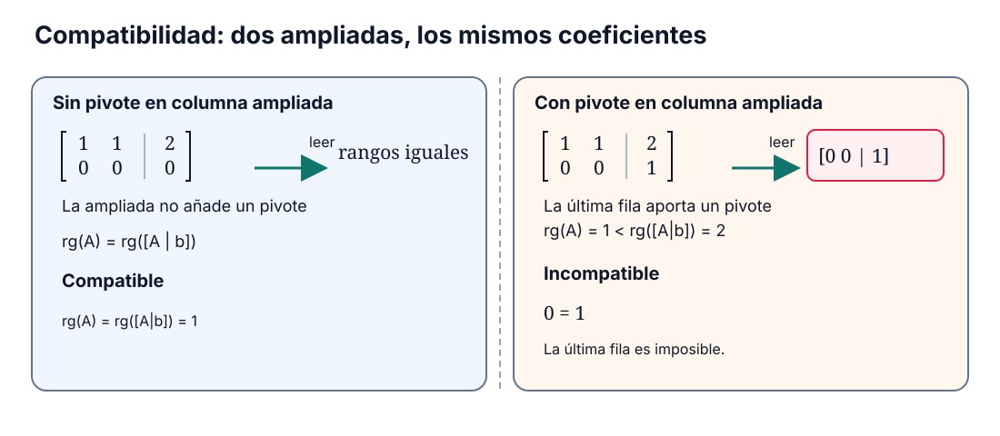

# Compatibilidad y clasificación de sistemas

Consideremos el sistema

$$
\begin{cases}
x+y=2,\\
2x+2y=4.
\end{cases}
$$

Al restar dos veces la primera ecuación a la segunda obtenemos $0=0$: la segunda no impone ninguna condición adicional. Si cambiamos su término independiente de $4$ a $5$, la misma operación da $0=1$ y el sistema deja de tener solución.

Los coeficientes son los mismos en ambos casos. Para decidir la compatibilidad tenemos que seguir también la columna de términos independientes durante la eliminación. El rango permite expresar esa diferencia mediante el número de [[Física/Grado/1º/Álgebra Lineal y Geometría Analítica/01 Matrices y sistemas/04 Eliminación de Gauss y Gauss-Jordan#Pivote|pivotes]].[^a9]

> [!warning] Aviso
> Como ya es habitual en otros capítulos en este también trabajaremos sobre $K=\mathbb R$ o $K=\mathbb C$, con $m,n\geq1$, matrices $A\in M_{m\times n}(K)$ y vectores columna $\mathbf x\in K^n$ y $\mathbf b\in K^m$.

## Criterio de compatibilidad

### Sistema compatible

> [!definicion] Compatibilidad
> Un [[Matemáticas/Álgebra/Sistemas de ecuaciones lineales|sistema lineal]] es **compatible** si tiene al menos una solución.[^a9]

Por ejemplo, $x+y=2$ admite la solución $(2,0)$. En un sistema con varias ecuaciones, una misma tupla debe satisfacerlas todas. Para comprobarlo por eliminación, trabajamos con la [[Matemáticas/Álgebra lineal/Matriz ampliada|matriz ampliada]] $[A\mid\mathbf b]$: las operaciones transforman los coeficientes y los términos independientes a la vez.

```anki
deck: Matemáticas::Álgebra lineal::Sistemas lineales
tags:
  - matemáticas
  - compatibilidad
---
> [!note] Pregunta
> ¿Qué significa que un sistema sea compatible?
===
> [!important] Respuesta
> Que existe al menos una tupla que satisface todas sus ecuaciones.
```

### Teorema de Rouché–Capelli

Para establecer el [[Matemáticas/Álgebra lineal/Teorema de Rouché-Capelli|criterio de Rouché–Capelli]], escalonemos $A\in M_{m\times n}(K)$ y apliquemos las mismas operaciones a la columna $\mathbf b\in K^m$. Si $r=\operatorname{rg}(A)$, bajo las primeras $r$ filas no nulas todos los coeficientes serán cero. En esas filas sólo pueden quedar entradas no nulas en la [[Matemáticas/Álgebra lineal/Matriz ampliada|columna ampliada]].

Si todas ellas son cero, no aparece ningún [[Física/Grado/1º/Álgebra Lineal y Geometría Analítica/01 Matrices y sistemas/04 Eliminación de Gauss y Gauss-Jordan#Pivote|pivote]] nuevo. Si alguna es distinta de cero, podemos usarla como pivote y anular las restantes entradas de esa columna: se añade exactamente uno. Los $r$ [[Física/Grado/1º/Álgebra Lineal y Geometría Analítica/01 Matrices y sistemas/04 Eliminación de Gauss y Gauss-Jordan#Pivote|pivotes]] de los coeficientes siguen presentes. Por tanto,

$$
\operatorname{rg}(A)\leq\operatorname{rg}([A\mid\mathbf b])\leq\operatorname{rg}(A)+1.
$$

La columna $\mathbf b$ deja el rango igual cuando no aparece un [[Física/Grado/1º/Álgebra Lineal y Geometría Analítica/01 Matrices y sistemas/04 Eliminación de Gauss y Gauss-Jordan#Pivote|pivote]] en su posición; si aparece, el rango de la ampliada sube exactamente en uno.

```anki
deck: Matemáticas::Álgebra lineal::Sistemas lineales
tags:
  - matemáticas
  - rango
---
> [!note] Pregunta
> ¿Cuánto puede aumentar el rango al añadir una columna a una matriz?
===
> [!important] Respuesta
> Como máximo, en uno: la nueva columna aporta a lo sumo un pivote. El rango nunca disminuye.
```

#### Propiedad

> [!teorema] Criterio de Rouché–Capelli
> El sistema $A\mathbf x=\mathbf b$ es compatible si, y sólo si,
>
> $$
> \boxed{\operatorname{rg}(A)=\operatorname{rg}([A\mid\mathbf b])}.
> $$
>
> [^a9]



[[Física/Grado/1º/Álgebra Lineal y Geometría Analítica/01 Matrices y sistemas/assets/03-compatibilidad-rango-ampliada.excalidraw|Abrir dibujo editable]].

*Figura. Los dos casos usan la misma matriz de coeficientes y difieren en la última fila de la ampliada. Así se ve por qué el rango de $A$ por sí solo no decide la compatibilidad.*

#### Demostración

> [!demostracion] Demostración
> Sean $A\in M_{m\times n}(K)$ y $\mathbf b\in K^m$. Reducimos $A$ mediante [[Matemáticas/Álgebra lineal/Operaciones elementales por filas|operaciones elementales por filas]], aplicándolas también a $\mathbf b$. Su [[Física/Grado/1º/Álgebra Lineal y Geometría Analítica/01 Matrices y sistemas/03 Matrices elementales y operaciones elementales#Composición de operaciones elementales|composición]] se representa por una matriz invertible $Q\in M_m(K)$:
>
> $$
> [A\mid\mathbf b]\longrightarrow[R\mid\mathbf c]
> =[QA\mid Q\mathbf b].
> $$
>
> Aquí $R=(r_{ij})\in M_{m\times n}(K)$ está en forma escalonada reducida y $\mathbf c=(c_1,\ldots,c_m)^T\in K^m$. Las operaciones conservan el rango de $A$, el de $[A\mid\mathbf b]$ y el conjunto de soluciones:
>
> $$
> \begin{aligned}
> r&=\operatorname{rg}(A)=\operatorname{rg}(R),\\
> \operatorname{rg}([A\mid\mathbf b])&=\operatorname{rg}([R\mid\mathbf c]),\\
> A\mathbf x=\mathbf b&\quad\Longleftrightarrow\quad R\mathbf x=\mathbf c.
> \end{aligned}
> $$
>
> Las filas de $R$ con índice $i>r$ son nulas.[^a9]

##### Rangos distintos: contradicción

> [!demostracion] Imposibilidad de una solución
> Si los rangos son distintos, la columna ampliada aporta un [[Física/Grado/1º/Álgebra Lineal y Geometría Analítica/01 Matrices y sistemas/04 Eliminación de Gauss y Gauss-Jordan#Pivote|pivote]] adicional. Existe, por tanto, un índice $i\in\{r+1,\ldots,m\}$ con $c_i\ne0$. Para cualquier $\mathbf x=(x_1,\ldots,x_n)^T\in K^n$,
>
> $$
> \begin{aligned}
> (R\mathbf x)_i&=\sum_{j=1}^{n}r_{ij}x_j\\
> &=\sum_{j=1}^{n}0\cdot x_j\\
> &=0\ne c_i.
> \end{aligned}
> $$
>
> Ningún vector satisface $R\mathbf x=\mathbf c$; tampoco $A\mathbf x=\mathbf b$. El sistema es [[#Sistema incompatible|incompatible]].[^a9]

##### Rangos iguales: construcción de una solución

> [!demostracion] Existencia de una solución
> Si los rangos son iguales, la columna ampliada no aporta ningún pivote adicional:
>
> $$
> c_i=0\qquad\forall i\in\{r+1,\ldots,m\}.
> $$
>
> Sean $j_1<\cdots<j_r$ los índices de las columnas [[Física/Grado/1º/Álgebra Lineal y Geometría Analítica/01 Matrices y sistemas/04 Eliminación de Gauss y Gauss-Jordan#Pivote|pivote]] de $R$, y sea
>
> $$
> F=\{1,\ldots,n\}\setminus\{j_1,\ldots,j_r\}
> $$
>
> el conjunto de índices de las [[Física/Grado/1º/Álgebra Lineal y Geometría Analítica/01 Matrices y sistemas/04 Eliminación de Gauss y Gauss-Jordan#Variable libre|variables libres]]. Elegimos estas variables iguales a cero y definimos las restantes por
>
> $$
> x_\ell=0\quad(\ell\in F),\qquad
> x_{j_i}=c_i\quad(i\in\{1,\ldots,r\}).
> $$
>
> En cada fila no nula, la columna pivote tiene entrada $1$ y las otras columnas pivote tienen entrada $0$. Así,
>
> $$
> \begin{aligned}
> (R\mathbf x)_i
> &=x_{j_i}+\sum_{\ell\in F}r_{i\ell}x_\ell\\
> &=c_i+\sum_{\ell\in F}r_{i\ell}\cdot0\\
> &=c_i,\qquad i\in\{1,\ldots,r\}.
> \end{aligned}
> $$
>
> En las filas nulas,
>
> $$
> (R\mathbf x)_i=0=c_i\qquad\forall i\in\{r+1,\ldots,m\}.
> $$
>
> Así, $R\mathbf x=\mathbf c$ y, por la equivalencia inicial, $A\mathbf x=\mathbf b$. El sistema es [[#Sistema compatible|compatible]]. $\blacksquare$[^a9]

```anki
deck: Matemáticas::Álgebra lineal::Sistemas lineales
tags:
  - matemáticas
  - rango
  - compatibilidad
---
> [!note] Pregunta
> ¿Cuál es el criterio de Rouché–Capelli para que $A\mathbf x=\mathbf b$ tenga solución?
===
> [!important] Respuesta
> Que $\operatorname{rg}(A)=\operatorname{rg}([A\mid\mathbf b])$.
```

## Clasificación de los sistemas

==Una vez comprobada la compatibilidad==, se cuentan las columnas de coeficientes sin [[Física/Grado/1º/Álgebra Lineal y Geometría Analítica/01 Matrices y sistemas/04 Eliminación de Gauss y Gauss-Jordan#Pivote|pivote]]. Si hay $n$ incógnitas y $r$ [[Física/Grado/1º/Álgebra Lineal y Geometría Analítica/01 Matrices y sistemas/04 Eliminación de Gauss y Gauss-Jordan#Pivote|pivotes]], quedan $n-r$ [[Física/Grado/1º/Álgebra Lineal y Geometría Analítica/01 Matrices y sistemas/04 Eliminación de Gauss y Gauss-Jordan#Variables pivote y variables libres|variables libres]].[^a9]

### Sistema compatible determinado

> [!definicion] Compatible determinado
> Un sistema es compatible determinado cuando tiene **una única solución**. El criterio es
>
> $$
> \boxed{\operatorname{rg}(A)=\operatorname{rg}([A\mid\mathbf b])=n}.
> $$

No queda ninguna [[Física/Grado/1º/Álgebra Lineal y Geometría Analítica/01 Matrices y sistemas/04 Eliminación de Gauss y Gauss-Jordan#Variables pivote y variables libres|variable libre]]: la sustitución determina una incógnita en cada fila [[Física/Grado/1º/Álgebra Lineal y Geometría Analítica/01 Matrices y sistemas/04 Eliminación de Gauss y Gauss-Jordan#Pivote|pivote]]. Por ejemplo, la ampliada reducida

$$
\left[\begin{array}{cc|c}1&0&2\\0&1&3\end{array}\right]
$$

expresa directamente $x=2$ e $y=3$. En general, si la ampliada reducida es $[I_n\mid\mathbf c]$, la solución es $\mathbf x=\mathbf c$.

```anki
deck: Matemáticas::Álgebra lineal::Sistemas lineales
tags:
  - matemáticas
  - compatibilidad
---
> [!note] Pregunta
> ¿Cuándo es compatible determinado un sistema de $n$ incógnitas?
===
> [!important] Respuesta
> Cuando tiene una única solución, lo que equivale a $\operatorname{rg}(A)=\operatorname{rg}([A\mid\mathbf b])=n$.
```

### Sistema compatible indeterminado

> [!definicion] Compatible indeterminado
> Un sistema es compatible indeterminado cuando tiene **más de una solución**. Sobre $\mathbb R$ o $\mathbb C$, el criterio es
>
> $$
> \boxed{\operatorname{rg}(A)=\operatorname{rg}([A\mid\mathbf b])<n}.
> $$

En $x+y=2$ podemos elegir $y=t$ y despejar $x=2-t$. Cada $t\in K$ produce una solución:

$$
(x,y)=(2-t,t).
$$

Esto ocurre siempre que el sistema es compatible y queda una [[Física/Grado/1º/Álgebra Lineal y Geometría Analítica/01 Matrices y sistemas/04 Eliminación de Gauss y Gauss-Jordan#Variables pivote y variables libres|variable libre]]: podemos variar su valor y resolver las [[Física/Grado/1º/Álgebra Lineal y Geometría Analítica/01 Matrices y sistemas/04 Eliminación de Gauss y Gauss-Jordan#Variables pivote y variables libres|variables pivote]]. Como $\mathbb R$ y $\mathbb C$ son infinitos, se obtienen infinitas soluciones.

```anki
deck: Matemáticas::Álgebra lineal::Sistemas lineales
tags:
  - matemáticas
  - compatibilidad
---
> [!note] Pregunta
> ¿Cuándo es compatible indeterminado un sistema real o complejo de $n$ incógnitas?
===
> [!important] Respuesta
> Cuando $\operatorname{rg}(A)=\operatorname{rg}([A\mid\mathbf b])<n$. Tiene variables libres y, por tanto, infinitas soluciones.
```

### Sistema incompatible

> [!definicion] Incompatible
> Un sistema es incompatible cuando **no tiene solución**. Esto equivale a
>
> $$
> \boxed{\operatorname{rg}(A)<\operatorname{rg}([A\mid\mathbf b])}.
> $$

Una fila $[0\ \cdots\ 0\mid c]$, con $c\ne0$, exige que $0=c$. Por ejemplo,

$$
\left[\begin{array}{cc|c}1&1&2\\0&0&1\end{array}\right]
$$

incluye la ecuación $0=1$. Ninguna elección de $x$ e $y$ puede satisfacerla.

```anki
deck: Matemáticas::Álgebra lineal::Sistemas lineales
tags:
  - matemáticas
  - compatibilidad
---
> [!note] Pregunta
> ¿Cómo se reconoce un sistema incompatible en su matriz ampliada escalonada?
===
> [!important] Respuesta
> Aparece una fila $[0\ \cdots\ 0\mid c]$ con $c\ne0$: expresa $0=c$. Entonces el rango de la ampliada supera al de los coeficientes.
```

### Grado de indeterminación

> [!definicion] Grado de indeterminación
> Para un sistema [[#Sistema compatible indeterminado|compatible indeterminado]] de $n$ incógnitas, el grado de indeterminación es el número de parámetros independientes de su solución general:
>
> $$
> \boxed{p=n-\operatorname{rg}(A)}.
> $$
>
> [^a9]

Por ejemplo, un sistema compatible de cinco incógnitas y rango tres tiene dos parámetros. **Discutir** un sistema consiste en clasificarlo e indicar, si procede, ese número; **resolverlo** exige además determinar sus soluciones.

```anki
deck: Matemáticas::Álgebra lineal::Sistemas lineales
tags:
  - matemáticas
  - variables-libres
---
> [!note] Pregunta
> ¿Cuál es el grado de indeterminación de un sistema compatible indeterminado con $n$ incógnitas y rango $r$?
===
> [!important] Respuesta
> $n-r$: el número de variables libres y de parámetros independientes de su solución general.
```

```anki
deck: Matemáticas::Álgebra lineal::Sistemas lineales
tags:
  - matemáticas
  - compatibilidad
---
> [!note] Pregunta
> ¿Qué diferencia hay entre discutir un sistema lineal y resolverlo?
===
> [!important] Respuesta
> Discutirlo es clasificarlo e indicar su grado de indeterminación, si procede. Resolverlo es determinar su conjunto solución.
```

### Ejemplo trabajado: el segundo miembro decide la compatibilidad

Clasifiquemos la ampliada escalonada

$$
\left[\begin{array}{cc|c}1&1&2\\0&0&0\end{array}\right].
$$

La parte de coeficientes tiene un [[Física/Grado/1º/Álgebra Lineal y Geometría Analítica/01 Matrices y sistemas/04 Eliminación de Gauss y Gauss-Jordan#Pivote|pivote]] y la [[Matemáticas/Álgebra lineal/Matriz ampliada|columna ampliada]] no añade otro: ambos rangos valen $1$. La primera fila exige $x+y=2$ y la segunda, $0=0$.

Elegimos $y=t$, con $t\in K$. La primera ecuación determina entonces $x=2-t$, de modo que

$$
\operatorname{Sol}(S)=\{(2-t,t):t\in K\}.
$$

Al sustituir obtenemos $(2-t)+t=2$ para cualquier $t\in K$. Hay un parámetro independiente: el sistema es [[#Sistema compatible indeterminado|compatible indeterminado]], de grado uno.

Si sólo cambia el último término independiente,

$$
\left[\begin{array}{cc|c}1&1&2\\0&0&1\end{array}\right],
$$

la última fila exige $0=1$. Ahora $\operatorname{rg}(A)=1$ y $\operatorname{rg}([A\mid\mathbf b])=2$: el sistema es [[#Sistema incompatible|incompatible]].

> [!advertencia] El rango de $A$ no basta
> Los dos ejemplos tienen la misma matriz de coeficientes. Para decidir si un segundo miembro concreto admite solución, hay que estudiar también la [[Matemáticas/Álgebra lineal/Matriz ampliada|columna ampliada]].

## Condiciones de validez y errores frecuentes

- **Compatibilidad antes que parámetros.** La cuenta $n-r$ describe las [[Física/Grado/1º/Álgebra Lineal y Geometría Analítica/01 Matrices y sistemas/04 Eliminación de Gauss y Gauss-Jordan#Variables pivote y variables libres|variables libres]] de una solución general sólo si el sistema tiene solución.

Para comprobar una clasificación, se sustituye la solución en el sistema original o se identifica una fila imposible.

## 📚 Fuentes

### Material base aportado

[^a9]: FCUL, aula 9, 07/10/2026, diapositivas 2–11. Archivo privado `ALGA-2026-27-AulasTeo-slides-Aula9-Sistemas-impressao.pdf`. Compatibilidad por comparación de rangos, clasificación, grado de indeterminación y cotas del rango. Diapositiva 4: fila contradictoria; diapositiva 5: rango completo; diapositivas 6–7: variables pivote en función de las libres. La demostración explicita esos casos mediante la reducción simultánea y la construcción de una solución particular.

### Contraste académico


## 🧑‍🏫 Prompt para tutor conversacional

Actúa como tutor de compatibilidad y clasificación de sistemas lineales para un estudiante universitario que conoce matrices ampliadas, pivotes, rango y reducción por filas. Formula una pregunta cada vez, espera el intento y ofrece pistas ajustadas al error. No inventes ejercicios nuevos; utiliza los ejemplos de esta nota.

En $A\mathbf x=\mathbf b$, $A\in M_{m\times n}(K)$, $\mathbf x\in K^n$ y $\mathbf b\in K^m$, con $K=\mathbb R$ o $\mathbb C$, se comparan los rangos de $A$ y $[A\mid\mathbf b]$. El sistema es compatible si, y sólo si, coinciden. Si la columna ampliada añade un pivote, aparece una ecuación $0=c$ con $c\ne0$ y el sistema es incompatible.

Tras confirmar compatibilidad, si el rango común es $n$, la solución es única. Si es $r<n$, hay $n-r$ variables libres y parámetros independientes; sobre $\mathbb R$ o $\mathbb C$ hay infinitas soluciones. Discutir el sistema es clasificarlo e indicar su grado de indeterminación; resolverlo exige determinar todas las soluciones.

Usa $x+y=2$, $2x+2y=4$: la reducción produce $x+y=2$ y $0=0$, ambos rangos valen $1$ y la solución general es $(x,y)=(2-t,t)$, $t\in K$. Si el segundo término independiente cambia a $5$, la misma operación da $0=1$; el rango de la ampliada sube a $2$ y no hay solución. Pide seguir la columna independiente y justificar por qué no basta conocer el rango de los coeficientes. Comprueba las soluciones por sustitución y distingue un fallo de cálculo de una aplicación incorrecta del criterio.
