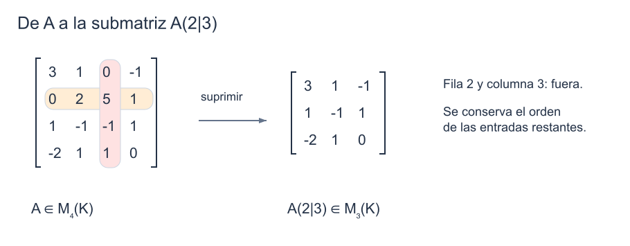
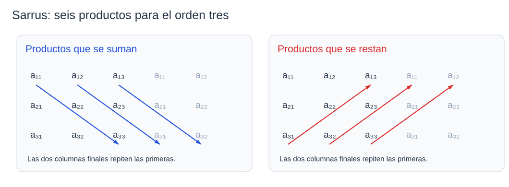

```dataviewjs
await dv.view("Planes/Estudio/Scripts/study-session", { location: "start" })
```

# Definición y cálculo de determinantes

Al eliminar una incógnita de un [[Matemáticas/Álgebra/Sistemas de ecuaciones lineales|sistema lineal]] de dos ecuaciones aparece la expresión $ad-bc$. Si no se anula, podemos despejar ambas incógnitas; si se anula, la eliminación no deja dos pivotes. Esa expresión es el [[Matemáticas/Álgebra lineal/Determinantes|determinante]] de la matriz de coeficientes. Su definición para matrices de mayor orden conservará esta relación con la [[Matemáticas/Álgebra lineal/Matriz inversa|invertibilidad]].[^a13]

## Motivación: unicidad en un sistema de dos ecuaciones

Trabajaremos sobre el [[Matemáticas/Estructuras algebraicas/Cuerpos|cuerpo]] $K=\mathbb R$ o $K=\mathbb C$. Consideremos

$$
\begin{cases}
ax+by=\alpha,\\
cx+dy=\beta.
\end{cases}
$$

Si $a\ne0$, la [[Matemáticas/Álgebra lineal/Eliminación de Gauss|eliminación de Gauss]] permite restar $c/a$ veces la primera ecuación a la segunda. El coeficiente de $y$ que queda es

$$
d-\frac{cb}{a}=\frac{ad-bc}{a}.
$$

Con $ad-bc\ne0$ podemos despejar $y$ y, después, $x$. Falta comprobar que la condición sigue siendo válida cuando $a=0$.

### Criterio de unicidad para dos incógnitas

#### Propiedad

> [!teorema] Solución única de un sistema $2\times2$
> Para cualesquiera $a,b,c,d,\alpha,\beta\in K$, el sistema anterior tiene solución única si y solo si
>
> $$
> \boxed{ad-bc\ne0.}
> $$
> [^unicidad]

#### Demostración

> [!demostracion] Demostración · TPC resuelto
> **Si $a\ne0$**, la eliminación da
>
> $$
> \left[\begin{array}{cc|c}a&b&\alpha\\c&d&\beta\end{array}\right]
> \xrightarrow{L_2\leftarrow L_2-\frac caL_1}
> \left[\begin{array}{cc|c}a&b&\alpha\\0&\frac{ad-bc}{a}&\beta-\frac{c\alpha}{a}\end{array}\right].
> $$
>
> Cuando $ad-bc\ne0$, la segunda fila fija un único $y$ y la primera fija un único $x$. Cuando $ad-bc=0$, la segunda fila expresa $0=\beta-c\alpha/a$: si el término derecho es distinto de cero, el sistema es incompatible; si vale cero, $y$ es libre. En ninguno de estos dos casos hay solución única.
>
> **Si $a=0$ y $c\ne0$**, intercambiamos las ecuaciones:
>
> $$
> \left[\begin{array}{cc|c}c&d&\beta\\0&b&\alpha\end{array}\right].
> $$
>
> Hay solución única exactamente cuando $b\ne0$: despejamos $y=\alpha/b$ y luego $x=(\beta-dy)/c$. Si $b=0$, la segunda fila es imposible o deja $y$ libre. En este caso $ad-bc=-bc$, que es no nulo exactamente cuando $b\ne0$.
>
> **Si $a=c=0$**, la incógnita $x$ no aparece. Si existe una solución, podemos cambiar $x$ sin dejar de satisfacer las ecuaciones; por tanto, nunca es única. También $ad-bc=0$.
>
> Los tres casos cubren todos los valores de $a$ y $c$. En cada uno se cumple la equivalencia anunciada. $\blacksquare$

```anki
deck: Matemáticas::Álgebra lineal::Determinantes
tags:
  - matemáticas
  - determinantes
  - unicidad
---
> [!note] Pregunta
> ¿Cuándo tiene solución única un sistema con matriz de coeficientes $\begin{pmatrix}a&b\\c&d\end{pmatrix}$?
===
> [!important] Respuesta
> Exactamente cuando $ad-bc\ne0$, con independencia de los términos independientes.
```

## Definición recursiva

Para definir el determinante de orden $n$ necesitamos determinantes de orden $n-1$. Primero debemos precisar qué matriz más pequeña corresponde a cada entrada.

### Suprimir una fila y una columna

> [!definicion] Submatriz $A(i|j)$
> Sea $A\in M_n(K)$, con $n\ge2$. Para $i,j\in\mathbb N$ tales que $1\le i,j\le n$, $A(i|j)$ es la matriz que queda al suprimir la fila $i$ y la columna $j$:
>
> $$
> A(i|j)\in M_{n-1}(K).
> $$
> Las filas y columnas restantes conservan su orden relativo.[^a13]

#### Ejemplo — obtener dos submatrices de orden tres

Tomemos la matriz de orden cuatro

$$
A=\begin{pmatrix}
3&1&0&-1\\
0&2&5&1\\
1&-1&-1&1\\
-2&1&1&0
\end{pmatrix}.
$$

Para formar $A(2|3)$, eliminamos la segunda fila y la tercera columna. Leemos las entradas que quedan por filas:

$$
A(2|3)=\begin{pmatrix}3&1&-1\\1&-1&1\\-2&1&0\end{pmatrix}.
$$

Si eliminamos en cambio la tercera fila y la segunda columna, obtenemos

$$
A(3|2)=\begin{pmatrix}3&0&-1\\0&5&1\\-2&1&0\end{pmatrix}.
$$

La notación conserva los índices de la matriz original; no pide buscar la posición $(2,3)$ dentro de una matriz ya recortada.[^a13]


*Se eliminan una fila y una columna completas. [[Física/Grado/1º/Álgebra Lineal y Geometría Analítica/02 Determinantes/assets/01-submatriz-cofactor.excalidraw|Dibujo editable]].*

```anki
deck: Matemáticas::Álgebra lineal::Determinantes
tags:
  - matemáticas
  - determinantes
  - submatriz
---
> [!note] Pregunta
> ¿Cómo se obtiene $A(i|j)$ de una matriz cuadrada de orden $n\ge2$?
===
> [!important] Respuesta
> Suprimiendo la fila $i$ y la columna $j$, sin reordenar las demás. La matriz resultante tiene orden $n-1$.
>
> 
```

### Determinante

> [!definicion] Determinante
> El **determinante** asigna a cada matriz cuadrada $A\in M_n(K)$ un escalar $\det(A)\in K$.
>
> Para el orden uno:
>
> $$
> \det([a])=a.
> $$
>
> Para $n\ge2$, se define recursivamente por la primera fila:
>
> $$
> \boxed{\det(A)=\sum_{j=1}^{n}a_{1j}(-1)^{1+j}\det\bigl(A(1|j)\bigr).}
> $$
> También se escribe $|A|$.[^a13]

Cada entrada de la primera fila multiplica el determinante de la submatriz que le corresponde. Los signos alternan $+,-,+,\ldots$; al repetir el procedimiento, llegamos a matrices de una sola entrada. Por ejemplo, $\det([-4])=-4$.

> [!warning] Las barras no indican valor absoluto
> $|A|$ puede ser negativo o complejo. Si queremos el valor absoluto del determinante, escribimos $|\det(A)|$. La definición ordinaria requiere una [[Matemáticas/Álgebra lineal/Matrices#Formas notables|matriz cuadrada]].

```anki
deck: Matemáticas::Álgebra lineal::Determinantes
tags:
  - matemáticas
  - determinantes
  - definición
---
> [!note] Pregunta
> ¿A qué tipo de matriz se le asigna un determinante y en qué conjunto está su valor?
===
> [!important] Respuesta
> A una matriz cuadrada; su determinante es un escalar del cuerpo de sus entradas.
```

```anki
deck: Matemáticas::Álgebra lineal::Determinantes
tags:
  - matemáticas
  - determinantes
  - notación
---
> [!note] Pregunta
> ¿Indica valor absoluto la notación $|A|$ para una matriz cuadrada?
===
> [!important] Respuesta
> No: significa $\det(A)$ y puede ser negativo o complejo. Su valor absoluto se escribe $|\det(A)|$.
```


```anki
deck: Matemáticas::Álgebra lineal::Determinantes
tags:
  - matemáticas
  - determinantes
  - definición
---
> [!note] Pregunta
> ¿Cuál es la definición recursiva del determinante por la primera fila?
===
> [!important] Respuesta
> $\det([a])=a$; para $n\ge2$, $\det(A)=\sum_{j=1}^n a_{1j}(-1)^{1+j}\det(A(1|j))$.
```


## Cálculo en órdenes dos y tres

### Orden dos

> [!formula] Determinante de orden dos
> Para una matriz de orden dos,
>
> $$
> \boxed{\det\begin{pmatrix}a&b\\c&d\end{pmatrix}=ad-bc.}
> $$


Para $A=\begin{pmatrix}a_{11}&a_{12}\\a_{21}&a_{22}\end{pmatrix}$, la definición da

$$
\det(A)=a_{11}a_{22}-a_{12}a_{21}.
$$

El primer producto utiliza la [[Matemáticas/Álgebra lineal/Matrices#Diagonal principal|diagonal principal]]; el segundo utiliza las otras dos entradas. Al restarlos, el signo forma parte del resultado.

#### Ejemplo — calcular un determinante de orden dos

Para la matriz $\begin{pmatrix}3&2\\4&5\end{pmatrix}$ obtenemos

$$
\det\begin{pmatrix}3&2\\4&5\end{pmatrix}=3\cdot5-2\cdot4=7.
$$

[^a13]

```anki
deck: Matemáticas::Álgebra lineal::Determinantes
tags:
  - matemáticas
  - determinantes
  - cálculo
---
> [!note] Pregunta
> ¿Cómo se calcula el determinante de una matriz de orden dos?
===
> [!important] Respuesta
> Para $A=\begin{pmatrix}a&b\\c&d\end{pmatrix}$, $\det(A)=ad-bc$.
```


### Orden tres: regla de Sarrus

Para $A=[a_{ij}]\in M_3(\mathbb K)$,

$$
\begin{aligned}
\det(A)={}&a_{11}a_{22}a_{33}+a_{12}a_{23}a_{31}+a_{13}a_{21}a_{32}\\
&-a_{13}a_{22}a_{31}-a_{11}a_{23}a_{32}-a_{12}a_{21}a_{33}.
\end{aligned}
$$

> [!definicion] Regla de Sarrus
> La [[Matemáticas/Álgebra lineal/Regla de Sarrus|regla de Sarrus]] calcula un determinante de orden tres repitiendo las dos primeras columnas: se suman los tres productos que descienden hacia la derecha y se restan los tres que ascienden hacia la derecha.[^a13]



*Las columnas repetidas sirven de guía para leer los productos; no cambian el orden de la matriz. [[Física/Grado/1º/Álgebra Lineal y Geometría Analítica/02 Determinantes/assets/01-sarrus.excalidraw|Dibujo editable]].*

> [!warning] Sarrus solo vale en orden tres
> ==No se extiende a orden cuatro repitiendo columnas.== Allí la expansión completa tiene $4!=24$ términos, no ocho.

#### Ejemplo — separar los dos grupos de productos

Tomemos

$$
A=\begin{pmatrix}2&-1&3\\1&-1&4\\-5&2&1\end{pmatrix},
$$

Los tres productos que se suman dan

$$
2(-1)(1)+(-1)(4)(-5)+3(1)(2)=-2+20+6=24.
$$

Los tres que se restan dan

$$
3(-1)(-5)+2(4)(2)+(-1)(1)(1)=15+16-1=30.
$$

Por tanto, $\det(A)=24-30=-6$. «Productos de signo positivo» nombra su signo en la fórmula; alguno de esos productos puede tener valor negativo.[^a13]

```anki
deck: Matemáticas::Álgebra lineal::Determinantes
tags:
  - matemáticas
  - determinantes
  - cálculo
---
> [!note] Pregunta
> ¿Cuándo puede aplicarse directamente la regla de Sarrus y qué método general permite calcular órdenes mayores?
===
> [!important] Respuesta
> Sarrus sólo calcula determinantes de orden tres. Para órdenes mayores puede usarse Laplace, eligiendo una fila o columna conveniente, o las propiedades de las transformaciones elementales.
```

## Menores, cofactores y desarrollo de Laplace

Suprimir una fila y una columna de $A\in M_n(\mathbb K)$, $n\ge2$, produce una matriz cuadrada de orden $n-1$.

### Menor de una entrada

> [!definicion] Menor $M_{ij}$
> El [[Matemáticas/Álgebra lineal/Menor de una matriz|menor]] asociado a la entrada $(i,j)$ es el escalar
>
> $$
> M_{ij}=\det\bigl(A(i|j)\bigr).
> $$

Para $A=\begin{pmatrix}1&2&0\\0&3&1\\2&1&4\end{pmatrix}$, suprimir la fila 1 y la columna 2 deja $\begin{pmatrix}0&1\\2&4\end{pmatrix}$, de modo que $M_{12}=0\cdot4-1\cdot2=-2$.

```anki
deck: Matemáticas::Álgebra lineal::Determinantes
tags:
  - matemáticas
  - determinantes
  - menores
---
> [!note] Pregunta
> ¿Qué diferencia hay entre la submatriz $A(i|j)$ y el menor $M_{ij}$?
===
> [!important] Respuesta
> $A(i|j)$ es una matriz; $M_{ij}=\det(A(i|j))$ es un escalar.
```


### Cofactor de una entrada

El menor anterior vale $-2$, pero la posición $(1,2)$ lleva signo negativo en el desarrollo. Su cofactor será $2$.

> [!definicion] Cofactor $\widehat A_{ij}$
> El [[Matemáticas/Álgebra lineal/Cofactor de una matriz|cofactor]] o **complemento algebraico** incorpora al menor el signo de su posición:
>
> $$
> \widehat A_{ij}=(-1)^{i+j}\det\bigl(A(i|j)\bigr)=(-1)^{i+j}M_{ij}.
> $$
> El signo alterna como un tablero, empezando por $+$ en $(1,1)$. Son habituales también las notaciones $C_{ij}$ para el cofactor y $M_{ij}$ para el menor.

```anki
deck: Matemáticas::Álgebra lineal::Determinantes
tags:
  - matemáticas
  - determinantes
  - cofactores
---
> [!note] Pregunta
> ¿Qué diferencia hay entre el menor $M_{ij}$ y el cofactor $\widehat A_{ij}$?
===
> [!important] Respuesta
> $M_{ij}$ es $\det(A(i|j))$; el cofactor incluye además el signo $(-1)^{i+j}$.
```

Para orden tres, el patrón es

$$
\begin{pmatrix}+&-&+\\-&+&-\\+&-&+\end{pmatrix}.
$$

```anki
deck: Matemáticas::Álgebra lineal::Determinantes
tags:
  - matemáticas
  - determinantes
  - cofactores
---
> [!note] Pregunta
> ¿Qué signo corresponde a un cofactor de posición $(i,j)$?
===
> [!important] Respuesta
> $(-1)^{i+j}$: positivo si $i+j$ es par y negativo si es impar.
```


### Teorema de Laplace

La definición utiliza la primera fila. El [[Matemáticas/Álgebra lineal/Desarrollo de Laplace|teorema de Laplace]] permite escoger otra fila o una columna y obtener el mismo escalar.

#### Propiedad

> [!teorema] Desarrollo por cualquier fila o columna
> Sea $A=(a_{ij})\in M_n(K)$, $n\ge2$, y fijemos $k\in\mathbb N$ con $1\le k\le n$.
>
> Por la **fila $k$**:
>
> $$
> \boxed{\det(A)=\sum_{j=1}^{n}a_{kj}\widehat A_{kj}.}
> $$
>
> Por la **columna $k$**:
>
> $$
> \boxed{\det(A)=\sum_{i=1}^{n}a_{ik}\widehat A_{ik}.}
> $$
> [^laplace]

En una fila, el índice de fila permanece fijo y recorremos sus columnas. En una columna ocurre lo contrario. En ambos desarrollos cada entrada multiplica **su propio cofactor**.

```anki
deck: Matemáticas::Álgebra lineal::Determinantes
tags:
  - matemáticas
  - determinantes
  - definición
  - laplace
---
> [!note] Pregunta
> ¿Cómo se desarrolla un determinante por una fila elegida?
===
> [!important] Respuesta
> Para $A\in M_n(K)$, $n\ge2$, por la fila $k$: $\det(A)=\sum_{j=1}^n a_{kj}\widehat A_{kj}$.
```


```anki
deck: Matemáticas::Álgebra lineal::Determinantes
tags:
  - matemáticas
  - determinantes
  - laplace
---
> [!note] Pregunta
> ¿Cómo se desarrolla un determinante por una columna elegida?
===
> [!important] Respuesta
> Para la columna $k$, $\det(A)=\sum_{i=1}^n a_{ik}\widehat A_{ik}$. Se recorren las filas de esa columna.
```

#### Una fila o columna nula

> [!consecuencia] Determinante nulo
> Si $A$ tiene una fila o columna nula, entonces $\det(A)=0$.[^a14]

> [!demostracion] Demostración
> Desarrollamos por esa fila o columna. Todos los sumandos contienen una entrada igual a cero, de modo que todos valen cero y también su suma. $\blacksquare$

```anki
deck: Matemáticas::Álgebra lineal::Determinantes
tags:
  - matemáticas
  - determinantes
  - laplace
---
> [!note] Pregunta
> ¿Qué ocurre con el determinante si una fila o columna es nula?
===
> [!important] Respuesta
> Es cero: al desarrollar por esa fila o columna, todos los sumandos tienen un factor cero.
```


### Ejemplo trabajado: desarrollo por una fila con cero

Sea

$$
A=\begin{pmatrix}1&2&0\\0&3&1\\2&1&4\end{pmatrix}.
$$

Por la primera fila:

$$
M_{11}=\begin{vmatrix}3&1\\1&4\end{vmatrix}=11,\qquad
M_{12}=\begin{vmatrix}0&1\\2&4\end{vmatrix}=-2.
$$

Así, $\widehat A_{11}=11$ y $\widehat A_{12}=2$. Entonces

$$
\det(A)=1\cdot11+2\cdot2+0\cdot\widehat A_{13}=15.
$$

El signo del cofactor en $(1,2)$ cambia el menor $-2$ a $2$; el último término desaparece porque la entrada es cero. El resultado coincide con Sarrus.[^a14]

## Fórmula general y número de términos

La fórmula siguiente agrupa los productos de la expansión recursiva. Para leerla, una permutación $\sigma$ asigna a cada fila $i$ una columna $\sigma(i)$ sin repetir ninguna; su signo es $+1$ o $-1$ según sea par o impar el número de inversiones de ese orden. Una inversión es un par $i<k$ para el que $\sigma(i)>\sigma(k)$: las columnas elegidas aparecen en el orden contrario al de sus filas. Por ejemplo, $(1,2,3)$ tiene signo positivo y $(2,1,3)$, negativo.[^recuento]


Si $S_n$ es el conjunto de permutaciones de $\{1,\ldots,n\}$ y $\operatorname{sgn}(\sigma)$ es el signo de la permutación,

$$
\det(A)=\sum_{\sigma\in S_n}\operatorname{sgn}(\sigma)
\prod_{i=1}^{n}a_{i,\sigma(i)}.
$$

Cada producto selecciona exactamente una entrada de cada fila y de cada columna.

El factorial $n!=1\cdot2\cdots n$ cuenta esas elecciones: hay $n$ columnas posibles para la primera fila, $n-1$ para la siguiente y así hasta la última. En particular, para $n\ge2$,

$$
n!=n(n-1)!.
$$

```anki
deck: Matemáticas::Álgebra lineal::Determinantes
tags:
  - matemáticas
  - determinantes
  - permutaciones
---
> [!note] Pregunta
> ¿Qué elige cada producto de la fórmula general del determinante?
===
> [!important] Respuesta
> Una entrada de cada fila y de cada columna, sin repetir ninguna fila ni columna.
```


```anki
deck: Matemáticas::Álgebra lineal::Determinantes
tags:
  - matemáticas
  - determinantes
  - permutaciones
---
> [!note] Pregunta
> ¿Qué representa una permutación $\sigma$ en la fórmula de Leibniz?
===
> [!important] Respuesta
> La elección de una columna $\sigma(i)$ distinta para cada fila $i$: ninguna columna se repite.
```

```anki
deck: Matemáticas::Álgebra lineal::Determinantes
tags:
  - matemáticas
  - determinantes
  - permutaciones
---
> [!note] Pregunta
> ¿Qué determina el signo de una permutación en la fórmula de Leibniz?
===
> [!important] Respuesta
> La paridad de sus inversiones: $\operatorname{sgn}(\sigma)=(-1)^N$, donde $N$ cuenta los pares $i<k$ con $\sigma(i)>\sigma(k)$.
```

### Número de términos de la fórmula del determinante

#### Propiedad

> [!teorema] Expansión con $n!$ términos
> Para cada matriz cuadrada de orden $n$, la expansión recursiva del determinante contiene $n!$ términos formales. Cada término es una potencia de $-1$ multiplicada por un producto de $n$ entradas, una de cada fila y una de cada columna.[^a13]

#### Demostración

> [!demostracion] Demostración · TPC resuelto
> Probamos por inducción tanto el recuento como la elección de entradas. En orden uno, $\det([a_{11}])=a_{11}$: hay $1!=1$ término y utiliza la única fila y columna.
>
> Supongamos que cada determinante de orden $n-1$ tiene $(n-1)!$ términos de la forma descrita. Para una matriz de orden $n$, la definición da
>
> $$
> \det(A)=\sum_{j=1}^{n}a_{1j}(-1)^{1+j}\det(A(1|j)).
> $$
>
> Hay $n$ elecciones de $a_{1j}$. Para cada elección, el menor aporta $(n-1)!$ términos; por tanto, en total aparecen
>
> $$
> n(n-1)!=n!
> $$
>
> términos formales. El factor $a_{1j}$ usa la primera fila y la columna $j$. Por hipótesis, cada término del menor usa una entrada de cada fila restante y de cada columna distinta de $j$. Al multiplicarlos queda **una entrada de cada fila y de cada columna original**. Los signos se multiplican y siguen siendo $+1$ o $-1$.
>
> Así se prueba el paso de $n-1$ a $n$ y, por inducción, la afirmación vale para todo $n\ge1$. Contamos términos antes de sustituir valores: que algunos sean cero no altera el recuento formal. $\blacksquare$[^recuento]

```anki
deck: Matemáticas::Álgebra lineal::Determinantes
tags:
  - matemáticas
  - determinantes
  - permutaciones
---
> [!note] Pregunta
> ¿Por qué la expansión recursiva de un determinante de orden $n$ contiene $n!$ términos?
===
> [!important] Respuesta
> La expansión por la primera fila tiene $n$ elecciones; cada menor de orden $n-1$ aporta $(n-1)!$ términos. Por inducción, el total es $n(n-1)!=n!$, con una entrada de cada fila y columna en cada producto.
```

## Elección del método y condiciones de validez

- En orden dos se aplica $a_{11}a_{22}-a_{12}a_{21}$.
- En orden tres se puede usar Sarrus o Laplace; Laplace suele ser breve si una fila o columna tiene ceros.
- En orden mayor, Laplace resulta útil si los menores son sencillos. La expansión completa tiene $n!$ términos, por lo que conviene aprovechar la estructura o usar las propiedades de [[Física/Grado/1º/Álgebra Lineal y Geometría Analítica/02 Determinantes/02 Propiedades y aplicaciones|Propiedades y aplicaciones de determinantes]].

**Condiciones de validez.** El determinante solo se define para matrices cuadradas y la regla de Sarrus solo se aplica a matrices de orden tres. Para órdenes mayores, usa Laplace u otras propiedades generales; la estructura de la matriz ayuda a elegir el método. La prueba de invertibilidad y las aplicaciones a sistemas se desarrollan en la nota siguiente.

```anki
deck: Matemáticas::Álgebra lineal::Determinantes
tags:
  - matemáticas
  - determinantes
  - laplace
---
> [!note] Pregunta
> ¿Qué fila o columna conviene escoger para desarrollar por Laplace?
===
> [!important] Respuesta
> La que tenga más ceros o produzca los menores más sencillos; las entradas nulas eliminan sumandos.
```


## Práctica graduada

### Ejercicio 1 — construir un menor y un cofactor

Para

$$
A=\begin{pmatrix}2&1&0\\-1&3&4\\2&0&1\end{pmatrix},
$$

calcula $M_{23}$ y $\widehat A_{23}$.

> [!resolucion]- Resolución
> Al suprimir la fila 2 y la columna 3 queda
> $$
> A(2|3)=\begin{pmatrix}2&1\\2&0\end{pmatrix},
> \qquad M_{23}=2\cdot0-1\cdot2=-2.
> $$
> Como $(-1)^{2+3}=-1$, el cofactor es $\widehat A_{23}=(-1)^5M_{23}=2$. El signo del cofactor cambia el valor del menor.

### Ejercicio 2 — elegir una columna y desarrollar por Laplace

Calcula el determinante de

$$
B=\begin{pmatrix}
2&-1&0&3\\
1&-1&-3&4\\
1&0&2&1\\
-5&2&0&1
\end{pmatrix}
$$

usando la columna más conveniente.

> [!resolucion]- Resolución
> La tercera columna contiene dos ceros. Su desarrollo sólo tiene dos términos:
> $$
> \det(B)=b_{23}\widehat B_{23}+b_{33}\widehat B_{33}
> =(-3)(-1)(8)+2(1)(-6)=12.
> $$
> Los menores se calculan con Sarrus:
> $$
> M_{23}=0+5+6-(0-1+4)=8,\qquad
> M_{33}=-2+20+6-(15-1+16)=-6.
> $$
> Los [[Matemáticas/Álgebra lineal/Cofactor de una matriz|cofactores]] correspondientes son $\widehat B_{23}=(-1)^{2+3}M_{23}=-8$ y $\widehat B_{33}=(-1)^{3+3}M_{33}=-6$. Así, los dos términos son $(-3)(-8)=24$ y $2(-6)=-12$. La elección de la columna reduce cuatro posibles términos a dos.[^a14][^a13]

### Ejercicio 3 — transferir el criterio de elección

Una matriz cuadrada de orden cuatro no es triangular y tiene tres ceros en una columna. Decide entre Sarrus y Laplace, e indica cuántos términos no nulos como máximo aporta ese desarrollo y cuántos términos tendría la fórmula general completa.

> [!resolucion]- Resolución
> Se elige Laplace por esa columna: sólo queda un término potencialmente no nulo. Sarrus no es aplicable porque la matriz tiene orden cuatro. La fórmula general completa tiene $4!=24$ términos, aunque en este desarrollo concreto sólo haya uno potencialmente distinto de cero.[^a13][^a14]

El recorrido parte de [[Física/Grado/1º/Álgebra Lineal y Geometría Analítica/01 Matrices y sistemas/03 Compatibilidad, rango e inversa|rango, compatibilidad e inversa]]: al estudiar una matriz de coeficientes surge la pregunta de cuándo un sistema cuadrado tiene solución única. El determinante convierte esa pregunta en un criterio escalar; la nota [[Física/Grado/1º/Álgebra Lineal y Geometría Analítica/02 Determinantes/02 Propiedades y aplicaciones|siguiente]] desarrolla cómo las operaciones elementales permiten calcularlo y cómo se aplica a la inversa y a Cramer.

## 📚 Fuentes

### Material base

[^a13]: FCUL, *Álgebra Linear e Geometria Analítica*, Aula 13, 16/10/2026, diapositivas 2–11. Archivo `ALGA-2026-27-AulasTeo-slides-aula13-Determinantes-impressao.pdf`. Motivación (2–3), submatrices (4), recurrencia (5), órdenes dos y tres (6–10).

[^a14]: FCUL, misma asignatura, Aula 14, 19/10/2026, diapositivas 2–4. Archivo `ALGA-2026-27-AulasTeo-slides-Aula14-Determinantes-impressao.pdf`. Menores, cofactores, Laplace y ejemplo de orden cuatro.

[^unicidad]: Aula 13, diapositivas 2–3: eliminación y encargo TPC para cubrir todos los coeficientes. Se completa aquí la prueba por casos; se contrasta el criterio general con ULisboa, Instituto Superior Técnico, *Álgebra Linear*, corolario 5.13, pp. 104–105, en los [apuntes integrados](https://fenix.tecnico.ulisboa.pt/downloadFile/563568428979297/ApontamentosInteg.pdf). El corolario respalda el criterio; no se atribuye al manual esta redacción de los tres casos.

[^recuento]: Aula 13, diapositiva 11, TPC: recuento y estructura de los términos por inducción. Desarrollo de la sugerencia de la fuente, contrastado con la expansión por permutaciones de los apuntes de IST, §5.5, pp. 100–103; no es una transcripción de una prueba completa publicada allí.

### Contraste académico

[^laplace]: W. Keith Nicholson, *Linear Algebra with Applications*, [§3.1, «The Cofactor Expansion»](https://math.libretexts.org/Bookshelves/Linear_Algebra/Linear_Algebra_with_Applications_(Nicholson)/03%3A_Determinants_and_Diagonalization/3.01%3A_The_Cofactor_Expansion), y [§3.8, prueba del teorema](https://math.libretexts.org/Bookshelves/Linear_Algebra/Linear_Algebra_with_Applications_(Nicholson)/03%3A_Determinants_and_Diagonalization/3.08%3A_Proof_of_the_Cofactor_Expansion_Theorem). Definiciones, signos y expansión por filas y columnas. La canónica de desarrollo de Laplace contiene el argumento por intercambios consecutivos.

## 🧑‍🏫 Prompt para tutor conversacional

Trabaja a nivel de primer curso universitario con $K=\mathbb R$ o $\mathbb C$. Presupón matrices y eliminación de Gauss. El determinante es un escalar definido por $\det([a])=a$ y, para $n\ge2$, por $\sum_j a_{1j}(-1)^{1+j}\det(A(1|j))$. $A(i|j)$ suprime fila $i$ y columna $j$; su determinante es el menor $M_{ij}$ y el cofactor es $\widehat A_{ij}=(-1)^{i+j}M_{ij}$. Laplace permite desarrollar por cualquier fila o columna. En orden dos, $\det A=ad-bc$; Sarrus solo vale en orden tres. La expansión completa tiene $n!$ términos formales.

Formula una pregunta cada vez y espera el intento antes de ofrecer una pista. Distingue un error de signo de una confusión entre submatriz, menor y cofactor. Usa los ejemplos existentes: $\det\begin{pmatrix}3&2\\4&5\end{pmatrix}=7$ y $\det\begin{pmatrix}2&-1&3\\1&-1&4\\-5&2&1\end{pmatrix}=-6$. En el ejercicio de orden cuatro, desarrollar por la tercera columna da $12$. Pide justificar la elección antes del cálculo y comprobar los menores. Recupera las pruebas de unicidad en orden dos y recuento por inducción; no reveles la solución antes del intento ni generes ejercicios nuevos. Repite más adelante los conceptos fallados con pistas cada vez menores.

```dataviewjs
await dv.view("Planes/Estudio/Scripts/study-session", { location: "end" })
```
