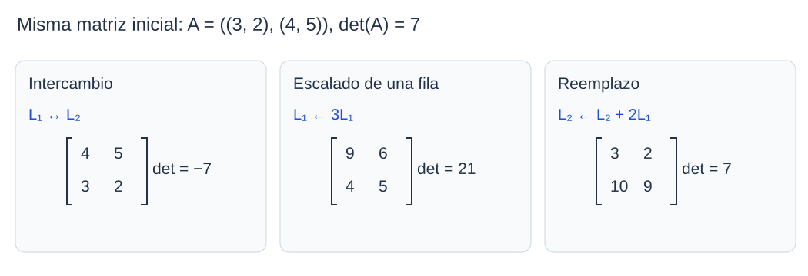
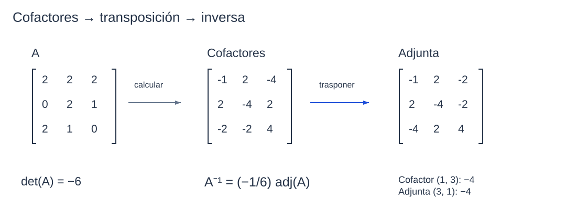
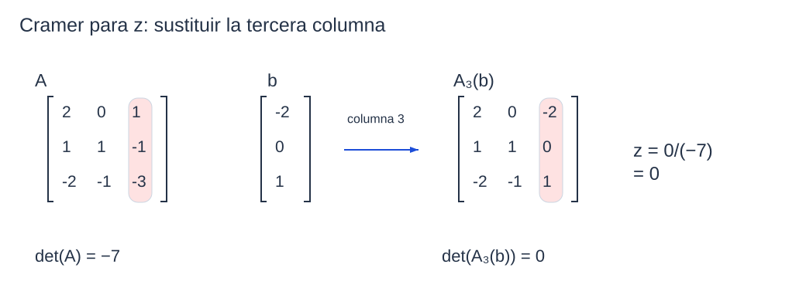

```dataviewjs
await dv.view("Planes/Estudio/Scripts/study-session", { location: "start" })
```

# Propiedades y aplicaciones de determinantes

Para calcular el determinante de una matriz grande podemos hacer ceros mediante [[Matemáticas/Álgebra lineal/Operaciones elementales por filas|operaciones elementales]] y terminar con un [[Física/Grado/1º/Álgebra Lineal y Geometría Analítica/02 Determinantes/01 Definición y cálculo de determinantes#Teorema de Laplace|desarrollo de Laplace]] breve o con una [[Matemáticas/Álgebra lineal/Matrices#Formas notables|matriz triangular]]. Debemos conservar, junto a cada operación, el factor por el que ha cambiado el determinante. Por ejemplo, intercambiar dos filas obliga a cambiar el signo; sumar a una fila un múltiplo de otra deja el valor intacto.[^a15]

Trabajamos sobre $K=\mathbb R$ o $K=\mathbb C$. Escribiremos $\mathbb K$ con el mismo significado en las fórmulas. Los resultados de [[#Invertibilidad y determinante|invertibilidad]], [[#Matriz adjunta e inversa|adjunta]] y [[#Regla de Cramer|Cramer]] utilizarán estas propiedades para decidir si podemos dividir por $\det(A)$.

## Linealidad por filas y columnas

En el [[Matemáticas/Álgebra lineal/Desarrollo de Laplace|desarrollo de Laplace]] por una fila, cada entrada multiplica un cofactor. Si cambiamos únicamente esa fila, sus [[Matemáticas/Álgebra lineal/Cofactor de una matriz|cofactores]] no cambian: para calcularlos hay que borrar precisamente la fila modificada. Por eso podemos distribuir una suma o extraer un factor común de esa fila.[^linealidad]

Fijemos $A\in M_n(K)$. Escribimos $A_{i\leftarrow L}$ para sustituir la fila $i$ por una fila $L\in K^{1\times n}$; $A_{j\leftarrow C}$ sustituye la columna $j$ por $C\in K^{n\times1}$. En cada expresión **las demás filas o columnas permanecen fijas**.

### Aditividad respecto de una fila

#### Propiedad

> [!teorema] Linealidad en una fila
> Si la fila $i$ de una matriz cuadrada es $L+H$, entonces
> $$
> \boxed{\det(A_{i\leftarrow L+H})=\det(A_{i\leftarrow L})+\det(A_{i\leftarrow H}).}
> $$
> [^a14]

#### Demostración

> [!demostracion] Demostración · TPC resuelto
> Sean $L=(\ell_1,\ldots,\ell_n)$ y $H=(h_1,\ldots,h_n)$. Para $n\ge2$, llamemos $q_j$ al cofactor de la posición $(i,j)$. Es común a las tres matrices, porque al suprimir la fila $i$ desaparecen todas las entradas modificadas.
>
> Desarrollamos por esa fila. La distributividad en $K$ permite separar la suma:
>
> $$
> \begin{aligned}
> \det(A_{i\leftarrow L+H})
> &=\sum_{j=1}^n(\ell_j+h_j)q_j\\
> &=\sum_{j=1}^n\ell_jq_j+\sum_{j=1}^nh_jq_j\\
> &=\det(A_{i\leftarrow L})+\det(A_{i\leftarrow H}).
> \end{aligned}
> $$
>
> La última línea reconoce los desarrollos por la misma fila en las otras dos matrices. Para $n=1$, la identidad se reduce a $\det([\ell_1+h_1])=\ell_1+h_1$. Quedan cubiertos todos los órdenes. $\blacksquare$[^linealidad]

```anki
deck: Matemáticas::Álgebra lineal::Determinantes
tags:
  - matemáticas
  - determinantes
  - linealidad
---
> [!note] Pregunta
> ¿Cómo se separa un determinante si una sola fila es $L+H$?
===
> [!important] Respuesta
> Como suma de dos determinantes: uno con esa fila $L$ y otro con esa fila $H$. Las demás filas son idénticas en los dos.
```


### Aditividad respecto de una columna

#### Propiedad

> [!teorema] Linealidad en una columna
> Si la columna $j$ de una matriz cuadrada es $C+D$, entonces
> $$
> \boxed{\det(A_{j\leftarrow C+D})=\det(A_{j\leftarrow C})+\det(A_{j\leftarrow D}).}
> $$
> [^a14]

#### Demostración

> [!demostracion] Demostración · TPC resuelto
> Escribamos $C=(c_1,\ldots,c_n)^T$ y $D=(d_1,\ldots,d_n)^T$. Para $n\ge2$, los cofactores $r_i$ de la columna $j$ son comunes a las tres matrices: al borrar esa columna se elimina lo que cambia.
>
> El desarrollo por la columna $j$ y la distributividad dan
>
> $$
> \begin{aligned}
> \det(A_{j\leftarrow C+D})
> &=\sum_{i=1}^n(c_i+d_i)r_i\\
> &=\sum_{i=1}^nc_ir_i+\sum_{i=1}^nd_ir_i\\
> &=\det(A_{j\leftarrow C})+\det(A_{j\leftarrow D}).
> \end{aligned}
> $$
>
> Las dos sumas son los desarrollos de las matrices con columnas $C$ y $D$, respectivamente. En orden uno, la definición $\det([c_1+d_1])=c_1+d_1$ prueba la misma igualdad. $\blacksquare$[^linealidad]

```anki
deck: Matemáticas::Álgebra lineal::Determinantes
tags:
  - matemáticas
  - determinantes
  - linealidad
---
> [!note] Pregunta
> ¿Cómo se separa un determinante si una sola columna es $C+D$?
===
> [!important] Respuesta
> Como suma de dos determinantes, con $C$ y con $D$ en esa posición; las demás columnas permanecen fijas.
```


### Homogeneidad respecto de una fila

#### Propiedad

> [!teorema] Homogeneidad en una fila
> Para $\lambda\in\mathbb K$, si la fila $i$ es $\lambda L$, entonces
> $$
> \boxed{\det(A_{i\leftarrow\lambda L})=\lambda\det(A_{i\leftarrow L}).}
> $$
> [^a14]

#### Demostración

> [!demostracion] Demostración · TPC resuelto
> Sea $L=(\ell_1,\ldots,\ell_n)$ y $\lambda\in K$. Para $n\ge2$, los cofactores $q_j$ de la fila $i$ coinciden antes y después de escalarla: sus submatrices no contienen esa fila.
>
> Por Laplace y por distributividad de la multiplicación escalar,
>
> $$
> \begin{aligned}
> \det(A_{i\leftarrow\lambda L})
> &=\sum_{j=1}^n(\lambda\ell_j)q_j\\
> &=\lambda\sum_{j=1}^n\ell_jq_j\\
> &=\lambda\det(A_{i\leftarrow L}).
> \end{aligned}
> $$
>
> No hemos dividido por $\lambda$, por lo que el argumento incluye $\lambda=0$. Para $n=1$, basta $\det([\lambda\ell_1])=\lambda\ell_1=\lambda\det([\ell_1])$. $\blacksquare$[^linealidad]

```anki
deck: Matemáticas::Álgebra lineal::Determinantes
tags:
  - matemáticas
  - determinantes
  - linealidad
---
> [!note] Pregunta
> ¿Qué factor sale del determinante al extraer $\lambda$ de una sola fila?
===
> [!important] Respuesta
> Un solo factor $\lambda$: $\det(A_{i\leftarrow\lambda L})=\lambda\det(A_{i\leftarrow L})$.
```


### Homogeneidad respecto de una columna

#### Propiedad

> [!teorema] Homogeneidad en una columna
> Para $\lambda\in\mathbb K$, si la columna $j$ es $\lambda C$, entonces
> $$
> \boxed{\det(A_{j\leftarrow\lambda C})=\lambda\det(A_{j\leftarrow C}).}
> $$
> [^a14]

#### Demostración

> [!demostracion] Demostración · TPC resuelto
> Sea $C=(c_1,\ldots,c_n)^T$ y $\lambda\in K$. En orden $n\ge2$, llamemos $r_i$ a los cofactores de la columna $j$. Son los mismos para $C$ y $\lambda C$, pues al construirlos se borra esa columna.
>
> Por el [[Matemáticas/Álgebra lineal/Desarrollo de Laplace|desarrollo de Laplace]] correspondiente,
>
> $$
> \begin{aligned}
> \det(A_{j\leftarrow\lambda C})
> &=\sum_{i=1}^n(\lambda c_i)r_i\\
> &=\lambda\sum_{i=1}^nc_ir_i\\
> &=\lambda\det(A_{j\leftarrow C}).
> \end{aligned}
> $$
>
> La extracción del factor común vale también para $\lambda=0$. En orden uno, la igualdad es $\det([\lambda c_1])=\lambda\det([c_1])$. $\blacksquare$[^linealidad]

```anki
deck: Matemáticas::Álgebra lineal::Determinantes
tags:
  - matemáticas
  - determinantes
  - linealidad
---
> [!note] Pregunta
> ¿Qué sucede con el determinante al multiplicar una sola columna por $\lambda$?
===
> [!important] Respuesta
> Se multiplica por $\lambda$, incluso si $\lambda=0$.
```


> [!definicion] Multilinealidad del determinante
> Ser [[Matemáticas/Álgebra lineal/Álgebra multilineal#1. Aplicaciones multilineales[^1]|multilineal]] significa ser lineal en cada fila —y en cada columna— por separado, manteniendo las demás fijas. No significa ser lineal en la matriz completa.[^linealidad]

```anki
deck: Matemáticas::Álgebra lineal::Determinantes
tags:
  - matemáticas
  - determinantes
  - linealidad
---
> [!note] Pregunta
> ¿Qué significa que el determinante sea multilineal?
===
> [!important] Respuesta
> Es aditivo y homogéneo por separado en cada fila y en cada columna: sustituir una fila o columna por una suma separa el determinante en dos; multiplicarla por $\lambda$ multiplica el determinante por $\lambda$.
```

### Ejemplos — descomponer una sola fila o columna

En la matriz

$$
D=\begin{pmatrix}12&18&3\\5&-15&-5\\4&2&-2\end{pmatrix},
$$

la primera fila se puede escribir como $(7,10,3)+(5,8,0)$. Manteniendo las otras dos filas, la aditividad da

$$
\det(D)=
\begin{vmatrix}7&10&3\\5&-15&-5\\4&2&-2\end{vmatrix}
+
\begin{vmatrix}5&8&0\\5&-15&-5\\4&2&-2\end{vmatrix}.
$$

Los dos determinantes valen $390$ y $120$; su suma es $510$, el determinante de $D$.

También podemos descomponer su segunda columna:

$$
\begin{pmatrix}18\\-15\\2\end{pmatrix}
=
\begin{pmatrix}4\\-9\\5\end{pmatrix}
+
\begin{pmatrix}14\\-6\\-3\end{pmatrix}.
$$

Dejando fijas las columnas primera y tercera, obtenemos

$$
\det(D)=
\begin{vmatrix}12&4&3\\5&-9&-5\\4&5&-2\end{vmatrix}
+
\begin{vmatrix}12&14&3\\5&-6&-5\\4&-3&-2\end{vmatrix}.
$$

Aquí los valores son $659$ y $-149$, que vuelven a sumar $510$.[^a14]

### Ejemplo — extraer factores de filas y columnas

Consideremos ahora

$$
E=\begin{pmatrix}12&18&3\\5&-30&-5\\4&4&-2\end{pmatrix}.
$$

La segunda fila tiene factor común $5$. Después de extraerlo, todas las entradas de la segunda columna tienen factor común $2$:

$$
\det(E)=5\begin{vmatrix}12&18&3\\1&-6&-1\\4&4&-2\end{vmatrix}
=10\begin{vmatrix}12&9&3\\1&-3&-1\\4&2&-2\end{vmatrix}.
$$

De la última fila podemos extraer $-2$:

$$
\det(E)=-20\begin{vmatrix}12&9&3\\1&-3&-1\\-2&-1&1\end{vmatrix}.
$$

El determinante restante vale $-60$ y, por tanto, $\det(E)=1200$. Cada factor procede de **una** fila o columna; las que no se han elegido conservan sus entradas.

Extraer un factor tampoco exige que las entradas sean enteras. Por ejemplo, de la tercera fila de $E$ se puede sacar $15$:

$$
\det(E)=15\begin{vmatrix}12&18&3\\5&-30&-5\\4/15&4/15&-2/15\end{vmatrix}.
$$

La igualdad es válida, aunque aquí introduce fracciones y no simplifica el cálculo.[^a14]

## Efecto de las operaciones elementales

Una operación por filas modifica las entradas que intervienen en el determinante. Las tres reglas siguientes indican si debemos cambiar el signo, extraer un escalar o conservar el resultado. Las mismas reglas valen por columnas; no se mezcla una fila con una columna en una sola operación.[^operaciones]



*Cada panel parte de la misma matriz. [[Física/Grado/1º/Álgebra Lineal y Geometría Analítica/02 Determinantes/assets/02-operaciones.excalidraw|Dibujo editable]].*

### Intercambio de dos filas o columnas

#### Propiedad

> [!teorema] Intercambio de filas o columnas
> Si $B$ se obtiene de $A$ intercambiando dos filas distintas o dos columnas distintas,
>
> $$
> \boxed{\det(B)=-\det(A).}
> $$
> [^operaciones]

#### Demostración

> [!demostracion] Demostración
> **Caso $n=2$.** Partimos de
>
> $$
> A=\begin{pmatrix}a&b\\c&d\end{pmatrix},\qquad \det(A)=ad-bc.
> $$
>
> Al intercambiar las filas queda
>
> $$
> A'=\begin{pmatrix}c&d\\a&b\end{pmatrix},\qquad \det(A')=cb-da.
> $$
>
> La conmutatividad de la multiplicación de escalares permite escribir $cb=bc$ y $da=ad$; por tanto,
>
> $$
> \det(A')=bc-ad=-(ad-bc)=-\det(A).
> $$
>
> Al intercambiar las columnas se obtiene
>
> $$
> A''=\begin{pmatrix}b&a\\d&c\end{pmatrix},\qquad \det(A'')=bc-ad=-\det(A).
> $$
>
> **Estrategia del paso inductivo.** Para las filas, desarrollaremos por una fila $t$ que no se intercambia; para las columnas, por una columna $s$ que no se intercambia. Así, las entradas y los signos de la expansión quedan iguales. Al borrar la fila o columna elegida, el menor todavía contiene las dos filas o columnas originales intercambiadas; la hipótesis inductiva se aplica a ese menor de orden $n-1$.
>
> **Paso inductivo para filas.** Sea $n\ge3$ y supongamos probada la regla para intercambios de filas y columnas en orden $n-1$. Intercambiemos las filas distintas $i,j$ de $A$. Elijamos una fila $t$ distinta de ambas; existe porque $n\ge3$. Si $A'$ es la matriz con esas filas intercambiadas, los desarrollos por la fila $t$ son
>
> $$
> \det(A)=\sum_{k=1}^n(-1)^{t+k}a_{tk}\det(A(t|k)),
> $$
>
> $$
> \det(A')=\sum_{k=1}^n(-1)^{t+k}a_{tk}\det(A'(t|k)).
> $$
>
> Las entradas de la fila $t$ y los signos son iguales. Al borrar esa fila y la columna $k$, los índices locales de las filas pueden cambiar, pero las filas originales $i$ y $j$ siguen presentes en el menor; sus posiciones locales cambian del mismo modo en los dos menores y permanecen intercambiadas. Por la hipótesis inductiva, los determinantes de $A(t|k)$ y $A'(t|k)$ son opuestos. Así, cada sumando de la segunda expansión es el opuesto del correspondiente sumando de la primera, y el determinante completo cambia de signo.
>
> **Paso inductivo para columnas.** Para intercambiar las columnas $i,j$, elijamos una columna $s$ distinta de ambas y llamemos $A'$ a la matriz intercambiada. Los desarrollos por la columna $s$ son
>
> $$
> \det(A)=\sum_{k=1}^n(-1)^{k+s}a_{ks}\det(A(k|s)),
> $$
>
> $$
> \det(A')=\sum_{k=1}^n(-1)^{k+s}a_{ks}\det(A'(k|s)).
> $$
>
> Las entradas de esa columna y los signos coinciden. Al borrar la columna $s$ y la fila $k$, los índices locales pueden cambiar, pero las columnas originales $i$ y $j$ siguen presentes en el menor y permanecen intercambiadas. Por la hipótesis inductiva, sus determinantes son opuestos, así que también lo son las dos sumas. El caso base y los dos pasos prueban ambas reglas para todo $n\ge2$.
> [^operaciones]

```anki
deck: Matemáticas::Álgebra lineal::Determinantes
tags:
  - matemáticas
  - determinantes
  - operaciones-elementales
---
> [!note] Pregunta
> ¿Qué efecto tiene intercambiar dos filas o dos columnas de una matriz cuadrada?
===
> [!important] Respuesta
> Cambia el signo: $\det(B)=-\det(A)$.
```


### Multiplicación de una fila o columna por un escalar

#### Propiedad

> [!teorema] Escalar una fila o columna
> Si $B$ se obtiene de $A$ multiplicando una sola fila o columna por $\lambda\in K$,
>
> $$
> \boxed{\det(B)=\lambda\det(A).}
> $$
> [^operaciones]

#### Demostración

> [!demostracion] Demostración
> Es la [[#Homogeneidad respecto de una fila|homogeneidad por filas]] o la [[#Homogeneidad respecto de una columna|homogeneidad por columnas]], según la operación realizada. Si $\lambda\ne0$, podemos despejar $\det(A)=\det(B)/\lambda$. Para $\lambda=0$, la fila o columna se anula y el determinante resultante vale cero. $\blacksquare$

```anki
deck: Matemáticas::Álgebra lineal::Determinantes
tags:
  - matemáticas
  - determinantes
  - operaciones-elementales
---
> [!note] Pregunta
> ¿Cómo se recupera el determinante original si multiplicaste una fila por $\lambda\ne0$?
===
> [!important] Respuesta
> Dividiendo el determinante nuevo por $\lambda$: $\det(A)=\det(B)/\lambda$.
```

### Suma de un múltiplo de otra fila o columna

#### Propiedad

> [!teorema] Reemplazo de una fila o columna
> Si $B$ se obtiene mediante $L_i\leftarrow L_i+\lambda L_j$, con $i\ne j$, entonces
>
> $$
> \boxed{\det(B)=\det(A).}
> $$
> La misma identidad vale para $C_i\leftarrow C_i+\lambda C_j$.[^operaciones]

#### Demostración

> [!demostracion] Demostración
> Por aditividad y homogeneidad en la fila modificada,
>
> $$
> \det(B)=\det(A)+\lambda\det(A_{i\leftarrow L_j}).
> $$
>
> La matriz del segundo término tiene dos filas iguales: la $i$ y la $j$. Su determinante es cero, como se demuestra [[#Determinante con dos filas iguales|más abajo]] únicamente a partir del intercambio. Así, $\det(B)=\det(A)+\lambda\cdot0=\det(A)$.
>
> Para columnas se distribuye por la columna modificada y el segundo determinante tiene dos columnas iguales. También vale cero. $\blacksquare$

```anki
deck: Matemáticas::Álgebra lineal::Determinantes
tags:
  - matemáticas
  - determinantes
  - operaciones-elementales
---
> [!note] Pregunta
> ¿Qué operación elemental por filas conserva el determinante?
===
> [!important] Respuesta
> Sumar a una fila un múltiplo de otra distinta: $L_i\leftarrow L_i+\lambda L_j$, con $i\ne j$.
```

### Ejemplos — combinar operaciones por filas y columnas

En todos los cálculos siguientes partimos de

$$
F=\begin{pmatrix}3&1&9\\-2&0&6\\1&1&-3\end{pmatrix}.
$$

Intercambiar $L_1$ y $L_3$ cambia el signo. Intercambiar después $C_2$ y $C_3$ lo cambia otra vez:

$$
\det(F)=-\begin{vmatrix}1&1&-3\\-2&0&6\\3&1&9\end{vmatrix}
=\begin{vmatrix}1&-3&1\\-2&6&0\\3&9&1\end{vmatrix}.
$$

Si extraemos $2$ de la segunda fila y luego $3$ de la tercera columna, obtenemos en cambio

$$
\det(F)=2\begin{vmatrix}3&1&9\\-1&0&3\\1&1&-3\end{vmatrix}
=6\begin{vmatrix}3&1&3\\-1&0&1\\1&1&-1\end{vmatrix}.
$$

Multiplicar una columna por $3$ exige compensar con $1/3$ si queremos expresar el determinante original:

$$
\det(F)=\frac13\begin{vmatrix}3&3&9\\-2&0&6\\1&3&-3\end{vmatrix}.
$$

Para introducir ceros sin factores de compensación, hacemos $L_2\leftarrow L_2+2L_3$ y después $C_3\leftarrow C_3-3C_1$:

$$
\det(F)=\begin{vmatrix}3&1&9\\0&2&0\\1&1&-3\end{vmatrix}
=\begin{vmatrix}3&1&0\\0&2&0\\1&1&-6\end{vmatrix}.
$$

Ahora Laplace por la segunda fila da $2\det\begin{pmatrix}3&0\\1&-6\end{pmatrix}=-36$. Es el mismo resultado que se obtiene por triangularización en el ejercicio 2.[^a15]

### Determinante con dos filas iguales

#### Propiedad

> [!teorema] Dos filas iguales
> Si una matriz cuadrada tiene dos filas iguales, su determinante es cero.

#### Demostración

> [!demostracion] Demostración
> **1. Intercambiar las dos filas.** Sea $d=\det(A)$. Como las filas son iguales, intercambiarlas no cambia la matriz; la matriz resultante sigue siendo $A$. Pero el intercambio de dos filas cambia el signo del determinante, de modo que
>
> $$
> d=-d.
> $$
>
> **2. Concluir que el determinante es cero.** Sumando $d$ a ambos lados obtenemos
>
> $$
> 2d=0.
> $$
>
> Como trabajamos sobre $\mathbb R$ o $\mathbb C$, el escalar $2$ tiene inverso. Multiplicamos ambos lados por $1/2$:
>
> $$
> d=\frac12(2d)=\frac12\cdot0=0.
> $$
>
> Así, el determinante se anula.[^a15]

```anki
deck: Matemáticas::Álgebra lineal::Determinantes
tags:
  - matemáticas
  - determinantes
  - filas-iguales
---
> [!note] Pregunta
> ¿Cuánto vale el determinante de una matriz con dos filas iguales?
===
> [!important] Respuesta
> Cero. El intercambio deja la matriz igual pero cambia el signo de su determinante.
```


### Determinante con dos columnas iguales

#### Propiedad

> [!teorema] Dos columnas iguales
> Si una matriz cuadrada tiene dos columnas iguales, su determinante es cero.

#### Demostración

> [!demostracion] Demostración
> **1. Intercambiar las columnas iguales.** El intercambio deja fija la matriz. Si $d$ es su determinante, la regla de intercambio de columnas también da
>
> $$
> d=-d.
> $$
>
> **2. Despejar $d$.** Sumando $d$ a los dos lados,
>
> $$
> 2d=0.
> $$
>
> Multiplicamos por $1/2$, que existe en $\mathbb R$ y en $\mathbb C$:
>
> $$
> d=\frac12(2d)=\frac12\cdot0=0.
> $$
>
> Así, el determinante se anula.[^a15]

```anki
deck: Matemáticas::Álgebra lineal::Determinantes
tags:
  - matemáticas
  - determinantes
  - columnas-iguales
---
> [!note] Pregunta
> ¿Cuánto vale el determinante de una matriz con dos columnas iguales?
===
> [!important] Respuesta
> Cero.
```


### Filas proporcionales

#### Propiedad

> [!consecuencia] Una fila múltiplo de otra
> Si $R_i=\lambda R_j$ para filas distintas $i,j$ y algún $\lambda\in\mathbb K$, entonces el determinante es cero.[^a15]

#### Demostración

> [!demostracion] Demostración · TPC resuelto
> **1. Reemplazar la fila por la fila proporcional sin dividir por $\lambda$.** Sea $B$ la matriz que coincide con $A$ salvo que su fila $i$ se reemplaza por $R_j$. Entonces $A$ se obtiene de $B$ multiplicando esa fila por $\lambda$. La homogeneidad, válida también para $\lambda=0$, da
>
> $$
> \det(A)=\lambda\det(B).
> $$
>
> **2. Anular el determinante restante.** En $B$, las filas $i$ y $j$ son iguales; por el resultado anterior, $\det(B)=0$. Así,
>
> $$
> \det(A)=\lambda\cdot0=0.
> $$
>
> El razonamiento incluye $\lambda=0$ (fila nula) y $\lambda=1$ (filas iguales), sin dividir por el factor de proporcionalidad.
> [^proporcionales]

```anki
deck: Matemáticas::Álgebra lineal::Determinantes
tags:
  - matemáticas
  - determinantes
  - filas-proporcionales
---
> [!note] Pregunta
> ¿Qué puedes concluir si una fila es múltiplo de otra fila distinta?
===
> [!important] Respuesta
> Que el determinante es cero; el factor de proporcionalidad puede ser cero.
```


### Columnas proporcionales

#### Propiedad

> [!consecuencia] Una columna múltiplo de otra
> Si $C_i=\lambda C_j$ para columnas distintas $i,j$ y algún $\lambda\in\mathbb K$, entonces el determinante es cero.[^a15]

#### Demostración

> [!demostracion] Demostración · TPC resuelto
> **1. Reemplazar la columna por la otra sin dividir por $\lambda$.** Sea $B$ la matriz que coincide con $A$ salvo que su columna $i$ se reemplaza por $C_j$. La matriz $A$ se obtiene de $B$ multiplicando esa columna por $\lambda$. Por homogeneidad en una columna,
>
> $$
> \det(A)=\lambda\det(B).
> $$
>
> **2. Usar las columnas iguales de $B$.** Las columnas $i$ y $j$ de $B$ son iguales, así que el resultado anterior da $\det(B)=0$. Por consiguiente,
>
> $$
> \det(A)=\lambda\cdot0=0.
> $$
>
> Esto incluye $\lambda=0$ y $\lambda=1$; no se divide por $\lambda$.
> [^proporcionales]

```anki
deck: Matemáticas::Álgebra lineal::Determinantes
tags:
  - matemáticas
  - determinantes
  - filas-proporcionales
---
> [!note] Pregunta
> ¿Por qué el argumento para filas proporcionales también incluye una fila nula?
===
> [!important] Respuesta
> Porque se usa $\det(A)=\lambda\det(B)=\lambda\cdot0$ sin dividir por $\lambda$; por eso admite $\lambda=0$.
```

```anki
deck: Matemáticas::Álgebra lineal::Determinantes
tags:
  - matemáticas
  - determinantes
  - columnas-proporcionales
---
> [!note] Pregunta
> ¿Qué puedes concluir si una columna es múltiplo de otra columna distinta?
===
> [!important] Respuesta
> Que el determinante es cero, también si una de esas columnas es nula.
```


## Transpuesta, conjugación, triangularidad y escala

### Determinante de la transpuesta

#### Propiedad

> [!teorema] Invariancia por transposición
> Para toda matriz cuadrada $A$,
>
> $$
> \boxed{\det(A^T)=\det(A).}
> $$
> [^ist]

#### Demostración

> [!demostracion] Demostración
> **Inducción sobre el orden.** Sea $P(n)$ la afirmación para matrices de orden $n$.
>
> **1. Base $n=1$.** Una matriz $A=[a_{11}]$ coincide con su [[Matemáticas/Álgebra lineal/Transpuesta de una matriz|transpuesta]], así que
>
> $$
> \det(A^T)=a_{11}=\det(A).
> $$
>
> **2. Hipótesis inductiva.** Fijemos $n\ge2$ y supongamos que la igualdad vale para toda matriz de orden $n-1$. Tomemos $A=[a_{ij}]\in M_n(\mathbb K)$.
>
> **3. Expandir $\det(A)$ por la primera fila.**
>
> $$
> \det(A)=\sum_{j=1}^n a_{1j}(-1)^{1+j}\det(A(1|j)).
> $$
>
> **4. Expandir $\det(A^T)$ por la primera columna.** La entrada de $A^T$ en la posición $(j,1)$ es $a_{1j}$:
>
> $$
> \det(A^T)=\sum_{j=1}^n a_{1j}(-1)^{j+1}\det(A^T(j|1)).
> $$
>
> Los signos coinciden porque $j+1=1+j$. Además, al borrar la primera fila de $A$ y la columna $j$ queda la misma submatriz que al borrar la fila $j$ y la primera columna de $A^T$, pero transpuesta:
>
> $$
> A^T(j|1)=A(1|j)^T.
> $$
>
> Ambas submatrices tienen orden $n-1$, así que la hipótesis inductiva dice que sus determinantes son iguales. Por ello, los sumandos de los dos desarrollos coinciden término a término y $\det(A^T)=\det(A)$. La base y el paso prueban el resultado para todo $n\ge1$.[^a14]

```anki
deck: Matemáticas::Álgebra lineal::Determinantes
tags:
  - matemáticas
  - determinantes
  - transpuesta
---
> [!note] Pregunta
> ¿Cambia el determinante al trasponer una matriz cuadrada?
===
> [!important] Respuesta
> No: $\det(A^T)=\det(A)$.
```


### Determinante de la conjugada compleja

#### Propiedad

> [!teorema] Compatibilidad con conjugación compleja
> Si $A\in M_n(\mathbb C)$, entonces
> $$
> \boxed{\det(\overline A)=\overline{\det(A)}.}
> $$
> [^a14]

#### Demostración

> [!demostracion] Demostración · TPC resuelto
> Sea $P(n)$ la afirmación de que, para toda matriz compleja cuadrada de orden $n$, el determinante de la matriz conjugada es el conjugado del determinante. La probamos por inducción usando la definición recursiva por la primera fila.
>
> **1. Caso base $n=1$.** Si $A=[a_{11}]$, entonces $\det(A)=a_{11}$ y $\det(\overline A)=\overline{a_{11}}$. Por ello,
>
> $$
> \det(\overline A)=\overline{\det(A)},
> $$
>
> de modo que $P(1)$ se cumple.
>
> **2. Hipótesis de inducción.** Fijemos $n\ge2$ y supongamos que la propiedad vale para toda matriz compleja cuadrada de orden $n-1$.
>
> **3. Expandir por la primera fila y aplicar la hipótesis a los menores.** Para $A=[a_{ij}]\in M_n(\mathbb C)$, la definición recursiva aplicada a $\overline A$ da
>
> $$
> \det(\overline A)=\sum_{j=1}^{n}\overline{a_{1j}}(-1)^{1+j}
> \det\bigl(\overline A(1|j)\bigr).
> $$
>
> Al suprimir la primera fila y la columna $j$, las entradas que quedan son exactamente las conjugadas de las entradas de $A(1|j)$; por tanto, $\overline A(1|j)=\overline{A(1|j)}$. Cada menor tiene orden $n-1$, así que la hipótesis inductiva permite sustituir
>
> $$
> \det\bigl(\overline A(1|j)\bigr)
> =\overline{\det\bigl(A(1|j)\bigr)}.
> $$
>
> **4. Reconocer el conjugado de la expansión de $\det(A)$.** Sustituimos esta igualdad. Como $(-1)^{1+j}$ es real, conjugar un producto lo conjuga factor a factor; la [[Matemáticas/Álgebra lineal/Conjugada de una matriz|conjugación]] también distribuye sobre la suma finita:
>
> $$
> \begin{aligned}
> \det(\overline A)
> &=\sum_{j=1}^{n}\overline{a_{1j}}(-1)^{1+j}\overline{\det\bigl(A(1|j)\bigr)}\\
> &=\overline{\sum_{j=1}^{n}a_{1j}(-1)^{1+j}\det\bigl(A(1|j)\bigr)}\\
> &=\overline{\det(A)}.
> \end{aligned}
> $$
>
> La última igualdad es la definición recursiva del determinante de $A$. Queda probado $P(n)$; por inducción, la propiedad vale para todo $n\ge1$.[^a14]
> [^conjugacion]

```anki
deck: Matemáticas::Álgebra lineal::Determinantes
tags:
  - matemáticas
  - determinantes
  - transpuesta
---
> [!note] Pregunta
> ¿Qué relación hay entre el determinante de una matriz compleja y el de su conjugada?
===
> [!important] Respuesta
> Para $A\in M_n(\mathbb C)$, $\det(\overline A)=\overline{\det(A)}$.
```

### Determinante de una matriz triangular

#### Propiedad

> [!teorema] Producto de la diagonal
> Si $A$ es [[Matemáticas/Álgebra lineal/Matriz triangular superior|triangular superior]] o inferior, entonces
> $$
> \boxed{\det(A)=a_{11}a_{22}\cdots a_{nn}.}
> $$
> En particular, $\det(I_n)=1$.

#### Demostración

> [!demostracion] Demostración
> **Inducción sobre el orden.** Para $n=1$, $A=[a_{11}]$ y la definición da $\det(A)=a_{11}$, el producto de su diagonal. Supongamos el resultado para orden $n-1$ y tomemos $A$ triangular de orden $n$.
>
> Si $A$ es superior, en la primera columna solo puede ser no nula la entrada $a_{11}$. El desarrollo por esa columna deja el menor superior que se obtiene al borrar la primera fila y la primera columna:
>
> $$
> \det(A)=a_{11}\det(A(1|1)).
> $$
>
> La hipótesis inductiva convierte el determinante del menor en el producto de $a_{22},\ldots,a_{nn}$.
>
> Si $A$ es inferior, en la última columna solo puede ser no nula $a_{nn}$. Al desarrollar por esa columna, el signo del cofactor es $(-1)^{n+n}=1$, y el menor resultante sigue siendo inferior:
>
> $$
> \det(A)=a_{nn}\det(A(n|n)).
> $$
>
> La hipótesis inductiva da el producto de $a_{11},\ldots,a_{n-1,n-1}$. En ambos casos resulta el producto de toda la diagonal. Para $I_n$, cada factor diagonal vale $1$, por lo que $\det(I_n)=1$.[^a14]

```anki
deck: Matemáticas::Álgebra lineal::Determinantes
tags:
  - matemáticas
  - determinantes
  - triangular
---
> [!note] Pregunta
> ¿Cómo se calcula el determinante de una matriz triangular?
===
> [!important] Respuesta
> Multiplicando las entradas de la diagonal principal: $\det(A)=\prod_{i=1}^n a_{ii}$.
```

```anki
deck: Matemáticas::Álgebra lineal::Determinantes
tags:
  - matemáticas
  - determinantes
  - identidad
---
> [!note] Pregunta
> ¿Cuánto vale $\det(I_n)$?
===
> [!important] Respuesta
> Vale $1$: el producto de sus $n$ entradas diagonales, todas iguales a $1$.
```


### Escalar una matriz completa

#### Propiedad

> [!consecuencia] Escala global
> Para $A\in M_n(\mathbb K)$ y $\lambda\in\mathbb K$,
> $$
> \boxed{\det(\lambda A)=\lambda^n\det(A).}
> $$

#### Demostración

> [!demostracion] Demostración
> Escalar toda la matriz por $\lambda$ equivale a multiplicar por $\lambda$ cada una de sus $n$ filas. La homogeneidad para una fila permite extraer un factor en el primer paso, otro en el segundo, y así sucesivamente:
>
> Denotemos por $A^{(r)}$ la matriz cuyas primeras $r$ filas son las de $A$ y cuyas restantes $n-r$ filas son las de $\lambda A$. Entonces $A^{(0)}=\lambda A$ y $A^{(n)}=A$.
>
> $$
> \det(\lambda A)=\lambda\det(A^{(1)})
> =\lambda^2\det(A^{(2)})
> =\cdots
> =\lambda^n\det(A),
> $$
>
> porque en cada paso se extrae $\lambda$ de la siguiente fila escalada. La regla de homogeneidad admite $\lambda=0$, así que el resultado vale para todo escalar.[^a15]

```anki
deck: Matemáticas::Álgebra lineal::Determinantes
tags:
  - matemáticas
  - determinantes
  - triangular
---
> [!note] Pregunta
> ¿Por qué escalar una matriz de orden $n$ por $\lambda$ introduce $n$ factores $\lambda$ en el determinante?
===
> [!important] Respuesta
> Porque se multiplican sus $n$ filas por $\lambda$. Cada fila aporta un factor: $\det(\lambda A)=\lambda^n\det(A)$.
```

## Producto de matrices

### Multiplicatividad del determinante

#### Propiedad

> [!teorema] Determinante de un producto
> Para $A,B\in M_n(\mathbb K)$,
> $$
> \boxed{\det(AB)=\det(A)\det(B).}
> $$

#### Demostración

> [!demostracion] Demostración
> **Reducción por filas.** Fijamos una secuencia de [[Matemáticas/Álgebra lineal/Operaciones elementales por filas|operaciones por filas]] que lleva $A$ a [[Matemáticas/Álgebra lineal/Forma escalonada|forma escalonada]]; cuando $A$ es invertible, podemos continuarla hasta $I_n$. Aplicaremos exactamente la misma secuencia a $AB$. Cada intercambio contribuye un factor $-1$ al determinante, cada escalado permitido por un factor $\lambda\ne0$ contribuye $\lambda$, y cada reemplazo contribuye $1$. Sea $c$ el producto de esos factores para la secuencia fijada; si la secuencia es vacía, $c=1$. Por tanto, $c\ne0$. La matriz que representa la secuencia es
>
> $$
> Q=E_s\cdots E_1.
> $$
>
> Para cualquier matriz cuadrada $M$ de orden $n$, aplicar esa secuencia equivale a multiplicar por $Q$ a la izquierda, y
>
> $$
> \det(QM)=c\det(M).
> $$
>
> **1. Caso en que $A$ es invertible.** La reducción puede llevar $A$ hasta $I_n$, de modo que $QA=I_n$. Aplicando la misma secuencia a $AB$ y usando la asociatividad del producto matricial,
>
> $$
> Q(AB)=(QA)B=I_nB=B.
> $$
>
> La regla del factor $c$ aplicada a $A$ y a $AB$ da
>
> $$
> c\det(A)=\det(I_n)=1,
> $$
>
> $$
> \det(B)=\det(Q(AB))=c\det(AB).
> $$
>
> Como $c\ne0$, la primera igualdad da $\det(A)=1/c$ y la segunda da $\det(AB)=\det(B)/c$. Por tanto,
>
> $$
> \det(AB)=\frac{\det(B)}{c}=\det(A)\det(B).
> $$
>
> **2. Caso en que $A$ no es invertible.** Por el [[Física/Grado/1º/Álgebra Lineal y Geometría Analítica/01 Matrices y sistemas/03 Compatibilidad, rango e inversa#Relación entre invertibilidad, rango y solución única|criterio de pivotes]], una matriz cuadrada no invertible tiene menos de $n$ pivotes; en forma escalonada eso significa que alguna de sus $n$ filas es nula. La misma secuencia fija transforma $A$ en $QA$, que conserva esa fila nula. Al multiplicar por $B$, la fila sigue siendo nula, así que $Q(AB)=(QA)B$ también tiene una fila nula. Por ello, ambos determinantes reducidos son cero:
>
> $$
> \det(QA)=c\det(A)=0,\qquad \det(Q(AB))=c\det(AB)=0.
> $$
>
> Puesto que $c\ne0$, se obtiene $\det(A)=0$ y $\det(AB)=0$; ambos miembros de la identidad buscada valen entonces cero. Los dos casos prueban la fórmula. $\blacksquare$[^operaciones]

El determinante no es lineal respecto de la suma de matrices. Por ejemplo,

$$
\det(I_2+I_2)=\det(2I_2)=2^2\det(I_2)=4,
\qquad
\det(I_2)+\det(I_2)=1+1=2.
$$

Por tanto, $\det(A+B)$ no es en general $\det(A)+\det(B)$.[^a15]

```anki
deck: Matemáticas::Álgebra lineal::Determinantes
tags:
  - matemáticas
  - determinantes
  - producto
---
> [!note] Pregunta
> ¿Cómo se calcula el determinante de un producto de matrices cuadradas del mismo orden?
===
> [!important] Respuesta
> $\det(AB)=\det(A)\det(B)$. No hace falta calcular primero $AB$.
```

```anki
deck: Matemáticas::Álgebra lineal::Determinantes
tags:
  - matemáticas
  - determinantes
  - linealidad
---
> [!note] Pregunta
> ¿Se cumple siempre $\det(A+B)=\det(A)+\det(B)$?
===
> [!important] Respuesta
> No. Por ejemplo, $\det(I_2+I_2)=4$, mientras que $\det(I_2)+\det(I_2)=2$.
```


### Determinante de la inversa

#### Propiedad

> [!consecuencia] Determinante de una matriz inversa
> Si $A\in M_n(K)$ es invertible,
>
> $$
> \boxed{\det(A^{-1})=\frac1{\det(A)}.}
> $$
> [^a15]

#### Demostración

> [!demostracion] Demostración
> La definición de inversa da $AA^{-1}=I_n$. Por [[#Producto de matrices|multiplicatividad]],
>
> $$
> 1=\det(I_n)=\det(AA^{-1})=\det(A)\det(A^{-1}).
> $$
>
> Como el producto vale $1$, $\det(A)$ no puede ser cero. Dividiendo por él obtenemos la fórmula. $\blacksquare$[^ist]

```anki
deck: Matemáticas::Álgebra lineal::Determinantes
tags:
  - matemáticas
  - determinantes
  - producto
---
> [!note] Pregunta
> ¿Cuál es el determinante de la inversa de una matriz invertible?
===
> [!important] Respuesta
> Si $A$ es invertible, $\det(A^{-1})=1/\det(A)$.
```

## Invertibilidad y determinante

### Criterio determinantal

#### Propiedad

> [!teorema] Criterio de invertibilidad
> Para una matriz cuadrada $A\in M_n(K)$,
>
> $$
> \boxed{A\text{ invertible}\iff\det(A)\ne0.}
> $$
> [^ist]

#### Demostración

> [!demostracion] Demostración
> Las operaciones elementales por filas llevan $A$ a [[Matemáticas/Álgebra lineal/Forma escalonada|forma escalonada]]. Un intercambio cambia el signo del determinante; escalar una fila por $\lambda\ne0$ lo multiplica por un factor no nulo; reemplazar una fila por ella más un múltiplo de otra no lo cambia.
>
> **Si $A$ es invertible**, Gauss–Jordan la reduce a $I_n$. Como cada operación previa cambia el determinante solo por un factor no nulo, el determinante inicial también es no nulo, pues $\det(I_n)=1$.
>
> **Si $\det(A)\ne0$**, la forma escalonada no puede tener una fila nula: tal fila haría nulo el determinante reducido y, por los factores no nulos de las operaciones, también el de $A$. Al ser una matriz cuadrada de orden $n$ con $n$ filas no nulas, hay $n$ pivotes. Sus columnas avanzan estrictamente y solo hay $n$ columnas, de modo que cada columna contiene un pivote. Gauss–Jordan puede entonces reducir $A$ a $I_n$, así que $A$ es invertible.[^a15]

```anki
deck: Matemáticas::Álgebra lineal::Determinantes
tags:
  - matemáticas
  - determinantes
  - invertibilidad
---
> [!note] Pregunta
> ¿Qué condición sobre el determinante equivale a la invertibilidad de una matriz cuadrada?
===
> [!important] Respuesta
> $A$ es invertible si y solo si $\det(A)\ne0$.
```


### Rango, matrices elementales y solución única

Para una matriz cuadrada de orden $n$, las equivalencias estudiadas en [[Física/Grado/1º/Álgebra Lineal y Geometría Analítica/01 Matrices y sistemas/03 Compatibilidad, rango e inversa|rango e inversa]] se completan con el determinante:

$$
\begin{aligned}
\det(A)\ne0
&\iff A\text{ es invertible}\\
&\iff\operatorname{rg}(A)=n\\
&\iff A\text{ es producto de matrices elementales}\\
&\iff A\mathbf x=\mathbf b\text{ tiene solución única para todo }\mathbf b\in K^n.
\end{aligned}
$$

Si $\det(A)=0$, el sistema no puede tener solución única. Para un término independiente concreto, hay dos posibilidades: es incompatible si $\mathbf b$ no pertenece al [[Matemáticas/Álgebra lineal/Espacios vectoriales/07 Núcleo, imagen, rango y nulidad|espacio columna]]; si pertenece, tiene infinitas soluciones sobre $\mathbb R$ o $\mathbb C$.[^a15]

> [!demostracion]- Otra justificación de la condición necesaria
> Si $A$ es invertible, $AA^{-1}=I_n$. Por multiplicatividad, $\det(A)\det(A^{-1})=1$. Un producto con un factor cero sería cero, por lo que $\det(A)\ne0$. Este argumento prueba la condición necesaria; la suficiencia ya se ha demostrado por reducción. $\blacksquare$[^ist]

```anki
deck: Matemáticas::Álgebra lineal::Determinantes
tags:
  - matemáticas
  - determinantes
  - invertibilidad
---
> [!note] Pregunta
> ¿Qué relación hay entre determinante no nulo y rango de una matriz cuadrada de orden $n$?
===
> [!important] Respuesta
> $\det(A)\ne0\iff\operatorname{rg}(A)=n$. Ambas condiciones equivalen a que $A$ sea invertible.
```

```anki
deck: Matemáticas::Álgebra lineal::Determinantes
tags:
  - matemáticas
  - determinantes
  - invertibilidad
---
> [!note] Pregunta
> ¿Tiene solución única un sistema cuadrado cuya matriz de coeficientes tiene determinante cero?
===
> [!important] Respuesta
> No. Puede no tener soluciones o tener infinitas soluciones sobre $\mathbb R$ o $\mathbb C$; se decide con los rangos o con Gauss.
```


## Matriz adjunta e inversa

### Adjunta clásica

> [!definicion] Matriz de cofactores
> La matriz $\widehat A=(\widehat A_{ij})$ coloca el cofactor de cada entrada en su misma posición.[^a15]


```anki
deck: Matemáticas::Álgebra lineal::Determinantes
tags:
  - matemáticas
  - determinantes
  - adjunta
---
> [!note] Pregunta
> ¿Qué contiene la matriz de cofactores de $A$?
===
> [!important] Respuesta
> En la posición $(i,j)$ contiene $\widehat A_{ij}=(-1)^{i+j}\det(A(i|j))$, todavía sin trasponer.
```


Para $n\ge2$, cada cofactor se obtiene con la fórmula [[Matemáticas/Álgebra lineal/Cofactor de una matriz|$\widehat A_{ij}=(-1)^{i+j}\det(A(i|j))$]]. Al reunirlos en una matriz, todavía no hemos calculado la adjunta: falta trasponer.

> [!recuerda] Convenio para orden uno
> Si $A=[a]$, tomamos $\widehat A=[1]$ y $\operatorname{adj}(A)=[1]$. Así se evita introducir menores de orden cero en estos cálculos.[^a15]

> [!warning] No confundir las dos adjuntas
> La [[Matemáticas/Álgebra lineal/Matriz adjunta clásica|adjunta clásica]] se calcula con [[Matemáticas/Álgebra lineal/Cofactor de una matriz|cofactores]]. La [[Matemáticas/Álgebra lineal/Conjugada transpuesta de una matriz|conjugada transpuesta]] $A^*=\overline A^{\,T}$ conjuga las entradas y traspone. Son operaciones distintas.


> [!definicion] Adjunta clásica
> La [[Matemáticas/Álgebra lineal/Matriz adjunta clásica|adjunta clásica]] es la [[Matemáticas/Álgebra lineal/Transpuesta de una matriz|transpuesta]] de la matriz de cofactores:
>
> $$
> \operatorname{adj}(A)=\widehat A^{\,T}.
> $$
> [^a15]

```anki
deck: Matemáticas::Álgebra lineal::Determinantes
tags:
  - matemáticas
  - determinantes
  - adjunta
---
> [!note] Pregunta
> ¿Son iguales la adjunta clásica y la conjugada transpuesta?
===
> [!important] Respuesta
> No. La adjunta clásica traspone la matriz de cofactores; la conjugada transpuesta conjuga las entradas y traspone.
```


```anki
deck: Matemáticas::Álgebra lineal::Determinantes
tags:
  - matemáticas
  - determinantes
  - adjunta
---
> [!note] Pregunta
> ¿Cómo se construye la adjunta clásica $\operatorname{adj}(A)$?
===
> [!important] Respuesta
> $\operatorname{adj}(A)=\widehat A^{\,T}$: se calcula la matriz de cofactores y se traspone.
```


```anki
deck: Matemáticas::Álgebra lineal::Determinantes
tags:
  - matemáticas
  - determinantes
  - adjunta
---
> [!note] Pregunta
> ¿Qué adjunta clásica se adopta para una matriz de orden uno $[a]$?
===
> [!important] Respuesta
> $\operatorname{adj}([a])=[1]$, también si $a=0$.
```

### Identidad de la adjunta

#### Propiedad

> [!teorema] Identidad de la adjunta
> Para toda matriz cuadrada $A$,
> $$
> \boxed{A\operatorname{adj}(A)=\operatorname{adj}(A)A=\det(A)I_n.}
> $$

#### Demostración

> [!demostracion] Demostración
> Primero tratamos el caso de orden uno. Si $A=[a]$, entonces $\operatorname{adj}(A)=[1]$ y $\det(A)=a$, de modo que
>
> $$
> A\operatorname{adj}(A)=\operatorname{adj}(A)A=[a]=\det(A)I_1.
> $$
>
> Supongamos ahora $n\ge2$, de modo que los cofactores se definen mediante menores de orden $n-1$.
>
> **1. Calcular las entradas de $A\operatorname{adj}(A)$.** La entrada $(k,j)$ de $\operatorname{adj}(A)=\widehat A^{\,T}$ es $\widehat A_{jk}$; por la regla del producto, la entrada $(i,j)$ es
>
> $$
> (A\operatorname{adj}(A))_{ij}=\sum_{k=1}^{n}a_{ik}\widehat A_{jk}.
> $$
>
> Si $i=j$, la suma es exactamente el desarrollo de $\det(A)$ por la fila $i$. Por tanto, las entradas diagonales valen $\det(A)$.
>
> Si $i\ne j$, formemos $M$ a partir de $A$ reemplazando la fila $j$ por la fila $i$. Las filas $i$ y $j$ de $M$ son iguales, así que $\det(M)=0$. Al borrar la fila reemplazada $j$ y la columna $k$, queda la misma submatriz que al borrar la fila $j$ y la columna $k$ de $A$; por eso el cofactor de $M$ en $(j,k)$ es $\widehat A_{jk}$. La fila $j$ de $M$ contiene $a_{i1},\ldots,a_{in}$, de modo que su [[Matemáticas/Álgebra lineal/Desarrollo de Laplace|desarrollo de Laplace]] es
>
> $$
> 0=\det(M)=\sum_{k=1}^{n}a_{ik}\widehat A_{jk}=(A\operatorname{adj}(A))_{ij}.
> $$
>
> Así, las entradas fuera de la diagonal son cero y $A\operatorname{adj}(A)=\det(A)I_n$.
>
> **2. Calcular las entradas de $\operatorname{adj}(A)A$.** La entrada $(i,j)$ de este producto es
>
> $$
> (\operatorname{adj}(A)A)_{ij}=\sum_{k=1}^{n}\widehat A_{ki}a_{kj}.
> $$
>
> Si $i=j$, esta suma es el desarrollo de Laplace por la columna $i$, así que vale $\det(A)$.
>
> Si $i\ne j$, formemos $N$ reemplazando en $A$ la columna $i$ por la columna $j$. Las columnas $i$ y $j$ de $N$ son iguales, por lo que $\det(N)=0$. Al borrar la columna reemplazada $i$ y la fila $k$, queda la misma submatriz que al borrar la fila $k$ y la columna $i$ de $A$; sus cofactores coinciden. La columna $i$ de $N$ tiene entradas $a_{1j},\ldots,a_{nj}$; su desarrollo da
>
> $$
> 0=\det(N)=\sum_{k=1}^{n}\widehat A_{ki}a_{kj}=(\operatorname{adj}(A)A)_{ij}.
> $$
>
> Por tanto, $\operatorname{adj}(A)A=\det(A)I_n$. Las dos igualdades quedan probadas para todo orden.[^a15]
> [^ist]

```anki
deck: Matemáticas::Álgebra lineal::Determinantes
tags:
  - matemáticas
  - determinantes
  - adjunta
---
> [!note] Pregunta
> ¿Qué producto relaciona una matriz cuadrada con su adjunta clásica?
===
> [!important] Respuesta
> $A\operatorname{adj}(A)=\operatorname{adj}(A)A=\det(A)I_n$, incluso si $A$ es singular.
```


### Inversa mediante cofactores

#### Propiedad

> [!consecuencia] Fórmula de la inversa
> Para $A\in M_n(K)$ con $\det(A)\ne0$,
>
> $$
> \boxed{A^{-1}=\frac{\operatorname{adj}(A)}{\det(A)},\qquad
> (A^{-1})_{ij}=\frac{\widehat A_{ji}}{\det(A)}.}
> $$
> [^ist]

#### Demostración

> [!demostracion] Demostración
> Supongamos $\det(A)\ne0$; por ello existe el escalar $1/\det(A)$. Definimos la matriz
>
> $$
> C=\frac{1}{\det(A)}\operatorname{adj}(A).
> $$
>
> Para comprobar que $C$ es inversa por la derecha, sacamos el escalar del producto matricial:
>
> $$
> AC=\frac{1}{\det(A)}\bigl(A\operatorname{adj}(A)\bigr).
> $$
>
> La identidad de la adjunta da $A\operatorname{adj}(A)=\det(A)I_n$. Al sustituirla y simplificar el escalar no nulo,
>
> $$
> AC=\frac{1}{\det(A)}\bigl(\det(A)I_n\bigr)=I_n.
> $$
>
> Para el otro orden, se usa por separado $\operatorname{adj}(A)A=\det(A)I_n$:
>
> $$
> CA=\frac{1}{\det(A)}\bigl(\operatorname{adj}(A)A\bigr)
> =\frac{1}{\det(A)}\bigl(\det(A)I_n\bigr)=I_n.
> $$
>
> Así, $C$ es inversa bilateral y, por definición, $C=A^{-1}$. Por tanto,
>
> $$
> A^{-1}=\frac{1}{\det(A)}\operatorname{adj}(A)
> =\frac{1}{\det(A)}\widehat A^{\,T}.
> $$
>
> En particular, cada entrada se obtiene directamente como
>
> $$
> (A^{-1})_{ij}=\frac{\widehat A_{ji}}{\det(A)}.
> $$
>
> La transposición de la matriz de cofactores es esencial: la entrada $(i,j)$ de la inversa usa el cofactor $(j,i)$. La fórmula proporciona incluso una entrada aislada sin calcular toda la inversa.[^a15]

```anki
deck: Matemáticas::Álgebra lineal::Determinantes
tags:
  - matemáticas
  - determinantes
  - adjunta
---
> [!note] Pregunta
> ¿Cómo se obtiene una inversa mediante la adjunta clásica?
===
> [!important] Respuesta
> Si $\det(A)\ne0$, $A^{-1}=\operatorname{adj}(A)/\det(A)$.
```

```anki
deck: Matemáticas::Álgebra lineal::Determinantes
tags:
  - matemáticas
  - determinantes
  - adjunta
---
> [!note] Pregunta
> ¿Qué cofactor necesitas para obtener la entrada $(i,j)$ de $A^{-1}$?
===
> [!important] Respuesta
> El de la posición transpuesta $(j,i)$: $(A^{-1})_{ij}=\widehat A_{ji}/\det(A)$, con $\det(A)\ne0$.
```


### Ejemplo — calcular la inversa de orden tres mediante la adjunta

Tomemos

$$
A=\begin{pmatrix}2&2&2\\0&2&1\\2&1&0\end{pmatrix}.
$$

Por Sarrus, $\det(A)=4-8-2=-6$. Podemos, por tanto, utilizar la fórmula de la inversa. Calculamos primero los cofactores; por ejemplo,

$$
\widehat A_{12}=-\begin{vmatrix}0&1\\2&0\end{vmatrix}=2,
\qquad
\widehat A_{13}=\begin{vmatrix}0&2\\2&1\end{vmatrix}=-4.
$$

Al completar las nueve posiciones obtenemos la matriz de cofactores

$$
\widehat A=\begin{pmatrix}-1&2&-4\\2&-4&2\\-2&-2&4\end{pmatrix}.
$$

Todavía falta trasponerla. Por ejemplo, el $-4$ de la posición $(1,3)$ pasa a la posición $(3,1)$ de la adjunta:

$$
\operatorname{adj}(A)=\widehat A^T
=\begin{pmatrix}-1&2&-2\\2&-4&-2\\-4&2&4\end{pmatrix}.
$$

Dividimos esta matriz por $-6$:

$$
A^{-1}=-\frac16\begin{pmatrix}-1&2&-2\\2&-4&-2\\-4&2&4\end{pmatrix}.
$$

Como comprobación, el producto $A\operatorname{adj}(A)$ da $\operatorname{diag}(-6,-6,-6)$; al multiplicarlo por $-1/6$, obtenemos $I_3$.[^a15]



*La trasposición coloca el cofactor $(j,i)$ en la posición $(i,j)$ de la adjunta. [[Física/Grado/1º/Álgebra Lineal y Geometría Analítica/02 Determinantes/assets/02-adjunta-cramer.excalidraw|Dibujo editable]].*

### Aplicación conjunta de Cramer y la adjunta

#### Ejemplo trabajado: Cramer y adjunta de orden dos

Sea

$$
A=\begin{pmatrix}2&1\\5&3\end{pmatrix},\qquad
\mathbf b=\begin{pmatrix}1\\2\end{pmatrix}.
$$

Su determinante es $\det(A)=6-5=1$, así que $A$ es invertible. Cramer da

$$
x_1=\frac{\begin{vmatrix}1&1\\2&3\end{vmatrix}}{1}=1,
\qquad
x_2=\frac{\begin{vmatrix}2&1\\5&2\end{vmatrix}}{1}=-1.
$$

Los cofactores son $\widehat A=\begin{pmatrix}3&-5\\-1&2\end{pmatrix}$, de modo que

$$
A^{-1}=\operatorname{adj}(A)=\widehat A^T=
\begin{pmatrix}3&-1\\-5&2\end{pmatrix}.
$$

Se comprueba $A(1,-1)^T=(1,2)^T$ y $AA^{-1}=I_2$. El ejemplo verifica las aplicaciones con un determinante no nulo, que es la condición común a Cramer y a la fórmula adjunta. (Ejemplo de elaboración propia.)

## Regla de Cramer

### Sistema de Cramer

> [!definicion] Sistema de Cramer
> Un [[Matemáticas/Álgebra/Sistemas de ecuaciones lineales|sistema de ecuaciones lineales]] es de Cramer si el número de ecuaciones coincide con el número de incógnitas y es compatible determinado, es decir, tiene una única solución.[^a16]


Para estos sistemas, la [[Matemáticas/Álgebra lineal/Regla de Cramer|regla de Cramer]] expresa cada coordenada mediante determinantes. Si las columnas de la matriz de coeficientes son $C_1,\ldots,C_n\in\mathbb K^{n\times1}$, entonces $A=[C_1\ C_2\ \cdots\ C_n]\in M_n(\mathbb K)$. Denotamos por $B=\mathbf b\in\mathbb K^{n\times1}$ la columna de términos independientes, de modo que el sistema se escribe $A\mathbf x=B$. El [[#Invertibilidad y determinante|criterio anterior]] da la equivalencia con $\det(A)\ne0$. Cuando se cumple, la solución es $\mathbf x=A^{-1}B$.[^a16]

```anki
deck: Matemáticas::Álgebra lineal::Determinantes
tags:
  - matemáticas
  - determinantes
  - regla-de-cramer
---
> [!note] Pregunta
> ¿Qué condiciones definen un sistema de Cramer?
===
> [!important] Respuesta
> Es un sistema cuadrado —igual número de ecuaciones e incógnitas— y compatible determinado: tiene una única solución.
```

### Regla de Cramer

Para una columna $V\in\mathbb K^{n\times1}$, $A_j(V)$ denota la matriz obtenida al sustituir por $V$ la columna $j$ de $A$. En particular, $A_j(B)$ sustituye esa columna por los términos independientes, mientras que $A_j(C_k)$ la sustituye por la columna original $C_k$. Esta segunda forma abrevia los determinantes que aparecen al desarrollar la prueba.

#### Propiedad

> [!teorema] Regla de Cramer
> Si $A\in M_n(\mathbb K)$ y $\det(A)\ne0$, la única solución de $A\mathbf x=B$ cumple
> $$
> \boxed{x_j=\frac{\det(A_j(B))}{\det(A)},\qquad j=1,\ldots,n.}
> $$
> [^a16]

La fórmula permite calcular una coordenada elegida sin conocer las demás: se construye solo la matriz $A_j(B)$ correspondiente a esa incógnita.[^a16]

#### Demostración

> [!demostracion] Demostración
> Como $\det(A)\ne0$, existe la [[Matemáticas/Álgebra lineal/Matriz inversa|inversa]] y la solución es $\mathbf x=A^{-1}B$. Por la fórmula de la [[Matemáticas/Álgebra lineal/Matriz adjunta clásica|adjunta clásica]],
>
> $$
> (A^{-1})_{ji}=\frac{\widehat A_{ij}}{\det(A)}.
> $$
>
> La componente $j$ del producto $A^{-1}B$ es, por tanto,
>
> $$
> x_j=\sum_{i=1}^n(A^{-1})_{ji}b_i
> =\frac1{\det(A)}\sum_{i=1}^n b_i\widehat A_{ij}.
> $$
>
> La suma final es el [[Matemáticas/Álgebra lineal/Desarrollo de Laplace|desarrollo de Laplace]] por la columna $j$ de $A_j(B)$. Sus [[Matemáticas/Álgebra lineal/Cofactor de una matriz|cofactores]] en esa columna coinciden con los de $A$, porque para calcularlos se borra precisamente la columna sustituida. Así,
>
> $$
> \sum_{i=1}^n b_i\widehat A_{ij}=\det(A_j(B)).
> $$
>
> Sustituimos y obtenemos la fórmula para cada $j$. La división está permitida por la hipótesis $\det(A)\ne0$. $\blacksquare$[^cramer]

> [!demostracion]- Alternativa por linealidad en una columna
> La hipótesis $\det(A)\ne0$ hace invertible a $A$, así que el criterio anterior garantiza que $A\mathbf x=B$ tiene una solución única. Tomemos esa solución y fijemos una coordenada $j$. La igualdad del sistema expresa la columna de términos independientes como combinación de las columnas de $A$:
>
> $$
> B=x_1C_1+\cdots+x_nC_n.
> $$
>
> La linealidad del determinante respecto de la columna $j$ permite distribuir la suma dentro de $\det(A_j(B))$:
>
> $$
> \det(A_j(B))=\sum_{k=1}^{n}x_k\det(A_j(C_k)).
> $$
>
> Si $k\ne j$, la matriz $A_j(C_k)$ contiene $C_k$ tanto en la posición $j$ como en la posición $k$. Tiene dos columnas iguales y, por la propiedad ya probada, su determinante es cero. Solo sobrevive el término $k=j$: en ese caso, $A_j(C_j)=A$, porque la columna sustituida vuelve a ser la columna original. Por tanto,
>
> $$
> \det(A_j(B))=x_j\det(A).
> $$
>
> La hipótesis $\det(A)\ne0$ autoriza dividir por ese escalar y da la fórmula de Cramer. La prueba usa la linealidad por columnas y la anulación cuando se repiten columnas[^a14][^a15].
> [^cramer]

```anki
deck: Matemáticas::Álgebra lineal::Determinantes
tags:
  - matemáticas
  - determinantes
  - regla-de-cramer
---
> [!note] Pregunta
> ¿Cuándo se puede aplicar la regla de Cramer y qué matriz se usa para hallar $x_j$?
===
> [!important] Respuesta
> Si $A$ es cuadrada y $\det(A)\ne0$, entonces $x_j=\det(A_j(B))/\det(A)$; $A_j(B)$ sustituye la columna $j$ de $A$ por la columna de términos independientes $B$.
```

```anki
deck: Matemáticas::Álgebra lineal::Determinantes
tags:
  - matemáticas
  - determinantes
  - regla-de-cramer
---
> [!note] Pregunta
> ¿Qué columna se sustituye para calcular $x_j$ mediante Cramer?
===
> [!important] Respuesta
> La columna $j$ de la matriz de coeficientes se sustituye por los términos independientes $B$; las demás no cambian.
```




*Se sustituye una columna, sin cambiar las otras. [[Física/Grado/1º/Álgebra Lineal y Geometría Analítica/02 Determinantes/assets/02-cramer-columna.excalidraw|Dibujo editable]].*

### Ejemplo trabajado

#### Sistema de tres incógnitas

Resuelve mediante la regla de Cramer el sistema
$$
\begin{cases}
2x+z=-2,\\
x+y-z=0,\\
-2x-y-3z=1,
\end{cases}
$$
y comprueba la solución por sustitución. Su matriz de coeficientes y la columna de términos independientes son
$$
A=\begin{pmatrix}2&0&1\\1&1&-1\\-2&-1&-3\end{pmatrix},\qquad
B=\begin{pmatrix}-2\\0\\1\end{pmatrix}.
$$
Por Sarrus, $\det(A)=-6-1+0+2-2-0=-7\ne0$, de modo que el sistema tiene una única solución y se puede aplicar Cramer. Sustituyendo cada columna por $B$:
$$
\det(A_1(B))=\begin{vmatrix}-2&0&1\\0&1&-1\\1&-1&-3\end{vmatrix}=6+0+0-1+2-0=7.
$$
Por tanto, $x=\dfrac{7}{-7}=-1$.
$$
\det(A_2(B))=\begin{vmatrix}2&-2&1\\1&0&-1\\-2&1&-3\end{vmatrix}=0-4+1-0+2-6=-7.
$$
Por tanto, $y=\dfrac{-7}{-7}=1$.
$$
\det(A_3(B))=\begin{vmatrix}2&0&-2\\1&1&0\\-2&-1&1\end{vmatrix}=2+0+2-4-0-0=0.
$$
Por tanto, $z=\dfrac{0}{-7}=0$ y la solución es $(x,y,z)=(-1,1,0)$. Al sustituir, $2(-1)+0=-2$, $-1+1-0=0$ y $-2(-1)-1-3(0)=1$.[^a16]

## Práctica graduada

Los ejercicios 1, 3, 4, 5 y 7 son de elaboración propia; el ejercicio 2 reproduce el cálculo por reducción de Aula 15 y el ejercicio 6 adapta el ejemplo de entrada aislada de la inversa de Aula 15.

### Ejercicios

#### Ejercicio 1 — transpuesta y conjugación

Para la matriz compleja

$$
A=\begin{pmatrix}1+i&2\\ i&1-i\end{pmatrix},
$$
calcula $\det(A)$, $\det(A^T)$ y $\det(\overline A)$ y comprueba las dos relaciones anteriores.

> [!resolucion]- Resolución
> $$
> \det(A)=(1+i)(1-i)-2i=2-2i.
> $$
> Directamente,
> $$
> \det(A^T)=(1+i)(1-i)-2i=2-2i=\det(A).
> $$
> Además,
> $$
> \det(\overline A)=(1-i)(1+i)-2(-i)=2+2i=\overline{\det(A)}.
> $$
> Se verifican tanto la invariancia por transposición como la compatibilidad con [[Matemáticas/Álgebra lineal/Conjugada de una matriz|conjugación]].

#### Ejercicio 2 — calcular por operaciones elementales

Calcula el determinante de

$$
A=\begin{pmatrix}3&1&9\\-2&0&6\\1&1&-3\end{pmatrix}
$$
reduciendo a una [[Matemáticas/Álgebra lineal/Matrices#Formas notables|matriz triangular]] y contabilizando los cambios de signo.

> [!resolucion]- Resolución
> Intercambiamos $L_1$ y $L_3$, lo que cambia el signo. Después sumamos múltiplos de filas para anular las entradas debajo del primer pivote:
> $$
> \det(A)=-\det\begin{pmatrix}1&1&-3\\0&2&0\\0&-2&18\end{pmatrix}
> =-\det\begin{pmatrix}1&1&-3\\0&2&0\\0&0&18\end{pmatrix}.
> $$
> La última operación, $L_3\leftarrow L_3+L_2$, conserva el determinante. La matriz final es triangular, así que
> $$
> \det(A)=-(1\cdot2\cdot18)=-36.
> $$
> Sólo se hizo un intercambio, por eso se conserva un signo negativo.[^a15]

#### Ejercicio 3 — escalar una matriz

Sea

$$
B=\begin{pmatrix}1&0&0\\2&1&0\\-1&4&2\end{pmatrix}.
$$
Calcula $\det(B)$ y $\det(3B)$ de dos maneras: usando triangularidad y usando la fórmula de escala global.

> [!resolucion]- Resolución
> $B$ es [[Matemáticas/Álgebra lineal/Matriz triangular inferior|triangular inferior]] y $\det(B)=1\cdot1\cdot2=2$. Como el orden es tres,
> $$
> \det(3B)=3^3\det(B)=27\cdot2=54.
> $$
> Directamente, $3B$ sigue siendo triangular y sus entradas diagonales son $3,3,6$, cuyo producto también es $54$. El factor es $3^3$, no $3$, porque cada una de las tres filas queda escalada.

#### Ejercicio 4 — resolver un sistema con Cramer

Indica si el sistema es de Cramer, resuélvelo mediante esa regla y comprueba la solución:

$$
\begin{cases}
3x+2y=7,\\
x-y=1.
\end{cases}
$$

> [!resolucion]- Resolución
> Hay dos ecuaciones y dos incógnitas; además, la matriz de coeficientes tiene determinante $\Delta=3(-1)-2(1)=-5\ne0$. Por tanto, el sistema es de Cramer y la regla se aplica. Sustituyendo cada columna por los términos independientes:
> $$
> \Delta_x=\begin{vmatrix}7&2\\1&-1\end{vmatrix}=-9,
> \qquad
> \Delta_y=\begin{vmatrix}3&7\\1&1\end{vmatrix}=-4.
> $$
> Así, $x=\Delta_x/\Delta=9/5$ e $y=\Delta_y/\Delta=4/5$. En efecto, $3(9/5)+2(4/5)=7$ y $9/5-4/5=1$.

#### Ejercicio 5 — distinguir incompatibilidad y compatibilidad indeterminada

Considera la matriz singular

$$
A=\begin{pmatrix}1&2\\2&4\end{pmatrix}
$$

y compara los sistemas $A\mathbf x=(3,6)^T$ y $A\mathbf x=(3,5)^T$.

> [!resolucion]- Resolución
> El determinante es $1\cdot4-2\cdot2=0$, así que $A$ no puede producir solución única para ningún término independiente. En el primer sistema, la segunda ecuación es el doble de la primera: $x+2y=3$, por lo que hay varias soluciones, por ejemplo $x=3-2t$, $y=t$. En el segundo, duplicar la primera ecuación daría $2x+4y=6$, en contradicción con $2x+4y=5$; es incompatible. La diferencia depende de si el término independiente pertenece al [[Matemáticas/Álgebra lineal/Espacios vectoriales/07 Núcleo, imagen, rango y nulidad|espacio columna]] de $A$.[^a15]

#### Ejercicio 6 — obtener una entrada de la inversa

Sea

$$
A=\begin{pmatrix}
2&-1&0&3\\
1&-1&-3&4\\
1&0&2&1\\
-5&2&0&1
\end{pmatrix},\qquad \det(A)=12.
$$
Calcula $(A^{-1})_{23}$ sin calcular toda la inversa.

> [!resolucion]- Resolución
> La entrada requiere el cofactor transpuesto, $\widehat A_{32}$:
> $$
> (A^{-1})_{23}=\frac{\widehat A_{32}}{12}
> =\frac{(-1)^{3+2}}{12}\det\begin{pmatrix}2&0&3\\1&-3&4\\-5&0&1\end{pmatrix}.
> $$
> Por Sarrus, el determinante menor es $-6+0+0-(45+0+0)=-51$. Por ello, $\widehat A_{32}=(-1)(-51)=51$ y
> $$
> (A^{-1})_{23}=\frac{51}{12}=\frac{17}{4}.
> $$
> La posición $(2,3)$ de la inversa usa el cofactor de la posición [[Matemáticas/Álgebra lineal/Transpuesta de una matriz|transpuesta]] $(3,2)$.[^a15][^a14]

#### Ejercicio 7 — calcular una coordenada aislada

Sea
$$
A=\begin{pmatrix}2&0&1\\1&1&-1\\-2&-1&-3\end{pmatrix},\qquad
B_s=\begin{pmatrix}-2\\0\\s\end{pmatrix},\qquad s\in\mathbb R.
$$
Esta variación conserva la matriz del sistema resuelto arriba y cambia el tercer término independiente. Calcula únicamente $z(s)$, sin determinar $x$ ni $y$, y comprueba el caso $s=1$.[^a16]

> [!resolucion]- Resolución
> Como $\det(A)=-7\ne0$, el sistema es de Cramer para todo $s\in\mathbb R$. Para hallar solo $z$, sustituimos la tercera columna de $A$ por $B_s$:
> $$
> A_3(B_s)=\begin{pmatrix}2&0&-2\\1&1&0\\-2&-1&s\end{pmatrix},\qquad \det(A_3(B_s))=2s+0+2-4-0-0=2s-2.
> $$
> La regla de Cramer da $z(s)=\dfrac{2s-2}{-7}=\dfrac{2-2s}{7}$. Para $s=1$, $z(1)=0$, como en el sistema del ejemplo.


## Condiciones de validez y elección del método

Cramer y la fórmula adjunta para $A^{-1}$ requieren que $A$ sea cuadrada e invertible, esto es, $\det(A)\ne0$. Si el determinante es cero, no se pueden usar para obtener una solución única; el sistema puede ser incompatible o compatible indeterminado. Antes de usar [[Matemáticas/Álgebra lineal/Operaciones elementales por filas|operaciones por filas]] para calcular un determinante, contabiliza los intercambios y los escalados: sumar múltiplos de otras filas conserva el valor, intercambiar cambia el signo y escalar una fila multiplica el resultado.


El criterio $\det(A)\ne0$ permite resolver un sistema cuadrado sin calcular antes su [[Matemáticas/Álgebra lineal/Forma escalonada|forma escalonada]]. Si el determinante se anula, volvemos al [[Matemáticas/Álgebra lineal/Teorema de Rouché-Capelli|criterio de rangos]] para distinguir incompatibilidad de indeterminación. En la [[Física/Grado/1º/Álgebra Lineal y Geometría Analítica/02 Determinantes/03 Interpretación geométrica del determinante|lectura geométrica]], esa misma anulación corresponde a que el paralelogramo o paralelepípedo de las columnas tiene área o volumen cero.

## 📚 Fuentes

### Material base

[^a14]: FCUL, *Álgebra Linear e Geometria Analítica*, Aula 14, 19/10/2026, diapositivas 5–16. Archivo `ALGA-2026-27-AulasTeo-slides-Aula14-Determinantes-impressao.pdf`. Triangularidad (5–6), prueba de transposición (7–9), conjugación (10), notación y linealidad (11–16).

[^a15]: FCUL, misma asignatura, Aula 15, 21/10/2026, diapositivas 2–19. Archivo `ALGA-2026-27-AulasTeo-slides-Aula15-Determinantes-impressao.pdf`. Operaciones y reducción (2–7), escala (8), proporcionales (9), invertibilidad (10–11), adjunta e inversa (12–17), producto y determinante de la inversa (18–19).

[^a16]: FCUL, misma asignatura, Aula 16, 23/10/2026, diapositivas 2–5. Archivo `ALGA-2026-27-AulasTeo-slides-Aula16-SistemasCramer-impressao.pdf`. Definición de sistema de Cramer, fórmula y ejemplo. El ejercicio 7 conserva una variación propia del tercer término independiente sobre esas mismas ecuaciones. La diapositiva 6 remite a 58.b y 58.d; sus enunciados y resoluciones están en el cuaderno de ejercicios 55–58 del Vault.

### Contraste de resultados y demostraciones

[^linealidad]: Aula 14, diapositivas 12, 13 y 14: TPC de aditividad por filas, aditividad por columnas y homogeneidad en ambas. Se desarrolla aquí la prueba por Laplace, usando cofactores fijos. Ken Kuttler publica pruebas por inducción en *A First Course in Linear Algebra*, [§3.2, «Properties of Determinants»](https://math.libretexts.org/Bookshelves/Linear_Algebra/A_First_Course_in_Linear_Algebra_(Kuttler)/03%3A_Determinants/3.02%3A_Properties_of_Determinants), propiedades de linealidad; respalda las identidades, pero no se atribuye a ese texto la redacción local por cofactores fijos.

[^operaciones]: Kuttler, mismo §3.2: pruebas de intercambio, filas repetidas y reemplazo; también prueba del producto por matrices elementales. Se adapta la notación y se detalla el paso inductivo. En la prueba del producto se conserva la reducción por filas, sin suponer previamente multiplicatividad.

[^conjugacion]: Kenneth A. Ribet, University of California, Berkeley, *Math 110, Final Examination, May 10, 2010*, [soluciones, problema 5, p. 3](https://math.berkeley.edu/~ribet/110/finalsols_sp10.pdf): prueba por inducción de la compatibilidad entre determinante y conjugación. Adaptación de notación con desarrollo de los pasos. Corresponde al TPC de Aula 14, diapositiva 10.

[^proporcionales]: Aula 15, diapositiva 9: TPC para filas y columnas proporcionales. Adaptación del argumento de homogeneidad y filas repetidas de Kuttler §3.2; se incluye el factor cero sin dividir por él.

[^ist]: ULisboa, Instituto Superior Técnico, *Álgebra Linear*, [apuntes integrados](https://fenix.tecnico.ulisboa.pt/downloadFile/563568428979297/ApontamentosInteg.pdf), proposición 5.11 y corolarios 5.12–5.13, pp. 104–106: Laplace, producto, transposición, identidad de cofactores e inversa. La prueba local de la identidad de la adjunta desarrolla ambos órdenes del producto; la de transposición conserva el método inductivo completo publicado en Aula 14, diapositivas 7–9.

[^cramer]: W. Keith Nicholson, *Linear Algebra with Applications*, [§3.2, «Determinants and Matrix Inverses»](https://math.libretexts.org/Bookshelves/Linear_Algebra/Linear_Algebra_with_Applications_(Nicholson)/03%3A_Determinants_and_Diagonalization/3.02%3A_Determinants_and_Matrix_Inverses): demostración de Cramer mediante la inversa y Laplace, también publicada en IST, proposición 5.17, pp. 107–108. La prueba principal adapta ese argumento. La alternativa por linealidad de una columna es un desarrollo local de las propiedades ya demostradas, no una transcripción de Nicholson.

## 🧑‍🏫 Prompt para tutor conversacional

Trabaja el tema al nivel de primer curso universitario y presupón el manejo de matrices, determinantes por cofactores, rango y sistemas lineales. Evalúa también la linealidad por filas y columnas, el efecto de las operaciones, la transposición y conjugación, las matrices triangulares, la escala, el producto y el criterio de invertibilidad. Comprueba que el estudiante puede enunciar que un sistema de Cramer es cuadrado y compatible determinado; representar $A=[C_1\ \cdots\ C_n]$, $B=\mathbf b$ y $A\mathbf x=B$; y construir $A_j(B)$ sustituyendo por $B$ la columna $j$. La regla es
$$
x_j=\frac{\det(A_j(B))}{\det(A)},\qquad A\in M_n(\mathbb K),\quad B\in\mathbb K^{n\times1},\quad \det(A)\ne0.
$$
Relaciona el caso $\det(A)=0$ con sistemas incompatibles o compatibles indeterminados, y vincula Cramer con la invertibilidad y la fórmula de la adjunta. Aplica recuperación activa, repetición espaciada y práctica guiada: formula una pregunta cada vez, espera la respuesta, distingue el tipo de error, corrige con precisión y adapta la dificultad. No reveles la solución antes de que el estudiante lo intente. Para comprobar el procedimiento, usa el sistema concreto
$$
\begin{cases}
2x+z=-2,\\
x+y-z=0,\\
-2x-y-3z=1,
\end{cases}
\qquad A=\begin{pmatrix}2&0&1\\1&1&-1\\-2&-1&-3\end{pmatrix},\quad B=\begin{pmatrix}-2\\0\\1\end{pmatrix}.
$$
El resultado es $\det(A)=-7$, $\det(A_1(B))=7$, $\det(A_2(B))=-7$, $\det(A_3(B))=0$ y $(x,y,z)=(-1,1,0)$; exige verificar las tres ecuaciones por sustitución. Para practicar una coordenada aislada, usa $B_s=(-2,0,s)^T$ con $s\in\mathbb R$: basta obtener $z(s)=(2-2s)/7$, sin hallar las otras coordenadas. Al calcular $A^{-1}$, verifica que se transponga la matriz de cofactores; la interpretación geométrica del determinante queda como ampliación externa. No generes ejercicios: usa los sistemas y la práctica incluidos en esta nota.

```dataviewjs
await dv.view("Planes/Estudio/Scripts/study-session", { location: "end" })
```
