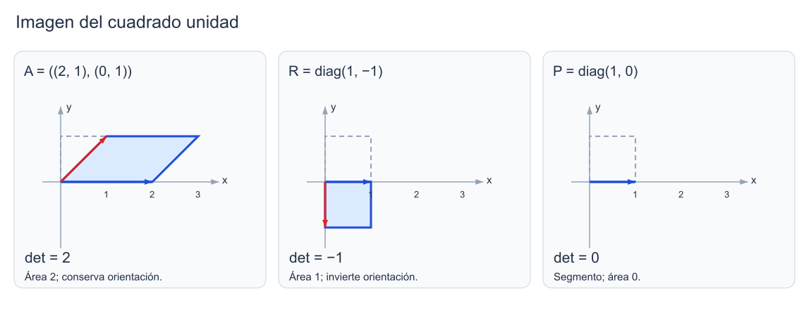
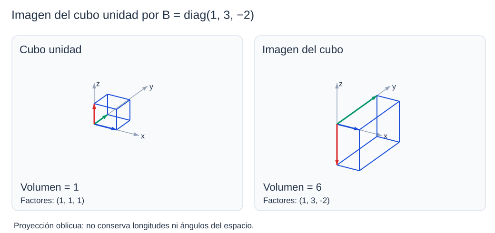

```dataviewjs
await dv.view("Planes/Estudio/Scripts/study-session", { location: "start" })
```

# Interpretación geométrica del determinante

> [!contexto] Ampliación geométrica
> Esta lectura complementa el cálculo de determinantes. Trabajamos con matrices **reales** de orden dos o tres y con la orientación habitual de los ejes.[^volumen]

## Transformación lineal en el plano y el espacio

Consideremos el cuadrado de vértices $(0,0)$, $(1,0)$, $(0,1)$ y $(1,1)$. Al multiplicar sus coordenadas por

$$
A=\begin{pmatrix}2&1\\0&1\end{pmatrix},
$$

el origen queda fijo, $(1,0)$ pasa a $(2,0)$ y $(0,1)$ pasa a $(1,1)$. El cuarto vértice pasa a $(3,1)$, suma de las dos imágenes anteriores. El cuadrado se ha convertido en un paralelogramo de base $2$ y altura $1$: su área es $2$, que coincide con $\det(A)$.

La [[Matemáticas/Álgebra lineal/Producto matricial|multiplicación matricial]] permite describir toda la transformación, no solo sus vértices:

$$
T_A(x,y)=A\begin{pmatrix}x\\y\end{pmatrix}
=\begin{pmatrix}2x+y\\y\end{pmatrix}.
$$

En general, para $A\in M_n(\mathbb R)$, con $n=2$ o $n=3$, definimos $T_A(\mathbf x)=A\mathbf x$. Es una [[Física/Grado/1º/Álgebra Lineal y Geometría Analítica/04 Transformaciones lineales/02 Transformaciones, núcleo e imagen|transformación lineal]]. Si $\mathbf e_j$ es el vector de la base estándar que tiene un $1$ en la posición $j$ y ceros en las demás, el producto $A\mathbf e_j$ selecciona la columna $j$ de $A$. Por eso las columnas son los lados de la imagen del cuadrado o del cubo unidad.[^volumen]

### Paralelogramo generado por dos vectores

> [!definicion] Paralelogramo generado por dos vectores
> Para $\mathbf u,\mathbf v\in\mathbb R^2$, el paralelogramo con vértice en el origen y lados $\mathbf u,\mathbf v$ es
>
> $$
> \{s\mathbf u+t\mathbf v:0\le s\le1,\ 0\le t\le1\}.
> $$
> Sus vértices son $\mathbf0$, $\mathbf u$, $\mathbf v$ y $\mathbf u+\mathbf v$.[^volumen]


*La escala de área, el signo y la anulación del determinante describen aspectos distintos de la transformación. [[Física/Grado/1º/Álgebra Lineal y Geometría Analítica/02 Determinantes/assets/03-area-orientacion.excalidraw|Dibujo editable]].*

```anki
deck: Matemáticas::Álgebra lineal::Determinantes
tags:
  - matemáticas
  - determinantes
  - interpretación-geométrica
---
> [!note] Pregunta
> ¿Qué representan las columnas de $A$ en la transformación $T_A(\mathbf x)=A\mathbf x$?
===
> [!important] Respuesta
> Las imágenes de los vectores de la base estándar: la columna $j$ es $A\mathbf e_j$.
```

```anki
deck: Matemáticas::Álgebra lineal::Determinantes
tags:
  - matemáticas
  - determinantes
  - interpretación-geométrica
---
> [!note] Pregunta
> ¿Qué puntos forman el paralelogramo generado por $\mathbf u$ y $\mathbf v$ desde el origen?
===
> [!important] Respuesta
> Los puntos $s\mathbf u+t\mathbf v$ con $0\le s,t\le1$. Sus vértices son $\mathbf0$, $\mathbf u$, $\mathbf v$ y $\mathbf u+\mathbf v$.
```

## Área y volumen: valor absoluto

### Área de un paralelogramo

> [!teorema] Área a partir de los lados
> Para $\mathbf u,\mathbf v\in\mathbb R^2$, el área del paralelogramo que generan es
>
> $$
> \boxed{\operatorname{Área}(\mathbf u,\mathbf v)
> =\left|\det[\mathbf u\ \mathbf v]\right|.}
> $$
> [^volumen]

En el ejemplo inicial, las columnas son $\mathbf u=(2,0)^T$ y $\mathbf v=(1,1)^T$. Su determinante es $2\cdot1-1\cdot0=2$; el valor absoluto coincide con la base por la altura que habíamos calculado.

```anki
deck: Matemáticas::Álgebra lineal::Determinantes
tags:
  - matemáticas
  - determinantes
  - área
---
> [!note] Pregunta
> ¿Cómo se calcula el área de un paralelogramo a partir de sus dos vectores lado?
===
> [!important] Respuesta
> Con $|\det[\mathbf u\ \mathbf v]|$, colocando ambos vectores como columnas de una matriz $2\times2$.
```

### Ejemplo trabajado: escala de área en el plano

El cuadrado unidad tiene área $1$ y su imagen tiene área $2$. Para cualquier paralelogramo, aplicar la misma matriz $A$ multiplica el área por ese factor $2$. Si la región inicial tiene área $5$, la imagen tiene área $10$; no necesitamos conocer sus lados para calcular esta proporción.[^escala]

### Factor de escala

> [!definicion] Factor de escala de área o volumen
> Para una transformación lineal real $T_A:\mathbb R^n\to\mathbb R^n$, con $n=2$ o $3$, el factor de escala es
>
> $$
> |\det(A)|.
> $$
> Multiplica el área en dimensión dos y el volumen en dimensión tres. Se aplica a regiones medibles; si $\det(A)=0$, el área o volumen de dimensión completa de la imagen es cero.[^escala]

```anki
id: 1793798107039
deck: Matemáticas::Álgebra lineal::Determinantes
tags:
  - matemáticas
  - determinantes
  - interpretación-geométrica
---
> [!note] Pregunta
> En una transformación lineal real cuadrada, ¿qué expresa $|\det(A)|$?
===
> [!important] Respuesta
> El factor por el que se multiplican las áreas en $\mathbb R^2$ o los volúmenes en $\mathbb R^3$.
>
> 
```

### Paralelepípedo generado por tres vectores

> [!definicion] Paralelepípedo generado por tres vectores
> Para $\mathbf u,\mathbf v,\mathbf w\in\mathbb R^3$, el paralelepípedo con esos lados desde el origen es
>
> $$
> \{s\mathbf u+t\mathbf v+r\mathbf w:0\le s,t,r\le1\}.
> $$
> Su volumen es $|\det[\mathbf u\ \mathbf v\ \mathbf w]|$.[^volumen]

```anki
deck: Matemáticas::Álgebra lineal::Determinantes
tags:
  - matemáticas
  - determinantes
  - volumen
---
> [!note] Pregunta
> ¿Qué puntos forman el paralelepípedo generado por tres vectores desde el origen?
===
> [!important] Respuesta
> Los puntos $s\mathbf u+t\mathbf v+r\mathbf w$ con $0\le s,t,r\le1$.
```

### Ejemplo trabajado: escala de volumen en el espacio

Para construir la imagen del cubo unidad mediante

$$
B=\begin{pmatrix}1&0&0\\0&3&0\\0&0&-2\end{pmatrix},
$$

multiplicamos por $B$ sus tres aristas que parten del origen. Se convierten en $(1,0,0)^T$, $(0,3,0)^T$ y $(0,0,-2)^T$: sus longitudes son $1$, $3$ y $2$. La tercera arista apunta ahora hacia los valores negativos de $z$.

En este ejemplo los lados son perpendiculares, por lo que podemos comprobar el volumen multiplicando sus longitudes:

$$
V=1\cdot3\cdot2=6=|\det(B)|.
$$

El determinante vale $-6$. El volumen es $6$; el signo negativo describe un cambio de orientación, que estudiaremos a continuación.



*La imagen queda por debajo del plano $xy$ por el factor $-2$ en la tercera coordenada. Proyección oblicua: las longitudes aparentes del dibujo no están a escala espacial. [[Física/Grado/1º/Álgebra Lineal y Geometría Analítica/02 Determinantes/assets/03-volumen.excalidraw|Dibujo editable]].*

```anki
deck: Matemáticas::Álgebra lineal::Determinantes
tags:
  - matemáticas
  - determinantes
  - interpretación-geométrica
---
> [!note] Pregunta
> ¿Cómo se calcula el volumen del paralelepípedo generado por tres vectores de $\mathbb R^3$?
===
> [!important] Respuesta
> Con el valor absoluto del determinante de la matriz que tiene esos vectores como columnas: $|\det[\mathbf u\ \mathbf v\ \mathbf w]|$.
```

## Signo y orientación

### Orientación de las columnas

En el plano, el par estándar $\mathbf e_1=(1,0)^T$, $\mathbf e_2=(0,1)^T$ recorre un ángulo antihorario menor que $180^\circ$ desde el primero al segundo. La reflexión respecto del eje horizontal lo convierte en $\mathbf e_1,-\mathbf e_2$; ese recorrido pasa a ser horario. El área del cuadrado no cambia, pero sí la orientación del par de lados.[^orientacion]

> [!definicion] Orientación y signo del determinante
> Fijada la base estándar, una transformación real invertible **conserva la orientación** si $\det(A)>0$ y **la invierte** si $\det(A)<0$.
>
> Con $\det(A)=0$, las columnas no forman una [[Matemáticas/Álgebra lineal/Espacios vectoriales/05 Bases y dimensión|base]]: no se les asigna una de esas dos orientaciones.[^orientacion]

Para la reflexión anterior,

$$
R=\begin{pmatrix}1&0\\0&-1\end{pmatrix},
\qquad \det(R)=-1.
$$

Su factor de área es $1$ y su orientación es la contraria. Una rotación del plano, en cambio, tiene matriz

$$
Q_\theta=\begin{pmatrix}\cos\theta&-\sin\theta\\\sin\theta&\cos\theta\end{pmatrix},
\qquad \det(Q_\theta)=\cos^2\theta+\sin^2\theta=1.
$$

Conserva tanto el área como la orientación. Tener valor absoluto $1$ no basta para distinguir una rotación de una reflexión.

```anki
deck: Matemáticas::Álgebra lineal::Determinantes
tags:
  - matemáticas
  - determinantes
  - orientación
---
> [!note] Pregunta
> ¿Cómo indica el determinante si una transformación real invertible conserva o invierte la orientación?
===
> [!important] Respuesta
> Si $\det(A)>0$, la conserva; si $\det(A)<0$, la invierte. La orientación se compara con una base fijada.
```

```anki
deck: Matemáticas::Álgebra lineal::Determinantes
tags:
  - matemáticas
  - determinantes
  - orientación
---
> [!note] Pregunta
> ¿Por qué $|\det(A)|=1$ no basta para afirmar que una transformación conserva la orientación?
===
> [!important] Respuesta
> Porque el determinante puede ser $-1$: conserva áreas o volúmenes, pero invierte la orientación. Una reflexión es un ejemplo.
```

## Determinante nulo y colapso dimensional

La matriz

$$
P=\begin{pmatrix}1&0\\0&0\end{pmatrix}
$$

transforma $(x,y)$ en $(x,0)$. Todo el cuadrado unidad acaba en el segmento entre $(0,0)$ y $(1,0)$. La segunda columna es [[Matemáticas/Álgebra lineal/Matriz nula|nula]] y $\det(P)=0$.

En este caso, todos los puntos con la misma coordenada $x$ tienen la misma imagen: $(x,1)$ y $(x,7)$ se convierten en $(x,0)$. No podemos recuperar la coordenada $y$ a partir del resultado; por eso $P$ no tiene [[Matemáticas/Álgebra lineal/Matriz inversa|inversa]].

### Degeneración dimensional

> [!definicion] Degeneración dimensional
> Una transformación lineal de $\mathbb R^n$ en sí mismo es **singular** si su imagen tiene dimensión menor que $n$. Para su matriz $A$,
>
> $$
> \boxed{\det(A)=0\iff\operatorname{rg}(A)<n.}
> $$
> [^singular]

El [[Matemáticas/Álgebra lineal/Rango de una matriz|rango]] precisa cuánto se reduce la dimensión: en el plano, rango $1$ significa una imagen recta y rango $0$, solo el origen. En el espacio, rango $2$ da un plano; rango $1$, una recta; rango $0$, el origen. El determinante distingue únicamente si el rango es completo o menor que $n$; no separa esos distintos rangos inferiores.

```anki
deck: Matemáticas::Álgebra lineal::Determinantes
tags:
  - matemáticas
  - determinantes
  - singularidad
---
> [!note] Pregunta
> ¿Qué significa geométricamente $\det(A)=0$ para $T_A:\mathbb R^n\to\mathbb R^n$?
===
> [!important] Respuesta
> Que la imagen tiene dimensión menor que $n$. Las columnas son dependientes y la transformación no es invertible.
```

```anki
deck: Matemáticas::Álgebra lineal::Determinantes
tags:
  - matemáticas
  - determinantes
  - rango
---
> [!note] Pregunta
> Si una matriz real $3\times3$ tiene determinante cero, ¿puedes saber solo con ello la dimensión exacta de su imagen?
===
> [!important] Respuesta
> No. Puede ser $2$, $1$ o $0$; para distinguirlas hace falta el rango.
```

## Composición y multiplicatividad

### Aplicar dos transformaciones sucesivas

Si primero aplicamos $T_B$ y después $T_A$, el resultado es $A(B\mathbf x)=(AB)\mathbf x$. La matriz de la [[Física/Grado/1º/Álgebra Lineal y Geometría Analítica/04 Transformaciones lineales/04 Transformaciones geométricas y composición|composición]] es, por tanto, $AB$.

#### Propiedad

> [!teorema] Escalas geométricas bajo composición
> Para matrices reales cuadradas $A,B$ del mismo orden,
>
> $$
> \boxed{\det(AB)=\det(A)\det(B).}
> $$
>
> Los factores de área o volumen se multiplican:
>
> $$
> |\det(AB)|=|\det(A)|\,|\det(B)|.
> $$
> [^escala]

#### Demostración

> [!demostracion] Demostración
> La [[Física/Grado/1º/Álgebra Lineal y Geometría Analítica/02 Determinantes/02 Propiedades y aplicaciones#Producto de matrices|multiplicatividad algebraica]] ya establece la primera igualdad para todas las matrices cuadradas. Al tomar valores absolutos y usar $|ab|=|a||b|$ obtenemos la segunda. No suponemos invertibilidad: un factor cero da una imagen de volumen completo nulo. $\blacksquare$

### Ejemplo trabajado: composición de escala y reflexión

Para duplicar la coordenada horizontal utilizamos

$$
S=\begin{pmatrix}2&0\\0&1\end{pmatrix}.
$$

Después reflejamos respecto del eje horizontal mediante $R=\operatorname{diag}(1,-1)$. Un punto $(x,y)$ pasa primero a $(2x,y)$ y luego a $(2x,-y)$. Así,

$$
RS=\begin{pmatrix}2&0\\0&-1\end{pmatrix},
\qquad \det(RS)=(-1)\cdot2=-2.
$$

La imagen tiene el doble de área y la orientación contraria. Dos reflexiones sucesivas invierten dos veces la orientación: el producto de sus determinantes negativos es positivo.

```anki
deck: Matemáticas::Álgebra lineal::Determinantes
tags:
  - matemáticas
  - determinantes
  - composición
---
> [!note] Pregunta
> ¿Cómo se combinan los factores de área o volumen al componer dos transformaciones lineales reales cuadradas?
===
> [!important] Respuesta
> Se multiplican: $|\det(AB)|=|\det(A)|\,|\det(B)|$.
```

### Por qué el mismo factor vale para otros paralelogramos

#### Demostración

> [!demostracion] Demostración
> Sean $\mathbf u,\mathbf v$ los lados de un paralelogramo y $U=[\mathbf u\ \mathbf v]$. Tras aplicar $A$, sus lados son $A\mathbf u,A\mathbf v$, es decir, las columnas de $AU$. Por la fórmula del área y por multiplicatividad,
>
> $$
> \begin{aligned}
> \operatorname{Área}(A\mathbf u,A\mathbf v)
> &=|\det(AU)|\\
> &=|\det(A)|\,|\det(U)|\\
> &=|\det(A)|\operatorname{Área}(\mathbf u,\mathbf v).
> \end{aligned}
> $$
>
> Con tres columnas, la misma operación da el factor de volumen de cualquier paralelepípedo. El paso a regiones medibles generales requiere la extensión del teorema de volumen; no se deduce únicamente de dibujar un cuadrado. $\blacksquare$[^volumen][^escala]

```anki
deck: Matemáticas::Álgebra lineal::Determinantes
tags:
  - matemáticas
  - determinantes
  - orientación
---
> [!note] Pregunta
> ¿Qué ocurre con la orientación al componer dos transformaciones que la invierten?
===
> [!important] Respuesta
> Se conserva: el producto de sus dos determinantes negativos es positivo.
```

## Condiciones de validez y límites

La lectura por signo requiere matrices reales: en $\mathbb C$ no hay una clasificación entre determinantes positivos y negativos. También exige fijar la orientación con la que se comparan las columnas.

Una matriz rectangular no tiene determinante ordinario. Puede describir una transformación entre dimensiones distintas, pero las fórmulas anteriores de escala cuadrada no se aplican directamente.

Una transformación afín añade una [[Física/Grado/1º/Álgebra Lineal y Geometría Analítica/04 Transformaciones lineales/04 Transformaciones geométricas y composición|traslación]], $\mathbf x\mapsto A\mathbf x+\mathbf b$. Trasladar una región no cambia su área ni su volumen; el factor depende de la parte lineal $A$.[^escala]

Por último, el determinante no determina la forma de la imagen: $I_2$ y $\operatorname{diag}(2,1/2)$ tienen ambos determinante $1$. La segunda transforma el cuadrado en un rectángulo alargado, aunque conserva su área.

```anki
deck: Matemáticas::Álgebra lineal::Determinantes
tags:
  - matemáticas
  - determinantes
  - interpretación-geométrica
---
> [!note] Pregunta
> ¿Permite el determinante conocer cuánto se estira una región en cada dirección?
===
> [!important] Respuesta
> No. Solo da el factor global de área o volumen y, en el caso real no singular, el cambio de orientación. Por ejemplo, $I_2$ y $\operatorname{diag}(2,1/2)$ tienen determinante $1$.
```

```anki
deck: Matemáticas::Álgebra lineal::Determinantes
tags:
  - matemáticas
  - determinantes
  - límites
---
> [!note] Pregunta
> ¿Qué parte de una transformación afín $\mathbf x\mapsto A\mathbf x+\mathbf b$ determina el factor de área o volumen?
===
> [!important] Respuesta
> La parte lineal: $|\det(A)|$. La traslación por $\mathbf b$ no cambia la medida.
```

```anki
deck: Matemáticas::Álgebra lineal::Determinantes
tags:
  - matemáticas
  - determinantes
  - límites
---
> [!note] Pregunta
> ¿Puede interpretarse el signo de un determinante complejo como conservación o inversión de orientación?
===
> [!important] Respuesta
> No. Esa lectura por signo corresponde a matrices reales; un número complejo no se clasifica como positivo o negativo.
```


## 📚 Fuentes

### Material base

La interpretación geométrica se conserva como ampliación externa; no se atribuye a las aulas 13–16.

### Ampliación académica

[^volumen]: Joseph Rabinoff y Dan Margalit, Georgia Institute of Technology, *Interactive Linear Algebra*, [§4.3, «Determinants and Volumes»](https://textbooks.math.gatech.edu/ila/determinants-volumes.html), definiciones de paralelogramo y paralelepípedo y teorema de volumen. La prueba local de escala para esos sólidos combina este teorema con multiplicatividad; no reproduce la prueba del teorema general de medida.

[^escala]: ULisboa, Instituto Superior Técnico, *Álgebra Linear*, [apuntes integrados](https://fenix.tecnico.ulisboa.pt/downloadFile/563568428979297/ApontamentosInteg.pdf), §5.1, pp. 95–97, y observación 5.14, pp. 106–107. Motivación por volúmenes y composición. La extensión a regiones medibles figura también en Georgia Tech §4.3, «The Volume Scaling Theorem».

[^orientacion]: IST, mismos apuntes, §5.1 y §5.22, y Georgia Tech §4.3: volumen absoluto y orientación. Las matrices de reflexión, rotación y los cálculos concretos son desarrollos explicativos comprobados en esta nota.

[^singular]: IST, corolario 5.13, pp. 104–105, y Georgia Tech §4.3, observación sobre volumen cero y dependencia. La equivalencia con rango recupera el criterio de invertibilidad ya estudiado.

## 🧑‍🏫 Prompt para tutor conversacional

Trabaja a nivel de primer curso de Álgebra Lineal con matrices reales $2\times2$ y $3\times3$. Presupón producto matricial, determinantes e invertibilidad. $T_A(\mathbf x)=A\mathbf x$ envía los vectores de la base estándar a las columnas de $A$. El paralelogramo de lados $\mathbf u,\mathbf v$ tiene área $|\det[\mathbf u\ \mathbf v]|$; el paralelepípedo de tres lados tiene volumen igual al valor absoluto del determinante de sus columnas. $|\det(A)|$ es el factor de escala; el signo positivo conserva orientación y el negativo la invierte. Con determinante cero, el rango es menor que la dimensión y no hay inversa. El factor no determina los estiramientos individuales. La composición primero $B$ y después $A$ tiene matriz $AB$ y sus factores se multiplican.

Formula una pregunta cada vez, espera el intento y adapta las pistas al error conceptual o de cálculo. Usa los ejemplos existentes: $A=\begin{pmatrix}2&1\\0&1\end{pmatrix}$ transforma el cuadrado unidad en un paralelogramo de área $2$; $\operatorname{diag}(1,3,-2)$ da volumen $6$ e invierte orientación; $\operatorname{diag}(1,0)$ proyecta sobre el eje horizontal y no es invertible. Pide reconstruir los vértices antes de interpretar el determinante. No reveles respuestas antes del intento ni generes ejercicios nuevos; recupera más tarde las distinciones que hayan fallado.

```dataviewjs
await dv.view("Planes/Estudio/Scripts/study-session", { location: "end" })
```
