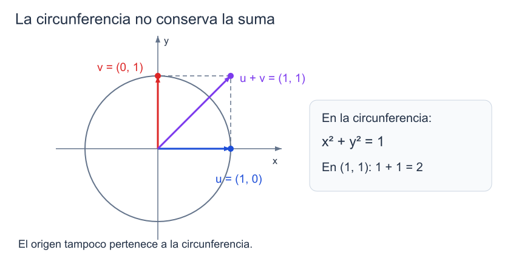

```dataviewjs
await dv.view("Planes/Estudio/Scripts/study-session", { location: "start" })
```

# Espacios vectoriales y axiomas

Al sumar los polinomios $1+x$ y $2-x$ obtenemos $3$; al multiplicar $1+x$ por $2$, obtenemos $2+2x$. Podemos hacer estas operaciones sin convertir los polinomios en flechas. Con las matrices ocurría algo parecido: sumábamos entradas y multiplicábamos por escalares, aunque el resultado siguiera siendo una matriz.

La definición de [[Matemáticas/Álgebra lineal/Espacios vectoriales/01 Espacios vectoriales — definición y axiomas|espacio vectorial]] recoge las leyes que permiten operar así. Una vez demostrada una consecuencia de esas leyes, podremos utilizarla con polinomios, matrices o funciones sin repetir la prueba para cada clase de objetos.[^base]

## Conjunto, escalares y operaciones

### Cuerpo de escalares

> [!definicion] Cuerpo de escalares
> El **cuerpo de escalares** $K$ es el cuerpo del que se toman los números que multiplican a los vectores. En este curso será normalmente $\mathbb R$ o $\mathbb C$.

En un [[Matemáticas/Estructuras algebraicas/Cuerpos|cuerpo]] cada escalar no nulo tiene inverso multiplicativo. Esa posibilidad de dividir será necesaria, por ejemplo, para deducir $v=0_V$ de $\lambda v=0_V$ cuando $\lambda\ne0_K$.

```anki
deck: Física::Álgebra Lineal::Espacios vectoriales
tags:
  - matematicas
  - algebra-lineal
  - espacios-vectoriales
---
> [!note] Pregunta
> ¿Qué determina el cuerpo de escalares de un espacio vectorial?
===
> [!important] Respuesta
> Qué números pueden multiplicar a sus vectores. Todo escalar no nulo admite inverso en ese cuerpo.
```

### Suma interna

> [!definicion] Suma interna
> Una **suma interna** en $V$ es una función
>
> $$
> +:V\times V\longrightarrow V,\qquad (u,v)\longmapsto u+v.
> $$

La condición de [[Matemáticas/Estructuras algebraicas/Operaciones algebraicas#2. Cerradura y operaciones externas|cierre]] está incluida en el codominio: cada pareja de elementos de $V$ debe tener una suma única que pertenezca a $V$. Por ejemplo, sumar dos matrices $3\times3$ produce otra matriz $3\times3$.

Una [[Matemáticas/Estructuras algebraicas/Operaciones algebraicas#1. 🔗 Operaciones como funciones|operación binaria]] puede obedecer otras reglas. En $\mathbb R$, tanto $a\ast b=a+b+2ab$ como $a\ast b=5$ definen operaciones internas. Esto no las convierte en la suma habitual: para la operación constante ni siquiera existe un neutro, pues $a\ast e=5$ no puede ser igual a todo $a\in\mathbb R$.[^operaciones]

```anki
deck: Física::Álgebra Lineal::Espacios vectoriales
tags:
  - matematicas
  - algebra-lineal
  - operaciones
---
> [!note] Pregunta
> ¿Qué exige que una suma sea una operación interna en $V$?
===
> [!important] Respuesta
> Que asigne a cada $(u,v)\in V\times V$ un único resultado $u+v\in V$. Esto todavía no exige asociatividad ni conmutatividad.
```

### Multiplicación externa por escalares

> [!definicion] Multiplicación por escalares
> Una **multiplicación por escalares** de $K$ sobre $V$ es una función
>
> $$
> K\times V\longrightarrow V,\qquad (\lambda,v)\longmapsto\lambda v.
> $$

En $\mathbb R^2$, $3(1,2)=(3,6)$: el primer argumento es un real y el segundo, un vector. El producto debe estar definido para ==todos los escalares del cuerpo elegido==, incluidos el cero y los negativos cuando $K=\mathbb R$.

```anki
deck: Física::Álgebra Lineal::Espacios vectoriales
tags:
  - matematicas
  - algebra-lineal
  - operaciones
---
> [!note] Pregunta
> ¿Cuáles son el dominio y el codominio de la multiplicación por escalares?
===
> [!important] Respuesta
> $K\times V\to V$: recibe un escalar de $K$ y un vector de $V$, y devuelve un vector de $V$.
```

### Definición de espacio vectorial

> [!definicion] Espacio vectorial sobre $K$
> Un **espacio vectorial sobre $K$** es un conjunto no vacío $V$ con una suma interna y una multiplicación por escalares de $K$ que satisfacen los ocho axiomas siguientes. Sus elementos se llaman **vectores**; los elementos de $K$, **escalares**.[^base]

Así, en el espacio $M_{3\times3}(\mathbb R)$ los vectores son matrices y los escalares son reales. En $\mathbb R[x]$, los vectores son polinomios. La [[Matemáticas/Álgebra lineal/Espacios vectoriales/01 Espacios vectoriales — definición y axiomas|definición abstracta]] se aplica a las operaciones que acabamos de especificar, no al conjunto aislado.

```anki
deck: Física::Álgebra Lineal::Espacios vectoriales
tags:
  - matematicas
  - algebra-lineal
  - espacios-vectoriales
---
> [!note] Pregunta
> ¿Qué datos y condiciones definen un espacio vectorial sobre $K$?
===
> [!important] Respuesta
> Un conjunto no vacío $V$, una suma interna que lo hace grupo conmutativo y una acción $K\times V\to V$ que cumple las dos distributividades, la compatibilidad con el producto de escalares y $1_Kv=v$.
```

## Los ocho axiomas

En los enunciados, $u,v,w\in V$ y $\alpha,\beta\in K$ son arbitrarios. Conservamos las etiquetas A1–A4 y E1–E4. Las cuatro leyes aditivas hacen de $(V,+)$ un [[Matemáticas/Estructuras algebraicas/Operaciones algebraicas#4. Estructuras definidas por sus leyes|grupo conmutativo]].[^axiomas]

### A1. Conmutatividad de la suma

> [!principio] Conmutatividad de la suma
> $$
> \boxed{u+v=v+u}
> $$

Se pueden intercambiar los dos sumandos.

```anki
deck: Física::Álgebra Lineal::Espacios vectoriales
tags:
  - matematicas
  - algebra-lineal
  - axiomas
---
> [!note] Pregunta
> ¿Qué afirma la conmutatividad de la suma vectorial?
===
> [!important] Respuesta
> $u+v=v+u$ para todos $u,v\in V$.
```

### A2. Asociatividad de la suma

> [!principio] Asociatividad de la suma
> $$
> \boxed{(u+v)+w=u+(v+w)}
> $$

Podemos reagrupar tres sumandos conservando su orden.

```anki
deck: Física::Álgebra Lineal::Espacios vectoriales
tags:
  - matematicas
  - algebra-lineal
  - axiomas
---
> [!note] Pregunta
> ¿Qué permite la asociatividad de la suma vectorial?
===
> [!important] Respuesta
> Reagrupar: $(u+v)+w=u+(v+w)$ para todos $u,v,w\in V$.
```

### A3. Vector cero

> [!definicion] Vector cero
> $$
> \boxed{\exists\,0_V\in V:\quad\forall u\in V,\quad u+0_V=0_V+u=u}
> $$

El neutro es un elemento de $V$. En $\mathbb R^2$ es $(0,0)$; en un espacio de funciones es la función nula.

```anki
deck: Física::Álgebra Lineal::Espacios vectoriales
tags:
  - matematicas
  - algebra-lineal
  - axiomas
---
> [!note] Pregunta
> ¿Qué caracteriza al vector cero de un espacio vectorial?
===
> [!important] Respuesta
> Es el neutro de la suma: $u+0_V=0_V+u=u$ para todo $u\in V$. Pertenece a $V$; $0_K$ pertenece al cuerpo de escalares.
```

### A4. Opuesto aditivo

> [!definicion] Opuesto aditivo
> $$
> \boxed{\forall u\in V,\quad\exists\,(-u)\in V:\quad u+(-u)=(-u)+u=0_V}
> $$

Por ejemplo, el opuesto de $(2,-3)$ es $(-2,3)$. La unicidad del opuesto se demostrará a partir de estos axiomas.

```anki
deck: Física::Álgebra Lineal::Espacios vectoriales
tags:
  - matematicas
  - algebra-lineal
  - axiomas
---
> [!note] Pregunta
> ¿Qué caracteriza al opuesto aditivo de un vector $u$?
===
> [!important] Respuesta
> Un vector $-u\in V$ tal que $u+(-u)=(-u)+u=0_V$.
```

### E1. Compatibilidad con el producto de escalares

> [!principio] Compatibilidad con el producto de escalares
> $$
> \boxed{(\alpha\beta)u=\alpha(\beta u)}
> $$

En $\alpha\beta$ se multiplican dos elementos de $K$; en $\beta u$ actúa un escalar sobre un vector.

```anki
deck: Física::Álgebra Lineal::Espacios vectoriales
tags:
  - matematicas
  - algebra-lineal
  - axiomas
---
> [!note] Pregunta
> ¿Qué ley relaciona dos multiplicaciones sucesivas por escalares?
===
> [!important] Respuesta
> $(\alpha\beta)u=\alpha(\beta u)$, con $\alpha,\beta\in K$ y $u\in V$.
```

### E2. Distributividad sobre la suma de vectores

> [!principio] Distributividad sobre la suma de vectores
> $$
> \boxed{\alpha(u+v)=\alpha u+\alpha v}
> $$

La suma entre paréntesis se efectúa en $V$.

```anki
deck: Física::Álgebra Lineal::Espacios vectoriales
tags:
  - matematicas
  - algebra-lineal
  - axiomas
---
> [!note] Pregunta
> ¿Cómo se distribuye un escalar sobre una suma de vectores?
===
> [!important] Respuesta
> $\alpha(u+v)=\alpha u+\alpha v$, con $\alpha\in K$ y $u,v\in V$.
```

### E3. Distributividad sobre la suma de escalares

> [!principio] Distributividad sobre la suma de escalares
> $$
> \boxed{(\alpha+\beta)u=\alpha u+\beta u}
> $$

Aquí se suman primero dos escalares en $K$.

```anki
deck: Física::Álgebra Lineal::Espacios vectoriales
tags:
  - matematicas
  - algebra-lineal
  - axiomas
---
> [!note] Pregunta
> ¿Cómo se distribuye una suma de escalares al multiplicar un vector?
===
> [!important] Respuesta
> $(\alpha+\beta)u=\alpha u+\beta u$, con $\alpha,\beta\in K$ y $u\in V$.
```

### E4. Acción de la unidad

> [!principio] Acción de la unidad
> $$
> \boxed{1_Ku=u}
> $$

La unidad multiplicativa del cuerpo debe dejar fijo a cada vector.

```anki
deck: Física::Álgebra Lineal::Espacios vectoriales
tags:
  - matematicas
  - algebra-lineal
  - axiomas
---
> [!note] Pregunta
> ¿Qué exige el axioma de acción de la unidad en un espacio vectorial?
===
> [!important] Respuesta
> $1_Ku=u$ para todo $u\in V$.
```


```anki
deck: Física::Álgebra Lineal::Espacios vectoriales
tags:
  - matematicas
  - algebra-lineal
  - operaciones
---
> [!note] Pregunta
> ¿Qué leyes debe cumplir la suma interna de un espacio vectorial?
===
> [!important] Respuesta
> Asociatividad, conmutatividad, existencia de neutro y existencia de opuesto para cada vector. La multiplicación por escalares tiene sus cuatro axiomas propios.
```

### Resta de vectores

> [!definicion] Resta vectorial
> Para $u,v\in V$, se define
>
> $$
> u-v=u+(-v).
> $$

Por ejemplo, $(3,1)-(1,4)=(3,1)+(-1,-4)=(2,-3)$.

```anki
deck: Física::Álgebra Lineal::Espacios vectoriales
tags:
  - matematicas
  - algebra-lineal
  - espacios-vectoriales
---
> [!note] Pregunta
> ¿Cómo se define la resta de dos vectores?
===
> [!important] Respuesta
> $u-v=u+(-v)$: se suma a $u$ el opuesto aditivo de $v$.
```

## Espacios de coordenadas y matrices

### Coordenadas sobre un cuerpo

> [!definicion] Espacio coordenado $K^n$
> Para $n\in\mathbb N$, $n\ge1$, el conjunto $K^n$ está formado por las $n$-tuplas con entradas en $K$, con suma y multiplicación por escalares componente a componente.

Para $u=(u_1,\ldots,u_n)$ y $v=(v_1,\ldots,v_n)$,

$$
u+v=(u_1+v_1,\ldots,u_n+v_n),
$$

$$
\lambda u=(\lambda u_1,\ldots,\lambda u_n).
$$

En $\mathbb R^2$, $(1,2)+(-3,4)=(-2,6)$ y $2(1,2)=(2,4)$. Cada axioma se comprueba fijando una componente arbitraria y aplicando la correspondiente ley del cuerpo.[^base]

#### Demostración de la asociatividad en $K^n$

> [!demostracion] Demostración
> Sean $u,v,w\in K^n$ y fijemos $i\in\{1,\ldots,n\}$ arbitrario. Por la suma por componentes y la asociatividad en $K$,
>
> $$
> ((u+v)+w)_i=(u_i+v_i)+w_i=u_i+(v_i+w_i)=(u+(v+w))_i.
> $$
>
> Ambos miembros pertenecen a $K^n$ y coinciden en todas las componentes; por tanto, $(u+v)+w=u+(v+w)$. $\blacksquare$

El vector cero de este espacio es $(0_K,\ldots,0_K)$.

```anki
deck: Física::Álgebra Lineal::Espacios vectoriales
tags:
  - matematicas
  - algebra-lineal
  - espacios-vectoriales
---
> [!note] Pregunta
> ¿Cómo se suman y se multiplican por escalares los elementos de $K^n$?
===
> [!important] Respuesta
> Componente a componente: $(u+v)_i=u_i+v_i$ y $(\lambda u)_i=\lambda u_i$, para $i\in\{1,\ldots,n\}$.
```

### Matrices de tamaño fijo

> [!definicion] Espacio matricial
> $M_{m\times n}(K)$ es el conjunto de matrices de tamaño $m\times n$ y entradas en $K$, con la suma y el producto por escalares habituales.

#### Ejemplo trabajado — sumar y escalar matrices

Para estas [[Matemáticas/Álgebra lineal/Matrices|matrices]],

$$
A=\begin{pmatrix}1&0&2\\-1&3&1\\2&1&0\end{pmatrix},
\qquad B=\begin{pmatrix}0&2&-1\\4&1&0\\-2&3&5\end{pmatrix},
$$

se obtiene

$$
A+B=\begin{pmatrix}1&2&1\\3&4&1\\0&4&5\end{pmatrix},
\qquad 2A=\begin{pmatrix}2&0&4\\-2&6&2\\4&2&0\end{pmatrix}.
$$

Los resultados conservan el tamaño. El neutro es la matriz nula y el opuesto es $-A$. Los axiomas se verifican entrada por entrada como en el [[Física/Grado/1º/Álgebra Lineal y Geometría Analítica/01 Matrices y sistemas/01 Matrices y operaciones|cálculo matricial]].[^base]

```anki
deck: Física::Álgebra Lineal::Espacios vectoriales
tags:
  - matematicas
  - algebra-lineal
  - espacios-vectoriales
---
> [!note] Pregunta
> ¿Qué operaciones y qué vector cero tiene el espacio $M_{m\times n}(K)$?
===
> [!important] Respuesta
> Suma y producto por escalares entrada a entrada; su vector cero es la matriz nula $0_{m\times n}$.
```

## Polinomios y funciones

### Polinomios sin cota de grado

> [!definicion] Espacio de polinomios $K[x]$
> $K[x]$ es el conjunto de polinomios en $x$ con coeficientes en $K$, con las operaciones usuales.

Cada polinomio tiene un número finito de términos, pero no se fija un grado máximo para todo el conjunto. La suma de dos polinomios y el múltiplo de uno de ellos siguen siendo polinomios; las leyes se verifican en sus coeficientes. El cero es el polinomio cuyos coeficientes son todos nulos.[^polinomios]

```anki
deck: Física::Álgebra Lineal::Espacios vectoriales
tags:
  - matematicas
  - algebra-lineal
  - polinomios
---
> [!note] Pregunta
> ¿Se fija un grado máximo al definir el espacio $K[x]$?
===
> [!important] Respuesta
> No. Cada polinomio tiene grado finito, pero el conjunto contiene polinomios de grados arbitrariamente altos.
```

### Polinomios de grado acotado

> [!definicion] Polinomios de grado a lo sumo $d$
> Para $d\in\mathbb N\cup\{0\}$,
>
> $$
> P_d(K)=\{a_0+a_1x+\cdots+a_dx^d:a_0,\ldots,a_d\in K\}.
> $$

Esta expresión incluye el polinomio nulo sin tener que asignarle un grado. La notación $\mathbb R_d[x]$ representa el mismo conjunto cuando $K=\mathbb R$. Por ejemplo, en $P_2(\mathbb R)$,

$$
(x^2+2x+1)+(-x^2+3)=2x+4,
$$

$$
3(x^2+2x+1)=3x^2+6x+3.
$$

La cancelación puede reducir el grado; no puede elevarlo por encima de $2$.[^polinomios]

```anki
deck: Física::Álgebra Lineal::Espacios vectoriales
tags:
  - matematicas
  - algebra-lineal
  - polinomios
---
> [!note] Pregunta
> ¿Qué polinomios forman $P_d(K)$?
===
> [!important] Respuesta
> Los de coeficientes en $K$ y grado a lo sumo $d$, incluido el polinomio nulo; se escribe $\sum_{j=0}^{d}a_jx^j$.
```

### Funciones con dominio fijo

> [!definicion] Espacio de funciones $F(X,K)$
> $F(X,K)$ es el conjunto de funciones $f:X\to K$, con operaciones definidas punto a punto:
>
> $$
> (f+g)(x)=f(x)+g(x),\qquad (\lambda f)(x)=\lambda f(x)
> \quad(\forall x\in X).
> $$

Con $X=\mathbb R$ y $K=\mathbb R$ escribiremos $F(\mathbb R)$. Si $f(x)=x^2$ y $g(x)=1-x$, entonces $(f+g)(x)=x^2-x+1$ y $(2f)(x)=2x^2$. El vector cero es la función $x\mapsto0$. Las identidades se comprueban en cada $x$, utilizando las leyes de $K$.[^funciones]

```anki
deck: Física::Álgebra Lineal::Espacios vectoriales
tags:
  - matematicas
  - algebra-lineal
  - funciones
---
> [!note] Pregunta
> ¿Cómo se definen la suma y el producto por escalares en $F(X,K)$?
===
> [!important] Respuesta
> Punto a punto: $(f+g)(x)=f(x)+g(x)$ y $(\lambda f)(x)=\lambda f(x)$ para cada $x\in X$.
```

### Funciones continuas

> [!definicion] Espacio $C(\mathbb R)$
> $C(\mathbb R)$ es el conjunto de funciones continuas $\mathbb R\to\mathbb R$, con las operaciones punto a punto.

La suma de dos funciones continuas y su producto por un real son continuos. Además, la función cero y el opuesto de cada función continua pertenecen al conjunto. Por eso estas operaciones también hacen de $C(\mathbb R)$ un espacio vectorial. Por ejemplo, $x^2+\cos x$ y $-3\cos x$ son continuas.[^funciones]

```anki
deck: Física::Álgebra Lineal::Espacios vectoriales
tags:
  - matematicas
  - algebra-lineal
  - funciones
---
> [!note] Pregunta
> ¿Por qué las funciones continuas $\mathbb R\to\mathbb R$ forman un espacio vectorial?
===
> [!important] Respuesta
> Contienen la función cero y sus opuestos, y la suma y el producto por escalares preservan la continuidad. Las leyes se heredan de las operaciones punto a punto.
```

## El cuerpo forma parte de la estructura

En $\mathbb C$, si admitimos escalares complejos, cualquier $z$ se escribe como $z\cdot1$. Si sólo admitimos escalares reales, necesitamos separar

$$
z=a+bi=a\,1+b\,i,\qquad a,b\in\mathbb R.
$$

Esto anticipa dos [[Matemáticas/Álgebra lineal/Espacios vectoriales/05 Bases y dimensión|dimensiones]] distintas: $\dim_{\mathbb C}\mathbb C=1$ y $\dim_{\mathbb R}\mathbb C=2$. Análogamente, $\dim_{\mathbb C}\mathbb C^n=n$ y $\dim_{\mathbb R}\mathbb C^n=2n$; la justificación mediante bases se desarrolla en [[Física/Grado/1º/Álgebra Lineal y Geometría Analítica/03 Espacios vectoriales/04 Independencia, bases y coordenadas|Independencia, bases y coordenadas]].[^cuerpo]

En cambio, con las operaciones habituales, $\mathbb R^n$ no es un espacio vectorial **sobre $\mathbb C$**: para $e_1=(1,0,\ldots,0)$,

$$
ie_1=(i,0,\ldots,0)\notin\mathbb R^n.
$$

Falla el cierre de la multiplicación por escalares complejos. Considerando ambos espacios sobre $\mathbb R$, sí tendremos $\mathbb R^n\le\mathbb C^n$.

```anki
deck: Física::Álgebra Lineal::Espacios vectoriales
tags:
  - matematicas
  - algebra-lineal
  - espacios-vectoriales
---
> [!note] Pregunta
> ¿Por qué $\mathbb R^n$ no es espacio vectorial sobre $\mathbb C$ con las operaciones habituales?
===
> [!important] Respuesta
> Porque no es cerrado bajo escalares complejos: $ie_1\notin\mathbb R^n$. Sobre $\mathbb R$, sí es subespacio de $\mathbb C^n$.
```


```anki
deck: Física::Álgebra Lineal::Espacios vectoriales
tags:
  - matematicas
  - algebra-lineal
  - espacios-vectoriales
---
> [!note] Pregunta
> ¿Qué dimensiones tiene $\mathbb C$ sobre $\mathbb C$ y sobre $\mathbb R$?
===
> [!important] Respuesta
> Dimensión compleja $1$, con base $(1)$; dimensión real $2$, con base $(1,i)$.
```

## Comprobar y descartar una estructura

### Espacio nulo

> [!definicion] Espacio vectorial nulo
> El espacio $\{0_V\}$ tiene un único elemento y operaciones $0_V+0_V=0_V$ y $\lambda0_V=0_V$ para todo $\lambda\in K$.

Todos los axiomas se verifican porque sus dos miembros son ese único elemento. No se exige que un espacio vectorial contenga un vector no nulo.[^casos]

```anki
deck: Física::Álgebra Lineal::Espacios vectoriales
tags:
  - matematicas
  - algebra-lineal
  - espacios-vectoriales
---
> [!note] Pregunta
> ¿El conjunto que sólo contiene al vector cero es un espacio vectorial?
===
> [!important] Respuesta
> Sí: con $0_V+0_V=0_V$ y $\lambda0_V=0_V$ cumple todos los axiomas. No es el conjunto vacío.
```

### Una circunferencia que no conserva la suma

Para la circunferencia unidad

$$
S^1=\{(x,y)\in\mathbb R^2:x^2+y^2=1\},
$$

los puntos $(1,0)$ y $(0,1)$ pertenecen al conjunto, pero su suma es $(1,1)$ y $1^2+1^2=2\ne1$. Por tanto, la suma habitual ni siquiera define una operación interna en $S^1$.[^casos]


*Los dos sumandos están en la circunferencia; el extremo de su suma queda fuera.* [[Física/Grado/1º/Álgebra Lineal y Geometría Analítica/03 Espacios vectoriales/assets/01-circunferencia-cierre.excalidraw|Dibujo editable]].


```anki
deck: Física::Álgebra Lineal::Espacios vectoriales
tags:
  - matematicas
  - algebra-lineal
  - espacios-vectoriales
---
> [!note] Pregunta
> ¿Por qué la circunferencia unidad de $\mathbb R^2$ no es un espacio vectorial con las operaciones habituales?
===
> [!important] Respuesta
> No es cerrada bajo suma: $(1,0),(0,1)\in S^1$, pero $(1,1)\notin S^1$.
>
> 
```

### Un producto escalar que incumple la unidad

Conservemos la suma habitual en $\mathbb R^2$ y definamos

$$
\lambda\odot(x,y)=(\lambda x,0).
$$

Los resultados son pares reales, pero $1\odot(1,2)=(1,0)\ne(1,2)$. Falla E4; estas operaciones no hacen de $\mathbb R^2$ un espacio vectorial.[^contraste]

```anki
deck: Física::Álgebra Lineal::Espacios vectoriales
tags:
  - matematicas
  - algebra-lineal
  - espacios-vectoriales
---
> [!note] Pregunta
> ¿Qué axioma falla para $\lambda\odot(x,y)=(\lambda x,0)$ en $\mathbb R^2$?
===
> [!important] Respuesta
> La acción de la unidad: $1\odot(1,2)=(1,0)\ne(1,2)$. Que la operación sea cerrada no basta.
```

Para comprobar una estructura hay que fijar $K$, $V$ y sus dos operaciones, verificar el cierre y revisar los ocho axiomas. Para descartarla basta un contraejemplo. Las identidades $0_Kv=0_V$ y $(-1_K)v=-v$ se deducirán de los axiomas en [[Física/Grado/1º/Álgebra Lineal y Geometría Analítica/03 Espacios vectoriales/02 Propiedades derivadas de los axiomas|la nota siguiente]]; no son condiciones adicionales de la definición.

```anki
deck: Física::Álgebra Lineal::Espacios vectoriales
tags:
  - matematicas
  - algebra-lineal
  - espacios-vectoriales
---
> [!note] Pregunta
> ¿Basta comprobar algunos vectores para demostrar que unas operaciones forman un espacio vectorial?
===
> [!important] Respuesta
> No. Los axiomas deben valer para vectores y escalares arbitrarios. En cambio, un solo contraejemplo basta para descartar la estructura.
```

## Práctica graduada

1. En $V=M_{2\times2}(\mathbb R)$ con las operaciones habituales, identifica el dominio y el codominio de la suma y del producto por escalares.
2. Decide si $\mathbb R^2$ es un espacio vectorial con la suma habitual y $\lambda\odot(x,y)=(\lambda x,0)$. Señala la condición que decide.
3. Explica por qué $C(\mathbb R)$ es subespacio de $F(\mathbb R)$.

## Soluciones razonadas

1. La suma es interna, $V\times V\to V$: suma dos matrices del mismo tamaño y el resultado conserva sus cuatro entradas. El producto por escalares es externo, $\mathbb R\times V\to V$: combina un real y una matriz y devuelve otra matriz $2\times2$.
2. No. Para $v=(1,2)$, la operación propuesta da $1\odot v=(1,0)\ne v$. Falla el axioma de acción de la unidad, aunque el resultado sí pertenece a $\mathbb R^2$.
3. La función cero es continua, y la suma de dos funciones continuas y el múltiplo real de una función continua siguen siendo continuos. Así $C(\mathbb R)$ contiene el cero y es cerrado bajo ambas operaciones heredadas de $F(\mathbb R)$.

## 📚 Fuentes

### Material base

[^base]: FCUL, *ALGA 2026/27*, Aula 17, «Espaços vetoriais», 26/10/2026, diapositivas 2–5 y 14–18. Definición, operaciones y espacios coordenados y matriciales.
[^operaciones]: Misma fuente, diapositivas 6–13: operaciones binarias y externas, ejemplos, neutro y opuesto.
[^axiomas]: Misma fuente, diapositiva 15; etiquetas A1–A4 y E1–E4. Los axiomas se asumen en la definición abstracta; su verificación en casos concretos requiere las operaciones especificadas.
[^polinomios]: Misma fuente, diapositiva 19: $\mathbb R[x]$ y $\mathbb R_d[x]$. La notación $P_d(K)$ generaliza los coeficientes a un cuerpo.
[^funciones]: Misma fuente, diapositivas 20–21: funciones reales y funciones continuas. Desarrollo de las operaciones con ejemplos calculados aquí.
[^cuerpo]: Misma fuente, diapositiva 17; Aula 19, diapositiva 13, para generadores de $\mathbb C^2$ sobre ambos cuerpos. La dimensión se justifica mediante bases.
[^casos]: Aula 17, diapositiva 21: espacio nulo y circunferencia unidad.

### Contraste académico

[^contraste]: Instituto Superior Técnico, ULisboa, [*Álgebra Linear*](https://fenix.tecnico.ulisboa.pt/downloadFile/563568428979297/ApontamentosInteg.pdf), capítulo 3, definición 3.1 y ejemplos 3.4 y 3.7, pp. 37–40. [Nicholson, §6.1](https://math.libretexts.org/Bookshelves/Linear_Algebra/Linear_Algebra_with_Applications_(Nicholson)/06:_Vector_Spaces/6.01:_Examples_and_Basic_Properties), ejemplos de espacios de matrices, polinomios y funciones. El contraejemplo $\lambda\odot(x,y)=(\lambda x,0)$ es un cálculo de contraste conservado de la versión anterior, no una transcripción de esos ejemplos.

## 🧑‍🏫 Prompt para tutor conversacional

Actúa como tutor universitario en español. Trabajamos con una suma $V\times V\to V$ y un producto $K\times V\to V$. Los axiomas son A1 conmutatividad, A2 asociatividad, A3 neutro, A4 opuestos y E1 $(\alpha\beta)v=\alpha(\beta v)$, E2 $\alpha(u+v)=\alpha u+\alpha v$, E3 $(\alpha+\beta)v=\alpha v+\beta v$, E4 $1_Kv=v$. Pregunta una sola cosa cada vez y espera la respuesta. Usa los ejemplos ya desarrollados: polinomios de grado a lo sumo dos, matrices $3\times3$, funciones, circunferencia unidad y $\lambda\odot(x,y)=(\lambda x,0)$. Pide identificar el axioma o cierre decisivo, ofrece primero una pista y después el paso que falte. No generes ejercicios nuevos ni anticipes propiedades derivadas sin justificarlas.

```dataviewjs
await dv.view("Planes/Estudio/Scripts/study-session", { location: "end" })
```
