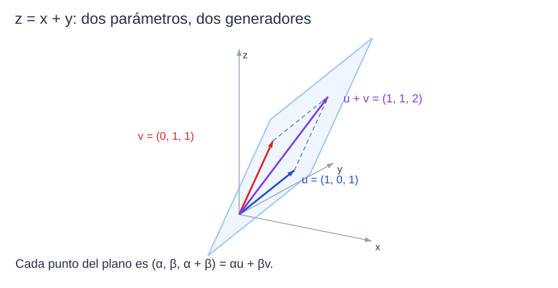
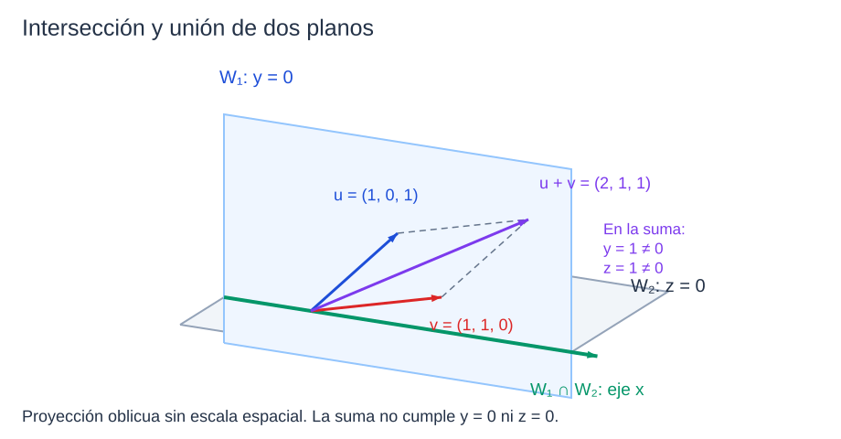

```dataviewjs
await dv.view("Planes/Estudio/Scripts/study-session", { location: "start" })
```

# Subespacios y espacio generado

La ecuación $x+y-z=0$ permite despejar $z=x+y$. Sus soluciones se escriben

$$
(x,y,z)=(x,y,x+y)=x(1,0,1)+y(0,1,1).
$$

Podemos describir el mismo plano mediante una condición sobre sus coordenadas o mediante dos vectores y todos sus múltiplos y sumas. Estudiaremos por qué ambas descripciones conservan la estructura de [[Matemáticas/Álgebra lineal/Espacios vectoriales/01 Espacios vectoriales — definición y axiomas|espacio vectorial]] y cómo pasar de unos generadores a otros.[^base]

## Subespacios: operaciones heredadas

### Subespacio vectorial

La noción de [[Matemáticas/Álgebra lineal/Espacios vectoriales/02 Subespacios vectoriales|subespacio]] mantiene las operaciones del espacio ambiente.

> [!definicion] Subespacio vectorial
> Sea $V$ un espacio vectorial sobre $K$. Un subconjunto $W\subseteq V$ es un **subespacio vectorial**, escrito $W\le V$, si con las operaciones heredadas de $V$ también es un espacio vectorial sobre $K$.

Se mantiene tanto el cuerpo como las operaciones. Por ejemplo, $\mathbb R^n\le\mathbb C^n$ si ambos se consideran sobre $\mathbb R$. Sobre $\mathbb C$, el múltiplo $ie_1$ deja de pertenecer a $\mathbb R^n$ y falla el cierre escalar.[^ejemplos]

```anki
deck: Física::Álgebra Lineal::Espacios vectoriales
tags:
  - matematicas
  - algebra-lineal
  - subespacios
---
> [!note] Pregunta
> ¿Qué significa que $W$ sea subespacio de $V$?
===
> [!important] Respuesta
> Que $W$ usa las operaciones heredadas de $V$ y, con ellas, también es un espacio vectorial sobre el mismo cuerpo.
```


```anki
deck: Física::Álgebra Lineal::Espacios vectoriales
tags:
  - matematicas
  - algebra-lineal
  - subespacios
---
> [!note] Pregunta
> ¿Cuándo es $\mathbb R^n$ subespacio de $\mathbb C^n$ con las operaciones habituales?
===
> [!important] Respuesta
> Cuando el cuerpo es $\mathbb R$. Sobre $\mathbb C$ falla el cierre: $ie_1\notin\mathbb R^n$.
```

### Criterio de subespacio

#### Propiedad

> [!teorema] Criterio de subespacio
> Para $W\subseteq V$, son equivalentes:[^criterio]
>
> 1. $W\le V$.
> 2. $W\ne\varnothing$ y es [[Matemáticas/Estructuras algebraicas/Operaciones algebraicas#2. Cerradura y operaciones externas|cerrado bajo suma y producto por escalares]].
> 3. $W\ne\varnothing$ y $\alpha u+\beta v\in W$ para todos $u,v\in W$ y $\alpha,\beta\in K$.

#### Demostración

> [!demostracion] Demostración
> Si $W$ es un subespacio, es no vacío y sus operaciones están cerradas: se cumple 2.
>
> Supongamos 2. Elegimos $w\in W$. Por cierre escalar, $0_Kw=0_V\in W$. Para cualquier $u\in W$, también $(-1_K)u=-u\in W$. Así, $W$ contiene el neutro y todos los opuestos. Asociatividad, conmutatividad y las cuatro leyes escalares siguen siendo las mismas igualdades que en $V$, pues usamos sus operaciones. Se cumplen los ocho axiomas y resulta 1.
>
> Si vale 2, primero $\alpha u,\beta v\in W$ y después $\alpha u+\beta v\in W$, de modo que vale 3. Si vale 3, tomamos $\alpha=\beta=1_K$ para obtener cierre bajo suma; con $\beta=0_K$ obtenemos cierre bajo escalares. Esto recupera 2. $\blacksquare$


```anki
deck: Física::Álgebra Lineal::Espacios vectoriales
tags:
  - matematicas
  - algebra-lineal
  - subespacios
---
> [!note] Pregunta
> ¿Cuál es el criterio de combinación lineal para que $W\subseteq V$ sea subespacio?
===
> [!important] Respuesta
> $W$ debe ser no vacío y cumplir $\alpha u+\beta v\in W$ para todo $u,v\in W$ y $\alpha,\beta\in K$.
```


```anki
deck: Física::Álgebra Lineal::Espacios vectoriales
tags:
  - matematicas
  - algebra-lineal
  - subespacios
---
> [!note] Pregunta
> ¿Cuáles son las dos versiones habituales del criterio de subespacio?
===
> [!important] Respuesta
> No vacío y cerrado bajo suma y escalares; o contiene $0_V$ y cumple esos mismos cierres. La primera implica que contiene $0_V$ al multiplicar un elemento por $0_K$.
```

> [!warning] La condición de no vaciedad no se puede suprimir
> El conjunto vacío satisface vacíamente las condiciones universales de cierre, pero no contiene al vector cero. Comprobar sólo que $0_V\in W$ tampoco basta: todavía hay que demostrar los cierres.

### Subespacios nulo y total

> [!definicion] Subespacios triviales
> Para cualquier $V$, los subespacios **nulo** y **total** son, respectivamente, $\{0_V\}$ y $V$.

El primero contiene un elemento, no cero elementos; sus operaciones siempre devuelven $0_V$. El segundo conserva todas las operaciones de $V$.[^criterio]

```anki
deck: Física::Álgebra Lineal::Espacios vectoriales
tags:
  - matematicas
  - algebra-lineal
  - subespacios
---
> [!note] Pregunta
> ¿Qué subespacios existen siempre en cualquier espacio vectorial $V$?
===
> [!important] Respuesta
> El nulo $\{0_V\}$ y el total $V$. Si $V=\{0_V\}$, ambos coinciden.
```

## Comprobar condiciones y encontrar un fallo

### Ejemplo trabajado — un plano por el origen

Para $W=\{(x,y,z):x+y-z=0\}$, el origen cumple la ecuación. Sean $u=(x_1,y_1,z_1)$ y $v=(x_2,y_2,z_2)$ elementos arbitrarios de $W$, y $\alpha,\beta\in\mathbb R$.

> [!demostracion] Demostración
> Sustituimos las componentes de $\alpha u+\beta v$ en la ecuación:
>
> $$
> \begin{aligned}
> &(\alpha x_1+\beta x_2)+(\alpha y_1+\beta y_2)-(\alpha z_1+\beta z_2)\\
> &\qquad=\alpha(x_1+y_1-z_1)+\beta(x_2+y_2-z_2)=0.
> \end{aligned}
> $$
>
> Cada paréntesis vale cero por las hipótesis sobre $u,v$. La combinación pertenece a $W$ y el criterio concluye $W\le\mathbb R^3$. $\blacksquare$

La parametrización de la introducción describe exactamente ese plano. La figura muestra cómo una elección de $x$ y otra de $y$ producen una suma dentro de él.



*Representación oblicua, sin escala espacial: los dos generadores y su suma cumplen $z=x+y$.* [[Física/Grado/1º/Álgebra Lineal y Geometría Analítica/03 Espacios vectoriales/assets/03-plano-generado.excalidraw|Dibujo editable]].

### Un sistema homogéneo

Consideremos

$$
F=\{(x,y,z)\in\mathbb R^3:x+y=0,\ y+2z=0\}.
$$

> [!demostracion] Demostración
> El origen cumple las dos ecuaciones. Sean $u=(x,y,z)$ y $v=(a,b,c)$ elementos de $F$ y $\alpha,\beta\in\mathbb R$. Para la primera ecuación,
>
> $$
> (\alpha x+\beta a)+(\alpha y+\beta b)=\alpha(x+y)+\beta(a+b)=0.
> $$
>
> Para la segunda,
>
> $$
> (\alpha y+\beta b)+2(\alpha z+\beta c)=\alpha(y+2z)+\beta(b+2c)=0.
> $$
>
> Por tanto la combinación satisface **simultáneamente** ambas condiciones y pertenece a $F$. El criterio da $F\le\mathbb R^3$. $\blacksquare$[^sistemas]

### Cambiar el término independiente

Para

$$
G=\{(x,y,z)\in\mathbb R^3:x+y=0,\ y+2z=1\},
$$

el origen no cumple la segunda ecuación: $0+2\cdot0\ne1$. Eso basta para concluir que $G$ no es subespacio.[^sistemas]

```anki
deck: Física::Álgebra Lineal::Espacios vectoriales
tags:
  - matematicas
  - algebra-lineal
  - subespacios
---
> [!note] Pregunta
> ¿Por qué un sistema $Ax=b$ con $b\ne0$ no tiene un subespacio como conjunto de soluciones?
===
> [!important] Respuesta
> El vector cero no es solución, pues $A0=0\ne b$. Incluso si el conjunto es vacío, no puede ser subespacio.
```

### Una condición no lineal que contiene al cero

El conjunto

$$
H=\{(x,y,z)\in\mathbb R^3:xy-y=0\}
$$

contiene al origen. Sin embargo, $(1,1,1)\in H$ y $2(1,1,1)=(2,2,2)\notin H$, porque $2\cdot2-2=2\ne0$. Falla el cierre escalar.[^sistemas]

```anki
deck: Física::Álgebra Lineal::Espacios vectoriales
tags:
  - matematicas
  - algebra-lineal
  - subespacios
---
> [!note] Pregunta
> ¿Por qué contener al origen no basta para ser subespacio?
===
> [!important] Respuesta
> Todavía pueden fallar los cierres. Por ejemplo, $xy-y=0$ contiene $(0,0,0)$ y $(1,1,1)$, pero no el doble de este último.
```

### Polinomios y funciones

La inclusión $P_{n-1}(\mathbb R)\le P_n(\mathbb R)\le\mathbb R[x]$ se comprueba porque sumar o escalar polinomios no eleva la cota de grado; el polinomio nulo está incluido. Por ejemplo, $2(1+x)-(3-x)=-1+3x$ sigue en $P_1(\mathbb R)$.

También $C(\mathbb R)\le F(\mathbb R)$: la función cero es continua y las operaciones preservan continuidad. Por ejemplo, $x^2-2\cos x$ es continua.[^ejemplos]

```anki
deck: Física::Álgebra Lineal::Espacios vectoriales
tags:
  - matematicas
  - algebra-lineal
  - subespacios
---
> [!note] Pregunta
> ¿Por qué $P_n(\mathbb R)$ es subespacio de $\mathbb R[x]$?
===
> [!important] Respuesta
> Contiene al polinomio nulo y la suma y el producto por escalares no superan la cota de grado $n$.
```


```anki
deck: Física::Álgebra Lineal::Espacios vectoriales
tags:
  - matematicas
  - algebra-lineal
  - subespacios
---
> [!note] Pregunta
> ¿Qué permite considerar $C(\mathbb R)$ subespacio de $F(\mathbb R)$?
===
> [!important] Respuesta
> La función cero pertenece a $C(\mathbb R)$ y las operaciones punto a punto preservan la continuidad.
```

### Matrices con ceros prescritos

Las [[Física/Grado/1º/Álgebra Lineal y Geometría Analítica/01 Matrices y sistemas/01 Matrices y operaciones#Matriz triangular superior|matrices triangulares superiores]] tienen entradas nulas por debajo de la diagonal; esas entradas siguen siendo cero al sumar y al multiplicar por un escalar. Las [[Física/Grado/1º/Álgebra Lineal y Geometría Analítica/01 Matrices y sistemas/01 Matrices y operaciones#Matriz diagonal|diagonales]] tienen ceros fuera de la diagonal y satisfacen el mismo cierre. Así,

$$
D_n(K)\le TS_n(K)\le M_n(K).
$$

Por ejemplo,

$$
\begin{pmatrix}1&2&0\\0&-1&3\\0&0&2\end{pmatrix}
+2\begin{pmatrix}0&1&4\\0&2&0\\0&0&-1\end{pmatrix}
=\begin{pmatrix}1&4&8\\0&3&3\\0&0&0\end{pmatrix}
$$

sigue siendo triangular superior. La prueba general se basa en las entradas prescritas, no en este cálculo particular.[^ejemplos]

```anki
deck: Física::Álgebra Lineal::Espacios vectoriales
tags:
  - matematicas
  - algebra-lineal
  - subespacios
---
> [!note] Pregunta
> ¿Por qué las matrices triangulares superiores y las diagonales forman subespacios?
===
> [!important] Respuesta
> Los ceros exigidos por cada clase se conservan bajo suma y multiplicación por escalares; la matriz nula pertenece a ambas.
```

## Combinaciones lineales

### Sistema de vectores

> [!definicion] Sistema de vectores
> Un **sistema de vectores** de $V$ es una lista ordenada finita $(v_1,\ldots,v_p)$ de elementos de $V$.

La lista $((1,0),(0,1))$ se distingue de $((0,1),(1,0))$ y de $((1,0),(1,0),(0,1))$: conserva posición y repeticiones. Esta distinción será necesaria al asociar una columna de coeficientes a una combinación.[^combinaciones]

```anki
deck: Física::Álgebra Lineal::Espacios vectoriales
tags:
  - matematicas
  - algebra-lineal
  - generadores
---
> [!note] Pregunta
> ¿En qué se diferencia un sistema de vectores de un conjunto de vectores?
===
> [!important] Respuesta
> El sistema es una lista finita ordenada: conserva las posiciones y permite repeticiones. Un conjunto no registra esas diferencias.
```

### Combinación lineal

> [!definicion] Combinación lineal
> Un vector $v$ es **combinación lineal** de $(v_1,\ldots,v_p)$ si existen $\alpha_1,\ldots,\alpha_p\in K$ tales que
>
> $$
> v=\alpha_1v_1+\cdots+\alpha_pv_p.
> $$

Los $\alpha_i$ son los **coeficientes**. [[Matemáticas/Álgebra lineal/Espacios vectoriales/03 Combinaciones lineales y espacio generado|Las combinaciones lineales]] usan las operaciones de $V$ y los escalares de $K$. Cada combinación utiliza un número finito de sumandos, incluso si se parte de un conjunto infinito. Con todos los coeficientes cero obtenemos $0_V$; con uno igual a $1_K$ y los demás cero obtenemos el correspondiente $v_i$.[^combinaciones]

```anki
deck: Física::Álgebra Lineal::Espacios vectoriales
tags:
  - matematicas
  - algebra-lineal
  - generadores
---
> [!note] Pregunta
> ¿Qué significa que $v$ sea combinación lineal de $v_1,\ldots,v_p$?
===
> [!important] Respuesta
> Que $v=\sum_{i=1}^{p}\alpha_iv_i$ para ciertos escalares $\alpha_i\in K$. Se usan sumas finitas.
```


```anki
deck: Física::Álgebra Lineal::Espacios vectoriales
tags:
  - matematicas
  - algebra-lineal
  - generadores
---
> [!note] Pregunta
> ¿Cómo se obtienen el vector cero y cada generador como combinaciones del mismo sistema?
===
> [!important] Respuesta
> Para el cero se toman todos los coeficientes nulos; para $v_j$, el coeficiente $j$ es $1_K$ y los demás son cero.
```


```anki
deck: Física::Álgebra Lineal::Espacios vectoriales
tags:
  - matematicas
  - algebra-lineal
  - generadores
---
> [!note] Pregunta
> ¿Qué son los coeficientes de una combinación lineal?
===
> [!important] Respuesta
> Los escalares que multiplican a cada vector del sistema en la expresión $\sum_i\alpha_iv_i$.
```


### Un vector con varios sistemas de coeficientes

Sean $u=(-1,2)$ y $w=(2,-4)=-2u$. Entonces

$$
-3u+2w=(7,-14)=5u+6w=u+4w.
$$

En general, $au+bw=(a-2b)u$; para obtener $(7,-14)=-7u$ basta que $a-2b=-7$. Los coeficientes no tienen por qué ser únicos. En cambio, $(1,0)$ no es combinación de $u,w$: todo múltiplo de $u$ cumple $y=-2x$.[^combinaciones]

```anki
deck: Física::Álgebra Lineal::Espacios vectoriales
tags:
  - matematicas
  - algebra-lineal
  - generadores
---
> [!note] Pregunta
> ¿Son únicos los coeficientes de una combinación lineal de un sistema cualquiera?
===
> [!important] Respuesta
> No. Si hay dependencias entre los generadores, un mismo vector puede tener varias listas de coeficientes. La unicidad requiere independencia lineal.
```

## Espacio generado

### Definición de espacio generado

> [!definicion] Espacio generado o envolvente lineal
> Para $S\subseteq V$, su **espacio generado** $\langle S\rangle=\operatorname{span}(S)$ es el conjunto de combinaciones lineales finitas de elementos de $S$. Se adopta $\langle\varnothing\rangle=\{0_V\}$.

Para una lista finita, $\langle v_1,\ldots,v_p\rangle$ recoge todas las elecciones posibles de sus coeficientes. Por ejemplo,

$$
\langle(2,-1)\rangle=\{(2t,-t):t\in\mathbb R\}
$$

es una recta por el origen. Si el generador es cero, el generado se reduce a $\{0_V\}$.[^generado]

```anki
deck: Física::Álgebra Lineal::Espacios vectoriales
tags:
  - matematicas
  - algebra-lineal
  - generadores
---
> [!note] Pregunta
> ¿Qué elementos forman $\operatorname{span}(S)$?
===
> [!important] Respuesta
> Todas las combinaciones lineales finitas de elementos de $S$.
```


```anki
deck: Física::Álgebra Lineal::Espacios vectoriales
tags:
  - matematicas
  - algebra-lineal
  - generadores
---
> [!note] Pregunta
> ¿Qué generan el conjunto vacío y el conjunto que sólo contiene al cero?
===
> [!important] Respuesta
> Ambos generan $\{0_V\}$. La combinación vacía se interpreta como el vector cero.
```

### Sistema generador

> [!definicion] Sistema generador
> $(v_1,\ldots,v_p)$ es un **sistema generador** de $W$ si $W=\langle v_1,\ldots,v_p\rangle$.

Por ejemplo, $(1,0),(0,1)$ generan $\mathbb R^2$, pues $(x,y)=x(1,0)+y(0,1)$. Añadir $(a,b)$ no cambia esa posibilidad: basta asignarle coeficiente cero. Generar un espacio no exige que todos los vectores de la lista sean necesarios.[^generadores]

```anki
deck: Física::Álgebra Lineal::Espacios vectoriales
tags:
  - matematicas
  - algebra-lineal
  - generadores
---
> [!note] Pregunta
> ¿Cuándo un sistema de vectores genera un espacio $W$?
===
> [!important] Respuesta
> Cuando todo vector de $W$ es combinación lineal de ese sistema y sus vectores pertenecen a $W$; equivalentemente, su generado es $W$.
```

### Espacio finitamente generado

> [!definicion] Espacio finitamente generado
> Un espacio es **finitamente generado** si admite un sistema generador finito.

En $P_d(K)$,

$$
a_0+a_1x+\cdots+a_dx^d=a_0\,1+a_1x+\cdots+a_dx^d,
$$

de modo que $(1,x,\ldots,x^d)$ lo genera. En $K^n$, los vectores canónicos $e_1,\ldots,e_n$ generan cualquier tupla, porque $(x_1,\ldots,x_n)=\sum_{i=1}^n x_ie_i$.[^generadores]

```anki
deck: Física::Álgebra Lineal::Espacios vectoriales
tags:
  - matematicas
  - algebra-lineal
  - generadores
---
> [!note] Pregunta
> ¿Qué significa que un espacio vectorial sea finitamente generado?
===
> [!important] Respuesta
> Que existe una lista finita de vectores cuyas combinaciones lineales producen todo el espacio.
```

### El generado es el menor subespacio que contiene a sus generadores

#### Propiedad

> [!teorema] El generado es el menor subespacio que contiene a sus generadores
> Para $S\subseteq V$, el conjunto $\langle S\rangle$ es un subespacio, contiene a $S$ y satisface[^minimalidad]
>
> $$
> \boxed{S\subseteq U\le V\ \Longrightarrow\ \langle S\rangle\subseteq U.}
> $$

#### Demostración

> [!demostracion] Demostración
> El caso $S=\varnothing$ da el subespacio nulo. Para $S\ne\varnothing$, el cero es combinación de coeficientes nulos. Si $u=\sum_i\alpha_iv_i$ y $w=\sum_j\beta_jw_j$ son dos combinaciones finitas, su suma sigue siendo una combinación finita: se reúnen los términos de ambas sumas. Para $\lambda\in K$,
>
> $$
> \lambda u=\sum_i(\lambda\alpha_i)v_i.
> $$
>
> La distributividad permite repartir $\lambda$ y E1 permite agruparlo con cada coeficiente. Los nuevos coeficientes pertenecen a $K$. Por el [[#Criterio de subespacio|criterio]], $\langle S\rangle$ es subespacio.
>
> Cada $s\in S$ pertenece al generado porque $s=1_Ks$. Finalmente, si $U$ es un subespacio que contiene a $S$, contiene cada múltiplo $\alpha_is_i$ y la suma finita de esos múltiplos. Por tanto contiene todo vector del generado, es decir, $\langle S\rangle\subseteq U$. $\blacksquare$


```anki
deck: Física::Álgebra Lineal::Espacios vectoriales
tags:
  - matematicas
  - algebra-lineal
  - generadores
---
> [!note] Pregunta
> ¿Qué propiedad caracteriza a $\operatorname{span}(S)$ entre los subespacios que contienen $S$?
===
> [!important] Respuesta
> Es el menor subespacio que contiene a $S$: está incluido en todo subespacio que contenga cada elemento de $S$.
```

### Dos generadores de un plano

Para $u=(1,0,1)$ y $v=(0,1,1)$,

$$
\alpha u+\beta v=(\alpha,\beta,\alpha+\beta).
$$

Toda combinación cumple $z=x+y$. Recíprocamente, si $(x,y,z)$ cumple esa ecuación, es $xu+yv$. Hemos probado las dos inclusiones y obtenido

$$
\langle u,v\rangle=\{(x,y,z):z=x+y\}.
$$

Una [[Matemáticas/Álgebra lineal/Espacios vectoriales/03 Combinaciones lineales y espacio generado#Las dos descripciones de un subespacio|descripción por generadores]] produce vectores; una [[Matemáticas/Álgebra lineal/Espacios vectoriales/03 Combinaciones lineales y espacio generado#Las dos descripciones de un subespacio|descripción por ecuaciones]] permite comprobar si pertenecen al subespacio.

### El cuerpo cambia los generadores de $\mathbb C^2$

Sobre $\mathbb C$, $(1,0),(0,1)$ generan $\mathbb C^2$. Sobre $\mathbb R$, sus combinaciones sólo tienen componentes reales. Para $z=a+bi$ y $w=c+di$ necesitamos

$$
(z,w)=a(1,0)+b(i,0)+c(0,1)+d(0,i).
$$

Así, los cuatro vectores de la expresión generan $\mathbb C^2$ sobre $\mathbb R$.[^generadores]

```anki
deck: Física::Álgebra Lineal::Espacios vectoriales
tags:
  - matematicas
  - algebra-lineal
  - generadores
---
> [!note] Pregunta
> ¿Por qué $(1,0),(0,1)$ generan $\mathbb C^2$ sobre $\mathbb C$ pero no sobre $\mathbb R$?
===
> [!important] Respuesta
> Los coeficientes complejos producen cualquier componente compleja. Con coeficientes reales, esas combinaciones quedan en $\mathbb R^2$; hay que añadir $(i,0),(0,i)$.
```

### Los polinomios sin cota de grado no admiten generadores finitos

#### Propiedad

> [!teorema] Los polinomios sin cota de grado no admiten generadores finitos
> El espacio $K[x]$ no es finitamente generado.[^polinomios-tpc]
>

#### Demostración

> [!demostracion] Demostración · TPC resuelto
> Supongamos que $p_1,\ldots,p_s$ lo generan. Si todos son nulos, no pueden generar el polinomio $1$.
>
> Si alguno es no nulo, sea $d$ el mayor grado entre los polinomios no nulos de la lista. Cada múltiplo escalar tiene grado a lo sumo $d$ o es nulo; al sumar tampoco pueden aparecer potencias superiores a $x^d$. Por tanto toda combinación pertenece a $P_d(K)$.
>
> Sin embargo, $x^{d+1}\in K[x]$ no pertenece a $P_d(K)$. La lista supuesta no genera todo $K[x]$, contradicción. $\blacksquare$


```anki
deck: Física::Álgebra Lineal::Espacios vectoriales
tags:
  - matematicas
  - algebra-lineal
  - generadores
---
> [!note] Pregunta
> ¿Por qué ninguna lista finita genera todos los polinomios de $K[x]$?
===
> [!important] Respuesta
> La lista tiene un grado máximo $d$ y todas sus combinaciones tienen grado a lo sumo $d$. No puede producir $x^{d+1}$.
```

## Comparar y simplificar generadores

### Inclusión de espacios generados

#### Propiedad

> [!teorema] Inclusión de espacios generados
> Para listas $u_1,\ldots,u_s$ y $v_1,\ldots,v_p$,[^comparacion]
>
> $$
> \boxed{\langle u_1,\ldots,u_s\rangle\subseteq\langle v_1,\ldots,v_p\rangle
> \iff\forall i\in\{1,\ldots,s\},\ u_i\in\langle v_1,\ldots,v_p\rangle.}
> $$

#### Demostración

> [!demostracion] Demostración · TPC resuelto
> Si se cumple la inclusión, cada $u_i$ pertenece al primer generado y, por tanto, al segundo.
>
> Recíprocamente, supongamos que todos los $u_i$ pertenecen al segundo generado. Este último es un subespacio que contiene a los $u_i$; por la propiedad mínima, contiene a todo $\langle u_1,\ldots,u_s\rangle$. $\blacksquare$


```anki
deck: Física::Álgebra Lineal::Espacios vectoriales
tags:
  - matematicas
  - algebra-lineal
  - generadores
---
> [!note] Pregunta
> ¿Cómo se prueba que un espacio generado está contenido en otro?
===
> [!important] Respuesta
> Basta comprobar que cada generador del primero pertenece al segundo. La propiedad mínima extiende la inclusión a todas sus combinaciones.
```

### Igualdad de espacios generados

#### Propiedad

> [!teorema] Igualdad de espacios generados
> Para $S,T\subseteq V$,[^comparacion]
>
> $$
> \boxed{\langle S\rangle=\langle T\rangle\iff S\subseteq\langle T\rangle\ \text{y}\ T\subseteq\langle S\rangle.}
> $$

#### Demostración

> [!demostracion] Demostración · TPC resuelto
> La igualdad implica las dos pertenencias, porque cada conjunto está contenido en su propio generado. A la inversa, el criterio de inclusión da $\langle S\rangle\subseteq\langle T\rangle$ y $\langle T\rangle\subseteq\langle S\rangle$. La doble inclusión concluye la igualdad. $\blacksquare$


```anki
deck: Física::Álgebra Lineal::Espacios vectoriales
tags:
  - matematicas
  - algebra-lineal
  - generadores
---
> [!note] Pregunta
> ¿Cómo se demuestra que dos listas generan el mismo subespacio?
===
> [!important] Respuesta
> Se expresa cada generador de la primera como combinación de la segunda y cada generador de la segunda como combinación de la primera.
```

### Eliminar un generador redundante

#### Propiedad

> [!teorema] Eliminar un generador redundante
> Si $v_i$ es combinación de los demás vectores de una lista, entonces[^comparacion]
>
> $$
> \boxed{\langle v_1,\ldots,v_p\rangle=\langle v_1,\ldots,v_{i-1},v_{i+1},\ldots,v_p\rangle.}
> $$

#### Demostración

> [!demostracion] Demostración · TPC resuelto
> Todo vector de la lista abreviada pertenece a la lista original, luego su generado está contenido en el original.
>
> Para la otra inclusión, todos los generadores originales salvo $v_i$ están en la lista abreviada. El propio $v_i$ pertenece a su generado por hipótesis. El [[#Inclusión de espacios generados|criterio de inclusión]] da la inclusión que faltaba. $\blacksquare$


```anki
deck: Física::Álgebra Lineal::Espacios vectoriales
tags:
  - matematicas
  - algebra-lineal
  - generadores
---
> [!note] Pregunta
> ¿Cuándo puede eliminarse un vector de una lista sin cambiar su generado?
===
> [!important] Respuesta
> Cuando ese vector es combinación lineal de los restantes.
```

### Transformaciones que conservan el generado

#### Propiedad

> [!teorema] Transformaciones que conservan el generado
> No cambia el generado al intercambiar dos vectores, multiplicar uno por un escalar no nulo o sustituir $v_i$ por $v_i+\lambda v_j$ con $i\ne j$.[^transformaciones]
>

#### Demostración

> [!demostracion] Demostración · TPC resuelto
> **Intercambio.** Sólo cambia la posición de dos vectores. Cada lista contiene los mismos generadores, así que cada una está incluida en el generado de la otra.
>
> **Escalado.** Si $v_i'=c v_i$, con $c\ne0_K$, el vector nuevo es combinación del antiguo. Recíprocamente, $v_i=c^{-1}v_i'$. Las listas generan lo mismo. La hipótesis $c\ne0_K$ permite usar $c^{-1}$.
>
> **Reemplazo.** Si $v_i'=v_i+\lambda v_j$ y $v_j$ se mantiene, el nuevo vector es combinación de los antiguos. Además,
>
> $$
> v_i=v_i'-\lambda v_j.
> $$
>
> Así recuperamos el antiguo usando la nueva lista. En los tres casos se cumple el criterio de igualdad de generados. Una sucesión finita de estas operaciones conserva la igualdad en cada paso. $\blacksquare$


```anki
deck: Física::Álgebra Lineal::Espacios vectoriales
tags:
  - matematicas
  - algebra-lineal
  - generadores
---
> [!note] Pregunta
> ¿Qué tres transformaciones elementales de generadores conservan su espacio generado?
===
> [!important] Respuesta
> Intercambiar dos; multiplicar uno por un escalar no nulo; sumar a uno un múltiplo de otro que se conserva.
```


```anki
deck: Física::Álgebra Lineal::Espacios vectoriales
tags:
  - matematicas
  - algebra-lineal
  - generadores
---
> [!note] Pregunta
> ¿Por qué no se permite escalar un generador por cero al asegurar que el generado se conserva?
===
> [!important] Respuesta
> Porque no se puede recuperar el generador mediante un escalar inverso; por ejemplo, sustituir el único vector no nulo por cero reduce su recta a $\{0_V\}$.
```


```anki
deck: Física::Álgebra Lineal::Espacios vectoriales
tags:
  - matematicas
  - algebra-lineal
  - generadores
---
> [!note] Pregunta
> ¿Por qué intercambiar dos vectores de una lista conserva su generado?
===
> [!important] Respuesta
> Porque siguen estando los mismos generadores; sólo cambia su posición.
```


```anki
deck: Física::Álgebra Lineal::Espacios vectoriales
tags:
  - matematicas
  - algebra-lineal
  - generadores
---
> [!note] Pregunta
> ¿Por qué escalar un generador por un escalar no nulo conserva el generado?
===
> [!important] Respuesta
> El nuevo es múltiplo del antiguo y el antiguo se recupera multiplicando por el escalar inverso.
```


```anki
deck: Física::Álgebra Lineal::Espacios vectoriales
tags:
  - matematicas
  - algebra-lineal
  - generadores
---
> [!note] Pregunta
> ¿Por qué sustituir $v_i$ por $v_i+\lambda v_j$, con $i\ne j$, conserva el generado?
===
> [!important] Respuesta
> Se conserva $v_j$ y se recupera $v_i=(v_i+\lambda v_j)-\lambda v_j$. Las dos listas se generan mutuamente.
```

### Simplificar los cuatro generadores de las slides

Partimos de

$$
a=(1,-2,0),\quad b=(0,1,-1),\quad c=(1,-4,2),\quad d=(2,-3,-1).
$$

Calculamos $c-a=(0,-2,2)=-2b$ y $d-2a=(0,1,-1)=b$. Podemos recuperar $c=a-2b$ y $d=2a+b$, por lo que

$$
\langle a,b,c,d\rangle=\langle a,b\rangle.
$$

Esta sustitución explica cada eliminación: los vectores retirados ya se construyen con los dos que conservamos.[^simplificacion]

## Pertenencia: convertir la pregunta en un sistema
### Combinación lineal y compatibilidad

#### Propiedad

> [!teorema] Combinación lineal y compatibilidad
> Sean $A=[v_1\ \cdots\ v_p]\in M_{n\times p}(K)$ y $b\in K^n$. Entonces[^pertenencia]
>
> $$
> \boxed{b\in\langle v_1,\ldots,v_p\rangle\iff Ax=b\text{ es compatible}\iff r(A)=r([A\mid b]).}
> $$

#### Demostración

> [!demostracion] Demostración
> Por definición del producto matricial,
>
> $$
> Ax=x_1v_1+\cdots+x_pv_p.
> $$
>
> Por tanto, encontrar coeficientes de una combinación que produzca $b$ es exactamente encontrar una solución de $Ax=b$. La equivalencia con la igualdad de rangos es el [[Matemáticas/Álgebra lineal/Teorema de Rouché-Capelli|criterio de compatibilidad de Rouché–Capelli]]. $\blacksquare$


```anki
deck: Física::Álgebra Lineal::Espacios vectoriales
tags:
  - matematicas
  - algebra-lineal
  - generadores
---
> [!note] Pregunta
> ¿Cómo se decide si un vector pertenece al generado de las columnas de una matriz?
===
> [!important] Respuesta
> Se resuelve $Ax=b$: pertenece si el sistema es compatible, equivalentemente, si $r(A)=r([A\mid b])$.
```

### TPC — ¿se obtiene $(3,-4,-3)$ con los cuatro generadores?

Usamos $a,b,c,d$ del ejemplo anterior. Como $c=a-2b$ y $d=2a+b$, cualquier combinación se reduce a $sa+tb$. Esa combinación tiene forma

$$
sa+tb=(s,-2s+t,-t).
$$

> [!resolucion] Resolución · TPC resuelto
> Para igualar $(3,-4,-3)$, la primera componente obliga a $s=3$ y la tercera a $t=3$. Pero entonces la segunda sería $-2\cdot3+3=-3$, en lugar de $-4$. El sistema es incompatible y
>
> $$
> \boxed{(3,-4,-3)\notin\langle a,b,c,d\rangle.}
> $$
>
> También puede verse al reducir la matriz ampliada: la operación $L_2\leftarrow L_2+2L_1$ da $L_2=(0,1,-2,1\mid2)$, mientras $L_3=(0,-1,2,-1\mid-3)$. Sumarlas produce $(0,0,0,0\mid-1)$, es decir, $0=-1$.[^tpc-sistema]

## Intersecciones y uniones
### La intersección de subespacios es subespacio

#### Propiedad

> [!teorema] La intersección de subespacios es subespacio
> Si $W_1,W_2\le V$, entonces $W_1\cap W_2\le V$.[^interseccion]
>

#### Demostración

> [!demostracion] Demostración · TPC resuelto
> Ambos subespacios contienen $0_V$, luego su intersección es no vacía. Sean $u,v\in W_1\cap W_2$ y $\alpha,\beta\in K$. Los dos vectores pertenecen a $W_1$ y a $W_2$.
>
> El cierre de $W_1$ da $\alpha u+\beta v\in W_1$. El de $W_2$ da la misma pertenencia a $W_2$. Por definición de intersección, la combinación pertenece a $W_1\cap W_2$. El criterio concluye la prueba. $\blacksquare$


```anki
deck: Física::Álgebra Lineal::Espacios vectoriales
tags:
  - matematicas
  - algebra-lineal
  - subespacios
---
> [!note] Pregunta
> ¿Por qué la intersección de dos subespacios es subespacio?
===
> [!important] Respuesta
> Contiene al cero; una combinación de vectores de la intersección pertenece a cada subespacio y, por tanto, a ambos.
```

La misma prueba sirve para una familia no vacía de subespacios: se fija uno arbitrario y se comprueba que la combinación pertenece a él. Así pertenece a todos.

### La unión de dos planos puede perder el cierre

Para $W_1=\{y=0\}$ y $W_2=\{z=0\}$ en $\mathbb R^3$, la intersección es el eje $x$. En cambio,

$$
(1,0,1)+(1,1,0)=(2,1,1)\notin W_1\cup W_2.
$$

Cada sumando está en uno de los planos, pero la suma no cumple ninguna de las dos ecuaciones. La unión no es subespacio.[^interseccion]



*Proyección oblicua: la intersección conserva ambas ecuaciones; la unión no contiene necesariamente las sumas.* [[Física/Grado/1º/Álgebra Lineal y Geometría Analítica/03 Espacios vectoriales/assets/03-union-interseccion.excalidraw|Dibujo editable]].

### Cuándo la unión de dos subespacios es subespacio

#### Propiedad

> [!teorema] Cuándo la unión de dos subespacios es subespacio
> Para $W_1,W_2\le V$,[^union]
>
> $$
> \boxed{W_1\cup W_2\le V\iff W_1\subseteq W_2\ \text{o}\ W_2\subseteq W_1.}
> $$

#### Demostración

> [!demostracion] Demostración
> Si uno está contenido en el otro, la unión coincide con el mayor y es subespacio.
>
> Supongamos ahora que ninguno contiene al otro. Existen $u\in W_1\setminus W_2$ y $v\in W_2\setminus W_1$. Si la unión fuese subespacio, contendría $u+v$.
>
> Si $u+v\in W_1$, el cierre de $W_1$ bajo diferencias daría $v=(u+v)-u\in W_1$, contradicción. Si $u+v\in W_2$, daría $u=(u+v)-v\in W_2$, también contradicción. Ambos casos son imposibles; la unión no es subespacio. $\blacksquare$


```anki
deck: Física::Álgebra Lineal::Espacios vectoriales
tags:
  - matematicas
  - algebra-lineal
  - subespacios
---
> [!note] Pregunta
> ¿Cuándo es subespacio la unión de dos subespacios?
===
> [!important] Respuesta
> Exactamente cuando uno está contenido en el otro. En caso contrario puede fallar el cierre bajo suma.
```

Hemos podido eliminar generadores sin cambiar el subespacio. En [[Física/Grado/1º/Álgebra Lineal y Geometría Analítica/03 Espacios vectoriales/04 Independencia, bases y coordenadas|Independencia, bases y coordenadas]] precisaremos cuándo no queda ningún generador redundante.

## Práctica graduada

1. Decide si $\mathbb R^n$ es subespacio de $\mathbb C^n$ cuando el cuerpo es $\mathbb R$ y cuando es $\mathbb C$.
2. Comprueba si $G=\{(x,y,z):x+y=0,\ y+2z=1\}$ es subespacio de $\mathbb R^3$.
3. Para los planos $W_1=\{y=0\}$ y $W_2=\{z=0\}$ de $\mathbb R^3$, explica por qué su intersección es subespacio pero su unión no.

## Soluciones razonadas

1. Sobre $\mathbb R$, ambas operaciones de $\mathbb C^n$ conservan la realidad de las coordenadas de $\mathbb R^n$, así que sí es subespacio. Sobre $\mathbb C$, $e_1\in\mathbb R^n$ pero $ie_1\notin\mathbb R^n$; falla el cierre escalar.
2. No. El origen no satisface $y+2z=1$, de modo que $0\notin G$. Esto basta para descartar el criterio de subespacio.
3. La intersección es $\{(x,0,0):x\in\mathbb R\}$, que conserva suma y escalares. Para la unión, $(1,0,1)\in W_1$ y $(1,1,0)\in W_2$, pero su suma $(2,1,1)$ no está en ninguno de los planos; falla el cierre bajo suma.

## 📚 Fuentes

### Material base

[^base]: FCUL, *ALGA 2026/27*, aulas 18–20, 28/10–02/11/2026. Se mantienen las operaciones, el cuerpo y la notación de generado de las slides.
[^criterio]: Aula 18, diapositivas 6–8: definición, criterio y subespacios triviales; prueba adaptada de la diapositiva 7 y de IST, proposición 3.11, p. 40.
[^ejemplos]: Aula 18, diapositivas 9–10: cuerpos real y complejo, polinomios, funciones continuas, matrices y rectas y planos por el origen.
[^sistemas]: Aula 18, diapositivas 11–13: conjuntos $F,G,H$. Se desarrollan los cierres y los contraejemplos conservando sus ecuaciones.
[^combinaciones]: Aula 19, diapositivas 2–7: sistema ordenado, combinación lineal, coeficientes no únicos y pertenencia del cero y de los generadores.
[^generado]: Aula 19, diapositivas 8 y 11: generado y generación finita.
[^generadores]: Aula 19, diapositivas 12–14: coordenadas, cuerpos real y complejo, polinomios.
[^minimalidad]: Aula 19, diapositivas 8–10: demostración incluida; se explicitan las leyes que la diapositiva 9 pide justificar. Adaptación del argumento publicado en IST, proposición 3.16, pp. 42–43.
[^polinomios-tpc]: Aula 19, diapositiva 14: «justifique» que $\mathbb R[x]$ no es finitamente generado. Desarrollo por grado máximo, válido sobre $K$; adaptación de IST, ejemplo 3.20, p. 44.
[^comparacion]: Aula 20, diapositiva 2: TPC de inclusión, igualdad y eliminación de un generador redundante. Pruebas por propiedad mínima y doble inclusión, desarrolladas aquí; contraste con IST, proposición 3.16, pp. 42–43.
[^transformaciones]: Aula 20, diapositiva 3: TPC de las tres transformaciones. Se desarrollan los dos sentidos y las operaciones inversas; contraste con IST, §3.18, pp. 43–44, y la reversibilidad de las operaciones elementales. Los tres casos se desarrollan aquí mediante sus inversas.
[^simplificacion]: Aula 20, diapositiva 4. El orden de los dos últimos vectores difiere del de Aula 19, diapositiva 6; aquí se conserva el orden de Aula 19.
[^pertenencia]: Aula 20, diapositiva 14: equivalencia entre combinación, compatibilidad e igualdad de rangos.
[^tpc-sistema]: Aula 19, diapositiva 6, repetida en Aula 20, diapositiva 13: TPC de compatibilidad. Resolución calculada aquí; se comprueba también mediante reducción de la matriz ampliada.
[^interseccion]: Aula 18, diapositivas 14–15: intersección propuesta como TPC y contraejemplo de unión.

### Contraste académico

Instituto Superior Técnico, ULisboa, [*Álgebra Linear*](https://fenix.tecnico.ulisboa.pt/downloadFile/563568428979297/ApontamentosInteg.pdf), §§3.8–3.23 y soluciones de §3.51: subespacios, generado, simplificación y pertenencia. Las pruebas TPC desarrollan los argumentos indicados; no se atribuyen a esta fuente los cálculos numéricos propios.

[^union]: University of Lethbridge, [*Math 3410: New subspaces from old*](https://opentext.uleth.ca/Math3410/sec-subspace-combine.html), teorema 1.8.2 y demostración completa. Adaptación al español con notación $W_1,W_2$; se conserva el argumento por dos casos. El teorema 1.8.3 de la misma sección publica la prueba de intersección utilizada en el TPC.

## 🧑‍🏫 Prompt para tutor conversacional

Actúa como tutor universitario en español. Pregunta una sola cosa cada vez y espera. Criterio: $W\ne\varnothing$ y $\alpha u+\beta v\in W$ para $u,v\in W$, $\alpha,\beta\in K$. Generado: combinaciones finitas; es el menor subespacio que contiene sus generadores. Recupera las pruebas de inclusión, doble inclusión, eliminación y tres transformaciones invertibles. Usa sólo ejemplos ya incluidos: $F=\{x+y=0,y+2z=0\}$, $G$ con segunda ecuación igual a uno, $H=\{xy-y=0\}$, plano $z=x+y$, y el TPC de $(3,-4,-3)$ frente a $(1,-2,0),(0,1,-1),(1,-4,2),(2,-3,-1)$. En este TPC aparece $0=-1$ al reducir. Pide justificar cada transición y da pistas graduadas; no generes ejercicios nuevos.

```dataviewjs
await dv.view("Planes/Estudio/Scripts/study-session", { location: "end" })
```
