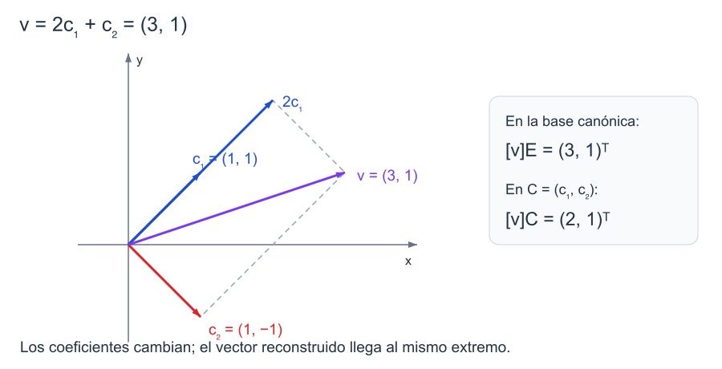

```dataviewjs
await dv.view("Planes/Estudio/Scripts/study-session", { location: "start" })
```

# Independencia, bases y coordenadas

Los vectores $(1,0)$ y $(0,1)$ permiten escribir $(x,y)=x(1,0)+y(0,1)$. Si añadimos $(1,1)$ a la lista, seguimos generando el plano, pero el vector $(1,1)$ admite ahora dos escrituras: la suma de los dos primeros o el tercer generador por sí solo.

Una [[Matemáticas/Álgebra lineal/Espacios vectoriales/05 Bases y dimensión|base]] debe permitir expresar todos los vectores y determinar de forma única sus coeficientes. La generación dará la existencia de esa escritura; la [[Matemáticas/Álgebra lineal/Espacios vectoriales/04 Dependencia e independencia lineal|independencia]], su unicidad.[^bases]

## Dependencia e independencia lineal

### Independencia lineal

> [!definicion] Sistema linealmente independiente
> Una lista $(v_1,\ldots,v_p)$ de un espacio $V$ sobre $K$ es **linealmente independiente** si
>
> $$
> \alpha_1v_1+\cdots+\alpha_pv_p=0_V
> \quad\Longrightarrow\quad
> \alpha_1=\cdots=\alpha_p=0_K.
> $$

La elección de coeficientes todos nulos siempre da cero: es la **solución trivial**. Los demás sistemas de coeficientes se llaman no triviales. La definición excluye cualquier otra solución. Por ejemplo, $\alpha(1,0)+\beta(0,1)=(0,0)$ obliga a $\alpha=\beta=0$.[^independencia]

```anki
deck: Física::Álgebra Lineal::Espacios vectoriales
tags:
  - matematicas
  - algebra-lineal
  - independencia
---
> [!note] Pregunta
> ¿Qué condición sobre las soluciones de $\alpha_1v_1+\cdots+\alpha_pv_p=0_V$ expresa independencia lineal?
===
> [!important] Respuesta
> La única solución debe ser la trivial: todos los coeficientes $\alpha_i$ son cero.
```


```anki
deck: Física::Álgebra Lineal::Espacios vectoriales
tags:
  - matematicas
  - algebra-lineal
  - independencia
---
> [!note] Pregunta
> ¿Qué es la solución trivial de una ecuación de combinación lineal igual a cero?
===
> [!important] Respuesta
> La que asigna cero a todos los coeficientes. Siempre existe; la independencia exige que sea la única.
```


### Dependencia lineal

> [!definicion] Sistema linealmente dependiente
> Una lista es **linealmente dependiente** si existe una combinación igual a $0_V$ con al menos un coeficiente no nulo.

Para $v_1=(1,2)$ y $v_2=(3,6)$, la relación $3v_1-v_2=0$ demuestra dependencia: los coeficientes $3,-1$ no son todos cero. En cambio, la combinación $0v_1+0v_2=0$ no permite decidir nada.[^independencia]

```anki
deck: Física::Álgebra Lineal::Espacios vectoriales
tags:
  - matematicas
  - algebra-lineal
  - independencia
---
> [!note] Pregunta
> ¿Qué hay que exhibir para probar dependencia lineal?
===
> [!important] Respuesta
> Una combinación igual a cero cuyos coeficientes no sean todos nulos.
```

### Dependencia y generadores redundantes

#### Propiedad

> [!teorema] Dependencia y generadores redundantes
> Una lista es dependiente si y sólo si algún vector es [[Matemáticas/Álgebra lineal/Espacios vectoriales/03 Combinaciones lineales y espacio generado|combinación lineal]] de los demás.[^independencia]
>

#### Demostración

> [!demostracion] Demostración
> Sea $\sum_i\alpha_iv_i=0_V$ una relación no trivial. Elegimos $j$ con $\alpha_j\ne0_K$ y despejamos usando su inverso:
>
> $$
> v_j=-\sum_{i\ne j}\frac{\alpha_i}{\alpha_j}v_i.
> $$
>
> Recíprocamente, si $v_j=\sum_{i\ne j}\beta_iv_i$, pasar todo al mismo miembro da una relación igual a cero con coeficiente $1_K\ne0_K$ en $v_j$. Por tanto la lista es dependiente. El [[Física/Grado/1º/Álgebra Lineal y Geometría Analítica/03 Espacios vectoriales/03 Subespacios y espacio generado#Eliminar un generador redundante|criterio de eliminación]] permite retirarlo sin cambiar el generado. $\blacksquare$


```anki
deck: Física::Álgebra Lineal::Espacios vectoriales
tags:
  - matematicas
  - algebra-lineal
  - independencia
---
> [!note] Pregunta
> ¿Qué permite despejar una relación lineal no trivial?
===
> [!important] Respuesta
> Un vector cuyo coeficiente sea no nulo queda como combinación de los restantes; puede eliminarse sin cambiar el generado.
```

### Ceros, repeticiones y sublistas

Una lista que contiene $0_V$ es dependiente: se asigna coeficiente $1_K$ a ese vector y cero al resto. Si contiene dos vectores iguales, los coeficientes $1_K,-1_K$ en esas posiciones dan una relación no trivial. Pero evitar ceros y repeticiones no basta: $(1,0),(0,1),(1,1)$ siguen siendo dependientes.

Toda sublista de una lista independiente es independiente: una relación en la sublista se prolongaría a la lista completa con coeficientes cero. Por la misma razón, añadir vectores a una lista ya dependiente no elimina su dependencia.[^independencia]

```anki
deck: Física::Álgebra Lineal::Espacios vectoriales
tags:
  - matematicas
  - algebra-lineal
  - independencia
---
> [!note] Pregunta
> ¿Puede una lista independiente contener el vector cero o dos vectores repetidos?
===
> [!important] Respuesta
> No: cualquiera de esos casos proporciona una relación lineal no trivial. Evitar ambos casos no garantiza independencia.
```


```anki
deck: Física::Álgebra Lineal::Espacios vectoriales
tags:
  - matematicas
  - algebra-lineal
  - independencia
---
> [!note] Pregunta
> ¿Qué ocurre con la independencia al tomar una sublista?
===
> [!important] Respuesta
> Una sublista de una lista independiente sigue siendo independiente. Una lista que contiene una sublista dependiente es dependiente.
```

### Decidir con una matriz

Para $v_1,\ldots,v_p\in K^m$, formamos $A=[v_1\ \cdots\ v_p]$. La ecuación de independencia es el sistema homogéneo $Ax=0$.

- Si todas las columnas son pivote, no hay variables libres y la lista es independiente.
- Si alguna variable es libre, hay una solución no trivial y la lista es dependiente.

Equivalentemente, $r(A)=p$. Cuando $p=m$, también equivale a $\det A\ne0$. Para vectores abstractos, primero hay que elegir una representación por coordenadas; no se colocan polinomios enteros como entradas escalares de una matriz.[^matriz]

```anki
deck: Física::Álgebra Lineal::Espacios vectoriales
tags:
  - matematicas
  - algebra-lineal
  - independencia
---
> [!note] Pregunta
> ¿Qué revela la reducción de una matriz sobre la independencia de sus columnas?
===
> [!important] Respuesta
> Son independientes si cada columna es pivote, es decir, si el sistema homogéneo no tiene variables libres y $r(A)$ coincide con el número de columnas.
```

## Bases y construcción

### Base

> [!definicion] Base y base ordenada
> Una **base** de $V$ es un conjunto de vectores linealmente independiente que genera $V$. Al fijar su orden escribimos una **base ordenada** $B=(b_1,\ldots,b_n)$.

El conjunto $\{(1,0),(0,1)\}$ es base de $\mathbb R^2$. Al intercambiar su orden, el conjunto sigue siendo el mismo, pero las coordenadas $(a,b)^T$ pasan a $(b,a)^T$. Por eso fijamos bases ordenadas para los cálculos.[^bases]

```anki
deck: Física::Álgebra Lineal::Espacios vectoriales
tags:
  - matematicas
  - algebra-lineal
  - bases
---
> [!note] Pregunta
> ¿Qué dos condiciones definen una base de un espacio vectorial?
===
> [!important] Respuesta
> Generar todo el espacio y ser linealmente independiente. Para escribir coordenadas se fija además un orden.
```

### Añadir un vector conservando la independencia

#### Propiedad

> [!teorema] Añadir un vector conservando la independencia
> Si $(v_1,\ldots,v_p)$ es independiente y $w\notin\langle v_1,\ldots,v_p\rangle$, entonces $(v_1,\ldots,v_p,w)$ es independiente.[^construccion]
>

#### Demostración

> [!demostracion] Demostración
> Supongamos $\sum_i\alpha_iv_i+\beta w=0_V$. Si $\beta\ne0_K$, despejar daría
>
> $$
> w=-\sum_i\frac{\alpha_i}{\beta}v_i,
> $$
>
> en contradicción con la hipótesis. Por tanto $\beta=0_K$. Queda una relación entre los $v_i$, y su [[#Independencia lineal|independencia]] obliga a que todos los $\alpha_i$ sean cero. $\blacksquare$


```anki
deck: Física::Álgebra Lineal::Espacios vectoriales
tags:
  - matematicas
  - algebra-lineal
  - bases
---
> [!note] Pregunta
> ¿Qué condición permite añadir un vector a una lista independiente sin perder independencia?
===
> [!important] Respuesta
> Que el nuevo vector no pertenezca al generado de la lista anterior.
```

### Extraer una base de generadores

En una lista generadora finita, retiramos un vector redundante cada vez que la lista sea dependiente. El generado se conserva; como la lista es finita, el proceso termina en una lista independiente que sigue generando. Ésta es una base.[^construccion]

#### Ejemplo trabajado — retirar dos generadores redundantes

Para

$$
v_1=(1,0,1),\quad v_2=(2,0,2),\quad v_3=(0,1,1),\quad v_4=(1,1,2),
$$

se tiene $v_2=2v_1$ y $v_4=v_1+v_3$. Conservamos $v_1,v_3$. En $av_1+bv_3=0$, las dos primeras componentes obligan a $a=b=0$, así que la pareja es una base del plano $z=x+y$.

Si utilizamos [[Matemáticas/Álgebra lineal/Espacios vectoriales/07 Núcleo, imagen, rango y nulidad#Cálculo con eliminación de Gauss|eliminación por filas]], tomamos las columnas pivote **de la matriz original**. Las de la reducida localizan las posiciones, pero no son en general vectores del subespacio original.

```anki
deck: Física::Álgebra Lineal::Espacios vectoriales
tags:
  - matematicas
  - algebra-lineal
  - bases
---
> [!note] Pregunta
> ¿Cómo se extrae una base de una lista generadora finita?
===
> [!important] Respuesta
> Se eliminan vectores que sean combinación de los restantes hasta obtener una lista independiente con el mismo generado. Mediante Gauss, se toman las columnas pivote de la matriz original.
```

### Completar una lista independiente

Si $V$ está generado por una lista finita, podemos recorrer sus generadores y añadir sólo los que no pertenezcan al generado de la lista independiente actual. Cada incorporación preserva la independencia por la propiedad anterior. Al terminar, todos los generadores de $V$ pertenecen al generado de la lista construida, que por tanto es una base de $V$.[^construccion]

En $\mathbb R^3$, partimos de $u_1=(1,1,0)$. El vector $u_2=(0,1,1)$ no es múltiplo de $u_1$. Tampoco $u_3=(1,0,0)$ está en su generado: la ecuación $a(1,1,0)+b(0,1,1)=(1,0,0)$ exigiría $a=1$, $b=0$ y $a+b=0$, incompatible. Los tres son independientes y generan $\mathbb R^3$: para cualquier $(x,y,z)$ podemos tomar

$$
(x,y,z)=(y-z)u_1+zu_2+(x-y+z)u_3.
$$

Además, el determinante de la matriz con estas columnas es $1$; esto confirma el cálculo sin sustituir la construcción.

```anki
deck: Física::Álgebra Lineal::Espacios vectoriales
tags:
  - matematicas
  - algebra-lineal
  - bases
---
> [!note] Pregunta
> ¿Cómo se completa una lista independiente a una base en un espacio finitamente generado?
===
> [!important] Respuesta
> Se añaden generadores externos al generado actual. Se conserva la independencia y el proceso finito acaba generando todo el espacio.
```

## Dimensión

### Cota entre independencia y generación

#### Propiedad

> [!teorema] Cota entre independencia y generación
> Si $s_1,\ldots,s_m$ generan $V$ y $t_1,\ldots,t_k$ son independientes, entonces $k\le m$.[^dimension]
>

#### Demostración

> [!demostracion] Demostración
> Sustituiremos generadores por los $t_i$ sin perder la generación. Al principio la lista $(s_1,\ldots,s_m)$ genera $V$.
>
> Supongamos que ya hemos incorporado $t_1,\ldots,t_j$ y conservado $m-j$ generadores antiguos, manteniendo una lista generadora de longitud $m$. Para incorporar $t_{j+1}$, lo expresamos en esa lista:
>
> $$
> t_{j+1}=\sum_{i=1}^{j}a_it_i+\sum_{\ell=1}^{m-j}b_\ell s_\ell'.
> $$
>
> Algún $b_\ell$ debe ser no nulo: si todos fueran cero, $t_{j+1}$ sería combinación de $t_1,\ldots,t_j$, contradiciendo la independencia. Despejamos ese $s_\ell'$ y lo sustituimos por $t_{j+1}$. El antiguo generador sigue siendo combinación de la nueva lista, por lo que se conserva la generación.
>
> Tras $m$ sustituciones no queda ningún generador antiguo. Si hubiera un $t_{m+1}$, tendría que ser combinación de $t_1,\ldots,t_m$, de nuevo en contradicción con la independencia. Por tanto $k\le m$. $\blacksquare$


```anki
deck: Física::Álgebra Lineal::Espacios vectoriales
tags:
  - matematicas
  - algebra-lineal
  - dimension
---
> [!note] Pregunta
> ¿Qué cota relaciona una lista independiente con una lista generadora del mismo espacio?
===
> [!important] Respuesta
> La lista independiente no puede tener más vectores que la generadora. El lema de intercambio permite sustituir generadores por los independientes sin perder generación.
```

### Todas las bases finitas tienen la misma longitud

#### Propiedad

> [!teorema] Todas las bases finitas tienen la misma longitud
> Si $B$ y $C$ son bases finitas de $V$, entonces $|B|=|C|$.[^dimension]
>

#### Demostración

> [!demostracion] Demostración
> Como $B$ es independiente y $C$ genera, la cota anterior da $|B|\le|C|$. Intercambiamos los papeles: $C$ es independiente y $B$ genera, luego $|C|\le|B|$. Las dos desigualdades obligan a $|B|=|C|$. $\blacksquare$


```anki
deck: Física::Álgebra Lineal::Espacios vectoriales
tags:
  - matematicas
  - algebra-lineal
  - dimension
---
> [!note] Pregunta
> ¿Por qué dos bases finitas del mismo espacio tienen igual número de vectores?
===
> [!important] Respuesta
> La cota entre independencia y generación da $|B|\le|C|$ y, al intercambiar ambas bases, $|C|\le|B|$.
```


### Definición de dimensión

> [!definicion] Dimensión
> Si $V$ admite una base finita, su [[Matemáticas/Álgebra lineal/Espacios vectoriales/05 Bases y dimensión#La dimensión está bien definida|dimensión sobre $K$]], $\dim_K V$, es el número de vectores de cualquiera de sus bases. Si no admite una base finita, se dice que tiene dimensión infinita.

El resultado anterior garantiza que el número no depende de la base elegida. El espacio nulo tiene como base la lista vacía y dimensión cero. El espacio $K[x]$ tiene dimensión infinita porque no admite generadores finitos.[^dimension]

```anki
deck: Física::Álgebra Lineal::Espacios vectoriales
tags:
  - matematicas
  - algebra-lineal
  - dimension
---
> [!note] Pregunta
> ¿Qué es la dimensión de un espacio vectorial finito-dimensional?
===
> [!important] Respuesta
> El número de vectores de cualquiera de sus bases. El teorema de igualdad de longitudes garantiza que está bien definida.
```


```anki
deck: Física::Álgebra Lineal::Espacios vectoriales
tags:
  - matematicas
  - algebra-lineal
  - dimension
---
> [!note] Pregunta
> ¿Qué base y dimensión tiene el espacio nulo?
===
> [!important] Respuesta
> La base vacía y dimensión cero. La lista $(0_V)$ no es base, porque es dependiente.
```

### Dimensiones de los espacios habituales

Las bases canónicas permiten contar:

| Espacio sobre $K$ | Base | Dimensión |
|---|---|---|
| $K^n$ | $e_1,\ldots,e_n$ | $n$ |
| $P_d(K)$ | $1,x,\ldots,x^d$ | $d+1$ |
| $M_{m\times n}(K)$ | $E_{ij}$, con un $1_K$ en $(i,j)$ y ceros en el resto | $mn$ |

En cada caso, los coeficientes de un objeto dan su escritura en la base: componentes, coeficientes del polinomio o entradas matriciales. Si una combinación es cero, todos esos coeficientes son cero; así se comprueban generación e independencia.[^dimension]

Sobre $\mathbb C$, $(1)$ es base de $\mathbb C$. Sobre $\mathbb R$, la escritura única $a+bi$ da la base $(1,i)$. En $\mathbb C^n$ se obtiene, del mismo modo, la base real $(e_1,ie_1,\ldots,e_n,ie_n)$, de longitud $2n$.

```anki
deck: Física::Álgebra Lineal::Espacios vectoriales
tags:
  - matematicas
  - algebra-lineal
  - dimension
---
> [!note] Pregunta
> ¿Cuáles son las dimensiones de $K^n$, $P_d(K)$ y $M_{m\times n}(K)$ sobre $K$?
===
> [!important] Respuesta
> $n$, $d+1$ y $mn$, respectivamente, contando sus bases canónicas.
```


```anki
deck: Física::Álgebra Lineal::Espacios vectoriales
tags:
  - matematicas
  - algebra-lineal
  - dimension
---
> [!note] Pregunta
> ¿Cómo se obtiene la dimensión real de $\mathbb C^n$?
===
> [!important] Respuesta
> Con la base real $(e_1,ie_1,\ldots,e_n,ie_n)$: cada componente compleja aporta dos coeficientes reales únicos, luego la dimensión es $2n$.
```


```anki
deck: Física::Álgebra Lineal::Espacios vectoriales
tags:
  - matematicas
  - algebra-lineal
  - dimension
---
> [!note] Pregunta
> ¿Cuál es una base de $P_d(K)$ y cuántos vectores tiene?
===
> [!important] Respuesta
> $(1,x,\ldots,x^d)$, de longitud $d+1$.
```


```anki
deck: Física::Álgebra Lineal::Espacios vectoriales
tags:
  - matematicas
  - algebra-lineal
  - dimension
---
> [!note] Pregunta
> ¿Por qué $M_{m\times n}(K)$ tiene dimensión $mn$?
===
> [!important] Respuesta
> Las matrices $E_{ij}$, con un uno en una posición y ceros en el resto, forman una base de $mn$ elementos.
```

### Criterios en dimensión $n$

Si $\dim V=n$, una lista independiente tiene a lo sumo $n$ elementos y una generadora tiene al menos $n$. Una lista de exactamente $n$ vectores es base si es independiente, o si genera: en el primer caso no puede ampliarse y en el segundo no puede perder ningún vector sin dejar de generar.[^dimension]

```anki
deck: Física::Álgebra Lineal::Espacios vectoriales
tags:
  - matematicas
  - algebra-lineal
  - dimension
---
> [!note] Pregunta
> ¿Cuándo basta una sola de las condiciones de base: generar o ser independiente?
===
> [!important] Respuesta
> Cuando la lista tiene exactamente $n$ vectores en un espacio de dimensión $n$. Entonces cualquiera de las dos condiciones implica que es base.
```

## Coordenadas en una base

Las [[Matemáticas/Álgebra lineal/Espacios vectoriales/06 Coordenadas y cambio de base|coordenadas]] se definen respecto a una base ordenada fija.

### Existencia y unicidad de las coordenadas

#### Propiedad

> [!teorema] Existencia y unicidad de las coordenadas
> En una base ordenada $B=(b_1,\ldots,b_n)$, cada $v\in V$ se escribe de forma única como $v=\sum_{i=1}^n\alpha_ib_i$.[^coordenadas]
>

#### Demostración

> [!demostracion] Demostración
> La existencia se debe a que $B$ genera $V$. Para la unicidad, supongamos dos escrituras:
>
> $$
> v=\sum_{i=1}^n\alpha_ib_i=\sum_{i=1}^n\beta_ib_i.
> $$
>
> Al restarlas,
>
> $$
> \sum_{i=1}^n(\alpha_i-\beta_i)b_i=0_V.
> $$
>
> La independencia de $B$ obliga a $\alpha_i-\beta_i=0_K$ para todo $i\in\{1,\ldots,n\}$. Por tanto $\alpha_i=\beta_i$ en cada posición. $\blacksquare$


```anki
deck: Física::Álgebra Lineal::Espacios vectoriales
tags:
  - matematicas
  - algebra-lineal
  - coordenadas
---
> [!note] Pregunta
> ¿Por qué una base da coordenadas únicas?
===
> [!important] Respuesta
> La generación asegura existencia. Restar dos escrituras daría una relación igual a cero; la independencia obliga a que todos los coeficientes correspondientes coincidan.
```


### Columna de coordenadas

> [!definicion] Coordenadas en una base ordenada
> Si $v=\alpha_1b_1+\cdots+\alpha_nb_n$, su **columna de coordenadas** en $B$ es
>
> $$
> [v]_B=\begin{pmatrix}\alpha_1\\\vdots\\\alpha_n\end{pmatrix}\in K^n.
> $$

Para $C=((1,1),(1,-1))$ y $v=(3,1)$, buscamos $v=a(1,1)+b(1,-1)$. Comparar componentes da $a+b=3$ y $a-b=1$. Sumando obtenemos $2a=4$ y después $b=1$. Así,

$$
[v]_C=\begin{pmatrix}2\\1\end{pmatrix},\qquad
2(1,1)+(1,-1)=(3,1).
$$

En la base canónica $E$, la columna es $(3,1)^T$. Ambas columnas reconstruyen el mismo vector en sus respectivas bases.[^coordenadas]


*Las coordenadas $(2,1)$ en $C$ son los coeficientes de los dos vectores oblicuos; el extremo sigue siendo $(3,1)$ en los ejes canónicos.* [[Física/Grado/1º/Álgebra Lineal y Geometría Analítica/03 Espacios vectoriales/assets/04-bases-y-coordenadas.excalidraw|Dibujo editable]].


```anki
deck: Física::Álgebra Lineal::Espacios vectoriales
tags:
  - matematicas
  - algebra-lineal
  - coordenadas
---
> [!note] Pregunta
> ¿Qué son las coordenadas de un vector en una base ordenada?
===
> [!important] Respuesta
> Los coeficientes únicos de su combinación en esa base, colocados en una columna y en el mismo orden.
>
> 
```

## Matrices de cambio de base

### Convención de partida y llegada

> [!definicion] Matriz de cambio de coordenadas
> Para bases ordenadas $B,C$ de un mismo espacio de dimensión $n$, $P_{C\leftarrow B}$ es la matriz que satisface
>
> $$
> \boxed{[v]_C=P_{C\leftarrow B}[v]_B\quad(\forall v\in V).}
> $$

El subíndice indica el recorrido $B\to C$. La matriz multiplica **columnas de coordenadas**; no cambia el vector $v$.[^cambio]

```anki
deck: Física::Álgebra Lineal::Espacios vectoriales
tags:
  - matematicas
  - algebra-lineal
  - cambio-de-base
---
> [!note] Pregunta
> ¿En qué sentido transforma coordenadas la matriz $P_{C\leftarrow B}$?
===
> [!important] Respuesta
> De la base $B$ a la base $C$: $[v]_C=P_{C\leftarrow B}[v]_B$.
```

### Columnas de la matriz de cambio

#### Propiedad

> [!teorema] Columnas de la matriz de cambio
> La columna $j$ de $P_{C\leftarrow B}$ es $[b_j]_C$:[^cambio]
>
> $$
> \boxed{P_{C\leftarrow B}=\bigl[[b_1]_C\ \cdots\ [b_n]_C\bigr].}
> $$

#### Demostración

> [!demostracion] Demostración
> Escribimos $v=\sum_j\alpha_jb_j$. Al expresar cada $b_j$ en $C$ y distribuir, la columna de coeficientes resultante es
>
> $$
> [v]_C=\sum_j\alpha_j[b_j]_C.
> $$
>
> Por la regla de columnas del producto matricial, esto es $P_{C\leftarrow B}[v]_B$ para la matriz indicada. Además, cualquier matriz que cumpla la definición debe enviar $[b_j]_B=e_j$ a $[b_j]_C$. Como multiplicar por $e_j$ selecciona la columna $j$, todas sus columnas quedan determinadas. $\blacksquare$


```anki
deck: Física::Álgebra Lineal::Espacios vectoriales
tags:
  - matematicas
  - algebra-lineal
  - cambio-de-base
---
> [!note] Pregunta
> En $[v]_C=P_{C\leftarrow B}[v]_B$, ¿qué representa la columna $j$ de $P_{C\leftarrow B}$?
===
> [!important] Respuesta
> Las coordenadas en la base de llegada $C$ del vector $b_j$, el $j$-ésimo vector de la base de partida $B$.
```

### De la base canónica a la base oblicua

Para $E=((1,0),(0,1))$ y $C=((1,1),(1,-1))$, resolver $(x,y)=a(1,1)+b(1,-1)$ da $a=(x+y)/2$ y $b=(x-y)/2$. Por tanto,

$$
P_{C\leftarrow E}=\begin{pmatrix}\frac12&\frac12\\[2pt]\frac12&-\frac12\end{pmatrix}.
$$

En particular,

$$
P_{C\leftarrow E}\begin{pmatrix}3\\1\end{pmatrix}=\begin{pmatrix}2\\1\end{pmatrix},
$$

coherente con el cálculo anterior. La matriz inversa se construye directamente colocando los vectores de $C$ en columnas:

$$
P_{E\leftarrow C}=\begin{pmatrix}1&1\\1&-1\end{pmatrix}.
$$

Su producto en ambos órdenes con $P_{C\leftarrow E}$ es $I_2$.
### Componer cambios de base

#### Propiedad

> [!teorema] Componer cambios de base
> Para bases $B,D,C$ de $V$,[^composicion]
>
> $$
> \boxed{P_{C\leftarrow B}=P_{C\leftarrow D}P_{D\leftarrow B}.}
> $$

#### Demostración

> [!demostracion] Demostración
> Aplicamos primero el cambio $B\to D$ y después $D\to C$:
>
> $$
> [v]_C=P_{C\leftarrow D}[v]_D
> =P_{C\leftarrow D}P_{D\leftarrow B}[v]_B.
> $$
>
> Esto vale para todo $v\in V$. Por la unicidad de la [[#Convención de partida y llegada|matriz de cambio]], el producto es $P_{C\leftarrow B}$. $\blacksquare$


```anki
deck: Física::Álgebra Lineal::Espacios vectoriales
tags:
  - matematicas
  - algebra-lineal
  - cambio-de-base
---
> [!note] Pregunta
> ¿Cómo se compone un cambio de base $B\to D$ con otro $D\to C$?
===
> [!important] Respuesta
> $P_{C\leftarrow B}=P_{C\leftarrow D}P_{D\leftarrow B}$; actúa primero la matriz de la derecha.
```

### Invertir el cambio de base

#### Propiedad

> [!teorema] Invertir el cambio de base
> Para bases $B,C$,[^composicion]
>
> $$
> \boxed{P_{B\leftarrow C}=P_{C\leftarrow B}^{-1}.}
> $$

#### Demostración

> [!demostracion] Demostración
> Cambiar de $B$ a $C$ y volver a $B$ deja todas las coordenadas iguales. La fórmula de composición da
>
> $$
> P_{B\leftarrow C}P_{C\leftarrow B}=P_{B\leftarrow B}=I_n.
> $$
>
> Hacer el recorrido en el otro orden da $P_{C\leftarrow B}P_{B\leftarrow C}=I_n$. Ambas matrices son inversas. $\blacksquare$


```anki
deck: Física::Álgebra Lineal::Espacios vectoriales
tags:
  - matematicas
  - algebra-lineal
  - cambio-de-base
---
> [!note] Pregunta
> ¿Cómo se obtiene la matriz del cambio de coordenadas inverso?
===
> [!important] Respuesta
> Invirtiendo la matriz del cambio original: $P_{B\leftarrow C}=(P_{C\leftarrow B})^{-1}$.
```

> [!recuerda] Condiciones de validez
> Los recuentos y matrices de esta nota se formulan en dimensión finita. Una base tiene que generar **el espacio declarado**, no sólo el generado de sus propios vectores. Para aplicar el [[Matemáticas/Álgebra lineal/Determinantes|criterio del determinante]], la matriz debe ser cuadrada.

## 📚 Fuentes

### Alcance curricular

El programa de FCUL incluye bases, dimensión, coordenadas y cambio de base. Las aulas 17–20 disponibles preparan estos conceptos mediante espacios, generadores y reducción; no se les atribuyen los teoremas posteriores de esta nota.

### Fuentes académicas

[^independencia]: Instituto Superior Técnico, ULisboa, [*Álgebra Linear*](https://fenix.tecnico.ulisboa.pt/downloadFile/563568428979297/ApontamentosInteg.pdf), §3.21, definición 3.22 y ejemplos 3.23, pp. 44–46: independencia, dependencia y despeje de un vector redundante.
[^bases]: Misma fuente, §3.21 y §3.42, definición 3.43, p. 55: base y base ordenada.
[^matriz]: [Margalit y Rabinoff, *Interactive Linear Algebra*, §2.7](https://textbooks.math.gatech.edu/ila/dimension.html), bases de espacios de columnas y relación con pivotes. La restricción a columnas de $K^m$ se explicita aquí.
[^construccion]: IST, proposiciones 3.25–3.26 y corolarios 3.27 y 3.29, pp. 47–49: pruebas de incorporación, extracción y extensión. Adaptación a listas finitas, con ejemplos calculados aquí.
[^dimension]: IST, lema 3.28 y teorema 3.30, pp. 48–49; definición 3.31 y ejemplos 3.32–3.33, pp. 49–50. La prueba de la cota adapta el intercambio por sustituciones sucesivas; se conservan el coeficiente no nulo, su despeje y el argumento de finitud.
[^coordenadas]: IST, argumento de unicidad tras el ejemplo 3.23, p. 46, y definición 3.44, p. 55. Adaptación de notación; ejemplo oblicuo calculado aquí.
[^cambio]: IST, desarrollo y proposición 3.46, pp. 56–57: existencia, columnas y unicidad de la matriz de cambio.
[^composicion]: IST, proposición 3.48 y prueba completa, pp. 57–58: composición e inversa; se adapta $S_{B	o C}$ a $P_{C\leftarrow B}$.

## 🧑‍🏫 Prompt para tutor conversacional

Actúa como tutor universitario en español. Trabaja una pregunta cada vez y espera la respuesta. Una base es independiente y generadora; la dimensión finita cuenta sus vectores. Recupera el despeje de un generador redundante, la ampliación por un vector externo al generado y el argumento de intercambio que limita las listas independientes. Para coordenadas usa $C=((1,1),(1,-1))$ y $v=(3,1)$: $[v]_C=(2,1)^T$. Fija siempre $[v]_C=P_{C\leftarrow B}[v]_B$ y la columna $j$ igual a $[b_j]_C$. Pide reconstruir existencia, unicidad y sentido de las matrices antes de calcular. Usa los ejemplos desarrollados y el boletín existente; no generes ejercicios nuevos. Si hay error, ofrece una pista y deja que el estudiante continúe.

```dataviewjs
await dv.view("Planes/Estudio/Scripts/study-session", { location: "end" })
```
