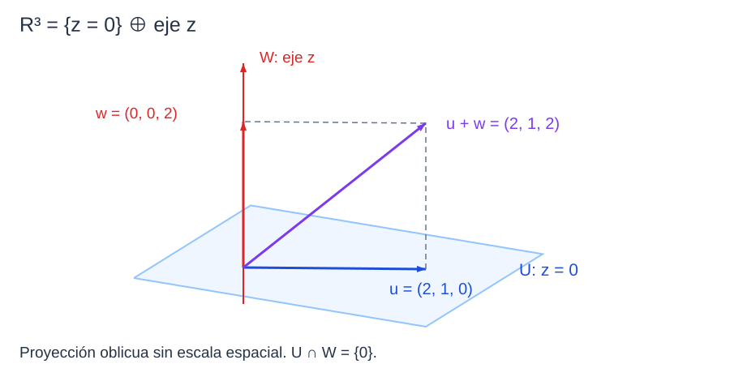

```dataviewjs
await dv.view("Planes/Estudio/Scripts/study-session", { location: "start" })
```

# Sumas y espacios asociados a una matriz

En $\mathbb R^3$, una dirección del plano $z=0$ no permite llegar a un punto con tercera coordenada no nula. Si añadimos múltiplos de $(0,0,1)$, cualquier vector se descompone como

$$
(x,y,z)=(x,y,0)+(0,0,z).
$$

La [[Matemáticas/Álgebra lineal/Espacios vectoriales/08 Suma, intersección y suma directa|suma de subespacios]] describe todas esas descomposiciones. Para saber si son únicas tendremos que estudiar la intersección. Después utilizaremos generadores, bases y dimensión para describir los espacios que determina una matriz.[^suma]

## Suma e intersección

### Suma de subespacios

> [!definicion] Suma de subespacios
> Para $U,W\le V$ sobre el mismo cuerpo $K$,
>
> $$
> U+W=\{u+w:u\in U,\ w\in W\}.
> $$

Si $U=\langle(1,0)\rangle$ y $W=\langle(0,1)\rangle$, cualquier $(x,y)$ se obtiene como $(x,0)+(0,y)$, luego $U+W=\mathbb R^2$. La unión sólo contiene los dos ejes y no contiene, por ejemplo, $(1,1)$.[^suma]

```anki
deck: Física::Álgebra Lineal::Espacios vectoriales
tags:
  - matematicas
  - algebra-lineal
  - sumas
---
> [!note] Pregunta
> ¿Qué vectores forman la suma $U+W$ de dos subespacios?
===
> [!important] Respuesta
> Los que se escriben como $u+w$ con $u\in U$ y $w\in W$. La suma puede contener vectores que no están en ninguno de los dos subespacios.
```

### La suma es el generado de la unión

#### Propiedad

> [!teorema] La suma es el generado de la unión
> Para $U,W\le V$,[^suma]
>
> $$
> \boxed{U+W=\langle U\cup W\rangle.}
> $$

#### Demostración

> [!demostracion] Demostración
> El cero pertenece a la suma porque $0_V=0_V+0_V$. Para $x=u+w$ e $y=u'+w'$, con los sumandos en sus respectivos subespacios,
>
> $$
> \alpha x+\beta y=(\alpha u+\beta u')+(\alpha w+\beta w')\in U+W.
> $$
>
> El primer paréntesis está en $U$ y el segundo en $W$. Por el criterio, la suma es subespacio.
>
> Además contiene a $U$, pues $u=u+0_V$, y a $W$, pues $w=0_V+w$. Todo subespacio que contenga a ambos contiene cada suma $u+w$; por tanto contiene a $U+W$. Esto caracteriza al menor subespacio que contiene la unión, es decir, a su generado. $\blacksquare$


```anki
deck: Física::Álgebra Lineal::Espacios vectoriales
tags:
  - matematicas
  - algebra-lineal
  - sumas
---
> [!note] Pregunta
> ¿Cuál es el menor subespacio que contiene a dos subespacios $U,W$?
===
> [!important] Respuesta
> Su suma $U+W=\langle U\cup W\rangle$. Para calcular generadores de la suma se reúnen los generadores de ambos.
```

### Intersección

> [!definicion] Intersección de subespacios
> La intersección reúne los vectores que pertenecen a ambos:
>
> $$
> U\cap W=\{v\in V:v\in U\text{ y }v\in W\}.
> $$

Es un subespacio por el [[Física/Grado/1º/Álgebra Lineal y Geometría Analítica/03 Espacios vectoriales/03 Subespacios y espacio generado#La intersección de subespacios es subespacio|criterio ya demostrado]]. Por ejemplo, los dos ejes de $\mathbb R^2$ sólo comparten $(0,0)$.

```anki
deck: Física::Álgebra Lineal::Espacios vectoriales
tags:
  - matematicas
  - algebra-lineal
  - sumas
---
> [!note] Pregunta
> ¿Cómo se calcula una intersección cuando ambos subespacios están dados por ecuaciones?
===
> [!important] Respuesta
> Se imponen simultáneamente las ecuaciones de ambos y se resuelve el sistema resultante. Sus soluciones pertenecen a los dos.
```

### Calcular desde generadores

Si $U=\langle u_1,\ldots,u_p\rangle$ y $W=\langle w_1,\ldots,w_q\rangle$, para la suma reunimos ambas listas y extraemos una base. Para la intersección buscamos un vector con las dos escrituras:

$$
\sum_{i=1}^{p}a_iu_i=\sum_{j=1}^{q}b_jw_j.
$$

Resolvemos el sistema homogéneo con matriz $[\,u_1\ \cdots\ u_p\ -w_1\ \cdots\ -w_q\,]$. Cada solución proporciona un vector de la intersección **al sustituir sus coeficientes en cualquiera de las dos escrituras**. Los pares de coeficientes son elementos de $K^{p+q}$; no son todavía los vectores de $V$ que buscamos.[^suma]

```anki
deck: Física::Álgebra Lineal::Espacios vectoriales
tags:
  - matematicas
  - algebra-lineal
  - sumas
---
> [!note] Pregunta
> ¿Cómo se calcula la intersección de dos subespacios dados por generadores?
===
> [!important] Respuesta
> Se igualan sus combinaciones lineales y se resuelve el sistema homogéneo de coeficientes. Después se reconstruyen los vectores comunes y se extrae una base.
```

## Suma directa

### Definición de suma directa

> [!definicion] Suma directa
> La suma $U+W$ es **directa**, escrita $U\oplus W$, si cada vector de la suma admite una única descomposición $u+w$, con $u\in U$ y $w\in W$.

En los dos ejes, $(x,y)=(x,0)+(0,y)$ determina cada sumando. Si en cambio $U=W$ es una recta no nula, un vector $v\in U$ tiene las descomposiciones $v+0_V$ y $0_V+v$; la suma no es directa.[^directa]

```anki
deck: Física::Álgebra Lineal::Espacios vectoriales
tags:
  - matematicas
  - algebra-lineal
  - sumas
---
> [!note] Pregunta
> ¿Qué añade la palabra directa a una suma de subespacios?
===
> [!important] Respuesta
> La unicidad de la descomposición de cada vector de $U+W$ como suma de un vector de $U$ y otro de $W$.
```

### Intersección trivial y unicidad

#### Propiedad

> [!teorema] Intersección trivial y unicidad
> Para $U,W\le V$,[^directa]
>
> $$
> \boxed{U+W=U\oplus W\iff U\cap W=\{0_V\}.}
> $$

#### Demostración

> [!demostracion] Demostración
> Supongamos $U\cap W=\{0_V\}$ y dos descomposiciones $u_1+w_1=u_2+w_2$. Reordenando,
>
> $$
> u_1-u_2=w_2-w_1.
> $$
>
> El miembro izquierdo pertenece a $U$ y el derecho a $W$. Como son el mismo vector, pertenecen a la intersección y deben ser cero. Así $u_1=u_2$ y $w_1=w_2$.
>
> Recíprocamente, si las descomposiciones son únicas y $z\in U\cap W$, entonces $z=z+0_V=0_V+z$ son dos descomposiciones admisibles. La unicidad obliga a $z=0_V$, de modo que la intersección es trivial. $\blacksquare$


```anki
deck: Física::Álgebra Lineal::Espacios vectoriales
tags:
  - matematicas
  - algebra-lineal
  - sumas
---
> [!note] Pregunta
> ¿Qué condición permite decidir si la suma de dos subespacios es directa?
===
> [!important] Respuesta
> $U\cap W=\{0_V\}$, equivalente a la unicidad de la descomposición en $U+W$.
```

### Un plano y una recta suplementarios

Para $U=\langle(1,0,0),(0,1,0)\rangle$ y $W=\langle(0,0,1)\rangle$, un vector común tendría sus tres coordenadas cero. Su intersección es trivial y

$$
\mathbb R^3=U\oplus W,\qquad (x,y,z)=(x,y,0)+(0,0,z).
$$

### Subespacios suplementarios

> [!definicion] Subespacios suplementarios
> $U,W\le V$ son **suplementarios en $V$** si $V=U\oplus W$.

Por ejemplo, el plano y el eje anteriores son suplementarios en $\mathbb R^3$. Que una suma sea directa no exige por sí solo que llene el espacio ambiente.[^directa]



*Proyección oblicua de una suma directa: los dos subespacios sólo comparten el origen.* [[Física/Grado/1º/Álgebra Lineal y Geometría Analítica/03 Espacios vectoriales/assets/05-sumas-e-intersecciones.excalidraw|Dibujo editable]].


```anki
deck: Física::Álgebra Lineal::Espacios vectoriales
tags:
  - matematicas
  - algebra-lineal
  - sumas
---
> [!note] Pregunta
> ¿Cuándo son suplementarios dos subespacios de $V$?
===
> [!important] Respuesta
> Cuando $V=U\oplus W$: su suma llena $V$ y su intersección es trivial. No se exige perpendicularidad.
```

## Fórmula de Grassmann

### Dimensión de una suma

#### Propiedad

> [!teorema] Dimensión de una suma
> Si $U,W\le V$ tienen dimensión finita, entonces[^grassmann]
>
> $$
> \boxed{\dim(U+W)=\dim U+\dim W-\dim(U\cap W).}
> $$

#### Demostración

> [!demostracion] Demostración
> Sea $(c_1,\ldots,c_r)$ una base de la intersección. La completamos a bases
>
> $$
> (c_1,\ldots,c_r,u_1,\ldots,u_p)\quad\text{de }U,
> $$
>
> $$
> (c_1,\ldots,c_r,w_1,\ldots,w_q)\quad\text{de }W.
> $$
>
> Probamos que la lista $(c_1,\ldots,c_r,u_1,\ldots,u_p,w_1,\ldots,w_q)$ es base de la suma.
>
> **Generación.** Todo $u+w$ se expande en las dos bases anteriores. Al reunir los coeficientes de los $c_i$, queda una combinación de la lista propuesta.
>
> **Independencia.** Supongamos una relación
>
> $$
> \sum_i a_ic_i+\sum_j b_ju_j+\sum_k d_kw_k=0_V.
> $$
>
> El vector $s=\sum_k d_kw_k=-\sum_i a_ic_i-\sum_j b_ju_j$ pertenece tanto a $W$ como a $U$. Por ello está en la intersección y se escribe $s=\sum_i e_ic_i$. Resulta
>
> $$
> \sum_k d_kw_k-\sum_i e_ic_i=0_V.
> $$
>
> Esta relación está escrita en una base de $W$, por lo que todos los $d_k$ y $e_i$ son cero. En la relación inicial queda $\sum_i a_ic_i+\sum_j b_ju_j=0_V$; la independencia de la base de $U$ obliga a que también todos los $a_i,b_j$ sean cero.
>
> La base de la suma tiene $r+p+q$ vectores, mientras $\dim U=r+p$, $\dim W=r+q$ y $\dim(U\cap W)=r$. Por tanto,
>
> $$
> \dim(U+W)=r+p+q=(r+p)+(r+q)-r.\qquad\blacksquare
> $$


```anki
deck: Física::Álgebra Lineal::Espacios vectoriales
tags:
  - matematicas
  - algebra-lineal
  - dimension
---
> [!note] Pregunta
> ¿Qué afirma la fórmula de Grassmann y bajo qué hipótesis se usa aquí?
===
> [!important] Respuesta
> Para subespacios finito-dimensionales del mismo espacio, $\dim(U+W)=\dim U+\dim W-\dim(U\cap W)$.
```


```anki
deck: Física::Álgebra Lineal::Espacios vectoriales
tags:
  - matematicas
  - algebra-lineal
  - dimension
---
> [!note] Pregunta
> ¿Por qué se resta la dimensión de la intersección en Grassmann?
===
> [!important] Respuesta
> Al completar una base de la intersección a bases de ambos subespacios, sus vectores se cuentan dos veces. En la base de la suma aparecen una sola vez.
```

### Dos comprobaciones de dimensión

Para los dos ejes de $\mathbb R^2$, Grassmann da $1+1-0=2$. Si $W=U$ es una recta, da $1+1-1=1$, pues $U+U=U$.

En una suma directa, el término de la intersección es cero: $\dim(U\oplus W)=\dim U+\dim W$.
> [!advertencia] Condiciones de validez: Grassmann
> La definición y el criterio de suma directa siguen teniendo sentido sin finitud; la cuenta escrita con restas de dimensiones se usa aquí sólo en dimensión finita.
## Espacios asociados a una matriz

Sea $A\in M_{m\times n}(K)$. Para unificar notaciones, las slides usan $N(A)$ para el núcleo, $L(A)$ para el espacio fila y $C(A)$ para el espacio columna. También escribiremos $\ker A$, $\operatorname{Row}(A)$ y $\operatorname{Col}(A)$.[^matrices]

### Núcleo o espacio nulo

> [!definicion] Núcleo de una matriz
> El **núcleo** de $A$ es
>
> $$
> N(A)=\ker A=\{x\in K^n:Ax=0_{K^m}\}.
> $$

Sus elementos tienen $n$ componentes. El cero satisface la ecuación y, si $Ax=Ay=0$, entonces $A(\alpha x+\beta y)=\alpha Ax+\beta Ay=0$. Por el criterio, el [[Matemáticas/Álgebra lineal/Espacios vectoriales/07 Núcleo, imagen, rango y nulidad|núcleo]] es subespacio de $K^n$.

```anki
deck: Física::Álgebra Lineal::Espacios vectoriales
tags:
  - matematicas
  - algebra-lineal
  - rango
---
> [!note] Pregunta
> ¿Qué es el núcleo de una matriz $A\in M_{m\times n}(K)$ y dónde vive?
===
> [!important] Respuesta
> $N(A)=\{x\in K^n:Ax=0\}$, el subespacio de soluciones del sistema homogéneo. Vive en $K^n$.
```

### Espacio columna

> [!definicion] Espacio columna
> Si $c_1,\ldots,c_n\in K^m$ son las columnas de $A$,
>
> $$
> C(A)=\operatorname{Col}(A)=\langle c_1,\ldots,c_n\rangle\le K^m.
> $$

Como $Ax=x_1c_1+\cdots+x_nc_n$, el espacio columna es la [[Matemáticas/Álgebra lineal/Espacios vectoriales/07 Núcleo, imagen, rango y nulidad|imagen]] de $x\mapsto Ax$. El sistema $Ax=b$ es compatible precisamente cuando $b\in C(A)$.

```anki
deck: Física::Álgebra Lineal::Espacios vectoriales
tags:
  - matematicas
  - algebra-lineal
  - rango
---
> [!note] Pregunta
> ¿Qué es el espacio columna de $A$?
===
> [!important] Respuesta
> El generado por sus columnas, $C(A)\le K^m$. Es la imagen de $x\mapsto Ax$ y contiene exactamente los términos $b$ para los que $Ax=b$ es compatible.
```

### Espacio fila

> [!definicion] Espacio fila
> Si $f_1,\ldots,f_m\in K^n$ son las filas de $A$, interpretadas como tuplas,
>
> $$
> L(A)=\operatorname{Row}(A)=\langle f_1,\ldots,f_m\rangle\le K^n.
> $$

Por ejemplo, una matriz $3\times4$ tiene espacio fila contenido en $K^4$ y espacio columna contenido en $K^3$. No pueden compararse como si fueran subconjuntos del mismo espacio.

```anki
deck: Física::Álgebra Lineal::Espacios vectoriales
tags:
  - matematicas
  - algebra-lineal
  - rango
---
> [!note] Pregunta
> ¿Qué es el espacio fila de una matriz $m\times n$?
===
> [!important] Respuesta
> El subespacio de $K^n$ generado por sus $m$ filas, interpretadas como vectores de coordenadas.
```

### Operaciones elementales y conservación de espacios

#### Propiedad

> [!teorema] Operaciones elementales y conservación de espacios
> Las operaciones elementales por filas conservan $L(A)$; las operaciones elementales por columnas conservan $C(A)$.[^operaciones]
>

#### Demostración

> [!demostracion] Demostración
> Una operación por filas es una de las [[Física/Grado/1º/Álgebra Lineal y Geometría Analítica/03 Espacios vectoriales/03 Subespacios y espacio generado#Transformaciones que conservan el generado|transformaciones de generadores]] ya demostradas: intercambio, escalado no nulo o suma de un múltiplo de otra fila. Por tanto conserva el generado de las filas. Una sucesión finita mantiene la igualdad en cada paso.
>
> El mismo argumento se aplica a las columnas cuando se opera sobre ellas. En cambio, operar por filas no asegura conservar el espacio columna: modifica los propios vectores columna. $\blacksquare$


```anki
deck: Física::Álgebra Lineal::Espacios vectoriales
tags:
  - matematicas
  - algebra-lineal
  - rango
---
> [!note] Pregunta
> ¿Qué espacio conserva cada tipo de operación elemental matricial?
===
> [!important] Respuesta
> Por filas se conserva el espacio fila; por columnas, el espacio columna. Las operaciones por filas no conservan en general el espacio columna.
```

### Rango

> [!definicion] Rango de una matriz
> El **rango** $r(A)$ es la dimensión de [[#Espacio columna|$C(A)$]].

Coincide con el número de pivotes y con $\dim L(A)$. Para justificarlo, reducimos $A$ por filas a una matriz escalonada $R$.[^rango]

```anki
deck: Física::Álgebra Lineal::Espacios vectoriales
tags:
  - matematicas
  - algebra-lineal
  - rango
---
> [!note] Pregunta
> ¿Cómo se define el rango de una matriz mediante su espacio columna?
===
> [!important] Respuesta
> Como $r(A)=\dim C(A)$: el número de vectores de una base de su espacio columna.
```


### Igualdad de los rangos fila y columna

#### Propiedad

> [!teorema] Igualdad de los rangos fila y columna
> Para $A\in M_{m\times n}(K)$,[^rango]
>
> $$
> \boxed{r(A)=\dim C(A)=\dim L(A)=r(A^T).}
> $$

#### Demostración

> [!demostracion] Demostración
> Supongamos que $R$ tiene $r$ filas no nulas. Éstas generan $L(R)$ y son independientes: al leer una relación lineal en las columnas pivote, la primera obliga a anular el coeficiente de la primera fila; la segunda anula el de la segunda y así sucesivamente. Como las [[#Operaciones elementales y conservación de espacios|operaciones por filas conservan el espacio fila]], $\dim L(A)=r$.
>
> Las columnas pivote de $R$ son independientes: restringidas a sus primeras $r$ filas forman una matriz triangular con diagonal no nula. Además generan todas las columnas de $R$, pues esas primeras $r$ componentes pueden obtenerse con ellas y las restantes son cero. Por tanto $\dim C(R)=r$.
>
> Existe una matriz invertible $E$ con $R=EA$. Multiplicar por $E$ lleva cada combinación de columnas de $A$ a la correspondiente combinación de columnas de $R$ y, al tener inversa, conserva independencia y generación. Así, $\dim C(A)=\dim C(R)=r$.
>
> Finalmente, las columnas de $A^T$ son las filas de $A$; de ahí $r(A^T)=\dim L(A)=r$. $\blacksquare$


```anki
deck: Física::Álgebra Lineal::Espacios vectoriales
tags:
  - matematicas
  - algebra-lineal
  - rango
---
> [!note] Pregunta
> ¿Qué cantidades coinciden con el rango de una matriz?
===
> [!important] Respuesta
> La dimensión del espacio columna, la del espacio fila, el número de pivotes y el rango de su traspuesta.
```

### Bases por reducción

Para el espacio columna, localizamos las columnas pivote al reducir y escogemos esas columnas **en $A$**. Para el espacio fila, las filas no nulas de una forma escalonada de $A$ constituyen una base. Para el núcleo, resolvemos $Ax=0$ y escribimos la solución como combinación de los vectores asociados a las variables libres.[^rango]

```anki
deck: Física::Álgebra Lineal::Espacios vectoriales
tags:
  - matematicas
  - algebra-lineal
  - rango
---
> [!note] Pregunta
> ¿De qué matriz se toman las columnas y las filas al calcular bases mediante Gauss?
===
> [!important] Respuesta
> Las columnas pivote se toman de la original; para el espacio fila se toman las filas no nulas de una forma escalonada.
```

### Ejemplo — filas y columnas que generan el mismo plano

Sea

$$
A=\begin{pmatrix}1&0&1\\0&1&1\\1&1&2\end{pmatrix}.
$$

La tercera fila es suma de las primeras dos, y lo mismo ocurre con las columnas. Las dos primeras son independientes en ambos casos, por sus dos primeras componentes. Por tanto $r(A)=2$ y

$$
C(A)=L(A)=\langle(1,0,1),(0,1,1)\rangle=\{(x,y,z):z=x+y\}.
$$

En esta matriz simétrica coinciden como subespacios de $\mathbb R^3$. Esa igualdad concreta no se deduce sólo de tener la misma dimensión y no ocurre para toda matriz cuadrada.

### Ejemplo — los tres espacios de una matriz rectangular

Consideremos la matriz de las slides:

$$
A=\begin{pmatrix}1&-2&0&-1\\-3&4&-2&-1\\-1&0&-2&-3\end{pmatrix}.
$$

Aplicamos $L_2\leftarrow L_2+3L_1$ y $L_3\leftarrow L_3+L_1$. Las dos últimas filas quedan iguales a $(0,-2,-2,-4)$. Restamos ambas y escalamos la segunda por $-1/2$; por último, $L_1\leftarrow L_1+2L_2$:

$$
R=\begin{pmatrix}1&0&2&3\\0&1&1&2\\0&0&0&0\end{pmatrix}.
$$

Los pivotes están en las columnas 1 y 2. Así,

$$
L(A)=\langle(1,0,2,3),(0,1,1,2)\rangle\le\mathbb R^4,
$$

$$
C(A)=\langle(1,-3,-1),(-2,4,0)\rangle\le\mathbb R^3.
$$

Para el núcleo, $x_1=-2x_3-3x_4$ y $x_2=-x_3-2x_4$. Con $x_3=\alpha$ y $x_4=\beta$,

$$
x=\alpha(-2,-1,1,0)+\beta(-3,-2,0,1).
$$

Los dos vectores son independientes porque sus últimas dos componentes forman $(1,0)$ y $(0,1)$. Al multiplicarlos por $A$ obtenemos cero. Luego son base de $N(A)$ y

$$
\dim N(A)=2=4-r(A).
$$

El número de parámetros libres coincide con el grado de indeterminación del sistema homogéneo.[^ejemplo-rectangular]

```anki
deck: Física::Álgebra Lineal::Espacios vectoriales
tags:
  - matematicas
  - algebra-lineal
  - rango
---
> [!note] Pregunta
> ¿Cómo se construye una base del núcleo desde las variables libres?
===
> [!important] Respuesta
> Se escribe la solución homogénea como combinación de parámetros. Para cada variable libre se toma el vector obtenido al darle valor uno y a las demás cero.
```


```anki
deck: Física::Álgebra Lineal::Espacios vectoriales
tags:
  - matematicas
  - algebra-lineal
  - rango
---
> [!note] Pregunta
> ¿En qué espacios viven el espacio fila y el espacio columna de $A\in M_{m\times n}(K)$?
===
> [!important] Respuesta
> $\operatorname{Row}(A)\subseteq K^n$ y $\operatorname{Col}(A)\subseteq K^m$; ambos tienen dimensión igual al rango de $A$.
```

> [!warning] Misma dimensión no implica mismo subespacio
> Dos rectas distintas tienen dimensión uno. Del mismo modo, $\dim L(A)=\dim C(A)$ no afirma que sus vectores coincidan. Para una matriz rectangular ni siquiera viven en el mismo espacio coordenado.

El núcleo se compara con el espacio fila dentro de $K^n$, mientras que el núcleo de la traspuesta se compara con el espacio columna dentro de $K^m$. La [[Física/Grado/1º/Álgebra Lineal y Geometría Analítica/03 Espacios vectoriales/06 Cuatro subespacios fundamentales|ampliación sobre los cuatro subespacios]] estudia estas relaciones geométricas sobre $\mathbb R$.

## 📚 Fuentes

### Material base

[^matrices]: FCUL, *ALGA 2026/27*, Aula 20, «Subespaços de $K^n$», 02/11/2026, diapositivas 5–10: núcleo, fila, columna y notaciones $N(A),L(A),C(A)$.
[^operaciones]: Misma fuente, diapositivas 11–12: invariancia del espacio fila y del espacio columna bajo sus respectivas operaciones. La prueba remite al argumento de transformaciones de generadores, cuyo TPC está resuelto en la nota 03.
[^ejemplo-rectangular]: Misma fuente, diapositivas 5 y 10: matriz rectangular, forma reducida y solución homogénea. Se desarrollan las operaciones y la extracción de bases. En el primer resultado matricial de la diapositiva 12 se copia $1$ en la posición $(2,4)$, aunque la operación sólo modifica la primera fila: esa entrada debe conservar $-1$, como sí aparece en la lista de generadores inmediatamente inferior. La segunda transformación, sobre la cuarta columna, sí da $-1+2=1$ en esa posición.

### Desarrollo académico del programa

[^suma]: Instituto Superior Técnico, ULisboa, [*Álgebra Linear*](https://fenix.tecnico.ulisboa.pt/downloadFile/563568428979297/ApontamentosInteg.pdf), §3.38 y solución del ejercicio 3.51.21(a), pp. 238–239: suma como subespacio. La descripción por generadores se obtiene de la definición y la propiedad mínima.
[^directa]: Misma fuente, definición 3.39 y proposición 3.40, pp. 53–54: suma directa y equivalencia con intersección trivial. Adaptación de la demostración completa.
[^grassmann]: Misma fuente, solución del ejercicio 3.51.21(c), p. 239: demostración por extensión de una base de la intersección. Se adapta la notación y se explicita cómo se anulan los coeficientes.
[^rango]: Misma fuente, §§3.18–3.23, pp. 43–46: espacios asociados y bases de filas escalonadas. [Margalit y Rabinoff, *Interactive Linear Algebra*, §6.2](https://textbooks.math.gatech.edu/ila/orthogonal-complements.html), igualdad de rangos fila y columna; [§2.7](https://textbooks.math.gatech.edu/ila/dimension.html), recetas de bases. La prueba incluida usa eliminación e invertibilidad de operaciones elementales, y se presenta como desarrollo de ese argumento, no como transcripción de la prueba por complementos ortogonales del §6.2.

## 🧑‍🏫 Prompt para tutor conversacional

Actúa como tutor universitario en español. Una pregunta cada vez y espera. Definiciones: $U+W=\{u+w\}$; suma directa si la descomposición es única, equivalente a $U\cap W=\{0\}$. Para dimensiones finitas usa Grassmann. Pide reconstruir la base de la suma desde una base de la intersección. Para matrices, $N(A)\le K^n$, $L(A)\le K^n$, $C(A)\le K^m$; el rango es la dimensión de ambos espacios fila y columna. Usa la matriz $A=((1,-2,0,-1),(-3,4,-2,-1),(-1,0,-2,-3))$ con filas indicadas: su forma reducida tiene filas $(1,0,2,3),(0,1,1,2),0$; núcleo generado por $(-2,-1,1,0),(-3,-2,0,1)$. Pide justificar columnas originales frente a filas reducidas y verificar cada base. Usa la práctica existente, sin generar ejercicios nuevos. Da pistas graduadas.

```dataviewjs
await dv.view("Planes/Estudio/Scripts/study-session", { location: "end" })
```
