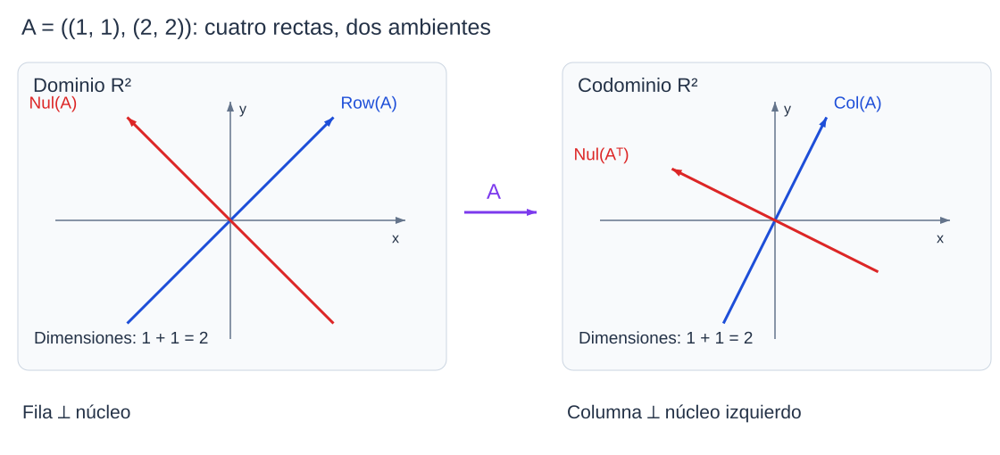

```dataviewjs
await dv.view("Planes/Estudio/Scripts/study-session", { location: "start" })
```

# Cuatro subespacios fundamentales

Para

$$
A=\begin{pmatrix}1&1\\2&2\end{pmatrix},
$$

el producto $Ax$ sólo depende de la suma de las componentes de $x$:

$$
Ax=\begin{pmatrix}x_1+x_2\\2(x_1+x_2)\end{pmatrix}.
$$

Las salidas están en la recta generada por $(1,2)$, mientras que los vectores $(t,-t)$ se envían a cero. El [[Matemáticas/Álgebra lineal/Espacios vectoriales/07 Núcleo, imagen, rango y nulidad|espacio columna y el núcleo]] describen esas dos condiciones. Al estudiar la [[Matemáticas/Álgebra lineal/Transpuesta de una matriz|traspuesta]] aparecen el espacio fila y el núcleo izquierdo.[^cuatro]

> [!contexto] Ampliación curricular
> Esta síntesis utiliza ortogonalidad, que pertenece a una unidad posterior del programa. Trabajamos sobre $\mathbb R$ con el producto escalar euclídeo. Las extensiones complejas requieren conjugación, como se precisa al final.

## Los cuatro subespacios y sus ambientes

Sea $A\in M_{m\times n}(\mathbb R)$. El producto $x\mapsto Ax$ es una [[Matemáticas/Álgebra lineal/Espacios vectoriales/09 Aplicaciones lineales|aplicación lineal]] de $\mathbb R^n$ a $\mathbb R^m$.

### Espacio columna

> [!definicion] Espacio columna
> $\operatorname{Col}(A)=\{Ax:x\in\mathbb R^n\}\le\mathbb R^m$ es el generado de las columnas de $A$.

En el ejemplo inicial es $\langle(1,2)\rangle$: $Ax=(x_1+x_2)(1,2)$. Para todo $t\in\mathbb R$, $A(t,0)^T=t(1,2)^T$, de modo que se alcanza la recta completa.

```anki
deck: Física::Álgebra Lineal::Espacios vectoriales
tags:
  - matematicas
  - algebra-lineal
  - cuatro-subespacios
---
> [!note] Pregunta
> ¿Qué vectores forman el espacio columna de una matriz real $m\times n$?
===
> [!important] Respuesta
> Las salidas $Ax$, equivalentes a las combinaciones de sus columnas. Es un subespacio de $\mathbb R^m$.
```

### Espacio nulo o núcleo

> [!definicion] Espacio nulo
> $\operatorname{Nul}(A)=\{x\in\mathbb R^n:Ax=0\}\le\mathbb R^n$.

Para la matriz inicial, $Ax=0$ equivale a $x_1+x_2=0$. Tomando $x_2=t$, obtenemos $x=t(-1,1)$. Por tanto $\operatorname{Nul}(A)=\langle(-1,1)\rangle$.

```anki
deck: Física::Álgebra Lineal::Espacios vectoriales
tags:
  - matematicas
  - algebra-lineal
  - cuatro-subespacios
---
> [!note] Pregunta
> ¿Qué contiene el núcleo de una matriz y dónde vive?
===
> [!important] Respuesta
> Las soluciones de $Ax=0$; si $A$ tiene $n$ columnas, su núcleo es subespacio de $\mathbb R^n$.
```

### Espacio fila

> [!definicion] Espacio fila
> $\operatorname{Row}(A)=\operatorname{Col}(A^T)\le\mathbb R^n$ es el generado de las filas de $A$, interpretadas como vectores de coordenadas.

En el ejemplo, $(2,2)=2(1,1)$, por lo que $\operatorname{Row}(A)=\langle(1,1)\rangle$.

```anki
deck: Física::Álgebra Lineal::Espacios vectoriales
tags:
  - matematicas
  - algebra-lineal
  - cuatro-subespacios
---
> [!note] Pregunta
> ¿Cómo se relaciona el espacio fila de $A$ con su traspuesta?
===
> [!important] Respuesta
> $\operatorname{Row}(A)=\operatorname{Col}(A^T)\le\mathbb R^n$.
```

### Núcleo izquierdo

> [!definicion] Núcleo izquierdo
> El **núcleo izquierdo** de $A$ es
>
> $$
> \operatorname{Nul}(A^T)=\{y\in\mathbb R^m:A^Ty=0\}
> =\{y\in\mathbb R^m:y^TA=0\}.
> $$

El nombre procede de $y^TA$, donde $y^T$ multiplica por la izquierda. Sus vectores describen relaciones entre filas: $y^TA=\sum_i y_if_i=0$. En el ejemplo, $A^Ty=0$ exige $y_1+2y_2=0$, así que $\operatorname{Nul}(A^T)=\langle(-2,1)\rangle$.[^cuatro]

```anki
deck: Física::Álgebra Lineal::Espacios vectoriales
tags:
  - matematicas
  - algebra-lineal
  - cuatro-subespacios
---
> [!note] Pregunta
> ¿Qué es el núcleo izquierdo de una matriz real $A$?
===
> [!important] Respuesta
> $\operatorname{Nul}(A^T)=\{y:A^Ty=0\}$, equivalentemente $y^TA=0$. Vive en $\mathbb R^m$ y expresa relaciones entre las filas de $A$.
```

## Dimensiones y rango

### Rango y nulidad

#### Propiedad

> [!teorema] Rango y nulidad
> Para $A\in M_{m\times n}(\mathbb R)$ de rango $r$,[^nulidad]
>
> $$
> \boxed{\dim\operatorname{Nul}(A)=n-r.}
> $$

#### Demostración

> [!demostracion] Demostración
> Sean $k_1,\ldots,k_s$ una base del núcleo. La completamos hasta una base $(k_1,\ldots,k_s,u_1,\ldots,u_t)$ de $\mathbb R^n$, de modo que $s+t=n$.
>
> Los vectores $Au_1,\ldots,Au_t$ generan $\operatorname{Col}(A)$: al expandir cualquier $x$ en la base anterior y aplicar $A$, desaparecen los términos $Ak_i=0$.
>
> Son independientes. Si $\sum_j a_jAu_j=0$, entonces $\sum_j a_ju_j$ pertenece al núcleo, por lo que se escribe $\sum_i b_ik_i$. Restar ambas expresiones produce una relación entre los vectores de la base completa. Su independencia fuerza todos los $a_j$ y $b_i$ a cero.
>
> Así, $(Au_1,\ldots,Au_t)$ es base de la imagen y $t=r$. De $s+t=n$ obtenemos $s=n-r$. $\blacksquare$


```anki
deck: Física::Álgebra Lineal::Espacios vectoriales
tags:
  - matematicas
  - algebra-lineal
  - cuatro-subespacios
---
> [!note] Pregunta
> ¿Qué afirma el teorema rango–nulidad para una matriz con $n$ columnas?
===
> [!important] Respuesta
> $r(A)+\dim\ker A=n$: cuenta la dimensión del dominio, no el número de filas.
```

### Las cuatro dimensiones

La [[Física/Grado/1º/Álgebra Lineal y Geometría Analítica/03 Espacios vectoriales/05 Sumas y espacios asociados a una matriz#Igualdad de los rangos fila y columna|igualdad de rango fila y columna]] da $r(A^T)=r(A)=r$. Aplicando rango–nulidad también a $A^T$, que tiene $m$ columnas, obtenemos:[^cuatro]

| Subespacio | Ambiente | Dimensión |
|---|---|---|
| $\operatorname{Row}(A)$ | $\mathbb R^n$ | $r$ |
| $\operatorname{Nul}(A)$ | $\mathbb R^n$ | $n-r$ |
| $\operatorname{Col}(A)$ | $\mathbb R^m$ | $r$ |
| $\operatorname{Nul}(A^T)$ | $\mathbb R^m$ | $m-r$ |

En el **mismo ambiente**, fila y núcleo suman dimensiones $n$; columna y núcleo izquierdo suman dimensiones $m$. Rango–nulidad también suma $\dim\operatorname{Nul}(A)+\dim\operatorname{Col}(A)=n$, aunque esos dos espacios viven en ambientes distintos: esa igualdad numérica no los convierte en una suma directa.

```anki
id: null
deck: Física::Álgebra Lineal::Espacios vectoriales
tags:
  - matematicas
  - algebra-lineal
  - cuatro-subespacios
---
> [!note] Pregunta
> Si $A\in M_{m\times n}(\mathbb R)$ tiene rango $r$, ¿cuáles son las dimensiones de $\operatorname{Nul}(A)$ y $\operatorname{Nul}(A^T)$?
===
> [!important] Respuesta
> $\dim\operatorname{Nul}(A)=n-r$ y $\dim\operatorname{Nul}(A^T)=m-r$.
```

## Ortogonalidad

### Producto escalar euclídeo

> [!definicion] Producto escalar euclídeo
> Para $x,y\in\mathbb R^d$,
>
> $$
> x\cdot y=x^Ty=\sum_{i=1}^d x_iy_i.
> $$

Dos vectores son **ortogonales** si este producto vale cero. Por ejemplo, $(1,1)\cdot(-1,1)=-1+1=0$.[^ortogonal]

```anki
deck: Física::Álgebra Lineal::Espacios vectoriales
tags:
  - matematicas
  - algebra-lineal
  - cuatro-subespacios
---
> [!note] Pregunta
> ¿Cuándo son ortogonales dos vectores reales con el producto euclídeo?
===
> [!important] Respuesta
> Cuando $x^Ty=\sum_i x_iy_i=0$.
```

### Norma euclídea

> [!definicion] Norma euclídea
> Para $x\in\mathbb R^d$,
>
> $$
> \|x\|=\sqrt{x^Tx}=\sqrt{\sum_{i=1}^d x_i^2}.
> $$

Por ejemplo, $\|(3,4)\|=5$. La suma de cuadrados garantiza $\|x\|^2\ge0$ y $\|x\|^2=0\iff x=0$; esta última equivalencia se utilizará en las pruebas siguientes.[^ortogonal]

```anki
deck: Física::Álgebra Lineal::Espacios vectoriales
tags:
  - matematicas
  - algebra-lineal
  - cuatro-subespacios
---
> [!note] Pregunta
> ¿Qué propiedad de la norma euclídea permite concluir que un vector es cero?
===
> [!important] Respuesta
> $\|x\|^2=\sum_i x_i^2=0$ si y sólo si $x=0$, porque los sumandos son no negativos.
```


### Complemento ortogonal

> [!definicion] Complemento ortogonal
> Para $S\le\mathbb R^d$, su **complemento ortogonal** es
>
> $$
> S^\perp=\{x\in\mathbb R^d:s^Tx=0\text{ para todo }s\in S\}.
> $$

Se utiliza el [[Matemáticas/Álgebra lineal/Espacios vectoriales/11 Producto escalar y Gram–Schmidt|producto escalar euclídeo]] $s^Tx=\sum_{i=1}^d s_ix_i$. Ser ortogonal al subespacio exige serlo a **todos** sus vectores; basta comprobarlo en sus generadores por linealidad. Por ejemplo, $(1,1)\cdot(-1,1)=0$ y, por tanto, las rectas que generan son perpendiculares.[^ortogonal]

```anki
deck: Física::Álgebra Lineal::Espacios vectoriales
tags:
  - matematicas
  - algebra-lineal
  - cuatro-subespacios
---
> [!note] Pregunta
> ¿Qué vectores forman el complemento ortogonal $S^\perp$ en $\mathbb R^d$?
===
> [!important] Respuesta
> Los que tienen producto escalar cero con todos los vectores de $S$. Basta verificarlo con un sistema generador de $S$.
```

### Núcleo y espacio fila

#### Propiedad

> [!teorema] Núcleo y espacio fila
> Para una matriz real $A$,[^ortogonal]
>
> $$
> \boxed{\operatorname{Nul}(A)=\operatorname{Row}(A)^\perp.}
> $$

#### Demostración

> [!demostracion] Demostración
> La componente $i$ de $Ax$ es el producto de la fila $f_i$ por $x$. Por tanto,
>
> $$
> Ax=0\iff f_ix=0\quad\forall i\in\{1,\ldots,m\}.
> $$
>
> Si esto se cumple, para cualquier combinación de filas $s=\sum_i\alpha_if_i$ se tiene $sx=\sum_i\alpha_i(f_ix)=0$. Así, $x$ es ortogonal a todo el espacio fila.
>
> Recíprocamente, si $x$ es ortogonal al espacio fila, lo es a cada fila individual, pues cada una pertenece a él. Todas las componentes de $Ax$ son cero, luego $x\in\operatorname{Nul}(A)$. Las dos inclusiones prueban la igualdad. $\blacksquare$


```anki
deck: Física::Álgebra Lineal::Espacios vectoriales
tags:
  - matematicas
  - algebra-lineal
  - cuatro-subespacios
---
> [!note] Pregunta
> ¿Qué relación ortogonal une núcleo y espacio fila de una matriz real?
===
> [!important] Respuesta
> $\operatorname{Nul}(A)=\operatorname{Row}(A)^\perp$, dentro de $\mathbb R^n$.
```

### Núcleo izquierdo y espacio columna

#### Propiedad

> [!teorema] Núcleo izquierdo y espacio columna
> Para una matriz real $A$,[^ortogonal]
>
> $$
> \boxed{\operatorname{Nul}(A^T)=\operatorname{Col}(A)^\perp.}
> $$

#### Demostración

> [!demostracion] Demostración
> Aplicamos la propiedad anterior a $A^T$. Su espacio fila, leído como espacio de coordenadas, es el generado por las columnas de $A$. Por tanto $A^Ty=0$ equivale a ser ortogonal a cada columna y, por linealidad, a todo su generado. $\blacksquare$


```anki
deck: Física::Álgebra Lineal::Espacios vectoriales
tags:
  - matematicas
  - algebra-lineal
  - cuatro-subespacios
---
> [!note] Pregunta
> ¿Qué relación ortogonal une núcleo izquierdo y espacio columna de una matriz real?
===
> [!important] Respuesta
> $\operatorname{Nul}(A^T)=\operatorname{Col}(A)^\perp$, dentro de $\mathbb R^m$.
```




*Cada par está dibujado en su propio ambiente. $A$ anula la dirección $(-1,1)$ y lleva $(1,1)$ a $(2,4)$.* [[Física/Grado/1º/Álgebra Lineal y Geometría Analítica/03 Espacios vectoriales/assets/06-cuatro-subespacios.excalidraw|Dibujo editable]].

## Soluciones de un sistema compatible

### Todas las soluciones difieren en un vector del núcleo

#### Propiedad

> [!teorema] Todas las soluciones difieren en un vector del núcleo
> Si $Ax_0=b$, el conjunto de soluciones de $Ax=b$ es[^soluciones]
>
> $$
> \boxed{x_0+\operatorname{Nul}(A).}
> $$

#### Demostración

> [!demostracion] Demostración
> Si $Ax=b$, entonces $A(x-x_0)=b-b=0$, luego $x-x_0$ pertenece al núcleo y $x=x_0+z$ para algún $z\in\operatorname{Nul}(A)$.
>
> Recíprocamente, para cualquier $z$ del núcleo, $A(x_0+z)=Ax_0+Az=b+0=b$. Así se obtienen todas las soluciones y sólo ellas. $\blacksquare$


```anki
deck: Física::Álgebra Lineal::Espacios vectoriales
tags:
  - matematicas
  - algebra-lineal
  - cuatro-subespacios
---
> [!note] Pregunta
> ¿Cómo se describen todas las soluciones de un sistema compatible a partir de una solución $x_0$?
===
> [!important] Respuesta
> Como $x_0+z$, con $z\in\ker A$. La diferencia entre dos soluciones pertenece al núcleo.
```

### Descomposición ortogonal del dominio

#### Propiedad

> [!teorema] Descomposición ortogonal del dominio
> Para una matriz real $A$,[^ortogonal]
>
> $$
> \boxed{\mathbb R^n=\operatorname{Row}(A)\oplus\operatorname{Nul}(A).}
> $$

#### Demostración

> [!demostracion] Demostración
> La intersección es trivial: si $x$ está en ambos subespacios, es ortogonal a todo el espacio fila y en particular a sí mismo. Entonces $x^Tx=\sum_i x_i^2=0$, lo que sobre $\mathbb R$ obliga a $x=0$.
>
> Las dimensiones suman $r+(n-r)=n$. Por [[Física/Grado/1º/Álgebra Lineal y Geometría Analítica/03 Espacios vectoriales/05 Sumas y espacios asociados a una matriz#Dimensión de una suma|Grassmann]], la suma tiene dimensión $n$; como es subespacio de $\mathbb R^n$, coincide con él. La intersección trivial hace que la suma sea directa. $\blacksquare$


```anki
deck: Física::Álgebra Lineal::Espacios vectoriales
tags:
  - matematicas
  - algebra-lineal
  - cuatro-subespacios
---
> [!note] Pregunta
> ¿Qué descomposición directa del dominio proporcionan el espacio fila y el núcleo?
===
> [!important] Respuesta
> $\mathbb R^n=\operatorname{Row}(A)\oplus\operatorname{Nul}(A)$ para matrices reales con producto euclídeo; los sumandos son ortogonales.
```

### Única solución en el espacio fila

#### Propiedad

> [!teorema] Única solución en el espacio fila
> Si $Ax=b$ es compatible, existe una única solución $x_r\in\operatorname{Row}(A)$.[^soluciones]
>

#### Demostración

> [!demostracion] Demostración
> Tomamos una solución $x_0$ y la descomponemos de forma única como $x_0=x_r+x_n$, con $x_r\in\operatorname{Row}(A)$ y $x_n\in\operatorname{Nul}(A)$. Entonces
>
> $$
> Ax_r=A(x_0-x_n)=b-0=b.
> $$
>
> Esto prueba existencia. Si $u,v$ son soluciones del espacio fila, $A(u-v)=0$, luego $u-v$ pertenece al núcleo. También pertenece al espacio fila por cierre. Como la intersección es trivial, $u-v=0$ y $u=v$. $\blacksquare$


```anki
deck: Física::Álgebra Lineal::Espacios vectoriales
tags:
  - matematicas
  - algebra-lineal
  - cuatro-subespacios
---
> [!note] Pregunta
> ¿Cuántas soluciones de un sistema real compatible pertenecen al espacio fila?
===
> [!important] Respuesta
> Exactamente una: la componente en el espacio fila de cualquier solución, en la descomposición ortogonal del dominio.
```

### La solución del espacio fila tiene norma mínima

#### Propiedad

> [!teorema] La solución del espacio fila tiene norma mínima
> Entre las soluciones de un sistema compatible, $x_r\in\operatorname{Row}(A)$ es la única de menor norma euclídea.[^minima]
>

#### Demostración

> [!demostracion] Demostración
> Toda otra solución es $x_r+z$, con $z\in\operatorname{Nul}(A)$. Como $x_r^Tz=0$,
>
> $$
> \begin{aligned}
> \|x_r+z\|^2
> &=(x_r+z)^T(x_r+z)\\
> &=\|x_r\|^2+2x_r^Tz+\|z\|^2\\
> &=\|x_r\|^2+\|z\|^2\ge\|x_r\|^2.
> \end{aligned}
> $$
>
> La igualdad sólo ocurre si $z=0$. Por tanto el mínimo es único y se alcanza en $x_r$. $\blacksquare$


```anki
deck: Física::Álgebra Lineal::Espacios vectoriales
tags:
  - matematicas
  - algebra-lineal
  - cuatro-subespacios
---
> [!note] Pregunta
> ¿Por qué la solución en el espacio fila es la de menor norma euclídea?
===
> [!important] Respuesta
> Toda otra solución es $x_r+z$ con $z\in\ker A$ y $x_r\perp z$; así $\|x_r+z\|^2=\|x_r\|^2+\|z\|^2$, mayor salvo si $z=0$.
```

## Invertibilidad de $A^TA$

### Cuándo es invertible $A^TA$

#### Propiedad

> [!teorema] Cuándo es invertible $A^TA$
> Para $A\in M_{m\times n}(\mathbb R)$,[^gram]
>
> $$
> \boxed{A^TA\text{ invertible}\iff\operatorname{Nul}(A)=\{0\}\iff r(A)=n.}
> $$

#### Demostración

> [!demostracion] Demostración
> Primero comparamos los núcleos. Si $Ax=0$, entonces $A^TAx=A^T0=0$. Recíprocamente, si $A^TAx=0$, multiplicamos por $x^T$:
>
> $$
> 0=x^TA^TAx=(Ax)^T(Ax)=\|Ax\|^2.
> $$
>
> La suma de cuadrados sólo puede ser cero si $Ax=0$. Por tanto $\operatorname{Nul}(A^TA)=\operatorname{Nul}(A)$.
>
> La matriz $A^TA$ es cuadrada de orden $n$, así que es invertible si y sólo si su núcleo es trivial. Rango–nulidad da la equivalencia final con $r(A)=n$, es decir, independencia de todas las columnas de $A$. $\blacksquare$


```anki
deck: Física::Álgebra Lineal::Espacios vectoriales
tags:
  - matematicas
  - algebra-lineal
  - cuatro-subespacios
---
> [!note] Pregunta
> ¿Cuándo es invertible $A^TA$ para una matriz real?
===
> [!important] Respuesta
> Cuando las columnas de $A$ son independientes: $\ker A=\{0\}$, equivalente a $r(A)=n$. En particular, es imposible si $m<n$.
```

## Ejemplo trabajado — los cuatro espacios de la matriz inicial

Para $A=\begin{pmatrix}1&1\\2&2\end{pmatrix}$, las bases calculadas son

$$
\begin{aligned}
\operatorname{Col}(A)&=\langle(1,2)\rangle,&
\operatorname{Nul}(A)&=\langle(-1,1)\rangle,\\
\operatorname{Row}(A)&=\langle(1,1)\rangle,&
\operatorname{Nul}(A^T)&=\langle(-2,1)\rangle.
\end{aligned}
$$

Todas tienen dimensión uno, de acuerdo con $m=n=2$ y $r=1$. Se verifica la ortogonalidad mediante

$$
(1,1)\cdot(-1,1)=0,\qquad (1,2)\cdot(-2,1)=0.
$$

Además, $A^TA=\begin{pmatrix}5&5\\5&5\end{pmatrix}$ es singular.

Para $b=(3,6)^T$, el sistema queda $x_1+x_2=3$. Sus soluciones son $(t,3-t)^T$. Pedir que la solución esté en $\operatorname{Row}(A)$ exige $x_1=x_2$, por lo que

$$
x_r=\begin{pmatrix}3/2\\3/2\end{pmatrix},\qquad Ax_r=\begin{pmatrix}3\\6\end{pmatrix}.
$$

Su norma al cuadrado es $9/2$. Para cualquier otra solución,

$$
t^2+(3-t)^2=\frac92+2\left(t-\frac32\right)^2,
$$

lo que confirma el mínimo en $t=3/2$.

## Alcance real y caso complejo

> [!warning] Condiciones de validez
> La prueba de $\ker(A^TA)=\ker A$ utiliza positividad del producto euclídeo. No vale con la traspuesta ordinaria sobre cualquier cuerpo. Para $A=\begin{pmatrix}1\\i\end{pmatrix}$, por ejemplo, $A^TA=1+i^2=0$ aunque la columna sea no nula.

En $\mathbb C$ se usa el producto hermítico $\langle x,y\rangle=x^*y$ y el [[Matemáticas/Álgebra lineal/Conjugada transpuesta de una matriz|adjunto]] $A^*=\overline A^T$. Las fórmulas correctas son

$$
\ker A=(\operatorname{im}A^*)^\perp,\qquad
\ker A^*=(\operatorname{im}A)^\perp,
$$

$$
A^*A\text{ invertible}\iff\ker A=\{0\}.
$$

Aquí $\operatorname{im}A^*$ es el generado por las columnas de $A^*$, es decir, por las filas **conjugadas** de $A$ leídas como columnas; no debe confundirse con el espacio de filas sin conjugar. La prueba utiliza $x^*A^*Ax=\|Ax\|^2$ y la positividad hermítica.[^complejo]

```anki
deck: Física::Álgebra Lineal::Espacios vectoriales
tags:
  - matematicas
  - algebra-lineal
  - cuatro-subespacios
---
> [!note] Pregunta
> ¿Qué sustituye a la traspuesta en las relaciones ortogonales para matrices complejas?
===
> [!important] Respuesta
> El adjunto $A^*=\overline A^T$, con producto hermítico. Se usa $A^*A$, no $A^TA$, y $\ker A=(\operatorname{im}A^*)^\perp$.
```

```anki
deck: Física::Álgebra Lineal::Espacios vectoriales
tags:
  - matematicas
  - algebra-lineal
  - cuatro-subespacios
---
> [!note] Pregunta
> ¿Cuándo es invertible $A^*A$ para una matriz compleja?
===
> [!important] Respuesta
> Cuando las columnas de $A$ son independientes, equivalentemente, $\ker A=\{0\}$. Se usa el producto hermítico y $A^*$ es la conjugada transpuesta.
```

## 📚 Fuentes

### Alcance

Ampliación sobre los espacios de matrices de la unidad 3. Las aulas 17–20 disponibles no contienen esta síntesis ortogonal; su desarrollo se apoya en las fuentes siguientes.

### Fuentes académicas

[^cuatro]: Gilbert Strang, MIT OpenCourseWare, [*The Four Fundamental Subspaces*, resumen de la sesión 10](https://ocw.mit.edu/courses/18-06sc-linear-algebra-fall-2011/62a9db9eeab190694d40afe4734068ca_MIT18_06SCF11_Ses1.10sum.pdf), pp. 1–2: definiciones, ambientes, bases y dimensiones. El ejemplo $A=((1,1),(2,2))$ se conserva y calcula aquí.
[^nulidad]: Instituto Superior Técnico, ULisboa, [*Álgebra Linear*](https://fenix.tecnico.ulisboa.pt/downloadFile/563568428979297/ApontamentosInteg.pdf), teorema 4.28 y demostración por completar una base del núcleo. Se adapta al caso matricial $x\mapsto Ax$.
[^ortogonal]: Dan Margalit y Joseph Rabinoff, [*Interactive Linear Algebra*, §6.2](https://textbooks.math.gatech.edu/ila/orthogonal-complements.html), proposición sobre el complemento ortogonal de un espacio columna, propiedades de $S^\perp$ y relación con el espacio fila. Adaptación del argumento por productos escalares con generadores; las dimensiones completan la descomposición directa.
[^soluciones]: IST, §4.37, proposición 4.39: soluciones de una ecuación lineal como solución particular más núcleo. La existencia y unicidad de la solución del espacio fila se deduce aquí de la descomposición ortogonal ya demostrada.
[^minima]: IST, §7.35, proposición 7.40, p. 173, y argumento pitagórico para el mínimo de distancia, p. 174. La prueba incluida aplica la identidad pitagórica al conjunto de soluciones; se explicita su cálculo y no se atribuye a la fuente el ejemplo numérico.
[^gram]: Margalit y Rabinoff, [*Interactive Linear Algebra*, §6.5](https://textbooks.math.gatech.edu/ila/least-squares.html), equivalencia entre columnas independientes e invertibilidad de $A^TA$. La igualdad de núcleos se desarrolla aquí mediante positividad de $\|Ax\|^2$.
[^complejo]: IST, §7.1, definición del producto interno complejo y §7.35, complemento ortogonal y proyección; el adjunto conjugado adapta las identidades reales a ese producto. El contraejemplo con $(1,i)^T$ se calcula aquí.

## 🧑‍🏫 Prompt para tutor conversacional

Actúa como tutor universitario en español. Una pregunta cada vez y espera. Esta nota es una ampliación sobre matrices reales con producto euclídeo. Para una matriz $m\times n$ de rango $r$, fila y núcleo viven en $\mathbb R^n$, con dimensiones $r,n-r$; columna y núcleo izquierdo viven en $\mathbb R^m$, con dimensiones $r,m-r$. Recupera las pruebas $\ker A=\operatorname{Row}(A)^\perp$ y $\ker A^T=\operatorname{Col}(A)^\perp$. Usa sólo $A=((1,1),(2,2))$ y $b=(3,6)^T$: núcleo $\langle(-1,1)\rangle$, fila $\langle(1,1)\rangle$, columna $\langle(1,2)\rangle$, núcleo izquierdo $\langle(-2,1)\rangle$, solución de norma mínima $(3/2,3/2)^T$. Pide justificar existencia, unicidad y mínimo. Para $A^TA$, exige la positividad; en complejos usa $A^*A$. No generes ejercicios nuevos; da pistas graduadas antes de mostrar la prueba.

```dataviewjs
await dv.view("Planes/Estudio/Scripts/study-session", { location: "end" })
```
